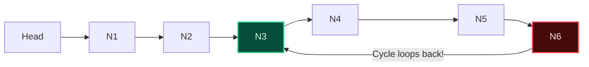
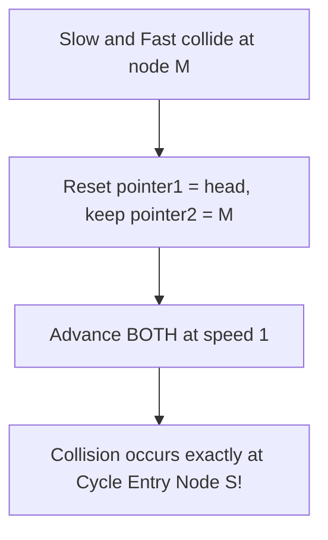

import { Callout } from "fumadocs-ui/components/callout";
import { Tabs, Tab } from "fumadocs-ui/components/tabs";
import { Steps, Step } from "fumadocs-ui/components/steps";
import { Cards, Card } from "fumadocs-ui/components/card";

## The Phase Velocity Principle

The **Fast and Slow Pointers** paradigm (also known as **Floyd's Tortoise and Hare Algorithm**) traverses a sequential structure using two pointers that advance at differential speeds:

- **Slow Pointer (`tortoise`):** Advances $1$ node per iteration ($v = 1$).
- **Fast Pointer (`hare`):** Advances $2$ nodes per iteration ($v = 2$).



---

## Floyd's Cycle Detection Proof

Does `fast` ever skip past `slow` without colliding in a loop of length $C$?

### Mathematical Proof of Guaranteed Collision:

1. Suppose `slow` and `fast` have both entered the cycle.
2. In each iteration, `slow` advances by 1 step while `fast` advances by 2 steps.
3. The relative distance between `fast` and `slow` decreases by exactly:
   $$
   (2 - 1) = 1 \text{ step per iteration} \pmod C
   $$
4. Because the gap shrinks by exactly $1$ on every step, it **must hit 0** within at most $C$ iterations. They cannot skip past each other!
5. **Time Complexity:** $\mathcal{O}(N)$
6. **Auxiliary Space:** $\mathcal{O}(1)$ (completely avoids allocating a hash set of visited pointers!).

---

## Finding the Cycle Entry Node

Once `slow` and `fast` collide at meeting point $M$:

1. Let the distance from `head` to the cycle start node $S$ be $a$.
2. Let the distance from cycle start $S$ to meeting node $M$ be $b$.
3. Total distance traveled:
   - $\text{Dist}(\text{slow}) = a + b$
   - $\text{Dist}(\text{fast}) = 2(a + b) = a + b + k \cdot C$ (where $k$ is integer laps)
   - Rearranging: $a = k \cdot C - b = (k - 1)C + (C - b)$.
4. **Algorithm:** Reset one pointer back to `head`, keep the other at $M$, and advance **both at speed 1**. They will collide precisely at the cycle entrance $S$!



---

## Finding the Midpoint of a Linked List

When searching for the midpoint of an acyclic linked list (e.g., during Merge Sort on linked lists):

- Advance `slow = slow->next` and `fast = fast->next->next`.
- When `fast` hits `nullptr` or `fast->next == nullptr`, `slow` sits **exactly on the middle node** in a single pass without prior knowledge of the list length!

---

## Polyglot Implementations

<Tabs items={["C++", "TypeScript", "Python"]}>
  <Tab value="C++">
```cpp
#include <iostream>

struct ListNode {
int val;
ListNode\* next;
ListNode(int x) : val(x), next(nullptr) {}
};

// Cycle detection: Returns entry node or nullptr
ListNode* detectCycle(ListNode* head) {
if (!head || !head->next) return nullptr;
ListNode* slow = head;
ListNode* fast = head;

    while (fast && fast->next) {
        slow = slow->next;
        fast = fast->next->next;
        if (slow == fast) {
            // Cycle confirmed: find entry node
            ListNode* p1 = head;
            ListNode* p2 = slow;
            while (p1 != p2) {
                p1 = p1->next;
                p2 = p2->next;
            }
            return p1;
        }
    }
    return nullptr; // No cycle

}

// Find midpoint in a single pass
ListNode* findMiddle(ListNode* head) {
ListNode* slow = head;
ListNode* fast = head;
while (fast && fast->next) {
slow = slow->next;
fast = fast->next->next;
}
return slow;
}

````
  </Tab>
  <Tab value="TypeScript">
```typescript
class ListNode<T> {
  val: T;
  next: ListNode<T> | null = null;
  constructor(val: T) { this.val = val; }
}

export function hasCycle<T>(head: ListNode<T> | null): boolean {
  let slow = head;
  let fast = head;

  while (fast !== null && fast.next !== null) {
    slow = slow!.next;
    fast = fast.next.next;
    if (slow === fast) return true;
  }
  return false;
}
````

  </Tab>
  <Tab value="Python">
```python
class ListNode:
    def __init__(self, val=0, next=None):
        self.val = val
        self.next = next

def find_duplicate_number(nums: list[int]) -> int:
"""Finds duplicate in array of N+1 integers in range [1, N] via Floyd's algorithm."""
slow = nums[0]
fast = nums[0]

    # Phase 1: Detect cycle
    while True:
        slow = nums[slow]
        fast = nums[nums[fast]]
        if slow == fast:
            break

    # Phase 2: Find cycle entrance
    p1 = nums[0]
    p2 = slow
    while p1 != p2:
        p1 = nums[p1]
        p2 = nums[p2]
    return p1

```
  </Tab>
</Tabs>
```
