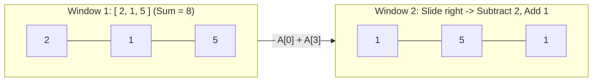

import { Callout } from "fumadocs-ui/components/callout";
import { Tabs, Tab } from "fumadocs-ui/components/tabs";
import { Steps, Step } from "fumadocs-ui/components/steps";
import { Cards, Card } from "fumadocs-ui/components/card";

## The Incremental State Transition

Suppose you need to compute the maximum sum across all contiguous subarrays of fixed length $K$ in an array of size $N$.

A naive algorithm re-sums all $K$ elements for each of the $N - K + 1$ windows:

$$
\text{Work} = (N - K + 1) \times K = \mathcal{O}(N \cdot K)
$$

The **Fixed-Size Sliding Window** observes that two adjacent windows of size $K$ share **$K - 1$ identical elements**! Instead of re-summing from scratch, slide the window rightward by one step:

- **Add** the incoming right element: $+A[i]$
- **Subtract** the outgoing left element: $-A[i - K]$

$$
\text{Sum}_{\text{new}} = \text{Sum}_{\text{old}} + A[i] - A[i - K]
$$



Every transition executes in strictly **$\mathcal{O}(1)$ time**, reducing the total algorithm to strictly **$\mathcal{O}(N)$ linear time**.

---

## Canonical Problem: Maximum Average Subarray of Size K

Given array `nums` and integer $K$:

1. Compute the sum of the first $K$ elements (`windowSum`).
2. Set `maxSum = windowSum`.
3. Loop $i$ from $K$ to $N - 1$:
   - `windowSum += nums[i] - nums[i - K]`
   - `maxSum = max(maxSum, windowSum)`
4. Return `maxSum / K`.

---

## Polyglot Implementations

<Tabs items={["C++", "TypeScript", "Python"]}>
  <Tab value="C++">
```cpp
#include <iostream>
#include <vector>
#include <numeric>
#include <algorithm>

double findMaxAverage(const std::vector<int>& nums, int k) {
// 1. Initial window sum
long long windowSum = 0;
for (int i = 0; i < k; ++i) windowSum += nums[i];

    long long maxSum = windowSum;

    // 2. Slide window across array
    for (size_t i = k; i < nums.size(); ++i) {
        windowSum += nums[i] - nums[i - k]; // + incoming, - outgoing
        maxSum = std::max(maxSum, windowSum);
    }

    return static_cast<double>(maxSum) / k;

}

````
  </Tab>
  <Tab value="TypeScript">
```typescript
export function findMaxAverage(nums: number[], k: number): number {
  let windowSum = 0;
  for (let i = 0; i < k; i++) windowSum += nums[i];

  let maxSum = windowSum;

  for (let i = k; i < nums.length; i++) {
    windowSum += nums[i] - nums[i - k];
    maxSum = Math.max(maxSum, windowSum);
  }

  return maxSum / k;
}
````

  </Tab>
  <Tab value="Python">
```python
def find_max_average(nums: list[int], k: int) -> float:
    window_sum = sum(nums[:k])
    max_sum = window_sum

    for i in range(k, len(nums)):
        window_sum += nums[i] - nums[i - k]
        if window_sum > max_sum:
            max_sum = window_sum

    return max_sum / k

```
  </Tab>
</Tabs>
```
