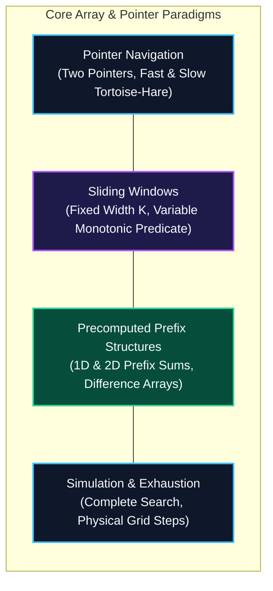

import { Callout } from "fumadocs-ui/components/callout";
import { Tabs, Tab } from "fumadocs-ui/components/tabs";
import { Steps, Step } from "fumadocs-ui/components/steps";
import { Cards, Card } from "fumadocs-ui/components/card";

## The Architectural Weaponry of Array Algorithms

Most naive algorithms process arrays using nested loops, incurring quadratic $\mathcal{O}(N^2)$ execution times. By mastering **Core Array and Pointer Paradigms**, engineers systematically transform brute-force quadratic bottlenecks into optimal **strictly linear $\mathcal{O}(N)$** solutions.

These paradigms exploit mathematical structure:

1. **Monotonicity:** In sorted collections, moving pointers unidirectionally eliminates redundant search states without backtracking.
2. **Phase Velocity (Cycle Detection):** Stepping two pointers at differential speeds exposes cyclic graph loops and linked list midpoints in a single pass.
3. **Cumulative Differential Precomputation:** Transforming arrays into prefix sums and difference arrays converts expensive range queries and range updates into instantaneous $\mathcal{O}(1)$ operations.

---

## Architectural Comparison Matrix

| Pattern              | Input Precondition                   | Time Complexity                                  | Space Complexity                          | Primary Signal in Problem Statement                |
| :------------------- | :----------------------------------- | :----------------------------------------------- | :---------------------------------------- | :------------------------------------------------- |
| **Complete Search**  | Small state space ($N \le 20$)       | $\mathcal{O}(N)$ to $\mathcal{O}(2^N)$           | $\mathcal{O}(1)$ to $\mathcal{O}(N)$      | "Simulate step-by-step", "Test all states"         |
| **Two Pointers**     | Sorted array / Monotonic             | $\mathcal{O}(N)$                                 | $\mathcal{O}(1)$                          | "Find pair summing to $T$", "Container with water" |
| **Fast & Slow**      | Linked list / Function cycle         | $\mathcal{O}(N)$                                 | $\mathcal{O}(1)$                          | "Detect loop / cycle", "Find middle of list"       |
| **Fixed Window**     | Contiguous subarray of length $K$    | $\mathcal{O}(N)$                                 | $\mathcal{O}(1)$                          | "Max sum subarray of size $K$", "Moving average"   |
| **Variable Window**  | Monotonic condition / Positive       | $\mathcal{O}(N)$ amortized                       | $\mathcal{O}(1)$ to $\mathcal{O}(\Sigma)$ | "Longest substring with $\le K$ distinct chars"    |
| **1D Prefix Sum**    | Static array, frequent range queries | $\mathcal{O}(1)$ query ($\mathcal{O}(N)$ prep)   | $\mathcal{O}(N)$                          | "Sum of elements between index $L$ and $R$"        |
| **2D Prefix Sum**    | Static grid, submatrix queries       | $\mathcal{O}(1)$ query ($\mathcal{O}(RC)$ prep)  | $\mathcal{O}(RC)$                         | "Sum of subgrid from $(r_1, c_1)$ to $(r_2, c_2)$" |
| **Difference Array** | Batch offline range updates          | $\mathcal{O}(1)$ update ($\mathcal{O}(N)$ build) | $\mathcal{O}(N)$                          | "Add $+V$ to interval $[L, R]$ multiple times"     |

---

## Stage 1.7 Curriculum Modules

Explore the dedicated modules in this section:

<Cards>
  <Card
    title="1.7.1 Complete Search and Simulation"
    href="/docs/dsa/01-beginner/core-array-and-pointer-paradigms/complete-search-and-simulation"
    description="Brute-force state space exhaustion, step-by-step physical simulation, and boundary invariants."
  />
  <Card
    title="1.7.2 Two Pointers"
    href="/docs/dsa/01-beginner/core-array-and-pointer-paradigms/two-pointers"
    description="Converging and parallel pointer strategies: Two Sum II, Container With Most Water, Trapping Rain Water."
  />
  <Card
    title="1.7.3 Fast and Slow Pointers"
    href="/docs/dsa/01-beginner/core-array-and-pointer-paradigms/fast-and-slow-pointers"
    description="Floyd's Tortoise and Hare algorithm, cycle detection, and one-pass linked list midpoint location."
  />
  <Card
    title="1.7.4 Fixed-Size Sliding Window"
    href="/docs/dsa/01-beginner/core-array-and-pointer-paradigms/fixed-size-sliding-window"
    description="Subarray state maintenance over static width K with O(1) incremental edge transitions."
  />
  <Card
    title="1.7.5 Variable-Size Sliding Window"
    href="/docs/dsa/01-beginner/core-array-and-pointer-paradigms/variable-size-sliding-window"
    description="Expanding right and shrinking left boundaries to maintain monotonic feasibility predicates."
  />
  <Card
    title="1.7.6 One-Dimensional Prefix Sums"
    href="/docs/dsa/01-beginner/core-array-and-pointer-paradigms/one-dimensional-prefix-sums"
    description="Cumulative sum precomputations answering arbitrary range queries in strictly O(1) time."
  />
  <Card
    title="1.7.7 Two-Dimensional Prefix Sums"
    href="/docs/dsa/01-beginner/core-array-and-pointer-paradigms/two-dimensional-prefix-sums"
    description="2D grid inclusion-exclusion formulations for O(1) subgrid bounding box evaluations."
  />
  <Card
    title="1.7.8 Difference Arrays"
    href="/docs/dsa/01-beginner/core-array-and-pointer-paradigms/difference-arrays"
    description="Range update optimization: applying increments to intervals in O(1) time via differential prefixes."
  />
</Cards>
