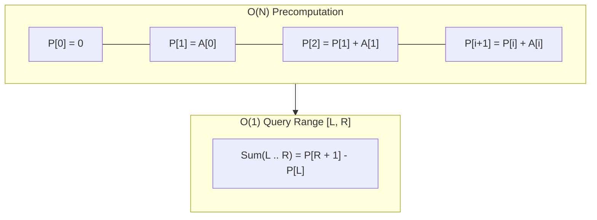

import { Callout } from "fumadocs-ui/components/callout";
import { Tabs, Tab } from "fumadocs-ui/components/tabs";
import { Steps, Step } from "fumadocs-ui/components/steps";
import { Cards, Card } from "fumadocs-ui/components/card";

## The Range Sum Query Dilemma

Suppose you have an array $A$ of $N$ integers and must answer $Q$ queries of the form:

$$
\text{Query}(L, R) = \sum_{k=L}^R A[k]
$$

- A naive loop across each range costs $\mathcal{O}(R - L + 1) = \mathcal{O}(N)$ per query, resulting in $\mathcal{O}(Q \cdot N)$ total time. For $Q = 100{,}000$ and $N = 100{,}000$, this requires $10^{10}$ operations—freezing the application for ~10 seconds.

**Prefix Sums** preprocess array $A$ into a running cumulative sum table in $\mathcal{O}(N)$ time, allowing **every subsequent query to be answered in strictly $\mathcal{O}(1)$ time**.



---

## The 1-Indexed Prefix Array Convention

To eliminate boundary conditions when $L = 0$, construct prefix array $P$ of size **$N + 1$**:

- $P[0] = 0$
- $P[i] = P[i - 1] + A[i - 1]$ for $i = 1, 2, \dots, N$

### The Universal Query Formula:

$$
\sum_{k=L}^R A[k] = P[R + 1] - P[L]
$$

**Why it works:**
$P[R + 1]$ represents the sum of all elements from index $0$ to $R$. $P[L]$ represents the sum of all elements from index $0$ to $L - 1$. Subtracting $P[L]$ leaves precisely the sum of interval $[L, R]$!

---

## Complexity Profile

| Phase                     | Time Complexity      | Auxiliary Space  |
| :------------------------ | :------------------- | :--------------- |
| **Precomputation**        | $\mathcal{O}(N)$     | $\mathcal{O}(N)$ |
| **Range Sum Query**       | $\mathcal{O}(1)$     | $\mathcal{O}(1)$ |
| **Total for $Q$ Queries** | $\mathcal{O}(N + Q)$ | $\mathcal{O}(N)$ |

---

## Polyglot Implementations

<Tabs items={["C++", "TypeScript", "Python"]}>
  <Tab value="C++">
```cpp
#include <iostream>
#include <vector>

class PrefixSum1D {
private:
std::vector<long long> prefix;

public:
PrefixSum1D(const std::vector<int>& nums) {
prefix.assign(nums.size() + 1, 0);
for (size_t i = 0; i < nums.size(); ++i) {
prefix[i + 1] = prefix[i] + nums[i];
}
}

    // O(1) range sum query for [L, R] inclusive
    long long query(size_t L, size_t R) const {
        return prefix[R + 1] - prefix[L];
    }

};

int main() {
std::vector<int> nums = {3, 1, 4, 1, 5, 9, 2};
PrefixSum1D ps(nums);

    // Query sum from index 2 to 5: 4 + 1 + 5 + 9 = 19
    std::cout << "Sum(2..5): " << ps.query(2, 5) << "\n";
    return 0;

}

````
  </Tab>
  <Tab value="TypeScript">
```typescript
export class PrefixSum1D {
  private prefix: number[];

  constructor(nums: number[]) {
    this.prefix = new Array(nums.length + 1).fill(0);
    for (let i = 0; i < nums.length; i++) {
      this.prefix[i + 1] = this.prefix[i] + nums[i];
    }
  }

  query(L: number, R: number): number {
    return this.prefix[R + 1] - this.prefix[L];
  }
}
````

  </Tab>
  <Tab value="Python">
```python
class PrefixSum1D:
    def __init__(self, nums: list[int]):
        self.prefix = [0] * (len(nums) + 1)
        for i, x in enumerate(nums):
            self.prefix[i + 1] = self.prefix[i] + x

    def query(self, L: int, R: int) -> int:
        return self.prefix[R + 1] - self.prefix[L]

ps = PrefixSum1D([3, 1, 4, 1, 5, 9, 2])
print("Sum(2..5):", ps.query(2, 5)) # 19

```
  </Tab>
</Tabs>
```
