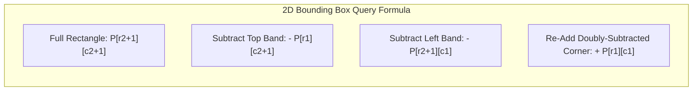

import { Callout } from "fumadocs-ui/components/callout";
import { Tabs, Tab } from "fumadocs-ui/components/tabs";
import { Steps, Step } from "fumadocs-ui/components/steps";
import { Cards, Card } from "fumadocs-ui/components/card";

## Submatrix Sum Queries in $\mathcal{O}(1)$

Given an $R \times C$ 2D matrix, we wish to answer repeated queries for the sum of elements inside an arbitrary submatrix bounded by top-left $(r_1, c_1)$ and bottom-right $(r_2, c_2)$.

A naive double loop takes $\mathcal{O}(R \cdot C)$ per query. By generalizing prefix sums to two dimensions via the **Inclusion-Exclusion Principle**, any bounding box sum can be computed in **strictly $\mathcal{O}(1)$ time**.



---

## 2D Precomputation Formula

Construct a 2D table `P` of size $(R + 1) \times (C + 1)$ with zero-padded row 0 and column 0:

$$
P[r][c] = \text{grid}[r-1][c-1] + P[r-1][c] + P[r][c-1] - P[r-1][c-1]
$$

### Query Evaluation Formula:

To compute the sum of submatrix $[r_1 \dots r_2][c_1 \dots c_2]$:

$$
\text{Sum} = P[r_2 + 1][c_2 + 1] - P[r_1][c_2 + 1] - P[r_2 + 1][c_1] + P[r_1][c_1]
$$

---

## Polyglot Implementations

<Tabs items={["C++", "TypeScript", "Python"]}>
  <Tab value="C++">
```cpp
#include <iostream>
#include <vector>

class NumMatrix {
private:
std::vector<std::vector<int>> P;

public:
NumMatrix(const std::vector<std::vector<int>>& matrix) {
if (matrix.empty() || matrix[0].empty()) return;
int R = matrix.size(), C = matrix[0].size();
P.assign(R + 1, std::vector<int>(C + 1, 0));

        for (int r = 0; r < R; ++r) {
            for (int c = 0; c < C; ++c) {
                P[r + 1][c + 1] = matrix[r][c] + P[r][c + 1] + P[r + 1][c] - P[r][c];
            }
        }
    }

    int sumRegion(int r1, int c1, int r2, int c2) const {
        return P[r2 + 1][c2 + 1] - P[r1][c2 + 1] - P[r2 + 1][c1] + P[r1][c1];
    }

};

````
  </Tab>
  <Tab value="TypeScript">
```typescript
export class MatrixPrefixSum2D {
  private P: number[][];

  constructor(matrix: number[][]) {
    const R = matrix.length;
    const C = matrix[0].length;
    this.P = Array.from({ length: R + 1 }, () => new Array(C + 1).fill(0));

    for (let r = 0; r < R; r++) {
      for (let c = 0; c < C; c++) {
        this.P[r + 1][c + 1] =
          matrix[r][c] + this.P[r][c + 1] + this.P[r + 1][c] - this.P[r][c];
      }
    }
  }

  query(r1: number, c1: number, r2: number, c2: number): number {
    return (
      this.P[r2 + 1][c2 + 1] -
      this.P[r1][c2 + 1] -
      this.P[r2 + 1][c1] +
      this.P[r1][c1]
    );
  }
}
````

  </Tab>
  <Tab value="Python">
```python
class NumMatrix:
    def __init__(self, matrix: list[list[int]]):
        if not matrix or not matrix[0]:
            return
        R, C = len(matrix), len(matrix[0])
        self.P = [[0] * (C + 1) for _ in range(R + 1)]

        for r in range(R):
            for c in range(C):
                self.P[r + 1][c + 1] = (
                    matrix[r][c] + self.P[r][c + 1] + self.P[r + 1][c] - self.P[r][c]
                )

    def sum_region(self, r1: int, c1: int, r2: int, c2: int) -> int:
        return (
            self.P[r2 + 1][c2 + 1]
            - self.P[r1][c2 + 1]
            - self.P[r2 + 1][c1]
            + self.P[r1][c1]
        )

```
  </Tab>
</Tabs>
```
