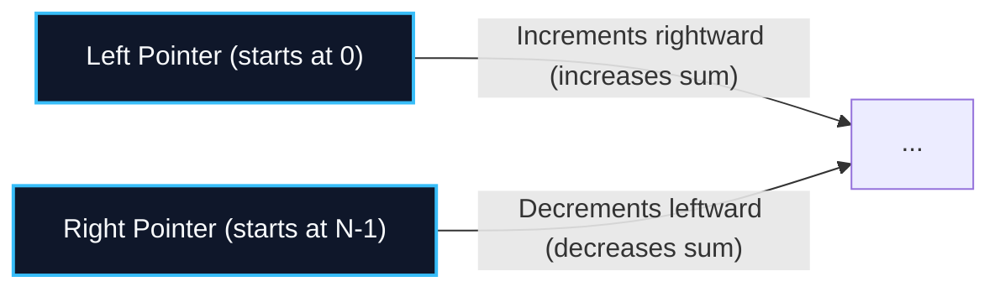
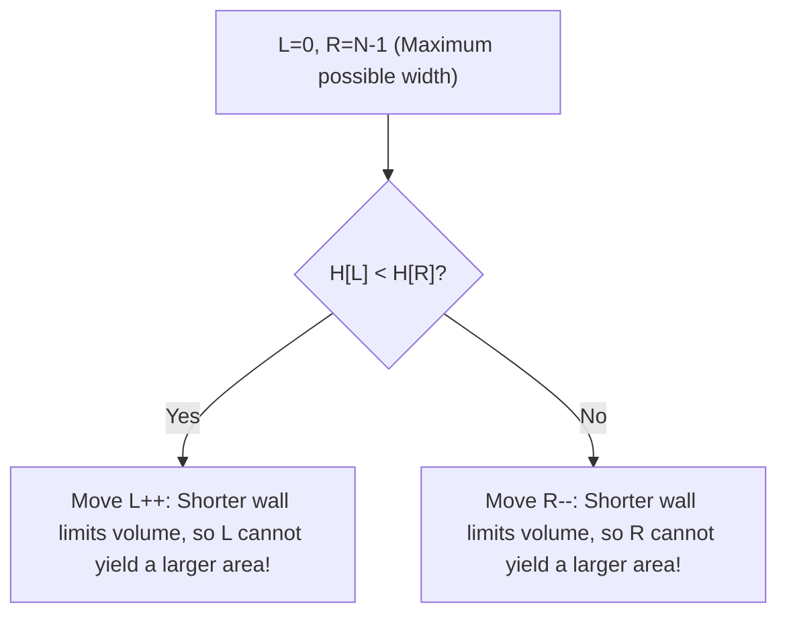

import { Callout } from "fumadocs-ui/components/callout";
import { Tabs, Tab } from "fumadocs-ui/components/tabs";
import { Steps, Step } from "fumadocs-ui/components/steps";
import { Cards, Card } from "fumadocs-ui/components/card";

## The Opposing-Convergence Paradigm

The **Two Pointers** pattern replaces nested $\mathcal{O}(N^2)$ loops with an optimal $\mathcal{O}(N)$ scan by maintaining two indices—typically `left` at index $0$ and `right` at index $N-1$—that converge toward one another based on a monotonic evaluation invariant.



---

## Canonical Problem 1: Two Sum II (Sorted Array)

Given a 0-indexed sorted array $A$ and a target $T$:

1. Compute current sum: $S = A[\text{left}] + A[\text{right}]$.
2. If $S == T$: Match found!
3. If $S < T$: Because the array is sorted, every pair with $A[\text{left}]$ has sum $\le S < T$. Hence, $A[\text{left}]$ cannot be part of the solution $\to$ increment `left++`.
4. If $S > T$: Every pair with $A[\text{right}]$ has sum $\ge S > T$. Hence, $A[\text{right}]$ cannot be part of the solution $\to$ decrement `right--`.

Every comparison permanently discards one element. The search completes in strictly **$\mathcal{O}(N)$ time and $\mathcal{O}(1)$ space**.

---

## Canonical Problem 2: Container With Most Water

Given an array of heights where vertical lines stand at $(i, 0)$ to $(i, H[i])$:

- The water volume bounded by lines $L$ and $R$ is:
  $$
  \text{Area} = (R - L) \times \min(H[L], H[R])
  $$



---

## Polyglot Implementations

<Tabs items={["C++ (Container With Most Water)", "TypeScript (Two Sum II)", "Python"]}>
  <Tab value="C++ (Container With Most Water)">
```cpp
#include <iostream>
#include <vector>
#include <algorithm>

int maxArea(const std::vector<int>& height) {
int left = 0, right = height.size() - 1;
int maxWater = 0;

    while (left < right) {
        int width = right - left;
        int h = std::min(height[left], height[right]);
        maxWater = std::max(maxWater, width * h);

        if (height[left] < height[right]) {
            left++;
        } else {
            right--;
        }
    }
    return maxWater;

}

````
  </Tab>
  <Tab value="TypeScript (Two Sum II)">
```typescript
export function twoSumSorted(numbers: number[], target: number): [number, number] | null {
  let left = 0;
  let right = numbers.length - 1;

  while (left < right) {
    const sum = numbers[left] + numbers[right];
    if (sum === target) {
      return [left, right];
    } else if (sum < target) {
      left++;
    } else {
      right--;
    }
  }
  return null;
}
````

  </Tab>
  <Tab value="Python">
```python
def trap_rain_water(height: list[int]) -> int:
    """Trapping Rain Water via Two Pointers: O(N) time, O(1) auxiliary space."""
    if not height:
        return 0
    left, right = 0, len(height) - 1
    left_max, right_max = height[left], height[right]
    water = 0

    while left < right:
        if left_max < right_max:
            left += 1
            left_max = max(left_max, height[left])
            water += left_max - height[left]
        else:
            right -= 1
            right_max = max(right_max, height[right])
            water += right_max - height[right]

    return water

```
  </Tab>
</Tabs>
```
