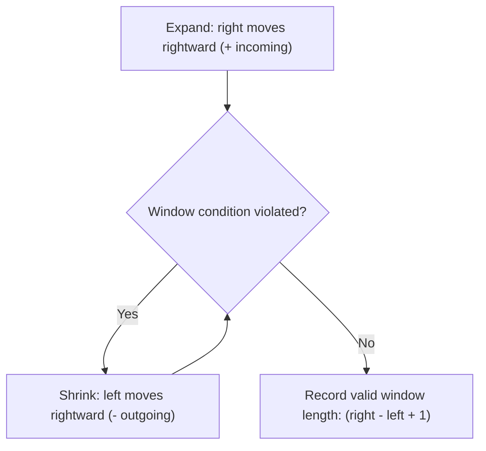

import { Callout } from "fumadocs-ui/components/callout";
import { Tabs, Tab } from "fumadocs-ui/components/tabs";
import { Steps, Step } from "fumadocs-ui/components/steps";
import { Cards, Card } from "fumadocs-ui/components/card";

## The Dynamic Elastic Window

When problems ask for the **longest** or **shortest** contiguous subarray satisfying a condition (e.g. "sum $\ge S$" or "at most $K$ distinct characters"), the window width cannot be fixed.

The **Variable-Size Sliding Window** uses two pointers:

- **`right` (Expander):** Marches forward one element at a time, consuming new data into the window state.
- **`left` (Contractor):** Advances rightward whenever the window condition is violated, evicting stale elements until validity is restored.



---

## Why is Variable Sliding Window $\mathcal{O}(N)$?

Even though the code contains a nested `while` loop:

```cpp
for (int right = 0; right < N; ++right) {
    while (conditionViolated()) {
        left++;
    }
}
```

Notice the movement invariants:

- `right` increments from $0$ to $N-1$ (exactly $N$ steps).
- `left` only increments and never decreases. Across the entire execution of the algorithm, `left` can step at most $N$ times.
- Total pointer steps: at most $2N$.
- Hence, the time complexity is **strictly $\mathcal{O}(N)$ amortized**.

---

## Canonical Problem: Longest Substring Without Repeating Characters

Given a string $S$, find the length of the longest substring without repeating characters:

1. Maintain a frequency map or last-seen index map for each character.
2. For each character $S[\text{right}]$:
   - If $S[\text{right}]$ already exists within the active window $[left, right-1]$, advance $left$ past its previous location:
     $$
     left = \max(left, \text{last\_seen}[S[\text{right}]] + 1)
     $$
   - Update $\text{last\_seen}[S[\text{right}]] = right$.
   - $\text{maxLen} = \max(\text{maxLen}, right - left + 1)$.

---

## Polyglot Implementations

<Tabs items={["C++", "TypeScript", "Python"]}>
  <Tab value="C++">
```cpp
#include <iostream>
#include <string>
#include <vector>
#include <algorithm>

int lengthOfLongestSubstring(const std::string& s) {
std::vector<int> lastSeen(128, -1);
int maxLen = 0;
int left = 0;

    for (int right = 0; right < s.size(); ++right) {
        char ch = s[right];
        if (lastSeen[ch] >= left) {
            left = lastSeen[ch] + 1; // Jump left pointer past duplicate
        }
        lastSeen[ch] = right;
        maxLen = std::max(maxLen, right - left + 1);
    }
    return maxLen;

}

````
  </Tab>
  <Tab value="TypeScript">
```typescript
export function lengthOfLongestSubstring(s: string): number {
  const lastSeen = new Map<string, number>();
  let maxLen = 0;
  let left = 0;

  for (let right = 0; right < s.length; right++) {
    const ch = s[right];
    if (lastSeen.has(ch) && lastSeen.get(ch)! >= left) {
      left = lastSeen.get(ch)! + 1;
    }
    lastSeen.set(ch, right);
    maxLen = Math.max(maxLen, right - left + 1);
  }
  return maxLen;
}
````

  </Tab>
  <Tab value="Python">
```python
def length_of_longest_substring(s: str) -> int:
    last_seen = {}
    max_len = 0
    left = 0

    for right, ch in enumerate(s):
        if ch in last_seen and last_seen[ch] >= left:
            left = last_seen[ch] + 1
        last_seen[ch] = right
        max_len = max(max_len, right - left + 1)

    return max_len

```
  </Tab>
</Tabs>
```
