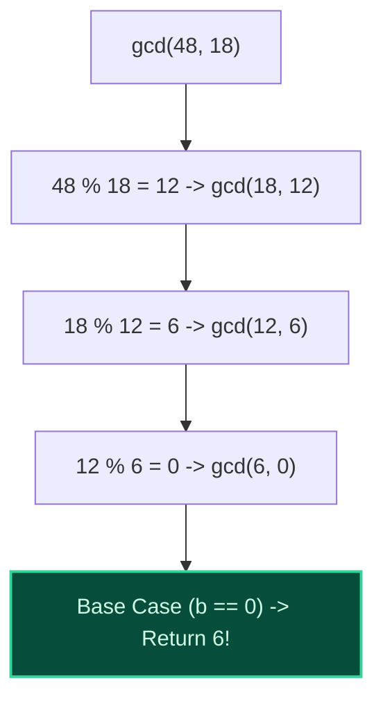

import { Callout } from "fumadocs-ui/components/callout";
import { Tabs, Tab } from "fumadocs-ui/components/tabs";
import { Steps, Step } from "fumadocs-ui/components/steps";
import { Cards, Card } from "fumadocs-ui/components/card";

## The Greatest Common Divisor

The **Greatest Common Divisor (GCD)** of two non-zero integers $a$ and $b$, denoted $\gcd(a, b)$, is the largest positive integer $d$ that divides both $a$ and $b$ without remainder.

- If $\gcd(a, b) = 1$, $a$ and $b$ are **coprime** (or relatively prime).

---

## The Euclidean Algorithm

Dating back to ~300 BC in Euclid's _Elements_, the **Euclidean Algorithm** computes $\gcd(a, b)$ based on a fundamental mathematical theorem:

$$
\gcd(a, b) = \gcd(b, a \pmod b) \quad \text{with base case } \gcd(a, 0) = a
$$



### Lamé's Theorem & Logarithmic Complexity

By **Gabriel Lamé's Theorem (1844)**, the number of division steps in the Euclidean algorithm never exceeds **5 times the number of decimal digits in the smaller number**.

- The worst-case input occurs when $a$ and $b$ are consecutive **Fibonacci numbers** ($F_{k+1}, F_k$).
- The algorithm runs in strictly **$\mathcal{O}(\log(\min(a, b)))$ time**.

---

## Least Common Multiple (LCM)

The **Least Common Multiple ($\text{lcm}(a, b)$)** is the smallest positive integer that is divisible by both $a$ and $b$.

### The Fundamental Product Identity:

$$
a \cdot b = \gcd(a, b) \cdot \text{lcm}(a, b)
$$

$$
\text{lcm}(a, b) = \frac{a \cdot b}{\gcd(a, b)}
$$

<Callout type="warn" title="Preventing 64-bit Integer Overflow">
  When evaluating LCM in code, never write `(a * b) / gcd(a, b)` because multiplying `a * b` can cause integer overflow before division occurs!
  Always divide first:
  $$
  \text{lcm}(a, b) = \left(\frac{a}{\gcd(a, b)}\right) \cdot b
  $$
</Callout>

---

## Polyglot Implementations

<Tabs items={["C++", "TypeScript", "Python"]}>
  <Tab value="C++">
```cpp
#include <iostream>
#include <numeric>

// Iterative Euclidean algorithm: O(log min(a, b))
long long gcd(long long a, long long b) {
while (b != 0) {
long long rem = a % b;
a = b;
b = rem;
}
return a;
}

// Overflow-safe LCM
long long lcm(long long a, long long b) {
if (a == 0 || b == 0) return 0;
return (a / gcd(a, b)) \* b;
}

int main() {
std::cout << "gcd(48, 18) = " << gcd(48, 18) << "\n"; // 6
std::cout << "lcm(12, 18) = " << lcm(12, 18) << "\n"; // 36
return 0;
}

````
  </Tab>
  <Tab value="TypeScript">
```typescript
export function gcd(a: number, b: number): number {
  while (b !== 0) {
    const rem = a % b;
    a = b;
    b = rem;
  }
  return Math.abs(a);
}

export function lcm(a: number, b: number): number {
  if (a === 0 || b === 0) return 0;
  return Math.abs(Math.floor(a / gcd(a, b)) * b);
}

console.log("gcd(48, 18):", gcd(48, 18));
console.log("lcm(12, 18):", lcm(12, 18));
````

  </Tab>
  <Tab value="Python">
```python
import math

# Python standard library math.gcd and math.lcm

print("gcd(48, 18) =", math.gcd(48, 18)) # 6
print("lcm(12, 18) =", math.lcm(12, 18)) # 36

def custom_gcd(a: int, b: int) -> int:
while b:
a, b = b, a % b
return abs(a)

```
  </Tab>
</Tabs>
```
