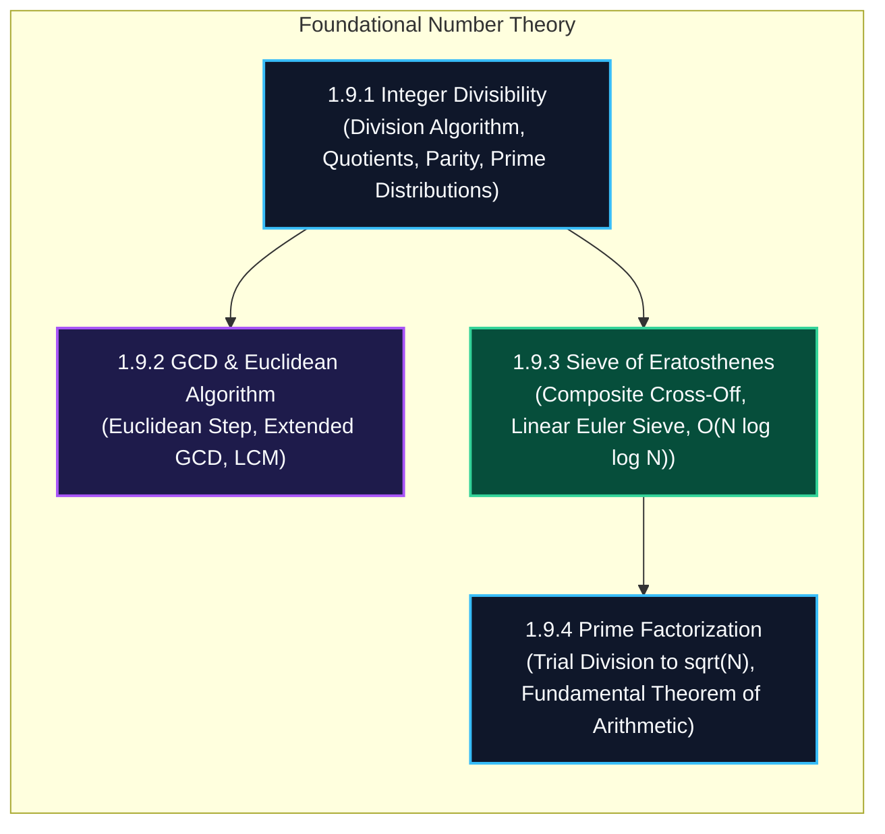

import { Callout } from "fumadocs-ui/components/callout";
import { Tabs, Tab } from "fumadocs-ui/components/tabs";
import { Steps, Step } from "fumadocs-ui/components/steps";
import { Cards, Card } from "fumadocs-ui/components/card";

## The Arithmetic Foundation of Computation

Number theory is the engine of modern cryptography, hashing, load balancing, and algorithmic optimization. Without a rigorous grasp of divisibility, prime numbers, and greatest common divisors, one cannot reason about modular arithmetic, RSA encryption, or prime modulo hashing.

---

## Computational Complexity Matrix

| Problem / Algorithm              | Input Size / Range         | Time Complexity                 | Auxiliary Space               | Key Invariant                                     |
| :------------------------------- | :------------------------- | :------------------------------ | :---------------------------- | :------------------------------------------------ |
| **Integer Divisibility Test**    | Single integer $N$         | $\mathcal{O}(1)$                | $\mathcal{O}(1)$              | Remainder $r = a \pmod b$                         |
| **Euclidean GCD**                | Two integers $a, b$        | $\mathcal{O}(\log(\min(a, b)))$ | $\mathcal{O}(1)$              | $\gcd(a, b) = \gcd(b, a \pmod b)$                 |
| **LCM**                          | Two integers $a, b$        | $\mathcal{O}(\log(\min(a, b)))$ | $\mathcal{O}(1)$              | $\text{lcm}(a, b) = \frac{a \cdot b}{\gcd(a, b)}$ |
| **Sieve of Eratosthenes**        | All primes up to $N$       | $\mathcal{O}(N \log \log N)$    | $\mathcal{O}(N)$ bits         | Multiples of $p$ cross off starting at $p^2$      |
| **Linear (Euler's) Sieve**       | All primes + SPF up to $N$ | $\mathcal{O}(N)$                | $\mathcal{O}(N)$ integers     | Each composite visited strictly once              |
| **Trial Division Factorization** | Single integer $N$         | $\mathcal{O}(\sqrt{N})$         | $\mathcal{O}(\log N)$ factors | Smallest divisor $> 1$ must be prime              |

---

## Stage 1.9 Curriculum Modules

Explore the dedicated modules in this section:

<Cards>
  <Card
    title="1.9.1 Integer Divisibility"
    href="/docs/dsa/01-beginner/foundational-mathematics/integer-divisibility"
    description="Division algorithm, quotient and remainder invariants, parity, and prime distribution bounds."
  />
  <Card
    title="1.9.2 Greatest Common Divisor & Euclidean Algorithm"
    href="/docs/dsa/01-beginner/foundational-mathematics/greatest-common-divisor-and-euclidean-algorithm"
    description="Euclidean algorithm for gcd(a, b), Bezout coefficients, and least common multiples."
  />
  <Card
    title="1.9.3 Sieve of Eratosthenes"
    href="/docs/dsa/01-beginner/foundational-mathematics/sieve-of-eratosthenes"
    description="Generating all primes up to N in O(N log log N) time, boolean arrays, and linear Euler sieves."
  />
  <Card
    title="1.9.4 Trial Division Prime Factorization"
    href="/docs/dsa/01-beginner/foundational-mathematics/trial-division-prime-factorization"
    description="Finding prime factors up to sqrt(N) in O(sqrt(N)) time and canonical factor decomposition."
  />
</Cards>
