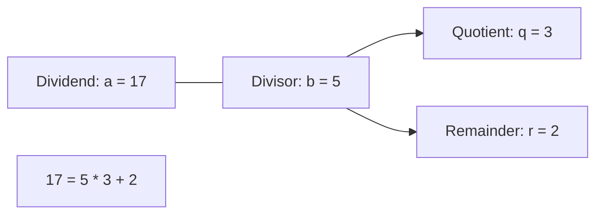

import { Callout } from "fumadocs-ui/components/callout";
import { Tabs, Tab } from "fumadocs-ui/components/tabs";
import { Steps, Step } from "fumadocs-ui/components/steps";
import { Cards, Card } from "fumadocs-ui/components/card";

## The Division Theorem

For any integer dividend $a$ and non-zero integer divisor $b$, there exist unique integers $q$ (**quotient**) and $r$ (**remainder**) such that:

$$
a = b \cdot q + r \quad \text{where } 0 \le r < |b|
$$

- If $r = 0$, we say that **$b$ divides $a$** (written $b \mid a$), meaning $a$ is an exact integer multiple of $b$.
- If $r \ne 0$, $b \nmid a$.



---

## Parity & Bitwise Invariant

An integer $n$ is:

- **Even** if $2 \mid n \iff n \equiv 0 \pmod 2$.
- **Odd** if $2 \nmid n \iff n \equiv 1 \pmod 2$.

In hardware, checking `(n & 1) == 0` evaluates parity in a single CPU cycle by inspecting the lowest significant bit, bypassing arithmetic division.

---

## Prime vs. Composite Numbers

- An integer $p > 1$ is **prime** if its only positive integer divisors are $1$ and $p$.
- An integer $n > 1$ that is not prime is **composite**, meaning it can be factored into $n = a \cdot b$ where $1 < a, b < n$.
- The number $1$ is defined as neither prime nor composite (a **unit**).

### The $\sqrt{N}$ Factor Symmetry Theorem

If an integer $n$ is composite, it must have at least one prime factor $p \le \sqrt{n}$.

**Proof by Contradiction:**
Suppose $n = a \cdot b$ and both factors are strictly greater than $\sqrt{n}$ ($a > \sqrt{n}$ and $b > \sqrt{n}$).
Multiplying them together yields:

$$
a \cdot b > \sqrt{n} \cdot \sqrt{n} = n
$$

This contradicts $a \cdot b = n$. Therefore, at least one factor must satisfy $a \le \sqrt{n}$.

<Callout type="tip" title="Algorithmic Consequence">
  To test whether a single integer $N$ is prime, we only need to test divisors
  up to $\lfloor \sqrt{N} \rfloor$, running in $\mathcal{O}(\sqrt{N})$ time
  instead of naive $\mathcal{O}(N)$!
</Callout>

---

## Prime Distribution: The Prime Number Theorem

How many primes exist below a given bound $N$?
By the **Prime Number Theorem (PNT)**:

$$
\pi(N) \approx \frac{N}{\ln N}
$$

Where $\pi(N)$ is the prime counting function.
For example, below $N = 1{,}000{,}000$, there are $78{,}498$ primes ($\approx 1{,}000{,}000 / \ln(10^6) \approx 72{,}382$).

---

## Polyglot Implementations (Primality Test)

<Tabs items={["C++", "TypeScript", "Python"]}>
  <Tab value="C++">
```cpp
#include <iostream>

// O(sqrt(N)) deterministic primality test with 6k ± 1 optimization
bool isPrime(long long n) {
if (n <= 1) return false;
if (n <= 3) return true;
if (n % 2 == 0 || n % 3 == 0) return false;

    // All primes > 3 are of form 6k ± 1
    for (long long i = 5; i * i <= n; i += 6) {
        if (n % i == 0 || n % (i + 2) == 0) return false;
    }
    return true;

}

int main() {
std::cout << "Is 1000000007 prime? " << (isPrime(1000000007) ? "true" : "false") << "\n";
return 0;
}

````
  </Tab>
  <Tab value="TypeScript">
```typescript
export function isPrime(n: number): boolean {
  if (n <= 1) return false;
  if (n <= 3) return true;
  if (n % 2 === 0 || n % 3 === 0) return false;

  for (let i = 5; i * i <= n; i += 6) {
    if (n % i === 0 || n % (i + 2) === 0) return false;
  }
  return true;
}
````

  </Tab>
  <Tab value="Python">
```python
def is_prime(n: int) -> bool:
    """Deterministic primality test in O(sqrt(n)) time."""
    if n <= 1:
        return False
    if n <= 3:
        return True
    if n % 2 == 0 or n % 3 == 0:
        return False
    i = 5
    while i * i <= n:
        if n % i == 0 or n % (i + 2) == 0:
            return False
        i += 6
    return True

print("Is 104729 prime?", is_prime(104729)) # True (the 10,000th prime)

```
  </Tab>
</Tabs>
```
