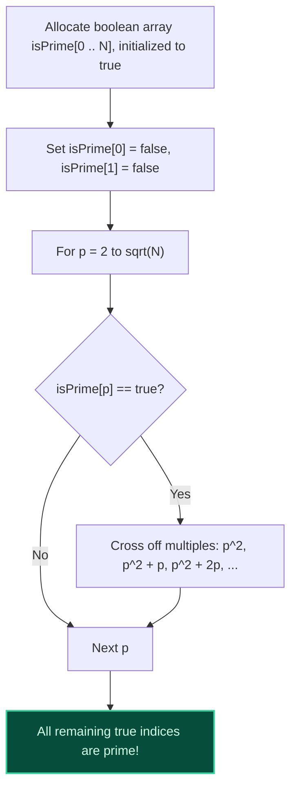

import { Callout } from "fumadocs-ui/components/callout";
import { Tabs, Tab } from "fumadocs-ui/components/tabs";
import { Steps, Step } from "fumadocs-ui/components/steps";
import { Cards, Card } from "fumadocs-ui/components/card";

## Generating All Primes Up to $N$

If you need to test primality for a single number, $\mathcal{O}(\sqrt{N})$ trial division is sufficient. However, if an algorithm demands all prime numbers up to $N = 10{,}000{,}000$:

- Running trial division on every number from $2$ to $N$ requires $\mathcal{O}(N \sqrt{N}) \approx 3 \times 10^{10}$ operations (too slow).

The **Sieve of Eratosthenes** (circa 200 BC) generates all primes up to $N$ in nearly linear **$\mathcal{O}(N \log \log N)$ time**.



---

## Critical Algorithmic Optimizations

### 1. Start Crossing Off Multiples at $p^2$

Any multiple $k \cdot p$ with $k < p$ has already been crossed off by a smaller prime factor! For example, when considering $p = 7$:

- $2 \times 7$ was crossed off by $2$.
- $3 \times 7$ was crossed off by $3$.
- $5 \times 7$ was crossed off by $5$.
  The first unvisited multiple of $p$ is strictly **$p^2$**!

### 2. Terminate the Outer Loop at $\sqrt{N}$

Because all composite numbers $\le N$ have a prime factor $\le \sqrt{N}$, once the outer loop passes $\lfloor \sqrt{N} \rfloor$, every remaining un-crossed index is guaranteed to be prime!

---

## Asymptotic Proof: $\mathcal{O}(N \log \log N)$

The total number of composite cross-off operations is:

$$
\sum_{p \le N} \frac{N}{p} = N \sum_{p \le N} \frac{1}{p}
$$

By **Mertens' Second Theorem (1874)**, the sum of the reciprocals of the primes diverges like $\ln(\ln N)$:

$$
\sum_{p \le N} \frac{1}{p} = \ln(\ln N) + M + \mathcal{O}\left(\frac{1}{\ln N}\right)
$$

Multiplying by $N$ gives a total time complexity of **$\mathcal{O}(N \log \log N)$**. For $N = 10^8$, $\log \log N \approx 2.9$, making the algorithm practically indistinguishable from linear $\mathcal{O}(N)$ time!

---

## The Linear Euler Sieve ($\mathcal{O}(N)$ Time)

Standard Eratosthenes crosses off some composite numbers multiple times (e.g. $12$ is crossed off by both $2$ and $3$).

The **Linear Sieve (Euler's Sieve)** guarantees that every composite number is marked **strictly once by its Smallest Prime Factor (SPF)**, achieving pure $\mathcal{O}(N)$ linear time!

---

## Polyglot Implementations

<Tabs items={["C++ (Sieve of Eratosthenes)", "TypeScript", "Python (Linear Euler Sieve)"]}>
  <Tab value="C++ (Sieve of Eratosthenes)">
```cpp
#include <iostream>
#include <vector>

std::vector<int> sieveOfEratosthenes(int n) {
std::vector<bool> isPrime(n + 1, true);
isPrime[0] = isPrime[1] = false;

    for (int p = 2; p * p <= n; ++p) {
        if (isPrime[p]) {
            // Start at p * p and step by p
            for (int i = p * p; i <= n; i += p) {
                isPrime[i] = false;
            }
        }
    }

    std::vector<int> primes;
    for (int i = 2; i <= n; ++i) {
        if (isPrime[i]) primes.push_back(i);
    }
    return primes;

}

int main() {
auto primes = sieveOfEratosthenes(50);
std::cout << "Primes up to 50: ";
for (int p : primes) std::cout << p << " ";
std::cout << "\n";
return 0;
}

````
  </Tab>
  <Tab value="TypeScript">
```typescript
export function sieveOfEratosthenes(n: number): number[] {
  const isPrime = new Uint8Array(n + 1).fill(1);
  isPrime[0] = 0;
  isPrime[1] = 0;

  for (let p = 2; p * p <= n; p++) {
    if (isPrime[p]) {
      for (let i = p * p; i <= n; i += p) {
        isPrime[i] = 0;
      }
    }
  }

  const primes: number[] = [];
  for (let i = 2; i <= n; i++) {
    if (isPrime[i]) primes.push(i);
  }
  return primes;
}
````

  </Tab>
  <Tab value="Python (Linear Euler Sieve)">
```python
def linear_euler_sieve(n: int) -> tuple[list[int], list[int]]:
    """Linear Sieve: O(N) time. Returns list of primes and SPF array."""
    spf = [0] * (n + 1) # Smallest Prime Factor
    primes = []

    for i in range(2, n + 1):
        if spf[i] == 0:
            spf[i] = i
            primes.append(i)
        for p in primes:
            if p > spf[i] or i * p > n:
                break
            spf[i * p] = p # Marked strictly once!

    return primes, spf

primes, spf = linear_euler_sieve(50)
print("Primes up to 50:", primes)

```
  </Tab>
</Tabs>
```
