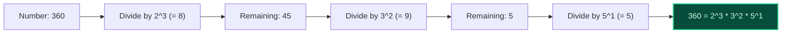
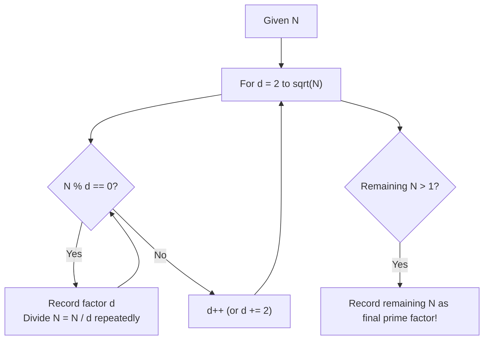

import { Callout } from "fumadocs-ui/components/callout";
import { Tabs, Tab } from "fumadocs-ui/components/tabs";
import { Steps, Step } from "fumadocs-ui/components/steps";
import { Cards, Card } from "fumadocs-ui/components/card";

## The Fundamental Theorem of Arithmetic

The **Fundamental Theorem of Arithmetic** states that every integer $N > 1$ either is a prime itself or can be represented uniquely (up to the order of factors) as a product of prime powers:

$$
N = p_1^{a_1} \cdot p_2^{a_2} \cdot p_3^{a_3} \cdots p_k^{a_k}
$$

Where each $p_i$ is a distinct prime number and $a_i \ge 1$ is its multiplicity.



---

## Trial Division Algorithm to $\sqrt{N}$

How do we extract the prime factorization of a single integer $N$?
We don't need a precomputed list of primes. By testing potential divisors $d = 2, 3, 4, 5, \dots$ up to $\lfloor \sqrt{N} \rfloor$:

1. As soon as $d$ divides $N$, extract $d$ repeatedly using a `while (N % d == 0)` loop, incrementing $d$'s count and updating $N = N / d$.
2. Because we extract smaller factors first, composite numbers (like $4$ or $6$) can never divide $N$ later, because their prime components were already stripped!
3. If $N > 1$ after loop terminates at $\sqrt{N}$, the remaining $N$ is guaranteed to be a **prime factor**.



### Complexity:

- **Time Complexity:** $\mathcal{O}(\sqrt{N})$ worst-case (when $N$ is a large prime or product of two large primes).
- **Auxiliary Space:** $\mathcal{O}(\log N)$ to store the output prime factors.

---

## Polyglot Implementations

<Tabs items={["C++", "TypeScript", "Python"]}>
  <Tab value="C++">
```cpp
#include <iostream>
#include <vector>
#include <utility>

// Returns vector of {prime, exponent} pairs in O(sqrt(N)) time
std::vector<std::pair<long long, int>> primeFactorize(long long n) {
std::vector<std::pair<long long, int>> factors;

    for (long long d = 2; d * d <= n; ++d) {
        if (n % d == 0) {
            int count = 0;
            while (n % d == 0) {
                count++;
                n /= d;
            }
            factors.push_back({d, count});
        }
    }
    // Remaining prime factor greater than sqrt(N)
    if (n > 1) {
        factors.push_back({n, 1});
    }
    return factors;

}

int main() {
auto factors = primeFactorize(360);
std::cout << "Prime factors of 360: ";
for (const auto& [p, exp] : factors) {
std::cout << p << "^" << exp << " ";
}
std::cout << "\n"; // 2^3 3^2 5^1
return 0;
}

````
  </Tab>
  <Tab value="TypeScript">
```typescript
export interface PrimeFactor {
  prime: number;
  exponent: number;
}

export function primeFactorize(n: number): PrimeFactor[] {
  const factors: PrimeFactor[] = [];

  for (let d = 2; d * d <= n; d++) {
    if (n % d === 0) {
      let count = 0;
      while (n % d === 0) {
        count++;
        n = Math.floor(n / d);
      }
      factors.push({ prime: d, exponent: count });
    }
  }

  if (n > 1) {
    factors.push({ prime: n, exponent: 1 });
  }

  return factors;
}
````

  </Tab>
  <Tab value="Python">
```python
def prime_factorize(n: int) -> list[tuple[int, int]]:
    """Trial division prime factorization in O(sqrt(N)) time."""
    factors = []
    d = 2
    while d * d <= n:
        if n % d == 0:
            count = 0
            while n % d == 0:
                count += 1
                n //= d
            factors.append((d, count))
        d += 1
    if n > 1:
        factors.append((n, 1))
    return factors

print("Factors of 360:", prime_factorize(360)) # [(2, 3), (3, 2), (5, 1)]

```
  </Tab>
</Tabs>
```
