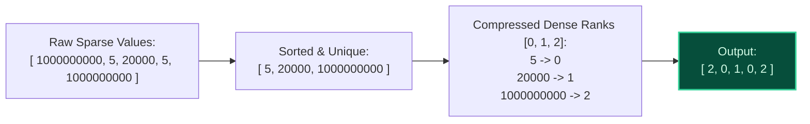

import { Callout } from "fumadocs-ui/components/callout";
import { Tabs, Tab } from "fumadocs-ui/components/tabs";
import { Steps, Step } from "fumadocs-ui/components/steps";
import { Cards, Card } from "fumadocs-ui/components/card";

## The Sparsity Dilemma

Many advanced algorithms and range data structures (such as Fenwick Trees, Segment Trees, and Difference Arrays) require array-based indexing over values:

- What if input coordinates span up to $10^9$ or $10^{18}$?
- What if coordinates are floating point numbers or negative numbers?

If there are only $N = 100{,}000$ points, allocating an array of size $10^9$ is impossible. However, the exact magnitudes of the numbers frequently do not matter—**only their relative ordering ($<, =, >$) matters**.

**Coordinate Compression** maps arbitrary large or sparse values into a compact, contiguous rank interval $[0, K-1]$ where $K \le N$.



---

## Canonical Algorithm Steps

<Steps>
  <Step>
    **Copy & Sort:** Duplicate the original array and sort the copy in ascending
    order ($\mathcal{O}(N \log N)$).
  </Step>
  <Step>
    **Deduplicate:** Remove adjacent duplicate elements (e.g., using
    `std::unique` in C++ or converting to a sorted set).
  </Step>
  <Step>
    **Binary Search Rank Assignment:** For any raw coordinate $x$, its
    compressed rank is its index in the deduplicated sorted array, found via
    binary search (`std::lower_bound`) in $\mathcal{O}(\log K)$ time.
  </Step>
</Steps>

---

## Polyglot Implementations

<Tabs items={["C++", "TypeScript", "Python"]}>
  <Tab value="C++">
```cpp
#include <iostream>
#include <vector>
#include <algorithm>

// Coordinate compression utility
class CoordinateCompressor {
private:
std::vector<int> sortedVals;

public:
CoordinateCompressor(const std::vector<int>& raw) : sortedVals(raw) {
std::sort(sortedVals.begin(), sortedVals.end());
sortedVals.erase(std::unique(sortedVals.begin(), sortedVals.end()), sortedVals.end());
}

    // Returns rank in [0, K-1] in O(log K) time
    int compress(int val) const {
        return std::lower_bound(sortedVals.begin(), sortedVals.end(), val) - sortedVals.begin();
    }

    // Decompress rank back to original coordinate in O(1) time
    int decompress(int rank) const {
        return sortedVals[rank];
    }

    size_t uniqueCount() const { return sortedVals.size(); }

};

int main() {
std::vector<int> coords = {1000000000, 5, 20000, 5, 1000000000};
CoordinateCompressor cc(coords);

    std::cout << "Original -> Compressed:\n";
    for (int x : coords) {
        std::cout << x << " -> Rank: " << cc.compress(x) << "\n";
    }
    return 0;

}

````
  </Tab>
  <Tab value="TypeScript">
```typescript
export class CoordinateCompressor {
  private readonly uniqueSorted: number[];

  constructor(coords: number[]) {
    this.uniqueSorted = Array.from(new Set(coords)).sort((a, b) => a - b);
  }

  compress(val: number): number {
    let low = 0, high = this.uniqueSorted.length;
    while (low < high) {
      const mid = (low + high) >> 1;
      if (this.uniqueSorted[mid] >= val) high = mid;
      else low = mid + 1;
    }
    return low;
  }

  decompress(rank: number): number {
    return this.uniqueSorted[rank];
  }
}
````

  </Tab>
  <Tab value="Python">
```python
import bisect

class CoordinateCompressor:
def **init**(self, coords: list[int]):
self.unique_sorted = sorted(set(coords))

    def compress(self, val: int) -> int:
        return bisect.bisect_left(self.unique_sorted, val)

    def decompress(self, rank: int) -> int:
        return self.unique_sorted[rank]

coords = [1000000000, 5, 20000, 5, 1000000000]
cc = CoordinateCompressor(coords)
compressed = [cc.compress(x) for x in coords]
print("Compressed ranks:", compressed) # [2, 0, 1, 0, 2]

```
  </Tab>
</Tabs>
```
