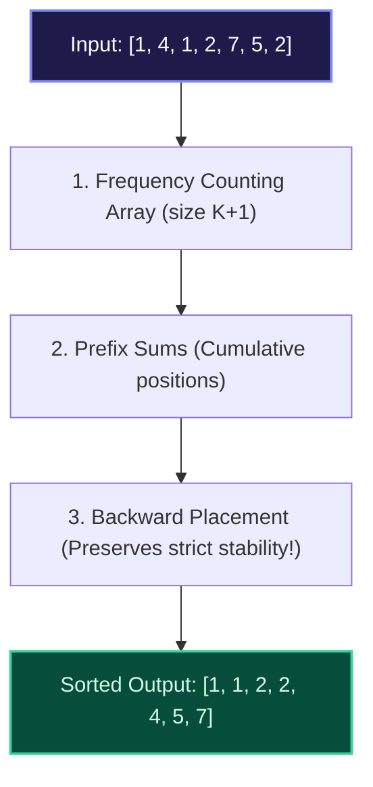

import { Callout } from "fumadocs-ui/components/callout";
import { Tabs, Tab } from "fumadocs-ui/components/tabs";
import { Steps, Step } from "fumadocs-ui/components/steps";
import { Cards, Card } from "fumadocs-ui/components/card";

## Bypassing the $\Omega(N \log N)$ Lower Bound

Comparison-based sorting algorithms (like QuickSort and MergeSort) are mathematically proven to require at least $\Omega(N \log N)$ comparisons in the worst case by decision tree information theory.

**Counting Sort** completely bypasses this theoretical barrier by treating keys as direct indices over a bounded integer universe $[0, K]$. It runs in strictly **$\mathcal{O}(N + K)$ linear time**.



---

## The Three-Phase Pipeline

<Steps>
  <Step>
    **Frequency Counting:** Count occurrences of each integer key in array
    `count[0 .. K]`.
  </Step>
  <Step>
    **Prefix Sums (Cumulative Offsets):** Compute running prefix sums `count[i]
    += count[i - 1]`. Now `count[val]` indicates the exact index boundary in the
    output array where elements equal to `val` should terminate.
  </Step>
  <Step>
    **Backward Placement for Stability:** Iterate from the end of the original
    array ($N-1$ down to $0$). Look up `target_idx = --count[arr[i]]` and write
    `output[target_idx] = arr[i]`. Right-to-left placement preserves the
    original relative ordering of equal elements, ensuring **strict stability**.
  </Step>
</Steps>

---

## Complexity Profile

| Metric               | Complexity           | Explanation                                                   |
| :------------------- | :------------------- | :------------------------------------------------------------ |
| **Time Complexity**  | $\mathcal{O}(N + K)$ | $N$ elements inspected, $K$ bucket slots scanned              |
| **Space Complexity** | $\mathcal{O}(N + K)$ | Auxiliary count array of size $K$ + output buffer of size $N$ |
| **Stability**        | **Strictly Stable**  | Backward placement maintains FIFO order of equal keys         |

<Callout type="warn" title="When NOT to Use Counting Sort">
  If range $K \gg N$ (for example, sorting 100 numbers that span up to $10^{12}
  $), allocating a count array of size $10^{12}$ causes memory exhaustion. Use
  Counting Sort only when $K = \mathcal{O}(N)$.
</Callout>

---

## Polyglot Implementations

<Tabs items={["C++", "TypeScript", "Python"]}>
  <Tab value="C++">
```cpp
#include <iostream>
#include <vector>
#include <algorithm>

std::vector<int> countingSort(const std::vector<int>& arr) {
if (arr.empty()) return {};
int minVal = *std::min_element(arr.begin(), arr.end());
int maxVal = *std::max_element(arr.begin(), arr.end());
int range = maxVal - minVal + 1;

    std::vector<int> count(range, 0);
    std::vector<int> output(arr.size());

    // 1. Frequency count
    for (int x : arr) count[x - minVal]++;

    // 2. Prefix sums
    for (int i = 1; i < range; ++i) count[i] += count[i - 1];

    // 3. Stable right-to-left placement
    for (int i = arr.size() - 1; i >= 0; --i) {
        output[--count[arr[i] - minVal]] = arr[i];
    }
    return output;

}

````
  </Tab>
  <Tab value="TypeScript">
```typescript
export function countingSort(arr: number[]): number[] {
  if (arr.length <= 1) return [...arr];
  let min = arr[0], max = arr[0];
  for (const x of arr) {
    if (x < min) min = x;
    if (x > max) max = x;
  }

  const range = max - min + 1;
  const count = new Array(range).fill(0);
  const output = new Array(arr.length);

  for (const x of arr) count[x - min]++;
  for (let i = 1; i < range; i++) count[i] += count[i - 1];

  for (let i = arr.length - 1; i >= 0; i--) {
    output[--count[arr[i] - min]] = arr[i];
  }
  return output;
}
````

  </Tab>
  <Tab value="Python">
```python
def counting_sort(arr: list[int]) -> list[int]:
    if not arr:
        return []
    min_val, max_val = min(arr), max(arr)
    k = max_val - min_val + 1
    count = [0] * k
    output = [0] * len(arr)

    for x in arr:
        count[x - min_val] += 1

    for i in range(1, k):
        count[i] += count[i - 1]

    for x in reversed(arr):
        count[x - min_val] -= 1
        output[count[x - min_val]] = x

    return output

```
  </Tab>
</Tabs>
```
