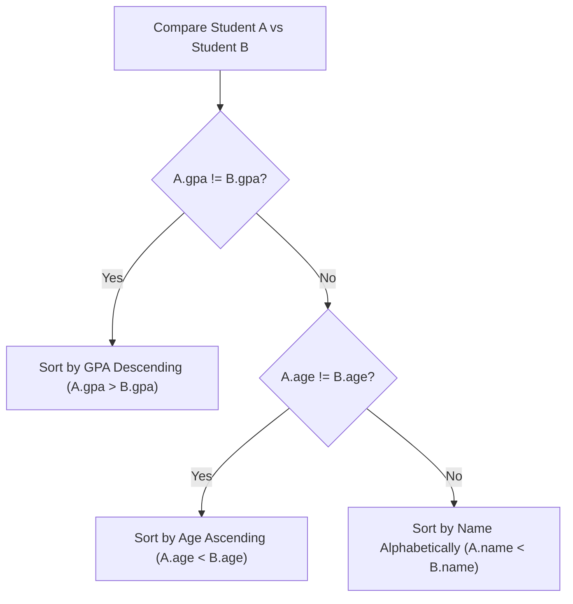

import { Callout } from "fumadocs-ui/components/callout";
import { Tabs, Tab } from "fumadocs-ui/components/tabs";
import { Steps, Step } from "fumadocs-ui/components/steps";
import { Cards, Card } from "fumadocs-ui/components/card";

## The Strict Weak Ordering Requirement

Sorting routines in modern standard libraries (`std::sort` in C++, `Array.prototype.sort` in JavaScript, `list.sort(key=...)` in Python) allow engineers to define custom ordering rules.

In languages like C++ and Java, a comparison function `comp(a, b)` (representing $a < b$) **must satisfy the mathematical axioms of a Strict Weak Ordering**:

1. **Irreflexivity:** `comp(a, a)` must always be `false`. (An element is never strictly less than itself).
2. **Asymmetry:** If `comp(a, b)` is `true`, then `comp(b, a)` must be `false`.
3. **Transitivity:** If `comp(a, b)` is `true` and `comp(b, c)` is `true`, then `comp(a, c)` must be `true`.
4. **Transitivity of Incomparability:** If neither `a < b` nor `b < a` (meaning $a$ and $b$ are equivalent), and neither `b < c` nor `c < b`, then neither `a < c` nor `c < a`.

<Callout type="error" title="The Fatal '<=' Comparator Bug">
  Writing `comp(a, b)` using `<=` (e.g. `return a <= b;`) **violates irreflexivity** because `comp(a, a)` evaluates to `true`!
  In C++ `std::sort`, violating strict weak ordering triggers undefined behavior: the sort algorithm's partition bounds fail to terminate, reading out-of-bounds heap memory and causing a **Segmentation Fault**!
  **Rule:** Always write strictly less-than `<` in C++ comparators.
</Callout>

---

## Multi-Key Composite Sorting

When sorting records with multiple fields (e.g. students sorted by GPA descending, then by age ascending, then by name alphabetically):



---

## Polyglot Implementations

<Tabs items={["C++ (Lambda & std::tie)", "TypeScript", "Python (Key Tuples)"]}>
  <Tab value="C++ (Lambda & std::tie)">
```cpp
#include <iostream>
#include <vector>
#include <string>
#include <algorithm>
#include <tuple>

struct Student {
std::string name;
double gpa;
int age;
};

int main() {
std::vector<Student> students = {
{"Alice", 3.8, 20},
{"Bob", 3.9, 22},
{"Charlie", 3.8, 19},
{"David", 3.8, 20}
};

    // Multi-key sort using lambda:
    // 1. GPA descending (-gpa)
    // 2. Age ascending
    // 3. Name ascending
    std::sort(students.begin(), students.end(), [](const Student& a, const Student& b) {
        if (a.gpa != b.gpa) return a.gpa > b.gpa; // higher GPA first
        if (a.age != b.age) return a.age < b.age; // younger first
        return a.name < b.name;                  // alphabetical
    });

    for (const auto& s : students) {
        std::cout << s.name << " | GPA: " << s.gpa << " | Age: " << s.age << "\n";
    }
    return 0;

}

````
  </Tab>
  <Tab value="TypeScript">
```typescript
interface Student {
  name: string;
  gpa: number;
  age: number;
}

const students: Student[] = [
  { name: "Alice", gpa: 3.8, age: 20 },
  { name: "Bob", gpa: 3.9, age: 22 },
  { name: "Charlie", gpa: 3.8, age: 19 },
];

// Return negative if a < b, positive if a > b, 0 if equal
students.sort((a, b) => {
  if (b.gpa !== a.gpa) return b.gpa - a.gpa; // GPA descending
  if (a.age !== b.age) return a.age - b.age; // Age ascending
  return a.name.localeCompare(b.name);      // Alphabetical
});
````

  </Tab>
  <Tab value="Python (Key Tuples)">
```python
students = [
    {"name": "Alice", "gpa": 3.8, "age": 20},
    {"name": "Bob", "gpa": 3.9, "age": 22},
    {"name": "Charlie", "gpa": 3.8, "age": 19},
]

# Python's key parameter sorts by tuple lexicographically

# Negating gpa sorts it in descending order!

students.sort(key=lambda s: (-s["gpa"], s["age"], s["name"]))

for s in students:
print(s)

```
  </Tab>
</Tabs>
```
