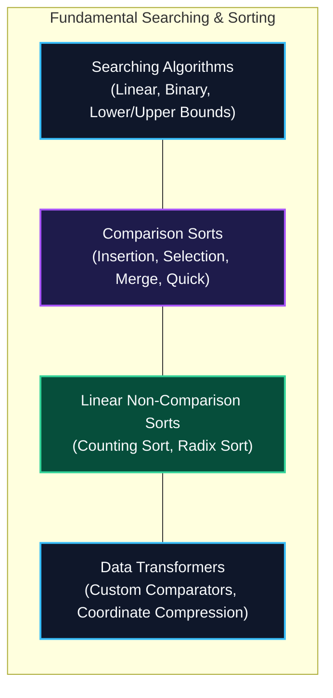

import { Callout } from "fumadocs-ui/components/callout";
import { Tabs, Tab } from "fumadocs-ui/components/tabs";
import { Steps, Step } from "fumadocs-ui/components/steps";
import { Cards, Card } from "fumadocs-ui/components/card";

## The Order-Finding Foundation

Searching and sorting are the twin pillars of algorithmic computer science. Organizing unorganized entropy into ordered sequences unlocks logarithmic searches, deduplication, geometric sweep-line processing, and efficient database query plans.

---

## Asymptotic Benchmark Matrix

| Algorithm          | Best Time               | Average Time            | Worst Time              | Space                 | Stable? | Key Characteristic                              |
| :----------------- | :---------------------- | :---------------------- | :---------------------- | :-------------------- | :------ | :---------------------------------------------- |
| **Linear Search**  | $\mathcal{O}(1)$        | $\mathcal{O}(N)$        | $\mathcal{O}(N)$        | $\mathcal{O}(1)$      | N/A     | Works on unsorted data                          |
| **Binary Search**  | $\mathcal{O}(1)$        | $\mathcal{O}(\log N)$   | $\mathcal{O}(\log N)$   | $\mathcal{O}(1)$      | N/A     | Requires sorted order                           |
| **Insertion Sort** | $\mathcal{O}(N)$        | $\mathcal{O}(N^2)$      | $\mathcal{O}(N^2)$      | $\mathcal{O}(1)$      | Yes     | Fast for tiny ($N < 32$) / nearly sorted arrays |
| **Selection Sort** | $\mathcal{O}(N^2)$      | $\mathcal{O}(N^2)$      | $\mathcal{O}(N^2)$      | $\mathcal{O}(1)$      | No      | Minimizes total memory writes                   |
| **Merge Sort**     | $\mathcal{O}(N \log N)$ | $\mathcal{O}(N \log N)$ | $\mathcal{O}(N \log N)$ | $\mathcal{O}(N)$      | Yes     | Guaranteed worst-case stability                 |
| **Quick Sort**     | $\mathcal{O}(N \log N)$ | $\mathcal{O}(N \log N)$ | $\mathcal{O}(N^2)$      | $\mathcal{O}(\log N)$ | No      | Cache-friendly partition                        |
| **Counting Sort**  | $\mathcal{O}(N + K)$    | $\mathcal{O}(N + K)$    | $\mathcal{O}(N + K)$    | $\mathcal{O}(N + K)$  | Yes     | Bypasses comparison lower bound                 |
| **Radix Sort**     | $\mathcal{O}(d(N + B))$ | $\mathcal{O}(d(N + B))$ | $\mathcal{O}(d(N + B))$ | $\mathcal{O}(N + B)$  | Yes     | Multi-digit stable passes                       |

---

## Stage 1.6 Curriculum Modules

Explore the dedicated modules in this section:

<Cards>
  <Card
    title="1.6.1 Linear Search"
    href="/docs/dsa/01-beginner/fundamental-searching-and-sorting/linear-search"
    description="Sequential inspection, cache prefetching, and sentinel loop acceleration."
  />
  <Card
    title="1.6.2 Binary Search on Sorted Arrays"
    href="/docs/dsa/01-beginner/fundamental-searching-and-sorting/binary-search"
    description="Logarithmic interval elimination, overflow-safe midpoints, and search invariants."
  />
  <Card
    title="1.6.3 Lower Bound and Upper Bound Search"
    href="/docs/dsa/01-beginner/fundamental-searching-and-sorting/lower-bound-and-upper-bound-search"
    description="Finding first elements >= target and > target in monotonic arrays; bisection routines."
  />
  <Card
    title="1.6.4 Insertion Sort"
    href="/docs/dsa/01-beginner/fundamental-searching-and-sorting/insertion-sort"
    description="Online adaptive sorting, sorted prefix maintenance, and TimSort subroutine role."
  />
  <Card
    title="1.6.5 Selection Sort"
    href="/docs/dsa/01-beginner/fundamental-searching-and-sorting/selection-sort"
    description="Repeated minimum extraction, swap count minimization, and instability analysis."
  />
  <Card
    title="1.6.6 Merge Sort"
    href="/docs/dsa/01-beginner/fundamental-searching-and-sorting/merge-sort"
    description="Stable divide-and-conquer, recursion tree analysis, buffer mechanics, and inversion counting."
  />
  <Card
    title="1.6.7 Quicksort"
    href="/docs/dsa/01-beginner/fundamental-searching-and-sorting/quick-sort"
    description="Lomuto vs Hoare partitioning, 3-way Dutch National Flag, and pivot heuristics."
  />
  <Card
    title="1.6.8 Counting Sort"
    href="/docs/dsa/01-beginner/fundamental-searching-and-sorting/counting-sort"
    description="Non-comparison integer sorting over bounded ranges, frequency prefixes, and stability."
  />
  <Card
    title="1.6.9 Radix Sort"
    href="/docs/dsa/01-beginner/fundamental-searching-and-sorting/radix-sort"
    description="LSD and MSD multi-pass byte and digit sorting combined with stable counting passes."
  />
  <Card
    title="1.6.10 Custom Comparators"
    href="/docs/dsa/01-beginner/fundamental-searching-and-sorting/custom-comparators"
    description="Strict weak ordering axioms, transitivity, multi-key composite sorting, and lambda comparators."
  />
  <Card
    title="1.6.11 Coordinate Compression"
    href="/docs/dsa/01-beginner/fundamental-searching-and-sorting/coordinate-compression"
    description="Mapping large sparse coordinate values into dense continuous rank ranges [0, N-1]."
  />
</Cards>
