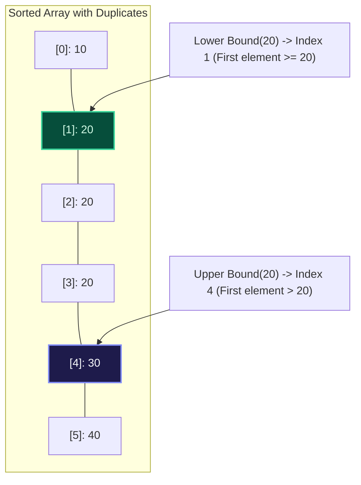

import { Callout } from "fumadocs-ui/components/callout";
import { Tabs, Tab } from "fumadocs-ui/components/tabs";
import { Steps, Step } from "fumadocs-ui/components/steps";
import { Cards, Card } from "fumadocs-ui/components/card";

## Beyond Exact Matching: The Bisection Invariants

In real-world algorithm design, we rarely search solely for exact target matches. Instead, we query **boundary thresholds**:

- **Lower Bound (`std::lower_bound`):** Finds the index of the first element that is **greater than or equal to** $\text{target}$ ($A[i] \ge \text{target}$).
- **Upper Bound (`std::upper_bound`):** Finds the index of the first element that is **strictly greater than** $\text{target}$ ($A[i] > \text{target}$).



### Deriving Subarray Frequency in $\mathcal{O}(\log N)$

Given lower bound $L$ and upper bound $R$ for target $X$:

- Does target $X$ exist in the array? If $L < N$ and $A[L] == X$, yes!
- How many times does $X$ appear?
  $$
  \text{Count}(X) = \text{Upper Bound}(X) - \text{Lower Bound}(X)
  $$

---

## Canonical Bisection Template

To avoid off-by-one errors and infinite loops:

- Maintain search interval $[low, high)$ or $[low, high]$.
- Compute overflow-safe midpoint: `mid = low + (high - low) / 2`.
- In Lower Bound: If $A[mid] \ge \text{target}$, the answer could be $mid$ or to its left $\to$ `high = mid`. Otherwise `low = mid + 1`.

---

## Polyglot Implementations

<Tabs items={["C++", "TypeScript", "Python"]}>
  <Tab value="C++">
```cpp
#include <iostream>
#include <vector>
#include <algorithm>

// Custom lower_bound implementation
int lowerBound(const std::vector<int>& arr, int target) {
int low = 0, high = arr.size();
while (low < high) {
int mid = low + (high - low) / 2;
if (arr[mid] >= target) {
high = mid;
} else {
low = mid + 1;
}
}
return low;
}

// Custom upper_bound implementation
int upperBound(const std::vector<int>& arr, int target) {
int low = 0, high = arr.size();
while (low < high) {
int mid = low + (high - low) / 2;
if (arr[mid] > target) {
high = mid;
} else {
low = mid + 1;
}
}
return low;
}

int main() {
std::vector<int> nums = {10, 20, 20, 20, 30, 40};
int lb = lowerBound(nums, 20); // 1
int ub = upperBound(nums, 20); // 4
std::cout << "Lower bound: " << lb << ", Upper bound: " << ub << "\n";
std::cout << "Count of 20: " << (ub - lb) << "\n"; // 3
return 0;
}

````
  </Tab>
  <Tab value="TypeScript">
```typescript
export function lowerBound(arr: number[], target: number): number {
  let low = 0;
  let high = arr.length;
  while (low < high) {
    const mid = low + Math.floor((high - low) / 2);
    if (arr[mid] >= target) {
      high = mid;
    } else {
      low = mid + 1;
    }
  }
  return low;
}

export function upperBound(arr: number[], target: number): number {
  let low = 0;
  let high = arr.length;
  while (low < high) {
    const mid = low + Math.floor((high - low) / 2);
    if (arr[mid] > target) {
      high = mid;
    } else {
      low = mid + 1;
    }
  }
  return low;
}
````

  </Tab>
  <Tab value="Python">
```python
import bisect

arr = [10, 20, 20, 20, 30, 40]

# bisect_left is lower_bound (first index where val >= target)

lb = bisect.bisect_left(arr, 20) # index 1

# bisect_right is upper_bound (first index where val > target)

ub = bisect.bisect_right(arr, 20) # index 4

print(f"Lower bound: {lb}, Upper bound: {ub}")
print(f"Occurrences of 20: {ub - lb}") # 3

```
  </Tab>
</Tabs>
```
