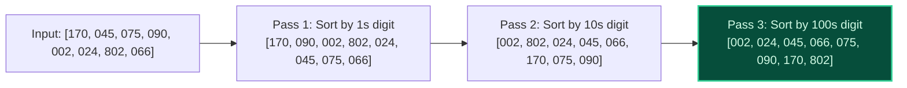

import { Callout } from "fumadocs-ui/components/callout";
import { Tabs, Tab } from "fumadocs-ui/components/tabs";
import { Steps, Step } from "fumadocs-ui/components/steps";
import { Cards, Card } from "fumadocs-ui/components/card";

## The Multi-Pass Digit Sorting Paradigm

While Counting Sort falters when keys span massive ranges (e.g. 32-bit or 64-bit integers), **Radix Sort** overcomes this limitation by decomposing keys into $d$ individual digits or byte chunks of radix base $B$:

$$
\text{Total Runtime} = \mathcal{O}(d \cdot (N + B))
$$



---

## LSD (Least Significant Digit) vs MSD (Most Significant Digit)

### 1. LSD Radix Sort (Standard for Fixed-Width Integers)

- Iterates from the rightmost (least significant) digit toward the leftmost digit.
- **Critical Requirement:** Every intermediate sorting pass must be **strictly stable** (like Counting Sort). Stability ensures that ties on current digits preserve the relative order established by previous passes!

### 2. MSD Radix Sort (Standard for Variable-Length Strings)

- Iterates from the leftmost (most significant) digit to the right.
- Operates recursively by partitioning items into buckets (like Trie construction).
- Highly effective for alphabetically sorting dictionaries and variable-length strings.

---

## High-Performance 32-Bit Systems Implementation

In systems engineering, sorting numbers using decimal digits (base 10) is suboptimal because division and modulo operations are slow.

Instead, high-performance engines sort 32-bit integers using **base $B = 256$ (1 byte = 8 bits)**:

- Total passes: exactly $d = 4$ passes ($32 / 8 = 4$).
- Inner Counting Sort uses an array of size $256$, which easily fits in the **CPU L1 Cache**!
- Digit extraction uses fast hardware bitwise shifts and bitmasks:
  $$
  \text{byte\_digit} = (x \gg \text{shift}) \ \& \ 0\text{xFF}
  $$
- The entire sort executes in guaranteed linear time: $4 \times (N + 256) = \mathcal{O}(N)$.

---

## Polyglot Implementations

<Tabs items={["C++ (Fast 8-bit Radix)", "TypeScript", "Python"]}>
  <Tab value="C++ (Fast 8-bit Radix)">
```cpp
#include <iostream>
#include <vector>
#include <cstdint>

void radixSort32(std::vector<uint32_t>& arr) {
size_t n = arr.size();
if (n <= 1) return;

    std::vector<uint32_t> output(n);
    const int RADIX = 256;
    const int MASK = 0xFF;

    // 4 passes for 32-bit unsigned integers
    for (int shift = 0; shift < 32; shift += 8) {
        int count[RADIX] = {0};

        for (size_t i = 0; i < n; ++i) {
            uint32_t byteVal = (arr[i] >> shift) & MASK;
            count[byteVal]++;
        }

        for (int i = 1; i < RADIX; ++i) count[i] += count[i - 1];

        for (int i = n - 1; i >= 0; --i) {
            uint32_t byteVal = (arr[i] >> shift) & MASK;
            output[--count[byteVal]] = arr[i];
        }

        arr = output;
    }

}

````
  </Tab>
  <Tab value="TypeScript">
```typescript
export function radixSort(arr: number[]): number[] {
  if (arr.length <= 1) return [...arr];
  let maxVal = Math.max(...arr);
  let res = [...arr];

  for (let exp = 1; Math.floor(maxVal / exp) > 0; exp *= 10) {
    const count = new Array(10).fill(0);
    const output = new Array(arr.length);

    for (let i = 0; i < res.length; i++) {
      const digit = Math.floor(res[i] / exp) % 10;
      count[digit]++;
    }

    for (let i = 1; i < 10; i++) count[i] += count[i - 1];

    for (let i = res.length - 1; i >= 0; i--) {
      const digit = Math.floor(res[i] / exp) % 10;
      output[--count[digit]] = res[i];
    }
    res = output;
  }
  return res;
}
````

  </Tab>
  <Tab value="Python">
```python
def radix_sort(arr: list[int]) -> list[int]:
    if not arr:
        return []
    max_val = max(arr)
    exp = 1
    res = arr[:]

    while max_val // exp > 0:
        count = [0] * 10
        output = [0] * len(arr)

        for x in res:
            digit = (x // exp) % 10
            count[digit] += 1

        for i in range(1, 10):
            count[i] += count[i - 1]

        for x in reversed(res):
            digit = (x // exp) % 10
            count[digit] -= 1
            output[count[digit]] = x

        res = output
        exp *= 10

    return res

```
  </Tab>
</Tabs>
```
