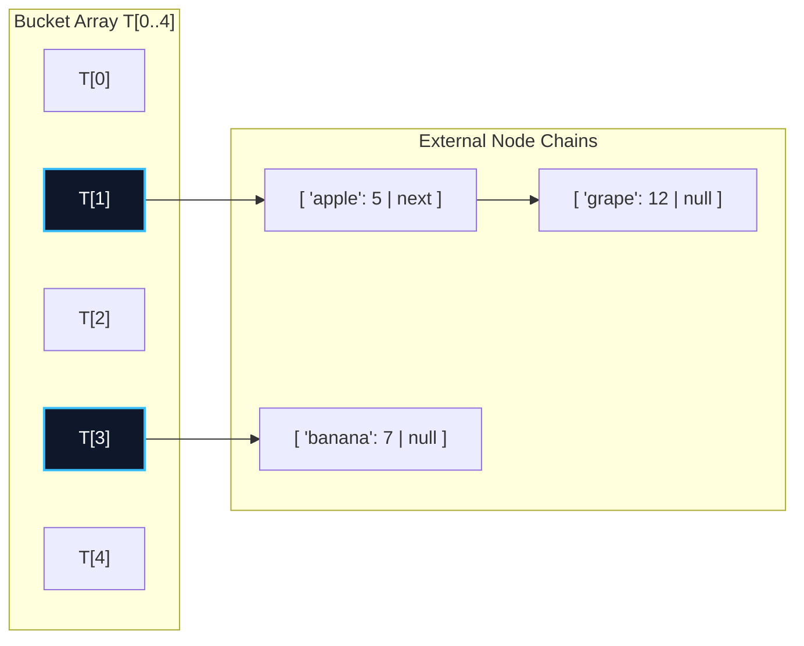
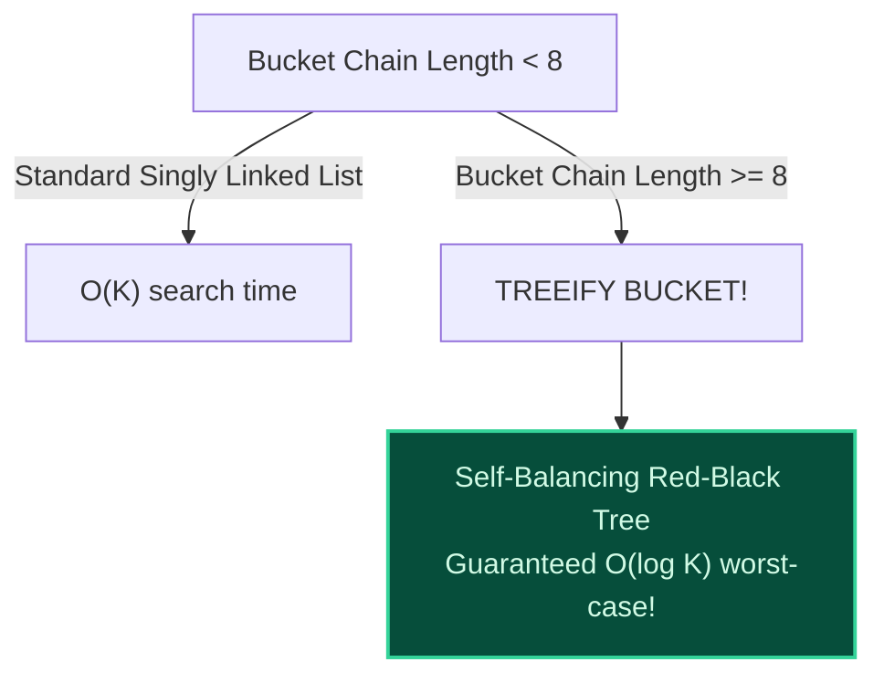

import { Callout } from "fumadocs-ui/components/callout";
import { Tabs, Tab } from "fumadocs-ui/components/tabs";
import { Steps, Step } from "fumadocs-ui/components/steps";
import { Cards, Card } from "fumadocs-ui/components/card";

## The Pigeonhole Principle & Collision Inevitability

Because the universe of possible keys $\mathcal{U}$ is far larger than the bucket array capacity $M$, collisions ($h(k_1) = h(k_2)$ for $k_1 \ne k_2$) are mathematically inevitable by the **Pigeonhole Principle**.

In **Separate Chaining**, each bucket in array $T[0 \dots M-1]$ acts as the head of an external data structure (traditionally a singly linked list). Whenever two or more keys hash to the identical index, they are appended to that bucket's chain.



---

## Load Factor ($\alpha$) & Performance Bounds

The **Load Factor** $\alpha$ represents the average number of elements stored per bucket:

$$
\alpha = \frac{N}{M}
$$

Where:

- $N$ = Total key-value pairs stored in the table.
- $M$ = Total number of allocated bucket slots.

### Theorem: Expected Time under SUHA

Under the Simple Uniform Hashing Assumption (SUHA):

- **Successful Search Time:** $\Theta(1 + \frac{\alpha}{2}) = \mathcal{O}(1)$ expected.
- **Unsuccessful Search Time:** $\Theta(1 + \alpha) = \mathcal{O}(1)$ expected.
- **Worst-Case Time:** $\mathcal{O}(N)$ (if all $N$ keys hash to the exact same bucket).

To guarantee that searches remain strictly $\mathcal{O}(1)$, standard libraries maintain $\alpha \le 0.75$. Once $\alpha > 0.75$, the table dynamically allocates $2M$ buckets and rehashes every existing key!

---

## Treeification: Java 8 Red-Black Tree Buckets

In 2014, Java 8 introduced an algorithmic breakthrough into `java.util.HashMap` to guard against $\mathcal{O}(N)$ worst-case degradation:



- When a single bucket chain grows to $\ge 8$ elements, the bucket automatically converts from a linked list into a **Red-Black Tree**.
- Even under targeted HashDoS attacks, bucket searches run in strictly **$\mathcal{O}(\log K)$** time rather than quadratic $\mathcal{O}(K)$.

---

## Polyglot Implementation

<Tabs items={["C++", "TypeScript", "Python"]}>
  <Tab value="C++">
```cpp
#include <iostream>
#include <vector>
#include <list>
#include <string>

template <typename K, typename V>
class ChainedHashMap {
private:
struct Entry {
K key;
V val;
};

    std::vector<std::list<Entry>> buckets;
    size_t count;
    size_t numBuckets;

    size_t hashKey(const K& key) const {
        return std::hash<K>{}(key) % numBuckets;
    }

public:
ChainedHashMap(size_t m = 16) : buckets(m), count(0), numBuckets(m) {}

    void insert(const K& key, const V& val) {
        size_t idx = hashKey(key);
        for (auto& entry : buckets[idx]) {
            if (entry.key == key) {
                entry.val = val;
                return;
            }
        }
        buckets[idx].push_back({key, val});
        count++;
    }

    bool get(const K& key, V& outVal) const {
        size_t idx = hashKey(key);
        for (const auto& entry : buckets[idx]) {
            if (entry.key == key) {
                outVal = entry.val;
                return true;
            }
        }
        return false;
    }

    bool remove(const K& key) {
        size_t idx = hashKey(key);
        for (auto it = buckets[idx].begin(); it != buckets[idx].end(); ++it) {
            if (it->key == key) {
                buckets[idx].erase(it);
                count--;
                return true;
            }
        }
        return false;
    }

};

````
  </Tab>
  <Tab value="TypeScript">
```typescript
class Entry<K, V> {
  constructor(public key: K, public val: V) {}
}

export class SeparateChainingMap<K, V> {
  private buckets: Entry<K, V>[][];
  private size = 0;

  constructor(private capacity = 16) {
    this.buckets = Array.from({ length: capacity }, () => []);
  }

  private hash(key: string): number {
    let h = 0;
    for (let i = 0; i < key.length; i++) h = (h * 31 + key.charCodeAt(i)) >>> 0;
    return h % this.capacity;
  }

  set(key: string, val: V): void {
    const idx = this.hash(key);
    const chain = this.buckets[idx];
    for (const e of chain) {
      if (e.key === (key as any)) {
        e.val = val;
        return;
      }
    }
    chain.push(new Entry(key as any, val));
    this.size++;
  }

  get(key: string): V | undefined {
    const idx = this.hash(key);
    const entry = this.buckets[idx].find((e) => e.key === (key as any));
    return entry ? entry.val : undefined;
  }
}
````

  </Tab>
  <Tab value="Python">
```python
class SeparateChainingMap:
    def __init__(self, capacity=16):
        self.capacity = capacity
        self.buckets = [[] for _ in range(capacity)]
        self.size = 0

    def _hash(self, key):
        return hash(key) % self.capacity

    def put(self, key, val):
        idx = self._hash(key)
        for i, (k, v) in enumerate(self.buckets[idx]):
            if k == key:
                self.buckets[idx][i] = (key, val)
                return
        self.buckets[idx].append((key, val))
        self.size += 1

    def get(self, key):
        idx = self._hash(key)
        for k, v in self.buckets[idx]:
            if k == key:
                return v
        return None

```
  </Tab>
</Tabs>
```
