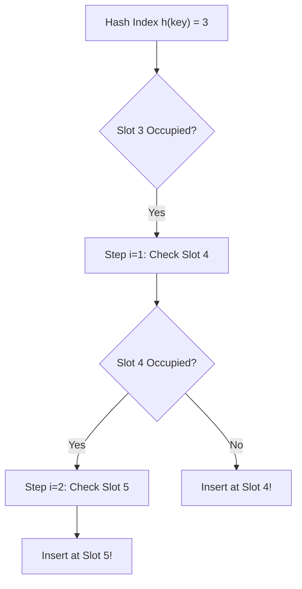
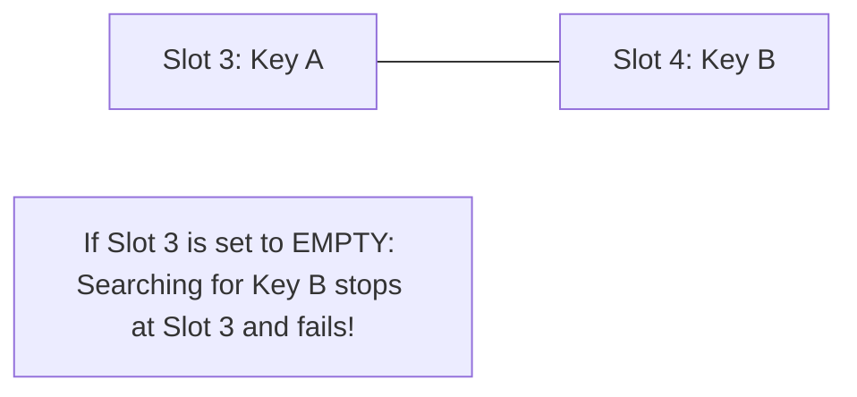

import { Callout } from "fumadocs-ui/components/callout";
import { Tabs, Tab } from "fumadocs-ui/components/tabs";
import { Steps, Step } from "fumadocs-ui/components/steps";
import { Cards, Card } from "fumadocs-ui/components/card";

## The In-Place Storage Architecture

In **Open Addressing**, all keys reside directly inside the contiguous bucket array. There are no external linked lists, auxiliary node pointers, or separate heap allocations.

When a collision occurs at initial index $h_0 = h(k)$, the algorithm computes a systematic probe sequence:

$$
h(k, i) = \left( h(k) + f(i) \right) \pmod M \quad \text{for probe step } i = 0, 1, 2, \dots, M-1
$$

The allocator steps through $h(k, 0), h(k, 1), h(k, 2), \dots$ until finding an empty slot.



---

## Probing Strategies

### 1. Linear Probing: $f(i) = i$

$$
h(k, i) = (h(k) + i) \pmod M
$$

- **Hardware Advantage:** Maximum cache locality. Scanning adjacent array indices streams through 64-byte L1 cache lines with almost zero DRAM misses!
- **Theoretical Flaw (Primary Clustering):** Long continuous blocks of occupied slots merge together, causing search times to degrade rapidly as load factor $\alpha > 0.5$.

### 2. Quadratic Probing: $f(i) = c_1 i + c_2 i^2$

$$
h(k, i) = (h(k) + c_1 i + c_2 i^2) \pmod M
$$

- Eliminates primary clustering by jumping quadratically further away on successive collisions.
- Suffers from **Secondary Clustering**: Keys with the exact same initial hash $h(k)$ trace identical probe sequences.

### 3. Double Hashing: $f(i) = i \cdot h_2(k)$

$$
h(k, i) = (h_1(k) + i \cdot h_2(k)) \pmod M
$$

- Uses a secondary hash function $h_2(k)$ to compute the jump step size.
- Because $h_2(k)$ depends on key $k$, different keys that collide on $h_1(k)$ jump at completely different intervals, completely eliminating both primary and secondary clustering!

---

## The Tombstone Deletion Problem

In open addressing, if you delete key $A$ simply by clearing its slot to `EMPTY`, any subsequent search for key $B$ (which collided with $A$ and probed past it) will terminate prematurely upon seeing `EMPTY`, falsely reporting that $B$ does not exist!



### The Solution: Tombstones (`DELETED`)

Instead of `EMPTY`, mark vacated slots with a sentinel value called a **Tombstone** (`DEL`):

- **Search:** Continues past tombstones as if the slot was occupied.
- **Insert:** Can overwrite tombstones with new keys.

---

## Robin Hood Hashing: "Steal from the Rich"

Engineered by Pedro Celis in 1985, **Robin Hood Hashing** drastically tightens lookup variance:

- Track the **DIB (Distance from Initial Bucket)** for each stored element.
- When inserting a new key $K_{new}$, if its current probe distance is **greater** than the probe distance of the existing key in that slot ($DIB(K_{new}) > DIB(K_{existing})$):
  - Evict $K_{existing}$, place $K_{new}$ in the slot ("steal from the rich"), and continue probing to re-insert $K_{existing}$!
- This ensures all elements remain near their ideal hash location, minimizing worst-case search times.

---

## Polyglot Implementation (Linear Probing with Tombstones)

<Tabs items={["C++", "TypeScript", "Python"]}>
  <Tab value="C++">
```cpp
#include <iostream>
#include <vector>
#include <string>

class LinearProbingMap {
private:
enum Status { EMPTY, OCCUPIED, TOMBSTONE };
struct Slot {
std::string key;
int val;
Status status = EMPTY;
};

    std::vector<Slot> table;
    size_t count;
    size_t capacity;

public:
LinearProbingMap(size_t cap = 16) : table(cap), count(0), capacity(cap) {}

    bool insert(const std::string& key, int val) {
        if (count >= capacity / 2) return false; // keep load factor <= 0.5
        size_t idx = std::hash<std::string>{}(key) % capacity;
        size_t firstTombstone = capacity;

        for (size_t i = 0; i < capacity; ++i) {
            size_t probe = (idx + i) % capacity;
            if (table[probe].status == OCCUPIED && table[probe].key == key) {
                table[probe].val = val;
                return true;
            }
            if (table[probe].status == TOMBSTONE && firstTombstone == capacity) {
                firstTombstone = probe;
            }
            if (table[probe].status == EMPTY) {
                size_t target = (firstTombstone != capacity) ? firstTombstone : probe;
                table[target] = {key, val, OCCUPIED};
                count++;
                return true;
            }
        }
        return false;
    }

};

````
  </Tab>
  <Tab value="TypeScript">
```typescript
enum Status { EMPTY, OCCUPIED, TOMBSTONE }

export class LinearProbingHashTable<V> {
  private keys: (string | null)[];
  private vals: (V | null)[];
  private status: Status[];
  private count = 0;

  constructor(private capacity = 16) {
    this.keys = new Array(capacity).fill(null);
    this.vals = new Array(capacity).fill(null);
    this.status = new Array(capacity).fill(Status.EMPTY);
  }

  private hash(k: string): number {
    let h = 0;
    for (let i = 0; i < k.length; i++) h = (h * 31 + k.charCodeAt(i)) >>> 0;
    return h % this.capacity;
  }

  put(key: string, val: V): boolean {
    if (this.count >= this.capacity * 0.7) return false;
    let idx = this.hash(key);
    for (let i = 0; i < this.capacity; i++) {
      const probe = (idx + i) % this.capacity;
      if (this.status[probe] === Status.EMPTY || this.status[probe] === Status.TOMBSTONE) {
        this.keys[probe] = key;
        this.vals[probe] = val;
        this.status[probe] = Status.OCCUPIED;
        this.count++;
        return true;
      }
      if (this.status[probe] === Status.OCCUPIED && this.keys[probe] === key) {
        this.vals[probe] = val;
        return true;
      }
    }
    return false;
  }
}
````

  </Tab>
  <Tab value="Python">
```python
class OpenAddressingMap:
    EMPTY = 0
    OCCUPIED = 1
    TOMBSTONE = 2

    def __init__(self, capacity=16):
        self.capacity = capacity
        self.table = [(self.EMPTY, None, None)] * capacity
        self.size = 0

    def put(self, key, val):
        idx = hash(key) % self.capacity
        tombstone_idx = None

        for i in range(self.capacity):
            probe = (idx + i) % self.capacity
            status, k, v = self.table[probe]

            if status == self.OCCUPIED and k == key:
                self.table[probe] = (self.OCCUPIED, key, val)
                return True
            if status == self.TOMBSTONE and tombstone_idx is None:
                tombstone_idx = probe
            if status == self.EMPTY:
                target = tombstone_idx if tombstone_idx is not None else probe
                self.table[target] = (self.OCCUPIED, key, val)
                self.size += 1
                return True
        return False

```
  </Tab>
</Tabs>
```
