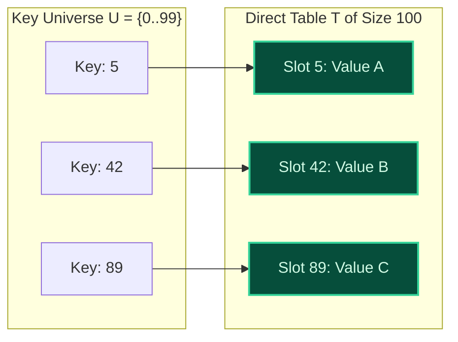

import { Callout } from "fumadocs-ui/components/callout";
import { Tabs, Tab } from "fumadocs-ui/components/tabs";
import { Steps, Step } from "fumadocs-ui/components/steps";
import { Cards, Card } from "fumadocs-ui/components/card";

## Direct Addressing Over Bounded Universes

Before modern hash tables were invented, associative mapping relied on **Direct Access Tables (DAT)**.

If every key is drawn from a small, bounded universe of non-negative integers $\mathcal{U} = \{0, 1, 2, \dots, M-1\}$, we can allocate an array $T$ of exact size $M$. Each key $k \in \mathcal{U}$ directly addresses slot $T[k]$.



---

## Performance and Space Limits

### The Strength: Unmatched Speed

- **Search:** $\mathcal{O}(1)$ worst-case.
- **Insert:** $\mathcal{O}(1)$ worst-case.
- **Delete:** $\mathcal{O}(1)$ worst-case.
  There are zero collisions, zero hash function evaluations, and zero probe loops.

### The Fatal Flaw: The Sparsity Crisis

If the universe of possible keys $\mathcal{U}$ is huge but the actual set of active keys $K$ is small ($|K| \ll |\mathcal{U}|$):

1. **Unusable Memory Overhead:** Storing 50 user profiles indexed by 64-bit Social Security Numbers or user IDs ($2^{64} \approx 1.84 \times 10^{19}$) would demand billions of petabytes of RAM!
2. **Non-Integer Keys:** String keys, email addresses, and composite objects cannot directly index an array without a transformation function.

<Callout type="info" title="Where Direct Addressing Still Reigns">
  Direct access tables remain optimal when the universe is tiny and fixed: -
  ASCII character frequency counting: array of size $128$ or $256$. - Tracking
  flags for HTTP status codes: array of size $600$. - Boolean bitsets and
  visited arrays in competitive programming.
</Callout>

---

## Polyglot Implementation

<Tabs items={["C++", "TypeScript", "Python"]}>
  <Tab value="C++">
```cpp
#include <iostream>
#include <vector>
#include <optional>

template <typename T, size_t UniverseSize>
class DirectAccessTable {
private:
std::vector<std::optional<T>> table;

public:
DirectAccessTable() : table(UniverseSize, std::nullopt) {}

    void insert(size_t key, const T& value) {
        if (key >= UniverseSize) throw std::out_of_range("Key exceeds universe");
        table[key] = value;
    }

    std::optional<T> search(size_t key) const {
        if (key >= UniverseSize) return std::nullopt;
        return table[key];
    }

    void remove(size_t key) {
        if (key < UniverseSize) table[key] = std::nullopt;
    }

};

````
  </Tab>
  <Tab value="TypeScript">
```typescript
export class DirectAccessTable<T> {
  private table: (T | undefined)[];

  constructor(universeSize: number) {
    this.table = new Array(universeSize).fill(undefined);
  }

  insert(key: number, val: T): void {
    this.table[key] = val;
  }

  search(key: number): T | undefined {
    return this.table[key];
  }

  remove(key: number): void {
    this.table[key] = undefined;
  }
}
````

  </Tab>
  <Tab value="Python">
```python
class DirectAccessTable:
    def __init__(self, universe_size: int):
        self.table = [None] * universe_size

    def insert(self, key: int, value):
        self.table[key] = value

    def search(self, key: int):
        return self.table[key]

    def delete(self, key: int):
        self.table[key] = None

```
  </Tab>
</Tabs>
```
