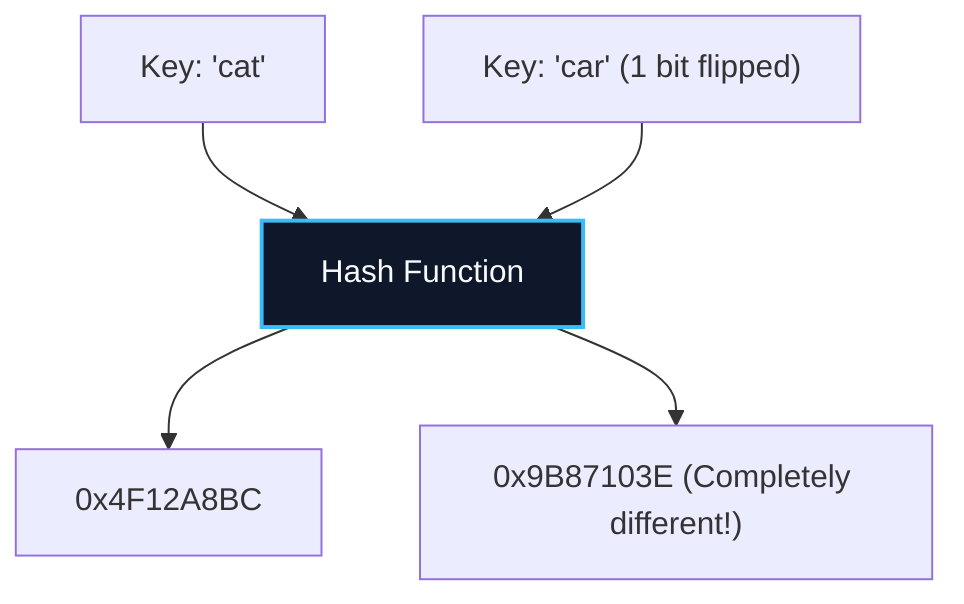

import { Callout } from "fumadocs-ui/components/callout";
import { Tabs, Tab } from "fumadocs-ui/components/tabs";
import { Steps, Step } from "fumadocs-ui/components/steps";
import { Cards, Card } from "fumadocs-ui/components/card";

## The Mathematical Compression Pipeline

A **Hash Function** $h(k)$ is a deterministic mathematical operator that maps an arbitrary, potentially infinite key universe $\mathcal{U}$ into a fixed integer interval $[0, M-1]$:

$$
h: \mathcal{U} \to \{0, 1, 2, \dots, M-1\}
$$

A high-performance hash function must fulfill three fundamental properties:

1. **Determinism:** If $k_1 == k_2$, then $h(k_1)$ must strictly equal $h(k_2)$ across all invocations.
2. **Uniform Distribution (SUHA):** Under the Simple Uniform Hashing Assumption, every key is equally likely to hash into any of the $M$ slots, independently of where other keys hash.
3. **Avalanche Effect:** Flipping a single bit in the input key must mutate roughly $50\%$ of the output bits, scrambling patterns into pseudo-random entropy.



---

## Classical Hash Function Architectures

### 1. The Division Method

$$
h(k) = k \pmod M
$$

- $M$ should be a **prime number** not close to a power of 2 or 10. If $M = 2^p$, $h(k)$ simply extracts the lowest $p$ bits of $k$, ignoring all higher-order bits!

### 2. Polynomial Rolling Hash for Strings

Used extensively in text searching (Rabin-Karp) and compiler symbol tables:

$$
h(s) = \left( \sum_{i=0}^{L-1} s[i] \cdot p^i \right) \pmod M
$$

Where $p$ is a prime roughly matching the alphabet size (e.g., $p = 31$ or $53$) and $M$ is a large prime (e.g., $10^9 + 7$).

---

## Industrial Algorithms: MurmurHash3 vs. SipHash

| Algorithm                | Type                      | Speed                | Cryptographic Collision Resistance      | Primary Usage                                   |
| :----------------------- | :------------------------ | :------------------- | :-------------------------------------- | :---------------------------------------------- |
| **MurmurHash3 / xxHash** | Non-cryptographic         | Extreme (~5–10 GB/s) | None (Vulnerable to crafted collisions) | In-memory indexing, Redis, Lucene               |
| **SipHash**              | Keyed PRF (Cryptographic) | High (~1–2 GB/s)     | High (Requires secret seed key)         | Python 3.4+, Rust `HashMap`, Ruby, Linux kernel |

---

## Security Engineering: The HashDoS Attack

In 2011, security researchers exposed a vulnerability affecting web application servers: **Hash Denial of Service (HashDoS)**.

<Callout type="warn" title="How HashDoS Works">
  Because non-cryptographic hash functions like Java's legacy string hash are deterministic, an attacker can precompute 100,000 distinct POST parameters that all hash to the **exact same bucket index**:
  $$
  h(\text{payload}_1) = h(\text{payload}_2) = \dots = h(\text{payload}_{100{,}000}) = 42
  $$
  When the server parses the request into its internal hash table:
  - All 100,000 keys collide in bucket 42.
  - The hash table degrades into a linked list of length 100,000.
  - Each insertion requires scanning the full chain: $\sum_{i=1}^N i = \mathcal{O}(N^2)$ work.
  - A tiny 2 MB request freezes the web server's CPU core for **several minutes**!
</Callout>

### The Solution: SipHash with Randomized Secret Keys

Modern runtimes (Python, Rust, Swift) initialize their hash tables with a **randomized secret seed** generated anew every time the process boots. Attackers cannot precalculate collisions because they do not possess the server's per-process secret key!

---

## Polyglot Implementations

<Tabs items={["C++ (MurmurHash3 Finalizer)", "TypeScript (Polynomial Hash)", "Python (SipHash Demo)"]}>
  <Tab value="C++ (MurmurHash3 Finalizer)">
```cpp
#include <iostream>
#include <cstdint>

// MurmurHash3 integer finalizer (fmix32): avalanche bit scrambler
uint32*t fmix32(uint32_t h) {
h ^= h >> 16;
h *= 0x85ebca6b;
h ^= h >> 13;
h \_= 0xc2b2ae35;
h ^= h >> 16;
return h;
}

int main() {
uint32_t key1 = 123456;
uint32_t key2 = 123457; // 1 bit different
std::cout << "fmix(123456): 0x" << std::hex << fmix32(key1) << "\n";
std::cout << "fmix(123457): 0x" << std::hex << fmix32(key2) << "\n";
return 0;
}

````
  </Tab>
  <Tab value="TypeScript (Polynomial Hash)">
```typescript
export function polynomialRollingHash(s: string, M = 1_000_000_007, P = 31): number {
  let hash = 0;
  let pPow = 1;

  for (let i = 0; i < s.length; i++) {
    const code = s.charCodeAt(i) - 96; // 1-26 for lowercase
    hash = (hash + code * pPow) % M;
    pPow = (pPow * P) % M;
  }

  return hash;
}

console.log("Hash of 'algorithm':", polynomialRollingHash("algorithm"));
````

  </Tab>
  <Tab value="Python (SipHash Demo)">
```python
import sys

# Python uses randomized SipHash24 for strings

# Every Python process invocation produces different hash values for strings

key = "sensitive_password"
print(f"Hash value in this process: {hash(key)}")
print(f"Hash random seed info: {sys.hash_info.algorithm}")

```
  </Tab>
</Tabs>
```
