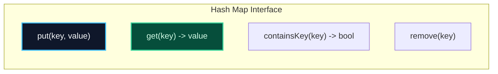
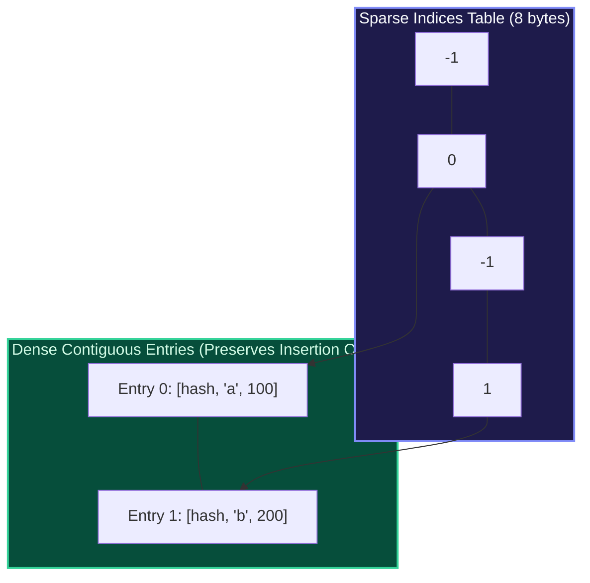

import { Callout } from "fumadocs-ui/components/callout";
import { Tabs, Tab } from "fumadocs-ui/components/tabs";
import { Steps, Step } from "fumadocs-ui/components/steps";
import { Cards, Card } from "fumadocs-ui/components/card";

## The Associative Array Abstraction

A **Hash Map** (or Dictionary / Associative Array) provides key-value pair binding:

- **Keys** must be hashable and unique.
- **Values** can be any arbitrary payload or object reference.

Unlike sorted binary search trees (`std::map`, which require $\mathcal{O}(\log N)$ comparisons), a Hash Map executes lookup, insertion, and deletion in **amortized $\mathcal{O}(1)$ time**.



---

## Dynamic Resizing & Rehashing

As more items enter the table, the load factor $\alpha = N / M$ rises. If left unchecked, collision chains elongate, degrading performance toward $\mathcal{O}(N)$.

To maintain strict $\mathcal{O}(1)$ averages:

1. **Threshold Trigger:** When $\alpha > \alpha_{\text{max}}$ (typically $0.75$), trigger resizing.
2. **Double Capacity:** Allocate a new buffer of size $2M$.
3. **Full Rehashing:** Every existing key is re-evaluated through the hash function and mapped to its new bucket:
   $$
   \text{new\_bucket} = h(\text{key}) \pmod{2M}
   $$

<Callout type="info" title="Amortized Cost Analysis">
  Just like dynamic vectors, copying $N$ items during resizing costs $\mathcal
  {O}(N)$ work, but happens only after $\Omega(N)$ cheap insertions. Thus, the
  amortized cost per insertion remains strictly **$\mathcal{O}(1)$**.
</Callout>

---

## Architecture Spotlight: Python 3.6+ Compact Dict

Before Python 3.6, dictionaries wasted ~60% of memory due to sparse arrays storing 24-byte entries (hash, key ptr, value ptr) directly in the bucket table.

PyPy and Python 3.6+ decoupled the structure into **two distinct arrays**:

1. **`indices` Array:** A compact byte/integer array of size $M$ (e.g. `int8` for small dicts).
2. **`entries` Array:** A densely-packed array containing only actively inserted items in exact insertion order: `[hash, key, value]`.



**Benefits:**

- Cuts memory consumption by **30% to 50%**.
- Preserves **insertion order** automatically during iteration!

---

## Polyglot Implementations

<Tabs items={["C++", "TypeScript", "Python"]}>
  <Tab value="C++">
```cpp
#include <iostream>
#include <unordered_map>
#include <string>

int main() {
std::unordered_map<std::string, int> scores;

    // O(1) amortized insertion
    scores["Alice"] = 95;
    scores["Bob"] = 82;

    // O(1) check and access
    if (scores.find("Alice") != scores.end()) {
        std::cout << "Alice's score: " << scores["Alice"] << "\n";
    }

    // O(1) removal
    scores.erase("Bob");

    std::cout << "Current load factor: " << scores.load_factor() << "\n";
    std::cout << "Max load factor: " << scores.max_load_factor() << "\n";
    return 0;

}

````
  </Tab>
  <Tab value="TypeScript">
```typescript
const userRoles = new Map<string, string>();

// Insertion
userRoles.set("alice@work.com", "admin");
userRoles.set("bob@work.com", "editor");

// O(1) Lookup
console.log("Alice role:", userRoles.get("alice@work.com"));

// Existence check
if (userRoles.has("bob@work.com")) {
  userRoles.delete("bob@work.com");
}

console.log("Map size:", userRoles.size);
````

  </Tab>
  <Tab value="Python">
```python
# Python dicts are hash maps preserving insertion order
inventory = {}

# O(1) insertion

inventory["apples"] = 50
inventory["oranges"] = 30

# O(1) retrieval with default fallback

bananas = inventory.get("bananas", 0)

# Membership test

if "apples" in inventory:
del inventory["apples"]

print("Final inventory:", inventory)

```
  </Tab>
</Tabs>
```
