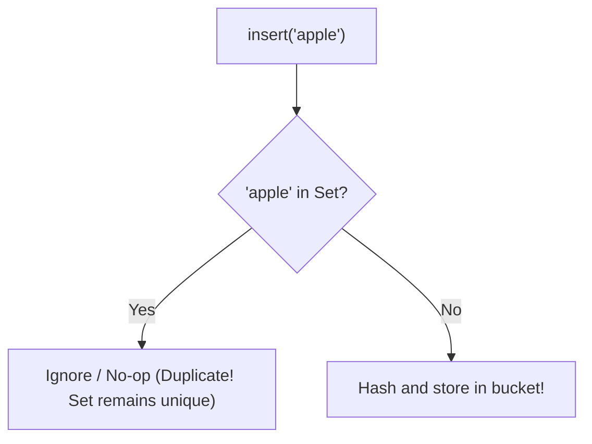
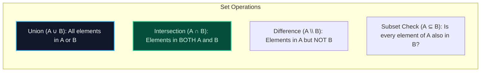

import { Callout } from "fumadocs-ui/components/callout";
import { Tabs, Tab } from "fumadocs-ui/components/tabs";
import { Steps, Step } from "fumadocs-ui/components/steps";
import { Cards, Card } from "fumadocs-ui/components/card";

## The Distinct-Element Collection

A **Hash Set** stores a collection of unique, distinct elements. Unlike arrays which allow duplicates and preserve positional order, a Hash Set:

1. Enforces strict uniqueness: duplicate insertions are silently ignored or rejected.
2. Unlocks instant **$\mathcal{O}(1)$ membership testing** (`contains(x)` / `x in set`).
3. Under the hood, is physically implemented as a **Hash Map where every key maps to a dummy singleton value** (e.g. `std::unordered_set`, Java `HashSet`).



---

## Fundamental Set-Theoretic Operations

Given two sets $A$ and $B$:



### Algorithmic Complexities of Set Operations

| Operation                   | Mathematical Notation | Time Complexity           | Auxiliary Space  |
| :-------------------------- | :-------------------- | :------------------------ | :--------------- | --- | ---------------- | --- | ------------------ | --- | --- | --- | --- |
| **Add / Remove / Contains** | $x \in A$             | $\mathcal{O}(1)$ expected | $\mathcal{O}(1)$ |
| **Union**                   | $A \cup B$            | $\mathcal{O}(             | A                | +   | B                | )$  | $\mathcal{O}(      | A   | +   | B   | )$  |
| **Intersection**            | $A \cap B$            | $\mathcal{O}(\min(        | A                | ,   | B                | ))$ | $\mathcal{O}(\min( | A   | ,   | B   | ))$ |
| **Difference**              | $A \setminus B$       | $\mathcal{O}(             | A                | )$  | $\mathcal{O}(    | A   | )$                 |
| **Subset Check**            | $A \subseteq B$       | $\mathcal{O}(             | A                | )$  | $\mathcal{O}(1)$ |

<Callout type="tip" title="Intersection Optimization Trick">
  To compute $A \cap B$ in minimum time: Always iterate through the **smaller
  set** and check membership inside the larger set! $$ \text{Time} = \mathcal{O}
  (\min(|A|, |B|)) $$
</Callout>

---

## Polyglot Implementations

<Tabs items={["C++", "TypeScript", "Python"]}>
  <Tab value="C++">
```cpp
#include <iostream>
#include <unordered_set>
#include <vector>

// Set intersection helper
std::unordered_set<int> intersectSets(const std::unordered_set<int>& A, const std::unordered_set<int>& B) {
const auto& smaller = (A.size() < B.size()) ? A : B;
const auto& larger = (A.size() < B.size()) ? B : A;
std::unordered_set<int> result;

    for (int x : smaller) {
        if (larger.count(x)) {
            result.insert(x);
        }
    }
    return result;

}

int main() {
std::unordered_set<int> s = {1, 2, 3};
s.insert(2); // Duplicate ignored: size remains 3
std::cout << "Contains 2? " << s.count(2) << "\n";
return 0;
}

````
  </Tab>
  <Tab value="TypeScript">
```typescript
const setA = new Set<number>([1, 2, 3, 4]);
const setB = new Set<number>([3, 4, 5, 6]);

// Set Union: A ∪ B
const union = new Set([...setA, ...setB]);

// Set Intersection: A ∩ B
const intersection = new Set([...setA].filter((x) => setB.has(x)));

// Set Difference: A \ B
const difference = new Set([...setA].filter((x) => !setB.has(x)));

console.log("Union:", [...union]);
console.log("Intersection:", [...intersection]);
console.log("Difference:", [...difference]);
````

  </Tab>
  <Tab value="Python">
```python
set_a = {1, 2, 3, 4}
set_b = {3, 4, 5, 6}

# Fast C-level set operators in Python

union = set_a | set_b
intersection = set_a & set_b
difference = set_a - set_b
symmetric_diff = set_a ^ set_b

print("Union:", union)
print("Intersection:", intersection)
print("Difference:", difference)
print("Is subset:", {3, 4}.issubset(set_a))

```
  </Tab>
</Tabs>
```
