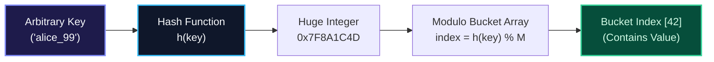

import { Callout } from "fumadocs-ui/components/callout";
import { Tabs, Tab } from "fumadocs-ui/components/tabs";
import { Steps, Step } from "fumadocs-ui/components/steps";
import { Cards, Card } from "fumadocs-ui/components/card";

## The Associative Constant-Time Breakthrough

How can a program retrieve arbitrary information associated with a complex string, user object, or 128-bit identifier in instantaneous $\mathcal{O}(1)$ time?

While arrays require dense numeric indices $[0, N-1]$, **Hash-Based Data Structures** bridge the chasm between infinite key universes and bounded memory buffers. By routing arbitrary keys through mathematical compression functions (**Hash Functions**), associative maps and sets achieve expected constant-time performance across insertions, deletions, and queries.

---

## Architectural Comparison Matrix

| Component / Technique   | Primary Mechanism             | Collision Strategy          | Cache Locality          | Typical Load Factor ($\alpha$) |
| :---------------------- | :---------------------------- | :-------------------------- | :---------------------- | :----------------------------- |
| **Direct Access Table** | Direct numeric indexing       | None (Universe bounded)     | High (Contiguous)       | Poor if sparse ($K \gg N$)     |
| **Separate Chaining**   | Array of linked lists / trees | External node chains        | Low (Pointer chasing)   | $\alpha \approx 0.75 - 1.0$    |
| **Open Addressing**     | Probing within array          | Linear/Quadratic/Robin Hood | High (Contiguous scans) | $\alpha \le 0.5 - 0.7$         |
| **Hash Map**            | Key-Value associative store   | Chaining or Probing         | Engine-dependent        | Resizes at threshold           |
| **Hash Set**            | Value-only distinct store     | Backed by Hash Map          | Engine-dependent        | Resizes at threshold           |

---

## Stage 1.5 Curriculum Modules

Explore the dedicated modules in this section:

<Cards>
  <Card
    title="1.5.1 Direct Access Tables"
    href="/docs/dsa/01-beginner/hash-based-data-structures/direct-access-tables"
    description="Array-indexed mapping over bounded key universes, trade-offs between memory footprint and access speed."
  />
  <Card
    title="1.5.2 Hash Functions"
    href="/docs/dsa/01-beginner/hash-based-data-structures/hash-functions"
    description="Uniform distribution, avalanche effect, polynomial rolling hashes, MurmurHash3, SipHash, and HashDoS defense."
  />
  <Card
    title="1.5.3 Collision Resolution via Separate Chaining"
    href="/docs/dsa/01-beginner/hash-based-data-structures/collision-resolution-chaining"
    description="Linked list and balanced tree bucket architectures, expected chain length, and load factor thresholding."
  />
  <Card
    title="1.5.4 Collision Resolution via Open Addressing"
    href="/docs/dsa/01-beginner/hash-based-data-structures/collision-resolution-open-addressing"
    description="Linear probing, quadratic probing, double hashing, Robin Hood hashing, and tombstone deletion markers."
  />
  <Card
    title="1.5.5 Hash Maps"
    href="/docs/dsa/01-beginner/hash-based-data-structures/hash-maps"
    description="Key-value mapping, dynamic rehashing, resizing thresholds, amortized O(1) performance guarantees."
  />
  <Card
    title="1.5.6 Hash Sets"
    href="/docs/dsa/01-beginner/hash-based-data-structures/hash-sets"
    description="Distinct item storage, fast membership testing, union, intersection, set difference, and subset checking."
  />
</Cards>
