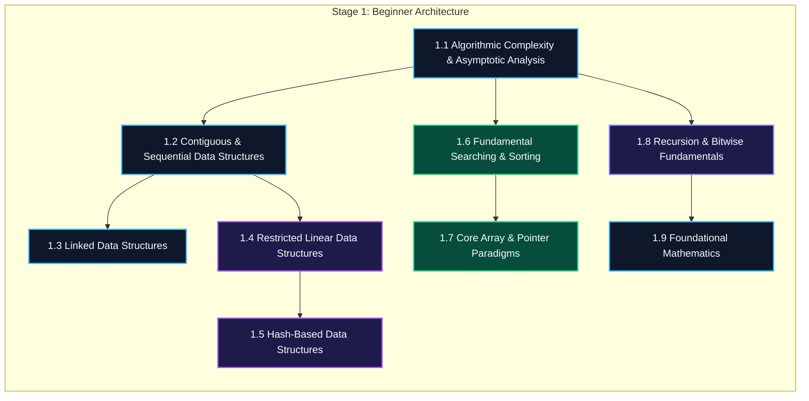
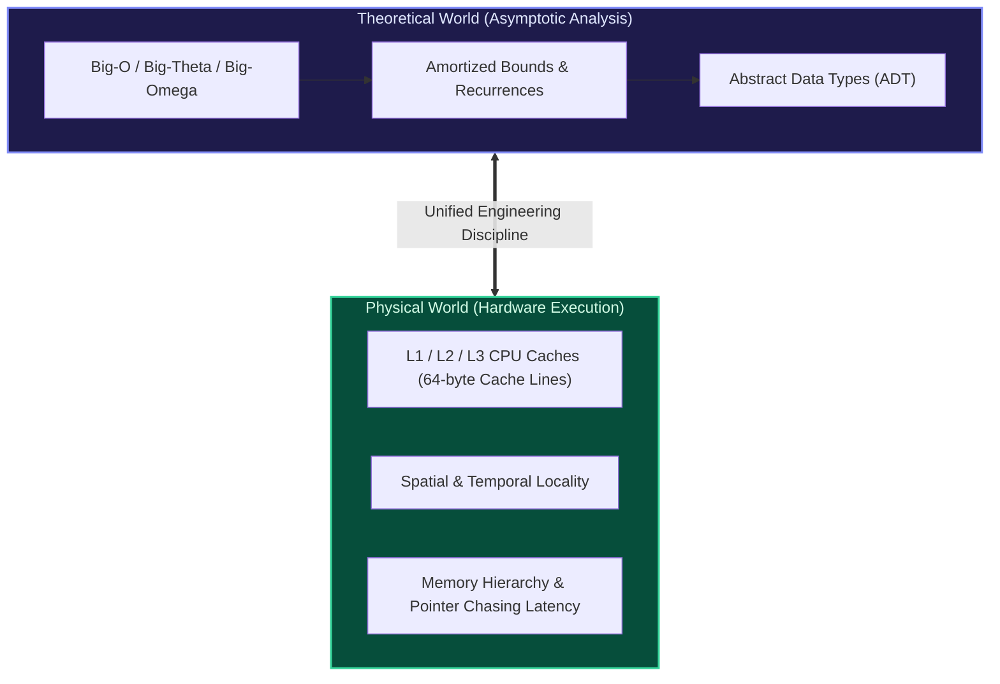

import { Callout } from "fumadocs-ui/components/callout";
import { Tabs, Tab } from "fumadocs-ui/components/tabs";
import { Steps, Step } from "fumadocs-ui/components/steps";
import { Cards, Card } from "fumadocs-ui/components/card";

## The Architectural Foundation of Computation

Welcome to **Stage 1 (Beginner)** of the Master Hierarchical Curriculum. This stage equips software engineers with mechanical sympathy, rigorous computational complexity analysis, linear data structures, classical sorting and searching algorithms, essential pointer paradigms, and number theory fundamentals.

---

## Silicon Reality: Math Meets Physics

Every algorithm executed in software eventually manifests as electrical signals flowing through physical silicon. While traditional curricula introduce data structures purely as abstract theoretical entities, modern high-performance engineering demands a unified perspective: **asymptotic time complexity coupled with physical hardware mechanics**.

A theoretical $\mathcal{O}(N)$ traversal of a linked list can run **10x to 50x slower** than an $\mathcal{O}(N)$ traversal of a contiguous dynamic array of identical size. Why? Because traversing an array exploits the CPU hardware prefetcher streaming 64-byte cache lines into 1-cycle L1 cache, whereas pointer-chasing in linked lists induces constant DRAM cache misses costing upwards of 100 to 200 CPU cycles each.

---

## Track Curriculum Modules

Explore the 9 foundational modules:

<Cards>
  <Card
    title="1.1 Algorithmic Complexity & Asymptotic Analysis"
    href="/docs/dsa/01-beginner/algorithmic-complexity-and-asymptotic-analysis"
    description="Time complexity, space bounds, Big-O/Theta/Omega notations, amortized potential methods, and recurrence relations."
  />
  <Card
    title="1.2 Contiguous and Sequential Data Structures"
    href="/docs/dsa/01-beginner/contiguous-and-sequential-data-structures"
    description="Static arrays, geometric dynamic vectors, multidimensional matrices, row/col-major layouts, and character strings."
  />
  <Card
    title="1.3 Linked Data Structures"
    href="/docs/dsa/01-beginner/linked-data-structures"
    description="Singly linked lists, bidirectional doubly linked chains, circular rings, sentinels, and pointer reversal."
  />
  <Card
    title="1.4 Restricted Linear Data Structures"
    href="/docs/dsa/01-beginner/restricted-linear-data-structures"
    description="LIFO stacks, FIFO circular queue ring buffers, double-ended deques, and expression parsing."
  />
  <Card
    title="1.5 Hash-Based Data Structures"
    href="/docs/dsa/01-beginner/hash-based-data-structures"
    description="Direct access tables, SipHash/MurmurHash functions, separate chaining, open addressing, hash maps, and sets."
  />
  <Card
    title="1.6 Fundamental Searching and Sorting"
    href="/docs/dsa/01-beginner/fundamental-searching-and-sorting"
    description="Linear search, binary search, bisection bounds, insertion/selection/merge/quick sort, counting sort, radix sort, and comparators."
  />
  <Card
    title="1.7 Core Array and Pointer Paradigms"
    href="/docs/dsa/01-beginner/core-array-and-pointer-paradigms"
    description="Simulation, two pointers, Floyd's cycle detection, fixed/variable sliding windows, 1D/2D prefix sums, and difference arrays."
  />
  <Card
    title="1.8 Recursion and Bitwise Fundamentals"
    href="/docs/dsa/01-beginner/recursion-and-bitwise-fundamentals"
    description="Linear and tail recursion, TCO, divide and conquer decompositions, bitwise operators, and bitmask sets."
  />
  <Card
    title="1.9 Foundational Mathematics"
    href="/docs/dsa/01-beginner/foundational-mathematics"
    description="Integer divisibility, Euclidean algorithm, LCM, Sieve of Eratosthenes, linear Euler sieve, and trial division."
  />
</Cards>

---

## Engineering Lab & Reference

<Cards>
  <Card
    title="Capstone: Browser History & Undo Engine"
    href="/docs/dsa/01-beginner/capstone-browser-history-and-undo-engine"
    description="Build an industrial-grade browser navigation stack and transactional multi-level undo/redo engine."
  />
  <Card
    title="Stage 1 Quick Reference"
    href="/docs/dsa/01-beginner/quick-reference"
    description="Asymptotic complexity cheat sheet, formula reference card, and hardware access rules."
  />
</Cards>
