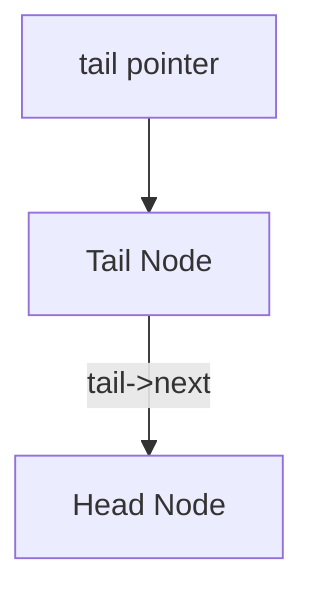

import { Callout } from "fumadocs-ui/components/callout";
import { Tabs, Tab } from "fumadocs-ui/components/tabs";
import { Steps, Step } from "fumadocs-ui/components/steps";
import { Cards, Card } from "fumadocs-ui/components/card";

## The Closed-Ring Topology

In a standard linked list, traversal terminates when a pointer points to `nullptr`.

A **Circular Linked List (CLL)** closes the loop: the `next` pointer of the final (tail) node points directly back to the `head` node, forming an infinite cyclic ring.


### Architectural Traversal Invariant

Because the list has no null terminator, a standard `while (curr != nullptr)` loop creates an **infinite loop**. Traversal requires either:

1. Stopping when `curr->next == head` (do-while loop).
2. Counting iterations up to known size $N$.

---

## The Single-Tail-Pointer Design

Counter-intuitively, the most efficient way to maintain a circular singly linked list is by holding a reference to **`tail` only**, rather than `head`:



From just the `tail` pointer:

- The head is accessible in $\mathcal{O}(1)$ time via `tail->next`.
- The tail is accessible in $\mathcal{O}(1)$ time directly (`tail`).
- Inserting at the front or the back takes $\mathcal{O}(1)$ time!

```cpp
// Insert at end in O(1) time using only tail pointer
void insertEnd(int val) {
    Node* newNode = new Node(val);
    if (!tail) {
        tail = newNode;
        tail->next = tail;
    } else {
        newNode->next = tail->next; // point new node to head
        tail->next = newNode;       // old tail points to new node
        tail = newNode;             // update tail pointer
    }
}
```

---

## Systems Applications: Round-Robin Scheduling

Circular linked lists model physical cyclic processes:

1. **Operating System Schedulers:** Allocating CPU timeslices round-robin to runnable threads. When a thread's quantum expires, the scheduler advances to `curr->next`.
2. **Audio/Video Playback Loops:** Continuously cycling through a music playlist.
3. **Multiplayer Turn Management:** Seamlessly passing turn priority in digital board games from player $P_k$ back to $P_0$.

---

## Split and Merge Operations

### Splitting a Circular List into Two Equal Halves

Using Floyd's slow and fast pointer technique:

1. Advance `slow` by 1 step and `fast` by 2 steps until `fast->next == head` or `fast->next->next == head`.
2. Split:
   - Head of second half = `slow->next`.
   - `slow->next = head` (closes first half).
   - Find end of second half and close loop to `second_head`.

---

## Polyglot Implementation

<Tabs items={["C++", "TypeScript", "Python"]}>
  <Tab value="C++">
```cpp
#include <iostream>

struct Node {
int val;
Node\* next;
Node(int v) : val(v), next(nullptr) {}
};

class CircularList {
private:
Node\* tail;

public:
CircularList() : tail(nullptr) {}

    void append(int val) {
        Node* node = new Node(val);
        if (!tail) {
            node->next = node;
            tail = node;
        } else {
            node->next = tail->next;
            tail->next = node;
            tail = node;
        }
    }

    void print() const {
        if (!tail) return;
        Node* curr = tail->next; // start at head
        do {
            std::cout << curr->val << " -> ";
            curr = curr->next;
        } while (curr != tail->next);
        std::cout << "(circular head)\n";
    }

};

````
  </Tab>
  <Tab value="TypeScript">
```typescript
class CNode<T> {
  val: T;
  next: CNode<T> | null = null;
  constructor(val: T) {
    this.val = val;
  }
}

export class CircularLinkedList<T> {
  private tail: CNode<T> | null = null;

  public append(val: T): void {
    const node = new CNode(val);
    if (!this.tail) {
      node.next = node;
      this.tail = node;
    } else {
      node.next = this.tail.next;
      this.tail.next = node;
      this.tail = node;
    }
  }

  public getHead(): CNode<T> | null {
    return this.tail ? this.tail.next : null;
  }
}
````

  </Tab>
  <Tab value="Python">
```python
class CNode:
    def __init__(self, val):
        self.val = val
        self.next = None

class CircularLinkedList:
def **init**(self):
self.tail = None

    def append(self, val):
        node = CNode(val)
        if not self.tail:
            node.next = node
            self.tail = node
        else:
            node.next = self.tail.next
            self.tail.next = node
            self.tail = node

    def display(self):
        if not self.tail:
            return []
        res = []
        curr = self.tail.next
        while True:
            res.append(curr.val)
            curr = curr.next
            if curr == self.tail.next:
                break
        return res

```
  </Tab>
</Tabs>
```
