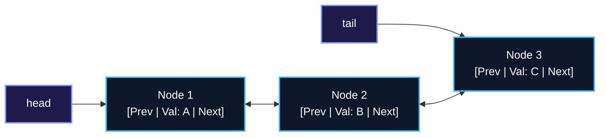
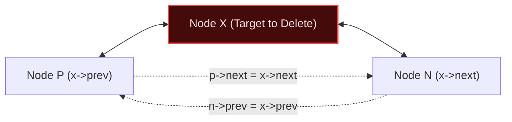
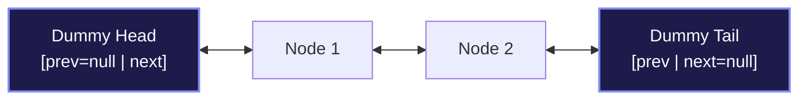

import { Callout } from "fumadocs-ui/components/callout";
import { Tabs, Tab } from "fumadocs-ui/components/tabs";
import { Steps, Step } from "fumadocs-ui/components/steps";
import { Cards, Card } from "fumadocs-ui/components/card";

## Bidirectional Node Anatomy

A **Doubly Linked List (DLL)** enriches each node with two distinct pointer references:

1. `next`: Points forward to the successor node.
2. `prev`: Points backward to the predecessor node.



### The Spatial Trade-Off

- **Memory Cost:** On a 64-bit architecture, each node requires two 8-byte pointers (16 bytes total of pointer overhead per element), doubling pointer consumption compared to singly linked lists.
- **Architectural Advantage:** Enables bidirectional traversal (forward and reverse iteration) and unlocks **strict $\mathcal{O}(1)$ arbitrary node deletion**.

---

## Arbitrary Node Deletion in $\mathcal{O}(1)$

In a singly linked list, even if you hold a direct pointer to node $X$, deleting $X$ requires finding $X$'s predecessor node, forcing an $\mathcal{O}(N)$ scan from `head`.

In a doubly linked list, because node $X$ directly references $X\text{->prev}$, deletion requires zero traversal:



```cpp
// O(1) in-place deletion given node pointer x
void removeNode(Node* x) {
    x->prev->next = x->next;
    x->next->prev = x->prev;
    delete x;
}
```

This capability makes doubly linked lists the fundamental building block for **LRU (Least Recently Used) Caches**, where elements are continuously moved between arbitrary positions and the head/tail.

---

## The Two-Sentinel Boundary Architecture

Production implementations (like Java's `LinkedList` and the Linux Kernel's `list_head`) use paired **Dummy Head and Dummy Tail** sentinels to permanently anchor list boundaries:



Because `head->next` and `tail->prev` always point to valid nodes, null-checks are completely eliminated from `insertFront`, `insertBack`, and `remove`.

---

## Polyglot Implementation

<Tabs items={["C++", "TypeScript", "Python"]}>
  <Tab value="C++">
```cpp
#include <iostream>

template <typename T>
class DoublyLinkedList {
private:
struct Node {
T val;
Node* prev;
Node* next;
Node(T v = T()) : val(v), prev(nullptr), next(nullptr) {}
};

    Node* headSentinel;
    Node* tailSentinel;
    size_t count;

public:
DoublyLinkedList() : count(0) {
headSentinel = new Node();
tailSentinel = new Node();
headSentinel->next = tailSentinel;
tailSentinel->prev = headSentinel;
}

    ~DoublyLinkedList() {
        Node* curr = headSentinel;
        while (curr) {
            Node* next = curr->next;
            delete curr;
            curr = next;
        }
    }

    void push_front(const T& val) {
        Node* node = new Node(val);
        node->next = headSentinel->next;
        node->prev = headSentinel;
        headSentinel->next->prev = node;
        headSentinel->next = node;
        count++;
    }

    void remove(Node* node) {
        if (!node || node == headSentinel || node == tailSentinel) return;
        node->prev->next = node->next;
        node->next->prev = node->prev;
        delete node;
        count--;
    }

    size_t size() const { return count; }

};

````
  </Tab>
  <Tab value="TypeScript">
```typescript
class DListNode<T> {
  val: T;
  prev: DListNode<T> | null = null;
  next: DListNode<T> | null = null;
  constructor(val: T) {
    this.val = val;
  }
}

export class DoublyLinkedList<T> {
  private headSentinel: DListNode<T>;
  private tailSentinel: DListNode<T>;
  private count = 0;

  constructor() {
    this.headSentinel = new DListNode<T>(null as any);
    this.tailSentinel = new DListNode<T>(null as any);
    this.headSentinel.next = this.tailSentinel;
    this.tailSentinel.prev = this.headSentinel;
  }

  public pushFront(val: T): DListNode<T> {
    const node = new DListNode(val);
    node.next = this.headSentinel.next;
    node.prev = this.headSentinel;
    this.headSentinel.next!.prev = node;
    this.headSentinel.next = node;
    this.count++;
    return node;
  }

  public remove(node: DListNode<T>): void {
    if (node === this.headSentinel || node === this.tailSentinel) return;
    node.prev!.next = node.next;
    node.next!.prev = node.prev;
    this.count--;
  }
}
````

  </Tab>
  <Tab value="Python">
```python
class DListNode:
    def __init__(self, val=0):
        self.val = val
        self.prev = None
        self.next = None

class DoublyLinkedList:
def **init**(self):
self.head = DListNode(None)
self.tail = DListNode(None)
self.head.next = self.tail
self.tail.prev = self.head
self.size = 0

    def push_front(self, val):
        node = DListNode(val)
        node.next = self.head.next
        node.prev = self.head
        self.head.next.prev = node
        self.head.next = node
        self.size += 1
        return node

    def remove(self, node):
        if node in (self.head, self.tail):
            return
        node.prev.next = node.next
        node.next.prev = node.prev
        self.size -= 1

```
  </Tab>
</Tabs>
```
