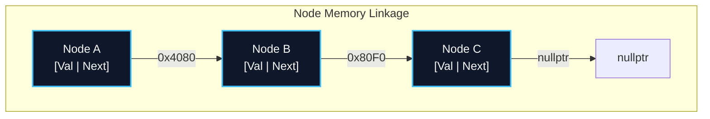

import { Callout } from "fumadocs-ui/components/callout";
import { Tabs, Tab } from "fumadocs-ui/components/tabs";
import { Steps, Step } from "fumadocs-ui/components/steps";
import { Cards, Card } from "fumadocs-ui/components/card";

## The Non-Contiguous Memory Paradigm

Unlike arrays that demand unbroken slabs of physical memory, **Linked Data Structures** embrace memory fragmentation. Each data item is bundled into an independent heap-allocated container called a **Node**, alongside one or more memory pointers that establish forward, backward, or circular links.

This dynamic trade-off provides:

1. **True $\mathcal{O}(1)$ Structural Insertions and Deletions:** Splicing a new node into the list requires merely updating pointer addresses, with zero shifting of neighbor elements.
2. **Infinite Elasticity:** Growth occurs node-by-node without massive block copying or reallocation spikes.
3. **Cache Trade-off:** Nodes scatter across the heap, eliminating spatial locality and incurring pointer chases that trigger CPU cache misses.

---

## Architectural Comparison Matrix

| Structure                | Forward Pointer | Backward Pointer | Tail Points To | Typical Insertion / Deletion                 | Ideal Systems Use Case                  |
| :----------------------- | :-------------- | :--------------- | :------------- | :------------------------------------------- | :-------------------------------------- |
| **Singly Linked List**   | Yes (`next`)    | No               | `nullptr`      | $\mathcal{O}(1)$ at head / after known node  | Memory-constrained stacks, hash buckets |
| **Doubly Linked List**   | Yes (`next`)    | Yes (`prev`)     | `nullptr`      | $\mathcal{O}(1)$ anywhere given node pointer | LRU caches, browser history engines     |
| **Circular Linked List** | Yes (`next`)    | Optional         | Head node      | $\mathcal{O}(1)$ around ring                 | CPU round-robin scheduling, audio loops |

---

## Stage 1.3 Curriculum Modules

Explore the dedicated modules in this section:

<Cards>
  <Card
    title="1.3.1 Singly Linked Lists"
    href="/docs/dsa/01-beginner/linked-data-structures/singly-linked-lists"
    description="Forward pointer manipulation, iterative and recursive list reversal, sentinel head nodes, and merge point detection."
  />
  <Card
    title="1.3.2 Doubly Linked Lists"
    href="/docs/dsa/01-beginner/linked-data-structures/doubly-linked-lists"
    description="Bidirectional traversal, O(1) arbitrary node deletion, and sentinel head/tail boundary management."
  />
  <Card
    title="1.3.3 Circular Linked Lists"
    href="/docs/dsa/01-beginner/linked-data-structures/circular-linked-lists"
    description="Ring topologies, tail-to-head cycles, split and merge operations, and round-robin queues."
  />
</Cards>
