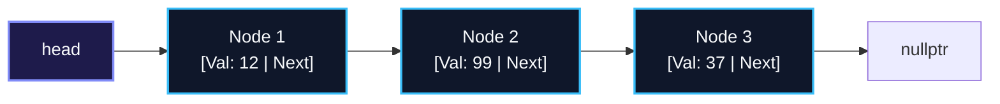
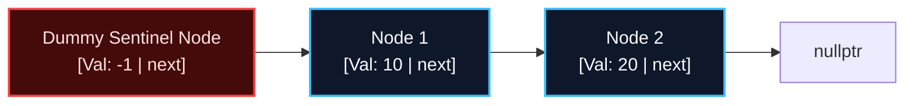
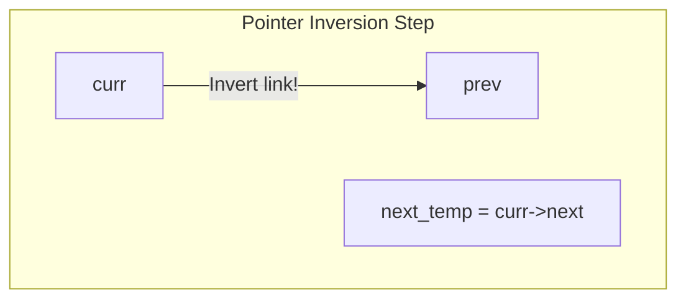
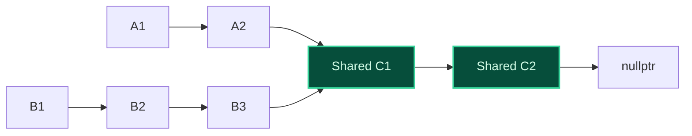

import { Callout } from "fumadocs-ui/components/callout";
import { Tabs, Tab } from "fumadocs-ui/components/tabs";
import { Steps, Step } from "fumadocs-ui/components/steps";
import { Cards, Card } from "fumadocs-ui/components/card";

## Anatomical Structure: Nodes & Forward Pointers

A **Singly Linked List** is a fundamental linear data structure consisting of self-contained heap-allocated blocks called **Nodes**. Each node packages two distinct fields:

1. **Data Payload:** The underlying element value (e.g., integer, object, string).
2. **Next Pointer:** A raw memory address pointing strictly forward to the subsequent node in the chain (or `nullptr` if terminating the list).



Because nodes are connected exclusively through unidirectional pointers:

- Traversal can only proceed in the forward direction.
- Finding the $k$-th element requires sequential traversal across $k$ pointers in $\mathcal{O}(k)$ time.
- Inserting a node immediately after a known node requires updating exactly two pointers in strictly $\mathcal{O}(1)$ time.

---

## The Sentinel (Dummy) Head Node Pattern

Edge cases in linked list manipulation frequently corrupt code with dozens of nested `if (head == nullptr)` checks.

The **Sentinel Head Node** pattern eliminates all edge cases by allocating an immortal placeholder node at the front of the list whose `val` is never read, but whose `next` pointer safely anchors the true list:



<Callout type="tip" title="Why Sentinels Prevent Bugs">
  Without a dummy node, inserting at the head requires reassigning the external `head` variable. With a dummy node, inserting at the true beginning is identical to inserting between two arbitrary nodes: `dummy->next = new_node; new_node->next = first_node`.
</Callout>

---

## In-Place Iterative List Reversal

Reversing a singly linked list in-place without allocating auxiliary nodes is an essential foundational algorithm. It requires maintaining three tracking pointers: `prev`, `curr`, and `next_temp`.



### Invariants:

1. `prev` points to the head of the already-reversed prefix.
2. `curr` points to the active node whose pointer is currently being inverted.
3. `next_temp` safely preserves the rest of the unreversed list before `curr->next` is overwritten.

---

## Merge Point Detection (Intersection of Two Lists)

Given two singly linked lists that merge into a shared Y-shaped stem:



### Two-Pointer Offset Equivalence Technique

Let length of List A be $L_A$ and List B be $L_B$:

- Initialize `ptrA = headA` and `ptrB = headB`.
- When `ptrA` reaches the end of List A, redirect it to `headB`.
- When `ptrB` reaches the end of List B, redirect it to `headA`.
- Both pointers travel exactly $L_A + L_B$ steps. Because distances equalize, they collide precisely at the intersection node $C1$ in $\mathcal{O}(L_A + L_B)$ time and $\mathcal{O}(1)$ space!

---

## Polyglot Implementations

<Tabs items={["C++", "TypeScript", "Python"]}>
  <Tab value="C++">
```cpp
#include <iostream>

struct ListNode {
int val;
ListNode\* next;
ListNode(int x) : val(x), next(nullptr) {}
};

// In-place iterative list reversal: O(N) time, O(1) space
ListNode* reverseList(ListNode* head) {
ListNode* prev = nullptr;
ListNode* curr = head;
while (curr != nullptr) {
ListNode\* nextTemp = curr->next;
curr->next = prev;
prev = curr;
curr = nextTemp;
}
return prev;
}

// Find merge intersection node of two lists: O(M + N) time, O(1) space
ListNode* getIntersectionNode(ListNode* headA, ListNode* headB) {
if (!headA || !headB) return nullptr;
ListNode* pA = headA;
ListNode\* pB = headB;
while (pA != pB) {
pA = (pA == nullptr) ? headB : pA->next;
pB = (pB == nullptr) ? headA : pB->next;
}
return pA;
}

````
  </Tab>
  <Tab value="TypeScript">
```typescript
export class ListNode<T> {
  val: T;
  next: ListNode<T> | null = null;
  constructor(val: T, next: ListNode<T> | null = null) {
    this.val = val;
    this.next = next;
  }
}

export function reverseList<T>(head: ListNode<T> | null): ListNode<T> | null {
  let prev: ListNode<T> | null = null;
  let curr: ListNode<T> | null = head;

  while (curr !== null) {
    const nextTemp: ListNode<T> | null = curr.next;
    curr.next = prev;
    prev = curr;
    curr = nextTemp;
  }

  return prev;
}
````

  </Tab>
  <Tab value="Python">
```python
class ListNode:
    def __init__(self, val=0, next=None):
        self.val = val
        self.next = next

def reverse_list(head: ListNode | None) -> ListNode | None:
prev = None
curr = head
while curr:
next_temp = curr.next
curr.next = prev
prev = curr
curr = next_temp
return prev

def get_intersection_node(headA: ListNode | None, headB: ListNode | None) -> ListNode | None:
pA, pB = headA, headB
while pA != pB:
pA = headB if pA is None else pA.next
pB = headA if pB is None else pB.next
return pA

```
  </Tab>
</Tabs>
```
