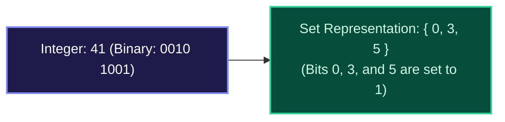
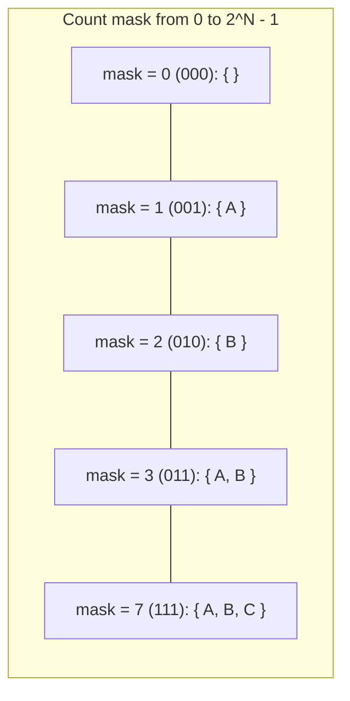

import { Callout } from "fumadocs-ui/components/callout";
import { Tabs, Tab } from "fumadocs-ui/components/tabs";
import { Steps, Step } from "fumadocs-ui/components/steps";
import { Cards, Card } from "fumadocs-ui/components/card";

## Integers as Compact Boolean Sets

For small universes containing up to 32 or 64 distinct elements (such as graph vertices $V \le 20$ in NP-hard problems), a standard integer can represent an entire **set of elements**:

- The $i$-th bit of integer `mask` is `1` if element $i$ belongs to the set, and `0` otherwise.



---

## Single-Instruction Set Operations

Because CPU hardware executes bitwise operations across all 64 bits simultaneously, standard mathematical set operations run in **strictly 1 clock cycle ($\mathcal{O}(1)$ time)**:

| Set Operation             | Mathematical Formula   | Bitwise Code             |
| :------------------------ | :--------------------- | :----------------------- |
| **Empty Set**             | $\emptyset$            | `0`                      |
| **Full Set of $N$ items** | $\{0, 1, \dots, N-1\}$ | `(1 << N) - 1`           |
| **Add Element $i$**       | $S \cup \{i\}$         | `mask \| (1 << i)`       |
| **Remove Element $i$**    | $S \setminus \{i\}$    | `mask & ~(1 << i)`       |
| **Test Membership**       | $i \in S$              | `(mask & (1 << i)) != 0` |
| **Toggle Element $i$**    | $S \Delta \{i\}$       | `mask ^ (1 << i)`        |
| **Set Union**             | $A \cup B$             | `A \| B`                 |
| **Set Intersection**      | $A \cap B$             | `A & B`                  |
| **Set Difference**        | $A \setminus B$        | `A & (~B)`               |

---

## Generating All Subsets (The Power Set in $\mathcal{O}(2^N)$)

An array of size $N$ has exactly $2^N$ distinct subsets. By counting an integer `mask` from $0$ up to $2^N - 1$, we can enumerate every single subset cleanly without recursion:



---

## Polyglot Implementations

<Tabs items={["C++ (Subsets Enumerator)", "TypeScript", "Python"]}>
  <Tab value="C++ (Subsets Enumerator)">
```cpp
#include <iostream>
#include <vector>

// Enumerate all 2^N subsets using bitmasks
void printAllSubsets(const std::vector<char>& items) {
int n = items.size();
int totalSubsets = 1 << n; // 2^n

    for (int mask = 0; mask < totalSubsets; ++mask) {
        std::cout << "{ ";
        for (int i = 0; i < n; ++i) {
            if (mask & (1 << i)) {
                std::cout << items[i] << " ";
            }
        }
        std::cout << "}\n";
    }

}

int main() {
std::vector<char> items = {'A', 'B', 'C'};
printAllSubsets(items);
return 0;
}

````
  </Tab>
  <Tab value="TypeScript">
```typescript
export function getSubsets<T>(items: T[]): T[][] {
  const n = items.length;
  const total = 1 << n; // 2^n
  const results: T[][] = [];

  for (let mask = 0; mask < total; mask++) {
    const subset: T[] = [];
    for (let i = 0; i < n; i++) {
      if ((mask & (1 << i)) !== 0) {
        subset.push(items[i]);
      }
    }
    results.push(subset);
  }
  return results;
}

console.log("Subsets of ['x', 'y']:", getSubsets(["x", "y"]));
````

  </Tab>
  <Tab value="Python">
```python
def generate_subsets(items: list) -> list[list]:
    """Generates all 2^N subsets using integer bitmasks."""
    n = len(items)
    subsets = []
    for mask in range(1 << n):
        subset = [items[i] for i in range(n) if (mask & (1 << i))]
        subsets.append(subset)
    return subsets

print(generate_subsets([1, 2, 3]))

```
  </Tab>
</Tabs>
```
