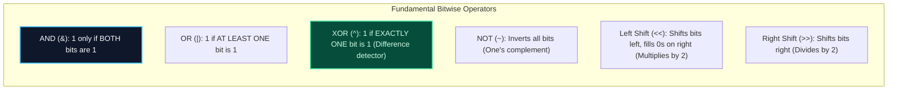
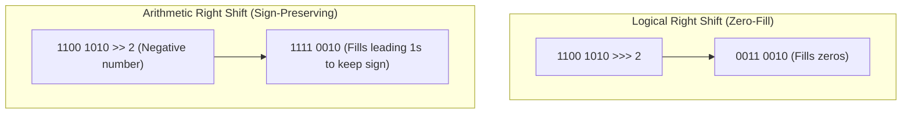

import { Callout } from "fumadocs-ui/components/callout";
import { Tabs, Tab } from "fumadocs-ui/components/tabs";
import { Steps, Step } from "fumadocs-ui/components/steps";
import { Cards, Card } from "fumadocs-ui/components/card";

## Hardware-Level Boolean ALU Primitives

Modern microprocessors store all data as binary digits (**bits**), where each transistor represents a `0` (low voltage) or `1` (high voltage).

**Bitwise Operators** manipulate these binary bits in parallel across entire 32-bit or 64-bit integer registers in a **single CPU clock cycle**.



---

## Arithmetic vs. Logical Right Shift

When shifting an integer rightward by $k$ bits:

- **Logical Right Shift (`>>>` in TS/Java):** Always shifts in `0` bits on the far left. Used for unsigned integers.
- **Arithmetic Right Shift (`>>` in C++/Python/Java):** Copies the **sign bit** (the most significant bit) into the new positions, preserving the negative sign for two's complement numbers!



---

## Essential Bit Manipulation Idioms

These micro-optimizations form the basis of competitive programming and systems algorithms:

| Idiom                      | Code                          | What It Does                                                                    |
| :------------------------- | :---------------------------- | :------------------------------------------------------------------------------ |
| **Check Odd / Even**       | `(n & 1) == 1`                | Checks if lowest bit is set (much faster than `n % 2`)                          |
| **Check if Power of 2**    | `n > 0 && (n & (n - 1)) == 0` | Powers of 2 have exactly one `1` bit; `n - 1` flips all trailing bits           |
| **Clear Lowest Set Bit**   | `n & (n - 1)`                 | Brian Kernighan's bit-counting trick; clears the rightmost `1` bit              |
| **Extract Lowest Set Bit** | `n & (-n)`                    | Isolates the lowest set bit as a single power-of-2 integer (Fenwick tree basis) |
| **Toggle $i$-th Bit**      | `n ^ (1 << i)`                | Flips the bit at position $i$ ($0 \to 1$ or $1 \to 0$)                          |
| **Swap Without Temp**      | `a ^= b; b ^= a; a ^= b;`     | Swaps two variables using XOR cancellation properties                           |

---

## Polyglot Implementations

<Tabs items={["C++", "TypeScript", "Python"]}>
  <Tab value="C++">
```cpp
#include <iostream>

// Brian Kernighan's Algorithm to count set bits: O(number of 1-bits)
int countSetBits(int n) {
int count = 0;
while (n > 0) {
n = n & (n - 1); // Clears the lowest set bit!
count++;
}
return count;
}

int main() {
int x = 29; // Binary: 0001 1101 (four 1-bits)
std::cout << "Set bits in 29: " << countSetBits(x) << "\n";
std::cout << "Is 32 power of 2: " << ((32 > 0 && (32 & (32 - 1)) == 0) ? "true" : "false") << "\n";
std::cout << "Lowest set bit of 12 (1100): " << (12 & (-12)) << "\n"; // 4 (0100)
return 0;
}

````
  </Tab>
  <Tab value="TypeScript">
```typescript
export function isPowerOfTwo(n: number): boolean {
  return n > 0 && (n & (n - 1)) === 0;
}

export function getLowestSetBit(n: number): number {
  return n & -n;
}

console.log("Is 16 a power of 2:", isPowerOfTwo(16)); // true
console.log("Is 18 a power of 2:", isPowerOfTwo(18)); // false
console.log("Lowest set bit of 20 (10100):", getLowestSetBit(20)); // 4 (00100)
````

  </Tab>
  <Tab value="Python">
```python
def single_number(nums: list[int]) -> int:
    """Finds element that appears once where every other element appears twice."""
    xor_acc = 0
    for x in nums:
        xor_acc ^= x # x ^ x = 0, so duplicates cancel completely!
    return xor_acc

print("Single number:", single_number([4, 1, 2, 1, 2])) # 4

```
  </Tab>
</Tabs>
```
