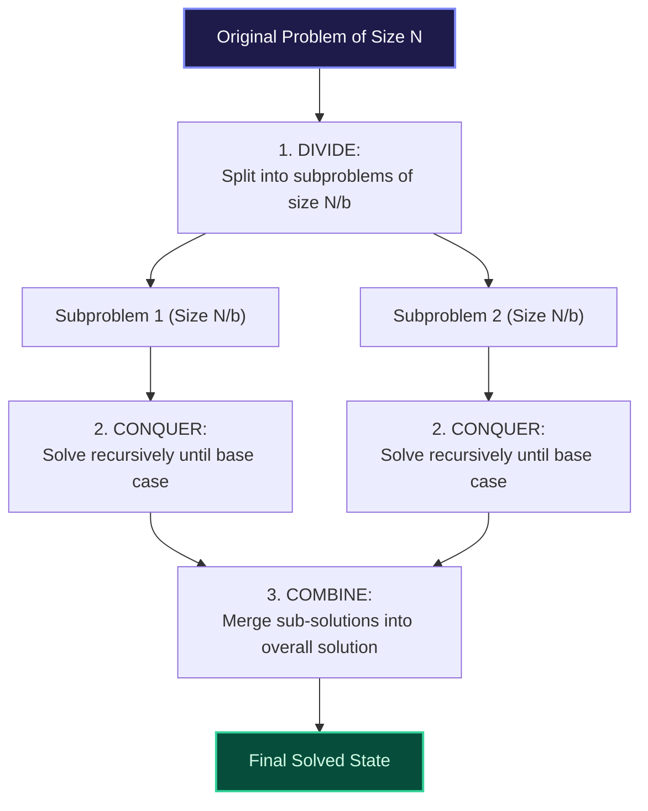

import { Callout } from "fumadocs-ui/components/callout";
import { Tabs, Tab } from "fumadocs-ui/components/tabs";
import { Steps, Step } from "fumadocs-ui/components/steps";
import { Cards, Card } from "fumadocs-ui/components/card";

## The Tripartite Paradigm

**Divide and Conquer (D&C)** is an algorithmic paradigm that breaks a complex problem into independent, non-overlapping subproblems of identical type, solves them recursively, and recombines their solutions.



---

## Canonical Archetypes

### 1. Binary Search (Divide without Combine)

- **Divide:** Inspect middle element `mid`.
- **Conquer:** Discard half the array and recursively search the remaining $N/2$ slice.
- **Combine:** Trivial $\mathcal{O}(1)$ step (the answer is returned directly).
- **Recurrence:** $T(N) = T(N/2) + \mathcal{O}(1) \implies \mathcal{O}(\log N)$.

### 2. Merge Sort (Light Divide, Heavy Combine)

- **Divide:** Split array into two equal halves at midpoint in $\mathcal{O}(1)$ time.
- **Conquer:** Recursively sort left and right halves ($2T(N/2)$).
- **Combine:** Merge two sorted subarrays into a single sorted array in linear $\mathcal{O}(N)$ time.
- **Recurrence:** $T(N) = 2T(N/2) + \mathcal{O}(N) \implies \mathcal{O}(N \log N)$.

### 3. Fast Exponentiation (Binary Powering)

To calculate $x^N$ in $\mathcal{O}(\log N)$ time:

$$
x^N =
\begin{cases}
1 & \text{if } N = 0 \\
(x^{N/2})^2 & \text{if } N \text{ is even} \\
x \cdot (x^{(N-1)/2})^2 & \text{if } N \text{ is odd}
\end{cases}
$$

---

## Polyglot Implementations (Binary Exponentiation)

<Tabs items={["C++", "TypeScript", "Python"]}>
  <Tab value="C++">
```cpp
#include <iostream>

// Divide and Conquer Binary Exponentiation: O(log N)
long long power(long long base, long long exp) {
if (exp == 0) return 1;
long long half = power(base, exp / 2);
if (exp % 2 == 0) {
return half _ half;
} else {
return base _ half \* half;
}
}

int main() {
std::cout << "2^10 = " << power(2, 10) << "\n"; // 1024
std::cout << "3^5 = " << power(3, 5) << "\n"; // 243
return 0;
}

````
  </Tab>
  <Tab value="TypeScript">
```typescript
export function binaryPower(base: number, exp: number): number {
  if (exp === 0) return 1;
  const half = binaryPower(base, Math.floor(exp / 2));
  return exp % 2 === 0 ? half * half : base * half * half;
}

console.log("2^10:", binaryPower(2, 10));
````

  </Tab>
  <Tab value="Python">
```python
def binary_power(base: int, exp: int) -> int:
    """Divide and conquer exponentiation in O(log exp) time."""
    if exp == 0:
        return 1
    half = binary_power(base, exp // 2)
    if exp % 2 == 0:
        return half * half
    return base * half * half

print("2^10 =", binary_power(2, 10)) # 1024

```
  </Tab>
</Tabs>
```
