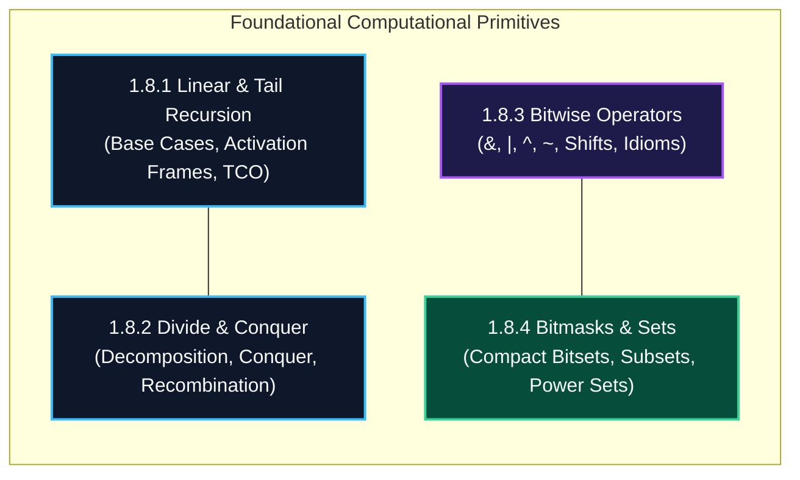

import { Callout } from "fumadocs-ui/components/callout";
import { Tabs, Tab } from "fumadocs-ui/components/tabs";
import { Steps, Step } from "fumadocs-ui/components/steps";
import { Cards, Card } from "fumadocs-ui/components/card";

## The Twin Primitives of Computational Thought

Two fundamental concepts bridge the gap between high-level algorithmic logic and low-level hardware registers:

1. **Recursion:** The mathematical self-similarity principle where a problem decomposes into smaller instances of itself until reaching a trivial base case.
2. **Bitwise Operations:** The machine-level manipulation of individual silicon transistor states ($0$ and $1$) using single-cycle boolean ALU instructions.

---

## Architectural Comparison Matrix

| Primitive              | Mechanism                    | Hardware Manifestation                  | Asymptotic Cost                   | Key Systems Application                      |
| :--------------------- | :--------------------------- | :-------------------------------------- | :-------------------------------- | :------------------------------------------- |
| **Linear Recursion**   | Function calls itself        | Pushes frame to `%rsp` stack            | $\mathcal{O}(N)$ memory frames    | Tree walks, syntax parsing                   |
| **Tail Recursion**     | Recursive call is final step | Reuses existing frame (TCO)             | $\mathcal{O}(1)$ space optimized  | Functional programming, loops                |
| **Divide & Conquer**   | Bisect into subproblems      | Recurrence tree $T(n) = aT(n/b) + f(n)$ | Typically $\mathcal{O}(N \log N)$ | Merge sort, binary search                    |
| **Bitwise Operations** | Direct ALU logic gates       | 1 CPU cycle (`AND`, `XOR`, `SHL`)       | $\mathcal{O}(1)$ time & space     | Cryptography, SIMD, flags                    |
| **Bitmask Sets**       | Integer as boolean array     | Single 32/64-bit integer                | $\mathcal{O}(1)$ set operations   | State compression, DP, traveling salesperson |

---

## Stage 1.8 Curriculum Modules

Explore the dedicated modules in this section:

<Cards>
  <Card
    title="1.8.1 Linear and Tail Recursion"
    href="/docs/dsa/01-beginner/recursion-and-bitwise-fundamentals/linear-and-tail-recursion"
    description="Base cases, call stack unwinding, tail-call optimization (TCO), and loop conversions."
  />
  <Card
    title="1.8.2 Divide and Conquer Fundamentals"
    href="/docs/dsa/01-beginner/recursion-and-bitwise-fundamentals/divide-and-conquer-fundamentals"
    description="Subproblem decomposition, conquering steps, and recombination architectures."
  />
  <Card
    title="1.8.3 Bitwise Operators"
    href="/docs/dsa/01-beginner/recursion-and-bitwise-fundamentals/bitwise-operators"
    description="Bitwise AND, OR, XOR, NOT, bit shifts, arithmetic vs logical, and core bit manipulation idioms."
  />
  <Card
    title="1.8.4 Bitmask Representation of Sets"
    href="/docs/dsa/01-beginner/recursion-and-bitwise-fundamentals/bitmask-representation-of-sets"
    description="Integers as compact boolean sets, membership tests, union, intersection, and power set enumeration."
  />
</Cards>
