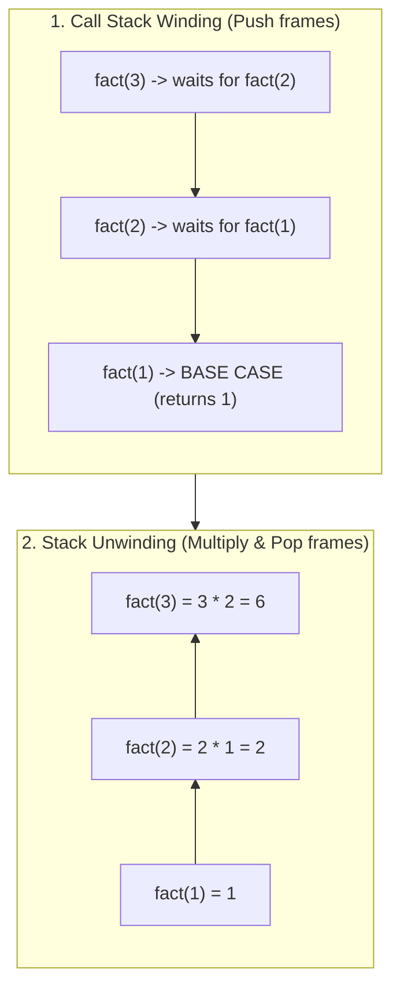
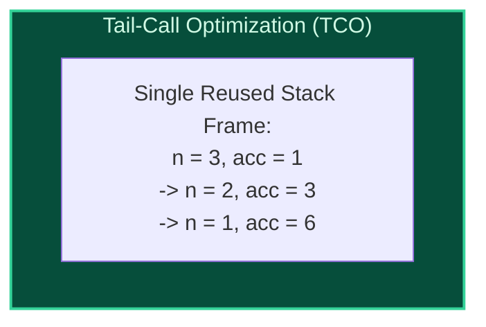

import { Callout } from "fumadocs-ui/components/callout";
import { Tabs, Tab } from "fumadocs-ui/components/tabs";
import { Steps, Step } from "fumadocs-ui/components/steps";
import { Cards, Card } from "fumadocs-ui/components/card";

## The Recursive Self-Similarity Paradigm

A function is **recursive** if its implementation calls itself to solve a smaller subproblem of identical structure. Every well-formed recursive function requires two essential components:

1. **Base Case:** A terminating condition that returns an immediate result without making further recursive calls.
2. **Recursive Step:** An operation that reduces the problem instance toward the base case and invokes itself.



---

## Linear Recursion vs. Tail Recursion

### 1. Standard Linear Recursion

In linear recursion, the recursive call is not the final operation. The function must wait for the child call to complete before performing additional work (such as multiplication):

```cpp
int factorial(int n) {
    if (n <= 1) return 1;
    return n * factorial(n - 1); // Multiplication occurs AFTER child returns!
}
```

- **Memory Cost:** Every call leaves an active stack frame on the hardware call stack, demanding $\mathcal{O}(N)$ auxiliary memory. If $N = 100{,}000$, a stack overflow crash occurs.

### 2. Tail Recursion & Tail-Call Optimization (TCO)

A function is **tail-recursive** if the recursive call is the **absolute last operation executed**—the function returns the result of the recursive call directly without modification.

To make a function tail-recursive, accumulate intermediate state into an **accumulator parameter**:

```cpp
int factTail(int n, int acc = 1) {
    if (n <= 1) return acc;
    return factTail(n - 1, n * acc); // Pure tail call!
}
```



<Callout type="tip" title="How the Compiler Executes TCO">
  When optimizing with `-O2` or `-O3`, modern C++ and Rust compilers recognize
  that the caller frame contains no further work. Instead of issuing a `CALL`
  instruction (which pushes a new frame), the compiler simply overwrites the
  function's local registers and issues a `JMP` instruction back to the start of
  the function! Tail recursion executes in **$\mathcal{O}(1)$ space**, identical
  to an iterative `while` loop!
</Callout>

---

## Polyglot Implementations

<Tabs items={["C++ (TCO Verified)", "TypeScript", "Python"]}>
  <Tab value="C++ (TCO Verified)">
```cpp
#include <iostream>

// Standard non-tail recursion: O(N) stack frames
int sumNonTail(int n) {
if (n <= 0) return 0;
return n + sumNonTail(n - 1);
}

// Tail-recursive version: O(1) space with compiler TCO
int sumTail(int n, int acc = 0) {
if (n <= 0) return acc;
return sumTail(n - 1, acc + n);
}

int main() {
std::cout << "Sum non-tail: " << sumNonTail(10) << "\n";
std::cout << "Sum tail: " << sumTail(10) << "\n";
return 0;
}

````
  </Tab>
  <Tab value="TypeScript">
```typescript
// Explicit conversion of tail recursion to an iterative loop
export function factorialIterative(n: number): number {
  let acc = 1;
  while (n > 1) {
    acc *= n;
    n--;
  }
  return acc;
}

console.log("Factorial(5):", factorialIterative(5));
````

  </Tab>
  <Tab value="Python">
```python
def fib_tail(n: int, a: int = 0, b: int = 1) -> int:
    """Tail-recursive Fibonacci using two accumulators."""
    if n == 0:
        return a
    if n == 1:
        return b
    return fib_tail(n - 1, b, a + b)

print("Fibonacci(10):", fib_tail(10)) # 55

```
  </Tab>
</Tabs>
```
