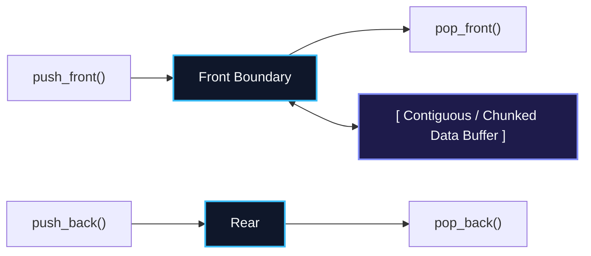
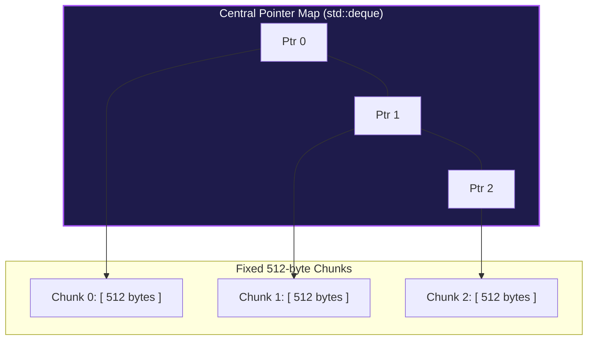

import { Callout } from "fumadocs-ui/components/callout";
import { Tabs, Tab } from "fumadocs-ui/components/tabs";
import { Steps, Step } from "fumadocs-ui/components/steps";
import { Cards, Card } from "fumadocs-ui/components/card";

## The Generalized Linear Double-Ended Buffer

A **Double-Ended Queue (Deque)** generalizes both stacks and queues by permitting strictly $\mathcal{O}(1)$ insertion and removal operations at **both** ends of the sequence:

- `push_front()` / `pop_front()`
- `push_back()` / `pop_back()`



---

## Architectural Backing: Circular Buffer vs Chunked Map

How is a Deque physically implemented under the hood?

### 1. Dynamic Circular Array (Java `ArrayDeque`, Python `collections.deque`)

- A single circular buffer that doubles capacity when full.
- Pushing to the front decrements `front = (front - 1 + capacity) % capacity`.
- Pushing to the back increments `rear = (rear + 1) % capacity`.
- **Advantage:** Unbeatable CPU cache locality and zero pointer overhead.

### 2. Chunked Array of Fixed Pages (C++ `std::deque`)

- Instead of a single massive contiguous block, `std::deque` allocates a central **Map array of pointers**, each pointing to a fixed-size contiguous chunk (typically 512 bytes).
- When expanding at either end, a new 512-byte chunk is allocated, avoiding the expensive $\mathcal{O}(N)$ full-buffer copying of `std::vector`!



---

## Systems Use Cases: Work-Stealing Schedulers

Deques are the core engine behind modern concurrent runtimes (e.g., the Go runtime scheduler, Java Fork/Join Framework, and Rust Tokio):

1. Each CPU worker thread holds a private deque of tasks.
2. The owner thread pushes and pops tasks from the **Front** of its own deque as a fast LIFO stack (maximizing CPU cache warmth).
3. When an idle thread runs out of tasks, it **steals** work from the **Rear** of another thread's deque in FIFO order, minimizing lock contention!

---

## Complexity Profile

| Operation                  | Deque Bound                        | Stack Equivalent | Queue Equivalent |
| :------------------------- | :--------------------------------- | :--------------- | :--------------- |
| **push_front(x)**          | $\mathcal{O}(1)$ amortized         | N/A              | N/A              |
| **push_back(x)**           | $\mathcal{O}(1)$ amortized         | `push(x)`        | `enqueue(x)`     |
| **pop_front()**            | $\mathcal{O}(1)$ amortized         | N/A              | `dequeue()`      |
| **pop_back()**             | $\mathcal{O}(1)$ amortized         | `pop()`          | N/A              |
| **random access ($D[i]$)** | $\mathcal{O}(1)$ (in `std::deque`) | N/A              | N/A              |

---

## Polyglot Implementations

<Tabs items={["C++", "TypeScript", "Python"]}>
  <Tab value="C++">
```cpp
#include <iostream>
#include <deque>

int main() {
std::deque<int> dq;

    // Insert at both boundaries
    dq.push_back(10);
    dq.push_front(20);
    dq.push_back(30);
    dq.push_front(40);
    // Deque contents: [40, 20, 10, 30]

    std::cout << "Front element: " << dq.front() << "\n"; // 40
    std::cout << "Back element:  " << dq.back() << "\n";  // 30

    // O(1) random indexing enabled by chunk map
    std::cout << "Index 2 element: " << dq[2] << "\n";    // 10

    dq.pop_front();
    dq.pop_back();
    return 0;

}

````
  </Tab>
  <Tab value="TypeScript">
```typescript
export class Deque<T> {
  private buffer: (T | undefined)[];
  private head = 0;
  private tail = 0;
  private count = 0;

  constructor(capacity = 8) {
    this.buffer = new Array(capacity);
  }

  pushBack(val: T): void {
    if (this.count === this.buffer.length) this.resize(this.buffer.length * 2);
    this.buffer[this.tail] = val;
    this.tail = (this.tail + 1) % this.buffer.length;
    this.count++;
  }

  pushFront(val: T): void {
    if (this.count === this.buffer.length) this.resize(this.buffer.length * 2);
    this.head = (this.head - 1 + this.buffer.length) % this.buffer.length;
    this.buffer[this.head] = val;
    this.count++;
  }

  popFront(): T | undefined {
    if (this.count === 0) return undefined;
    const val = this.buffer[this.head];
    this.buffer[this.head] = undefined;
    this.head = (this.head + 1) % this.buffer.length;
    this.count--;
    return val;
  }

  popBack(): T | undefined {
    if (this.count === 0) return undefined;
    this.tail = (this.tail - 1 + this.buffer.length) % this.buffer.length;
    const val = this.buffer[this.tail];
    this.buffer[this.tail] = undefined;
    this.count--;
    return val;
  }

  private resize(newCap: number): void {
    const newBuf = new Array<T | undefined>(newCap);
    for (let i = 0; i < this.count; i++) {
      newBuf[i] = this.buffer[(this.head + i) % this.buffer.length];
    }
    this.buffer = newBuf;
    this.head = 0;
    this.tail = this.count;
  }
}
````

  </Tab>
  <Tab value="Python">
```python
from collections import deque

# Python's collections.deque is implemented in C as a doubly linked list of 64-element blocks

dq = deque()

# Double-ended operations in strictly O(1) time

dq.append(10) # push back
dq.appendleft(20) # push front
dq.append(30) # push back
dq.appendleft(40) # push front

# Deque: [40, 20, 10, 30]

print("Front:", dq[0]) # 40
print("Back:", dq[-1]) # 30

dq.popleft() # removes 40
dq.pop() # removes 30

```
  </Tab>
</Tabs>
```
