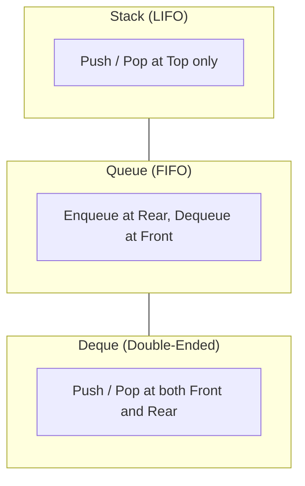

import { Callout } from "fumadocs-ui/components/callout";
import { Tabs, Tab } from "fumadocs-ui/components/tabs";
import { Steps, Step } from "fumadocs-ui/components/steps";
import { Cards, Card } from "fumadocs-ui/components/card";

## The Power of Deliberate Restriction

Why do computer scientists intentionally restrict data structure interfaces? While general-purpose arrays and linked lists permit insertions, lookups, and deletions at arbitrary indices, **Restricted Linear Data Structures** deliberately constrain access to designated endpoints.

By strictly enforcing behavioral disciplines:

1. **Invariants Guarantee Correctness:** Eliminating random writes protects internal state ordering from arbitrary external mutations.
2. **Deterministic $\mathcal{O}(1)$ Guarantees:** Push, pop, enqueue, and dequeue execute in strictly constant time without scanning.
3. **Silicon Architecture Alignment:** Modern CPU instruction sets implement dedicated hardware stack pointers (`RSP`/`ESP`) and ring buffers directly in hardware registers.

---

## Architectural Comparison Matrix

| Structure | Access Discipline         | Insert Points | Remove Points | Core Real-World Systems Application                   |
| :-------- | :------------------------ | :------------ | :------------ | :---------------------------------------------------- |
| **Stack** | LIFO (Last-In-First-Out)  | Top           | Top           | CPU call stack, syntax parsers, undo/redo             |
| **Queue** | FIFO (First-In-First-Out) | Rear          | Front         | OS job scheduling, thread message mailboxes           |
| **Deque** | Generalized Double-Ended  | Front & Rear  | Front & Rear  | Work-stealing schedulers (Go, Tokio), sliding windows |

---

## Stage 1.4 Curriculum Modules

Explore the dedicated modules in this section:

<Cards>
  <Card
    title="1.4.1 Stacks"
    href="/docs/dsa/01-beginner/restricted-linear-data-structures/stacks"
    description="LIFO protocol, call stack activation frames, expression evaluation, operator parsing, and parentheses validation."
  />
  <Card
    title="1.4.2 Queues"
    href="/docs/dsa/01-beginner/restricted-linear-data-structures/queues"
    description="FIFO protocol, front/rear pointer tracking, circular array ring buffers, and false overflow elimination."
  />
  <Card
    title="1.4.3 Double-Ended Queues (Deques)"
    href="/docs/dsa/01-beginner/restricted-linear-data-structures/double-ended-queues"
    description="O(1) operations at both boundaries, ring buffer backings, and chunked dynamic block architectures."
  />
</Cards>
