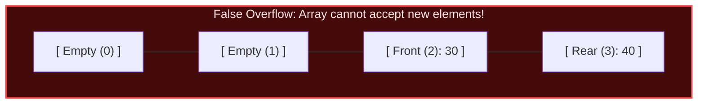
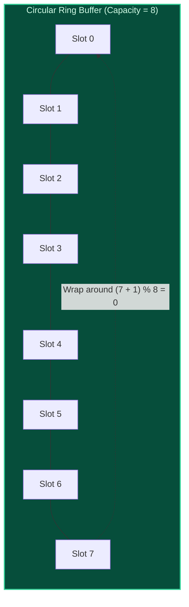

import { Callout } from "fumadocs-ui/components/callout";
import { Tabs, Tab } from "fumadocs-ui/components/tabs";
import { Steps, Step } from "fumadocs-ui/components/steps";
import { Cards, Card } from "fumadocs-ui/components/card";

## The FIFO Principle & The False Overflow Dilemma

A **Queue** enforces the **First-In, First-Out (FIFO)** discipline: elements are inserted at the back (**Rear**) and extracted from the front (**Front**).

### Naive Array Implementation & Memory Drift

If you implement a queue in a naive static array:

1. `enqueue()` increments `rear` and writes an element.
2. `dequeue()` increments `front` to remove an element.

After several operations, `rear` hits the maximum array boundary (`capacity - 1`), while `front` has drifted forward, leaving multiple vacated, empty slots at the beginning of the buffer!



Even though half the array is empty, calling `enqueue()` fails because `rear == capacity - 1`. This flaw is known as **False Overflow**.

---

## The Circular Array (Ring Buffer)

The standard systems solution to false overflow is the **Circular Queue (Ring Buffer)**:
Instead of moving linearly towards an end wall, the indices wrap seamlessly around to the beginning using modular arithmetic:

$$
\text{next\_index} = (\text{curr\_index} + 1) \pmod{\text{Capacity}}
$$



### Full vs Empty Invariant Tracking

In a circular queue of capacity $C$, when `front == rear`:

- Is the buffer completely empty or completely full?

Two standard solutions:

1. **Maintain an explicit `size` counter:**
   - Empty if `size == 0`.
   - Full if `size == capacity`.
2. **Leave one sacrificial slot empty:**
   - Full condition: `(rear + 1) % capacity == front`.

---

## Complexity Profile

| Operation      | Circular Array Queue    | Linked-List Queue        | Notes                                |
| :------------- | :---------------------- | :----------------------- | :----------------------------------- |
| **enqueue(x)** | $\mathcal{O}(1)$        | $\mathcal{O}(1)$         | Inserts at rear pointer              |
| **dequeue()**  | $\mathcal{O}(1)$        | $\mathcal{O}(1)$         | Removes from front pointer           |
| **peek()**     | $\mathcal{O}(1)$        | $\mathcal{O}(1)$         | Returns front element                |
| **Space**      | $\mathcal{O}(C)$ static | $\mathcal{O}(N)$ dynamic | Array has zero heap-pointer overhead |

---

## Polyglot Implementations

<Tabs items={["C++", "TypeScript", "Python"]}>
  <Tab value="C++">
```cpp
#include <iostream>
#include <vector>
#include <stdexcept>

class CircularQueue {
private:
std::vector<int> buffer;
int front;
int rear;
int count;
int capacity;

public:
CircularQueue(int k) : buffer(k), front(0), rear(0), count(0), capacity(k) {}

    bool enqueue(int value) {
        if (isFull()) return false;
        buffer[rear] = value;
        rear = (rear + 1) % capacity;
        count++;
        return true;
    }

    bool dequeue() {
        if (isEmpty()) return false;
        front = (front + 1) % capacity;
        count--;
        return true;
    }

    int getFront() const {
        return isEmpty() ? -1 : buffer[front];
    }

    int getRear() const {
        return isEmpty() ? -1 : buffer[(rear - 1 + capacity) % capacity];
    }

    bool isEmpty() const { return count == 0; }
    bool isFull() const { return count == capacity; }

};

````
  </Tab>
  <Tab value="TypeScript">
```typescript
export class CircularQueue<T> {
  private buffer: (T | undefined)[];
  private front = 0;
  private rear = 0;
  private count = 0;
  private readonly capacity: number;

  constructor(k: number) {
    this.capacity = k;
    this.buffer = new Array(k);
  }

  enqueue(val: T): boolean {
    if (this.isFull()) return false;
    this.buffer[this.rear] = val;
    this.rear = (this.rear + 1) % this.capacity;
    this.count++;
    return true;
  }

  dequeue(): T | undefined {
    if (this.isEmpty()) return undefined;
    const val = this.buffer[this.front];
    this.buffer[this.front] = undefined;
    this.front = (this.front + 1) % this.capacity;
    this.count--;
    return val;
  }

  isEmpty(): boolean { return this.count === 0; }
  isFull(): boolean { return this.count === this.capacity; }
}
````

  </Tab>
  <Tab value="Python">
```python
class CircularQueue:
    def __init__(self, k: int):
        self.capacity = k
        self.buffer = [None] * k
        self.front = 0
        self.rear = 0
        self.count = 0

    def enqueue(self, val: int) -> bool:
        if self.is_full():
            return False
        self.buffer[self.rear] = val
        self.rear = (self.rear + 1) % self.capacity
        self.count += 1
        return True

    def dequeue(self) -> int | None:
        if self.is_empty():
            return None
        val = self.buffer[self.front]
        self.buffer[self.front] = None
        self.front = (self.front + 1) % self.capacity
        self.count -= 1
        return val

    def is_empty(self) -> bool:
        return self.count == 0

    def is_full(self) -> bool:
        return self.count == self.capacity

```
  </Tab>
</Tabs>
```
