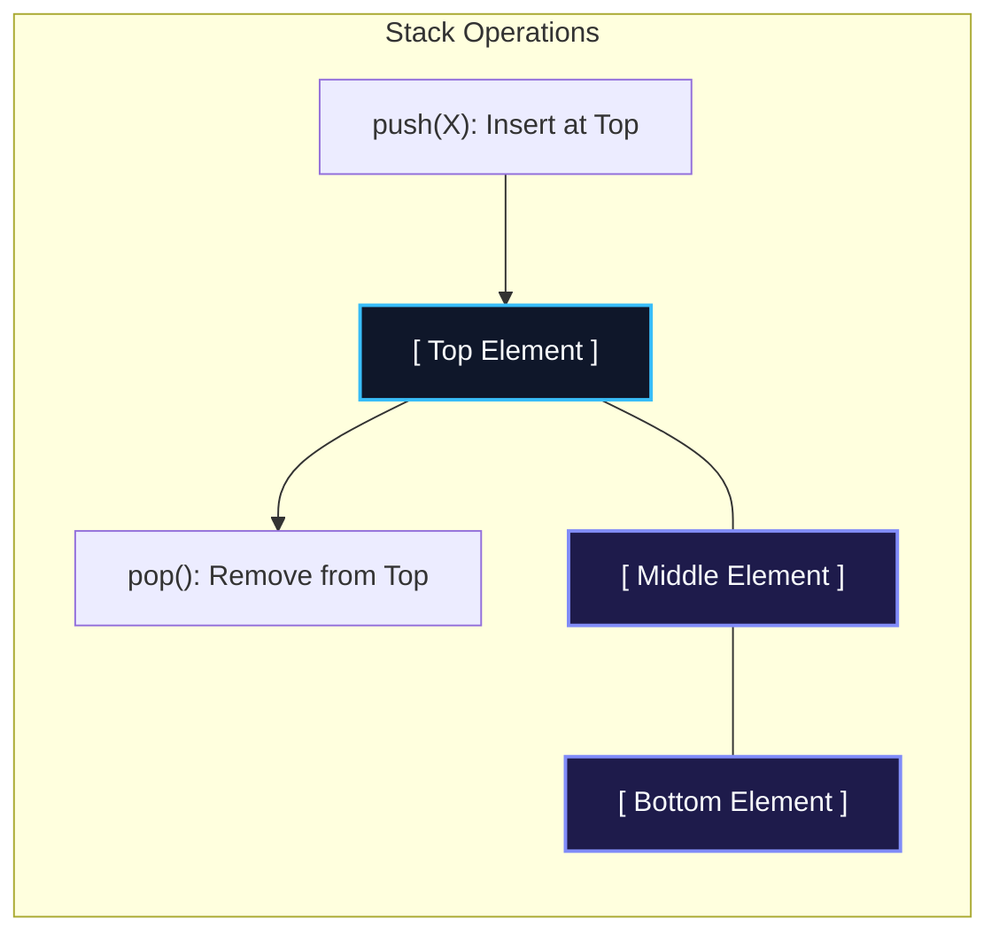
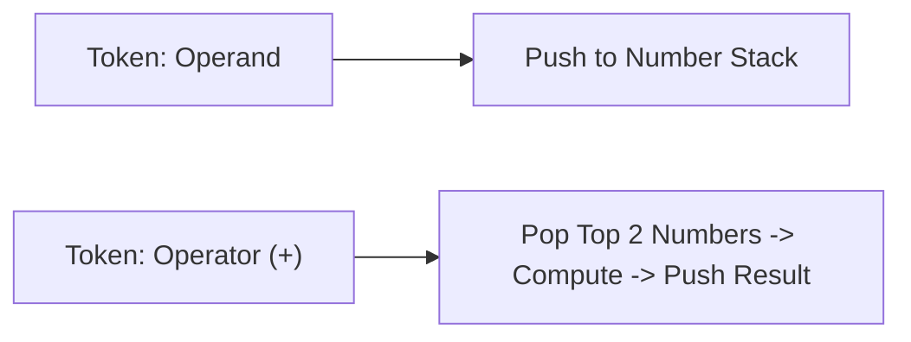

import { Callout } from "fumadocs-ui/components/callout";
import { Tabs, Tab } from "fumadocs-ui/components/tabs";
import { Steps, Step } from "fumadocs-ui/components/steps";
import { Cards, Card } from "fumadocs-ui/components/card";

## The LIFO Protocol & Silicon Mechanics

A **Stack** is a restricted linear data structure that strictly enforces the **Last-In, First-Out (LIFO)** protocol. Elements can only be appended to or removed from a single designated boundary called the **Top**.



### Hardware Activation Frames: The CPU Call Stack

The stack is not merely an abstract data structure—it is baked directly into the instruction set architecture (ISA) of modern CPUs.

- When function `foo()` invokes `bar()`, the CPU executes a hardware `CALL` instruction.
- The hardware **Stack Pointer register** (`%rsp` in x86-64) decrements, pushing an **Activation Frame** (return address, register states, local variables) onto the system stack.
- When `bar()` finishes, the `RET` instruction pops the activation frame and jumps execution back to the caller's return pointer.
- If recursion runs unbounded without reaching a base case, frames exhaust allocated stack memory, triggering a catastrophic hardware **Stack Overflow**.

---

## Canonical Application 1: Parentheses Matching

Syntax parsers validate balanced brackets (`()`, `{}`, `[]`) using an auxiliary stack:

1. When encountering an opening bracket (`(`, `{`, `[`), **push** it onto the stack.
2. When encountering a closing bracket (`)`, `}`, `]`):
   - If the stack is empty, there is no matching opener $\to$ **Invalid**.
   - Pop the top opener. If it does not match the closing character's type $\to$ **Invalid**.
3. After scanning the full string, if the stack is not empty $\to$ **Invalid**. Otherwise $\to$ **Valid**.

---

## Canonical Application 2: Expression Evaluation (Infix, Postfix, Prefix)

In standard mathematical notation (**Infix**), operators sit between operands: `(3 + 4) * 5`. Computers evaluate expressions much faster in **Postfix (Reverse Polish Notation)**: `3 4 + 5 *`, because postfix expressions require zero parentheses and can be evaluated in a single forward pass:



```cpp
// Postfix evaluation algorithm
int evalRPN(const vector<string>& tokens) {
    stack<int> s;
    for (const string& t : tokens) {
        if (t == "+" || t == "-" || t == "*" || t == "/") {
            int b = s.top(); s.pop();
            int a = s.top(); s.pop();
            if (t == "+") s.push(a + b);
            else if (t == "-") s.push(a - b);
            else if (t == "*") s.push(a * b);
            else if (t == "/") s.push(a / b);
        } else {
            s.push(stoi(t));
        }
    }
    return s.top();
}
```

---

## Complexity Profile

| Operation          | Array-Backed Stack          | Linked-List Backed Stack    | Notes                              |
| :----------------- | :-------------------------- | :-------------------------- | :--------------------------------- |
| **push(x)**        | $\mathcal{O}(1)$ amortized  | $\mathcal{O}(1)$ worst-case | Array benefits from cache locality |
| **pop()**          | $\mathcal{O}(1)$ worst-case | $\mathcal{O}(1)$ worst-case | Pops top element                   |
| **peek() / top()** | $\mathcal{O}(1)$            | $\mathcal{O}(1)$            | Inspects top without removal       |
| **isEmpty()**      | $\mathcal{O}(1)$            | $\mathcal{O}(1)$            | Checks if size == 0                |

---

## Polyglot Implementations

<Tabs items={["C++", "TypeScript", "Python"]}>
  <Tab value="C++">
```cpp
#include <iostream>
#include <vector>
#include <stdexcept>

template <typename T>
class ArrayStack {
private:
std::vector<T> data;

public:
void push(const T& val) {
data.push_back(val);
}

    void pop() {
        if (empty()) throw std::underflow_error("Stack is empty");
        data.pop_back();
    }

    T top() const {
        if (empty()) throw std::underflow_error("Stack is empty");
        return data.back();
    }

    bool empty() const {
        return data.empty();
    }

    size_t size() const {
        return data.size();
    }

};

````
  </Tab>
  <Tab value="TypeScript">
```typescript
export class Stack<T> {
  private items: T[] = [];

  push(item: T): void {
    this.items.push(item);
  }

  pop(): T | undefined {
    return this.items.pop();
  }

  peek(): T | undefined {
    return this.items[this.items.length - 1];
  }

  isEmpty(): boolean {
    return this.items.length === 0;
  }

  size(): number {
    return this.items.length;
  }
}

// Parentheses Validator
export function isValidParentheses(s: string): boolean {
  const stack = new Stack<string>();
  const match: Record<string, string> = { ')': '(', '}': '{', ']': '[' };

  for (const ch of s) {
    if (ch === '(' || ch === '{' || ch === '[') {
      stack.push(ch);
    } else if (ch in match) {
      if (stack.isEmpty() || stack.pop() !== match[ch]) {
        return false;
      }
    }
  }
  return stack.isEmpty();
}
````

  </Tab>
  <Tab value="Python">
```python
class Stack:
    def __init__(self):
        self._data = []

    def push(self, val):
        self._data.append(val)

    def pop(self):
        if not self._data:
            raise IndexError("pop from empty stack")
        return self._data.pop()

    def peek(self):
        if not self._data:
            raise IndexError("peek from empty stack")
        return self._data[-1]

    def is_empty(self):
        return len(self._data) == 0

    def __len__(self):
        return len(self._data)

def is_valid_parentheses(s: str) -> bool:
stack = []
lookup = {')': '(', '}': '{', ']': '['}
for char in s:
if char in lookup.values():
stack.append(char)
elif char in lookup:
if not stack or stack.pop() != lookup[char]:
return False
return len(stack) == 0

```
  </Tab>
</Tabs>
```
