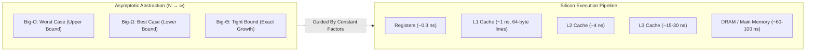
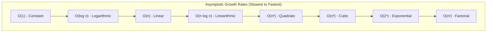
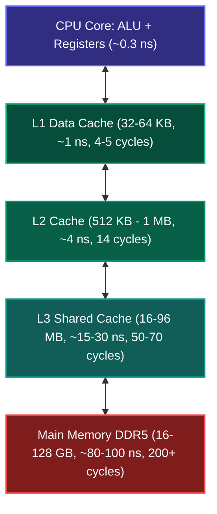

import { Callout } from "fumadocs-ui/components/callout";
import { Tabs, Tab } from "fumadocs-ui/components/tabs";
import { Steps, Step } from "fumadocs-ui/components/steps";
import { Cards, Card } from "fumadocs-ui/components/card";

## The Core Mental Model: Asymptotic Abstraction vs. Silicon Physics

When engineers talk about algorithm efficiency, they often speak two different languages:

1. **Theoretical Computer Science**: How does resource consumption (time, memory) scale as the input size $N$ approaches infinity ($N \to \infty$)?
2. **Systems Engineering**: How many CPU clock cycles, L1 cache misses, and pipeline branch mispredictions occur when processing a concrete dataset on physical hardware?

To design resilient, world-class systems, you must master both. Big-O notation allows us to classify algorithms independently of clock speed, compiler optimizations, or operating system quirks. But understanding hardware architecture explains why an $O(N)$ contiguous scan can run **50x faster** than an $O(N)$ pointer chase.



---

## Asymptotic Notation: Mathematical Definitions

Asymptotic analysis classifies functions according to their rate of growth. Let $f(n)$ and $g(n)$ be functions from non-negative integers to non-negative real numbers.

### 1. Big-O: Asymptotic Upper Bound ($O$)

$f(n) \in O(g(n))$ if and only if there exist positive constants $c > 0$ and $n_0 \ge 0$ such that:

$$0 \le f(n) \le c \cdot g(n) \quad \text{for all } n \ge n_0$$

- **Intuition**: $g(n)$ represents an **asymptotic ceiling**. The algorithm will never grow faster than $c \cdot g(n)$ for large inputs.
- **Example**: If an algorithm takes $f(n) = 3n^2 + 5n + 12$ operations, choosing $c = 4$ and $n_0 = 7$ confirms $f(n) \le 4n^2$, meaning $f(n) \in O(n^2)$.

### 2. Big-Omega: Asymptotic Lower Bound ($\Omega$)

$f(n) \in \Omega(g(n))$ if and only if there exist positive constants $c > 0$ and $n_0 \ge 0$ such that:

$$0 \le c \cdot g(n) \le f(n) \quad \text{for all } n \ge n_0$$

- **Intuition**: $g(n)$ represents an **asymptotic floor**. The algorithm will take at least $c \cdot g(n)$ operations for sufficiently large $n$.
- **Example**: Comparison-based sorting algorithms require $\Omega(n \log n)$ comparisons in the worst and average cases.

### 3. Big-Theta: Asymptotically Tight Bound ($\Theta$)

$f(n) \in \Theta(g(n))$ if and only if there exist positive constants $c_1, c_2 > 0$ and $n_0 \ge 0$ such that:

$$0 \le c_1 \cdot g(n) \le f(n) \le c_2 \cdot g(n) \quad \text{for all } n \ge n_0$$

- **Intuition**: $f(n)$ is sandwiched between $c_1 g(n)$ and $c_2 g(n)$. It grows at the **exact same rate** as $g(n)$.
- **Theorem**: $f(n) \in \Theta(g(n)) \iff f(n) \in O(g(n)) \text{ and } f(n) \in \Omega(g(n))$.



---

## Amortized Analysis: The Three Methods

When an occasional expensive operation occurs rarely enough that the average cost per operation remains small over a long sequence, simple worst-case analysis gives an overly pessimistic bound. We use **Amortized Analysis**.

Consider dynamic array resizing: inserting $N$ elements into an array that doubles whenever full.

### Method 1: Aggregate Analysis

Compute the total worst-case cost $T(n)$ for a sequence of $n$ operations, then calculate the amortized cost per operation as:

$$\hat{c} = \frac{T(n)}{n}$$

For dynamic array insertions starting at capacity 1:

- Normal insertions cost $1$ unit.
- Resizing occurs at powers of 2 ($i = 1, 2, 4, 8, \dots$). The resize copies $1, 2, 4, \dots, 2^{\lfloor \log_2 n \rfloor}$ elements.
- Total cost:
  $$T(n) = n + \sum_{j=0}^{\lfloor \log_2 n \rfloor} 2^j < n + 2n = 3n$$
- Amortized cost per operation: $\hat{c} = \frac{3n}{n} = 3 \in O(1)$.

### Method 2: The Accounting (Banker's) Method

Assign an amortized charge $\hat{c}_i$ to each operation. If $\hat{c}_i > \text{cost}_i$ (actual cost), store the excess as **credit** in the bank. If $\hat{c}_i < \text{cost}_i$, consume accumulated credit to pay for the expensive operation.

- **Invariant**: The total accumulated credit must remain non-negative at all times:
  $$\sum_{i=1}^{k} \hat{c}_i \ge \sum_{i=1}^{k} \text{cost}_i \quad \forall k$$
- **Dynamic Array Example**:
  - Actual cost to insert an element into an unfilled slot: $1$.
  - Charge an amortized price of $\hat{c} = 3$ credits per insertion.
  - Allocation of 3 credits:
    - $1$ credit pays for the immediate insertion of this new element.
    - $1$ credit is saved as insurance to move this element when the array resizes.
    - $1$ credit is saved as insurance to move an older element that has already exhausted its credits.
  - When the array doubles from size $N$ to $2N$, exactly $N/2$ elements were inserted since the last resize. Each element has contributed 2 stored credits ($N$ credits total), which precisely covers copying all $N$ existing elements into the new array. The bank never defaults. Amortized cost: $O(1)$.

### Method 3: The Potential (Physicist's) Method

Instead of tracking individual credits, define a state function $\Phi(D)$ that maps data structure state $D$ to a real number (the "potential energy").

The amortized cost $\hat{c}_i$ of the $i$-th operation is defined as:

$$\hat{c}_i = \text{cost}_i + \Phi(D_i) - \Phi(D_{i-1})$$

The sum of amortized costs across $n$ operations is:

$$\sum_{i=1}^{n} \hat{c}_i = \sum_{i=1}^{n} \left( \text{cost}_i + \Phi(D_i) - \Phi(D_{i-1}) \right) = \sum_{i=1}^{n} \text{cost}_i + \Phi(D_n) - \Phi(D_0)$$

Provided $\Phi(D_n) \ge \Phi(D_0)$ for all $n$, the amortized cost forms an upper bound on actual cost.

#### Mathematical Proof for Dynamic Array Resizing

Let:

- $s_i$ = number of elements currently stored after operation $i$.
- $c_i$ = total capacity of the array after operation $i$.
- Define potential function: $\Phi(D_i) = 2 s_i - c_i$.

Notice:

- Immediately after a doubling resize, $c_i = 2 s_i \implies \Phi(D_i) = 0$.
- Immediately before a doubling resize, $s_i = c_i \implies \Phi(D_i) = s_i \ge 0$.
- Thus $\Phi(D_i) \ge 0 = \Phi(D_0)$ at all times.

**Case A: Insertion without resize ($s_i < c_{i-1}$)**

- Actual cost: $\text{cost}_i = 1$
- State change: $s_i = s_{i-1} + 1$, capacity $c_i = c_{i-1}$
- $\Delta \Phi = \Phi(D_i) - \Phi(D_{i-1}) = (2(s_{i-1}+1) - c_{i-1}) - (2s_{i-1} - c_{i-1}) = 2$
- Amortized cost: $\hat{c}_i = 1 + 2 = 3$.

**Case B: Insertion with resize ($s_{i-1} = c_{i-1}$)**

- Actual cost: $\text{cost}_i = s_{i-1} + 1$ (copying $s_{i-1}$ items + inserting 1 item)
- New capacity: $c_i = 2 s_{i-1}$
- New count: $s_i = s_{i-1} + 1$
- Potential after: $\Phi(D_i) = 2(s_{i-1} + 1) - 2 s_{i-1} = 2$
- Potential before: $\Phi(D_{i-1}) = 2 s_{i-1} - s_{i-1} = s_{i-1}$
- $\Delta \Phi = 2 - s_{i-1}$
- Amortized cost: $\hat{c}_i = (s_{i-1} + 1) + (2 - s_{i-1}) = 3$.

In both cases, $\hat{c}_i = 3 \in O(1)$. The proof is complete.

---

## The Master Theorem

The Master Theorem provides a cookbook solution for divide-and-conquer recurrences of the form:

$$T(n) = a T\left(\frac{n}{b}\right) + f(n)$$

where $a \ge 1$ is the number of subproblems, $b > 1$ is the factor by which subproblem size decreases, and $f(n)$ is the cost of dividing and combining.

Let $c_{\text{crit}} = \log_b a$ be the **critical exponent** (measuring the leaf-work in the recursion tree). We compare $f(n)$ with $n^{\log_b a}$:

| Case       | Condition                                                                                           | Dominant Factor                 | Asymptotic Solution $T(n)$          | Canonical Example                                                                                   |
| :--------- | :-------------------------------------------------------------------------------------------------- | :------------------------------ | :---------------------------------- | :-------------------------------------------------------------------------------------------------- |
| **Case 1** | $f(n) \in O(n^{\log_b a - \epsilon})$ for some $\epsilon > 0$                                       | Tree leaves dominate            | $\Theta(n^{\log_b a})$              | Strassen's Matrix: $T(n) = 7T(n/2) + O(n^2) \implies \Theta(n^{\log_2 7}) \approx \Theta(n^{2.81})$ |
| **Case 2** | $f(n) \in \Theta(n^{\log_b a} \log^k n)$ for $k \ge 0$                                              | Balanced at all levels          | $\Theta(n^{\log_b a} \log^{k+1} n)$ | Merge Sort: $T(n) = 2T(n/2) + \Theta(n) \implies \Theta(n \log n)$ ($k=0$)                          |
| **Case 3** | $f(n) \in \Omega(n^{\log_b a + \epsilon})$ for $\epsilon > 0$ AND $a f(n/b) \le c f(n)$ for $c < 1$ | Root (divide/combine) dominates | $\Theta(f(n))$                      | Quickselect average: $T(n) = T(n/2) + \Theta(n) \implies \Theta(n)$                                 |

<Callout type="warn">
  **When the Master Theorem Fails:** The Master Theorem does not apply if: 1.
  $a$ is not constant (e.g., $T(n) = n T(n/2) + n$). 2. $f(n)$ is not polynomial
  (e.g., $T(n) = 2T(n/2) + n \log n$ cannot use Case 3 because the gap between
  $n$ and $n \log n$ is sub-polynomial; it falls under the Akra-Bazzi method or
  extended Case 2 with $k=1 \implies \Theta(n \log^2 n)$). 3. The subproblem
  sizes are unequal (e.g., Fibonacci recurrence $T(n) = T(n-1) + T(n-2)$).
</Callout>

---

## Hardware Reality: CPU Caches, Cache Lines & Mechanical Sympathy

A mathematical $O(N)$ algorithm can be sabotaged by hardware bottlenecks. Modern CPU execution is governed by the **memory hierarchy**.



### The 64-Byte Cache Line

RAM is never read one byte or word at a time. Hardware transfers data between DRAM and CPU caches in chunks of **64 bytes** called **cache lines**.

- **Spatial Locality**: If an element at address $A$ is accessed, elements at $A+1, A+2, \dots$ will be loaded into the same 64-byte line for free.
- **Temporal Locality**: If memory at address $A$ is accessed now, it is likely to be accessed again soon, remaining hot in L1/L2 cache.
- **Hardware Stream Prefetcher**: Modern CPU prefetchers identify sequential forward and backward memory access patterns and load the next cache lines before the CPU even requests them.

### Row-Major vs. Column-Major Memory Traversal

In row-major programming languages (C, C++, Rust, Python NumPy), 2D matrices are flattened sequentially row-by-row in memory.

- Traversing **row-by-row**: Consecutive memory reads. Every 64 bytes loaded yields 16 4-byte integers. 1 cache miss every 16 iterations.
- Traversing **column-by-column**: Strided memory reads across row strides. Every read accesses a completely different cache line, evicting prior lines. 1 cache miss on **every single iteration**.

---

## Code Implementation: Row-Major vs Column-Major Benchmark

Below is a complete, runnable demonstration contrasting cache-friendly (row-major) vs cache-hostile (column-major) iterations across languages.

<Tabs items={['Python', 'TypeScript', 'C++']}>
<Tab value="Python">
```python
import time
import sys

def benchmark*cache_locality(rows: int = 4096, cols: int = 4096):
"""
Demonstrates the impact of spatial locality.
A flat 1D list simulating a 2D matrix in row-major layout.
"""
matrix = [1] * (rows \_ cols)

    # 1. Row-major traversal (sequential, cache-friendly)
    start = time.perf_counter()
    sum_row = 0
    for r in range(rows):
        row_offset = r * cols
        for c in range(cols):
            sum_row += matrix[row_offset + c]
    row_duration = time.perf_counter() - start

    # 2. Column-major traversal (strided, cache-hostile)
    start = time.perf_counter()
    sum_col = 0
    for c in range(cols):
        for r in range(rows):
            sum_col += matrix[r * cols + c]
    col_duration = time.perf_counter() - start

    print(f"Matrix size: {rows}x{cols} ({rows * cols * 4 / (1024 * 1024):.1f} MB)")
    print(f"Row-major (sequential): {row_duration * 1000:.2f} ms")
    print(f"Col-major (strided):    {col_duration * 1000:.2f} ms")
    print(f"Slowdown factor:        {col_duration / row_duration:.2f}x")

if **name** == "**main**":
benchmark_cache_locality()

````
</Tab>

<Tab value="TypeScript">
```typescript
/**
 * Cache locality benchmark using typed arrays (Int32Array).
 * Int32Array provides raw, contiguous memory layout in V8 heap.
 */
function benchmarkCacheLocality(rows: number = 4096, cols: number = 4096): void {
  const totalElements = rows * cols;
  const matrix = new Int32Array(totalElements);
  matrix.fill(1);

  // 1. Row-major traversal (Sequential spatial locality)
  const startRow = performance.now();
  let sumRow = 0;
  for (let r = 0; r < rows; r++) {
    const rowOffset = r * cols;
    for (let c = 0; c < cols; c++) {
      sumRow += matrix[rowOffset + c];
    }
  }
  const rowDuration = performance.now() - startRow;

  // 2. Column-major traversal (Cache thrashing, high miss rate)
  const startCol = performance.now();
  let sumCol = 0;
  for (let c = 0; c < cols; c++) {
    for (let r = 0; r < rows; r++) {
      sumCol += matrix[r * cols + c];
    }
  }
  const colDuration = performance.now() - startCol;

  console.log(`Matrix: ${rows}x${cols} (${(totalElements * 4) / (1024 * 1024)} MB)`);
  console.log(`Row-Major time: ${rowDuration.toFixed(2)} ms`);
  console.log(`Col-Major time: ${colDuration.toFixed(2)} ms`);
  console.log(`Cache Penalty:  ${(colDuration / rowDuration).toFixed(2)}x slower`);
}

benchmarkCacheLocality();
````

</Tab>

<Tab value="C++">
```cpp
#include <iostream>
#include <vector>
#include <chrono>

int main() {
constexpr size_t ROWS = 8192;
constexpr size_t COLS = 8192;

    // Allocate contiguous heap memory
    std::vector<int> matrix(ROWS * COLS, 1);

    // 1. Sequential / Row-major Traversal (Cache Line Streaming)
    auto start_row = std::chrono::high_resolution_clock::now();
    long long sum_row = 0;
    for (size_t r = 0; r < ROWS; ++r) {
        size_t row_offset = r * COLS;
        for (size_t c = 0; c < COLS; ++c) {
            sum_row += matrix[row_offset + c];
        }
    }
    auto end_row = std::chrono::high_resolution_clock::now();
    std::chrono::duration<double, std::milli> duration_row = end_row - start_row;

    // 2. Strided / Column-major Traversal (L1/L2/L3 Cache Eviction)
    auto start_col = std::chrono::high_resolution_clock::now();
    long long sum_col = 0;
    for (size_t c = 0; c < COLS; ++c) {
        for (size_t r = 0; r < ROWS; ++r) {
            sum_col += matrix[r * COLS + c];
        }
    }
    auto end_col = std::chrono::high_resolution_clock::now();
    std::chrono::duration<double, std::milli> duration_col = end_col - start_col;

    std::cout << "Data size: " << (ROWS * COLS * sizeof(int)) / (1024 * 1024) << " MB\n";
    std::cout << "Row-major time: " << duration_row.count() << " ms (sum: " << sum_row << ")\n";
    std::cout << "Col-major time: " << duration_col.count() << " ms (sum: " << sum_col << ")\n";
    std::cout << "Speedup factor: " << (duration_col.count() / duration_row.count()) << "x\n";

    return 0;

}

````
</Tab>
</Tabs>

---

## Production Systems Case Study: DuckDB & ClickHouse Vectorized Execution

Traditional row-oriented relational databases (like PostgreSQL and MySQL) process data using the **Volcano iterator model**: a query executes via `next()` calls that yield one row (tuple) at a time. Each tuple is a struct containing heterogeneously typed columns scattered across memory.

Modern analytical columnar database engines like **ClickHouse** and **DuckDB** discard this model in favor of **vectorized execution**:

```mermaid
flowchart LR
    subgraph Volcano["Row-Oriented (Volcano Model)"]
        Row1["Row 1: {id, age, salary}"] --> Row2["Row 2: {id, age, salary}"]
        Row2 --> Row3["Row 3: {id, age, salary}"]
        Note1["High L1 cache miss rate<br/>Iterating on salary loads unused id & age"]
    end

    subgraph Columnar["Vectorized Columnar (DuckDB/ClickHouse)"]
        Col["salary: [45000, 72000, 91000, 58000, ...]"]
        Note2["Contiguous 64-byte cache lines<br/>SIMD instructions process 8 values per cycle"]
    end
````

By storing column data as contiguous primitive arrays:

1. When aggregating an expression like `AVG(salary)`, only the `salary` integers are pulled across the memory bus.
2. The hardware prefetcher saturates memory bandwidth, reading consecutive 64-byte cache lines with near zero latency stall.
3. Compilers can automatically vectorize loops using AVX-512 and Neon SIMD instructions, processing 8 or 16 numbers per CPU clock cycle.
4. Performance improves by **20x to 100x** over row-by-row iteration—even though both algorithms possess identical $O(N)$ theoretical Big-O complexity!

---

## Technical Interview Invariants & Traps

<Callout type="warn">
### The "Hidden Cost" Pitfalls
1. **String Concatenation in Loops**:
   ```python
   # Anti-pattern: O(N²) overall!
   s = ""
   for char in string_list:
       s += char  # Allocates a new string of size len(s) each time
   ```
   *Fix*: Use `''.join(string_list)` in Python or an array buffer in TypeScript to achieve true amortized $O(N)$.

2. **Array Slice & Copying**:
   Calling `arr[1:]` in Python or `arr.slice(1)` in JavaScript is **not** $O(1)$. It performs a full memory copy of $N-1$ elements, making recursion like `helper(arr[1:])` run in $O(N^2)$ time rather than $O(N)$.
   _Fix_: Pass index pointers `helper(arr, start_idx + 1)` instead of slicing.

3. **Hash Table Worst-Case $O(N)$**:
   Hash lookups are average-case $O(1)$, but can degrade to worst-case $O(N)$ under malicious or pathological hash collision cascades.

</Callout>

---

## Hands-On Verification Challenge

Write an asymptotic recurrence analyzer and verify it against empirical runs:

1. **Analytical Task**: Solve the recurrence $T(n) = 4 T(n/2) + n^2$ using the Master Theorem. What are $a$, $b$, and $\log_b a$? Which case applies?
2. **Coding Task**: Implement a recursive divide-and-conquer function matching this recurrence. Measure the execution time for $n = 512, 1024, 2048, 4096$. Verify that doubling $n$ causes runtime to scale by approximately $(2^2) \log_2(2n) / \log_2(n) \approx 4 \times$.
