import { Callout } from "fumadocs-ui/components/callout";
import { Tabs, Tab } from "fumadocs-ui/components/tabs";
import { Steps, Step } from "fumadocs-ui/components/steps";
import {
  Concepts,
  LessonIntro,
  AnalogyCard,
  Explain,
  LessonNote,
  TryIt,
  Takeaway,
} from "@/components/cs101/lesson-blocks";

<Concepts
  items={[
    "asymptotic complexity",
    "Big-O growth hierarchy",
    "simplification rules",
    "3-step code audit",
    "time vs space trade-offs",
    "hidden complexity traps",
  ]}
/>

<LessonIntro>

Imagine you write a function to search for duplicate items in an online store. You test it on your laptop with **50 items**, and it finishes in **0.002 milliseconds**. It feels instantaneous.

What happens when your store expands to **500,000 items** on Black Friday? Does it take 20 milliseconds? 2 seconds? Or does it lock your entire server for **16 minutes** and crash the site?

**Big-O Notation** is the universal language software engineers use to answer that question _before_ writing code. It is not an abstract math puzzle—it is your engineering radar for predicting how an algorithm behaves as its workload scales to infinity.

</LessonIntro>

---

## 01 — Why Stopwatch Benchmarks Lie

When developers first wonder _"how fast is my code?"_, the intuitive instinct is to measure it with a stopwatch or wall-clock timer (like `console.time()` or `time.perf_counter()`).

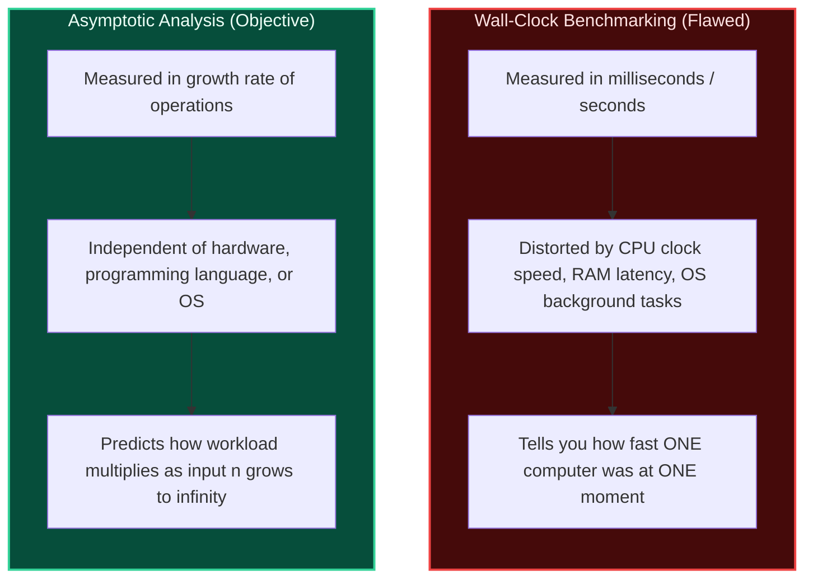

<AnalogyCard name="Stopwatch vs. Growth Curve">
  <div>
    <strong>The Stopwatch (Wall Clock)</strong>
    <p>
      Measuring an algorithm with a stopwatch is like testing a car's top speed
      in a muddy driveway during a rainstorm. The result tells you more about
      the weather and the tires than the engine. If your cloud server is busy
      handling background requests, your code appears slow. If you run it on a
      \$4,000 laptop, it appears fast.
    </p>
  </div>
  <div>
    <strong>The Big-O Lens (Growth Rate)</strong>
    <p>
      Big-O ignores milliseconds entirely. Instead, it asks one fundamental
      question:{" "}
      <em>
        "If the number of inputs doubles, how does the required work multiply?"
      </em>{" "}
      Does the work double? Does it quadruple? Or does it remain unchanged? That
      scaling relationship is invariant across every machine in the universe.
    </p>
  </div>
</AnalogyCard>

### The Two Golden Rules of Asymptotic Simplification

When evaluating Big-O, we only care about the dominant trend as the input size $n$ becomes very large ($n \to \infty$). To extract the core trend, we apply two simple rules:

<Steps>
### Rule 1: Drop Constant Multipliers
A multiplier like $2$, $5$, or $500$ does not change the shape of the growth curve.
- If an algorithm takes $3n$ steps, we write **$O(n)$**.
- If an algorithm takes $100n$ steps, we still write **$O(n)$**.
- Why? Because a linear line is still a linear line. As $n$ grows from $10$ to $10{,}000{,}000$, the steepness of the curve is far more important than any flat coefficient.

### Rule 2: Drop Lower-Order Terms

When multiple terms exist in an operation count, the fastest-growing term quickly renders all others completely irrelevant.

- Consider $f(n) = n^2 + 500n + 10{,}000$.
- When $n = 1{,}000{,}000$:
  - $n^2 = 1{,}000{,}000{,}000{,}000$ (one trillion operations)
  - $500n = 500{,}000{,}000$ (half a billion operations — just $0.05\%$ of the total work!)
  - $10{,}000$ is a microscopic rounding error.
- Therefore, $n^2 + 500n + 10{,}000 \implies \mathbf{O(n^2)}$.
  </Steps>

---

## 02 — The Big-O Hierarchy Ladder

Every algorithm you will ever write falls into one of seven universal complexity tiers. Think of these tiers as a ladder from **instant** to **catastrophic**:

```mermaid
flowchart LR
    O1["O(1)<br/>Constant"] --> OLog["O(log n)<br/>Logarithmic"]
    OLog --> ON["O(n)<br/>Linear"]
    ON --> ONLog["O(n log n)<br/>Linearithmic"]
    ONLog --> ON2["O(n²)<br/>Quadratic"]
    ON2 --> O2N["O(2ⁿ)<br/>Exponential"]
    O2N --> ONFact["O(n!)<br/>Factorial"]

    style O1 fill:#064e3b,stroke:#34d399,stroke-width:2px,color:#d1fae5
    style OLog fill:#064e3b,stroke:#34d399,stroke-width:2px,color:#d1fae5
    style ON fill:#065f46,stroke:#10b981,stroke-width:2px,color:#d1fae5
    style ONLog fill:#1e3a8a,stroke:#60a5fa,stroke-width:2px,color:#dbeafe
    style ON2 fill:#78350f,stroke:#f59e0b,stroke-width:2px,color:#fef3c7
    style O2N fill:#831843,stroke:#f43f5e,stroke-width:2px,color:#ffe4e6
    style ONFact fill:#450a0a,stroke:#ef4444,stroke-width:2px,color:#fee2e2
```

### Operations Required as Workload ($n$) Grows

| Big-O Class       | Common Name  | $n = 10$        | $n = 1{,}000$      | $n = 1{,}000{,}000$         | Production Behavior              | Everyday Analogy                                 |
| :---------------- | :----------- | :-------------- | :----------------- | :-------------------------- | :------------------------------- | :----------------------------------------------- |
| **$O(1)$**        | Constant     | $1$             | $1$                | $1$                         | Instant always                   | Looking up someone by their phone number         |
| **$O(\log n)$**   | Logarithmic  | $\approx 3$     | $\approx 10$       | $\approx 20$                | Super fast at any scale          | Finding a word in a printed dictionary           |
| **$O(n)$**        | Linear       | $10$            | $1{,}000$          | $1{,}000{,}000$             | Scales predictably               | Reading a book page by page                      |
| **$O(n \log n)$** | Linearithmic | $\approx 33$    | $\approx 10{,}000$ | $\approx 20{,}000{,}000$    | Standard sorting speed           | Sorting a shuffled deck of cards with MergeSort  |
| **$O(n^2)$**      | Quadratic    | $100$           | $1{,}000{,}000$    | $1{,}000{,}000{,}000{,}000$ | Danger zone at large $n$         | Every guest shaking hands with every other guest |
| **$O(2^n)$**      | Exponential  | $1{,}024$       | $> 10^{300}$       | _Unfathomable_              | Server crash past $n \approx 30$ | Guessing a numeric PIN by brute force            |
| **$O(n!)$**       | Factorial    | $3{,}628{,}800$ | _Impossible_       | _Impossible_                | Unusable past $n \approx 12$     | Testing every possible route to visit $n$ cities |

---

## 03 — Building Intuition: The Core Complexity Classes

If you have ever felt confused by Big-O notation, it is usually because textbooks throw Greek letters and abstract math at you before your brain has a **physical, tangible picture** of what the computer is actually doing.

To make Big-O click forever, use the single most powerful mental anchor in computer science:

<Callout type="info" title="The Golden Mental Anchor: The 'Double the Input' Test">
Whenever you want to know what a Big-O class really means, ask this one question:  
**"If my dataset doubles in size from $n$ to $2n$, what happens to my execution work?"**

- In **$O(1)$**: Work changes by **$+0$** (stays exactly the same).
- In **$O(\log n)$**: Work increases by just **$+1$ single step**!
- In **$O(n)$**: Work **doubles** ($2\times$).
- In **$O(n \log n)$**: Work **slightly more than doubles** ($\approx 2.1\times$).
- In **$O(n^2)$**: Work **quadruples** ($4\times$).
- In **$O(2^n)$**: Work **squares itself** (explodes to infinity).
  </Callout>

Let's walk through each one step-by-step with real-world pictures and plain-English code.

---

### 1. $O(1)$ — Constant Time (The Numbered Locker)

<AnalogyCard name="The Numbered Locker">
  <div>
    <strong>Everyday Intuition</strong>
    <p>
      Imagine a high school hallway with 10,000 lockers. You are assigned locker{" "}
      <strong>#4,218</strong>. You don't walk down the hallway opening locker
      #1, #2, #3, and #4 one-by-one. You walk directly to door #4,218 and open
      it in <strong>one single movement</strong>.
    </p>
  </div>
  <div>
    <strong>Machine Reality</strong>
    <p>
      When you access an array element by index (<code>arr[3]</code>), the CPU
      doesn't search through memory. It does a single instantaneous math
      calculation: <code>memory_address = base_address + (3 × 4 bytes)</code>.
      Whether the array holds 5 items or 5 billion items, calculating that
      address takes <strong>one single clock step</strong>.
    </p>
  </div>
</AnalogyCard>

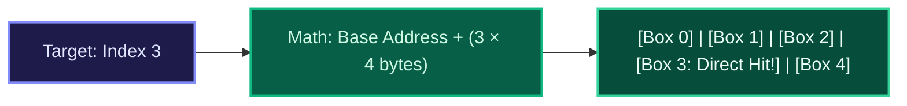

```python
# O(1) Example: Always takes exactly 1 operation
def get_user_by_id(users_by_id, user_id):
    return users_by_id.get(user_id)  # Hash table lookup: 1 direct jump
```

<LessonNote variant="myth" title="Common Myth: Does O(1) mean instant?">
  No. $O(1)$ does not mean "fast"—it means **unchanging**. A function that
  pauses for 2 seconds before returning a value is still $O(1)$ because it takes
  2 seconds whether the input size is 5 items or 5 million items. Big-O measures
  the *growth rate*, not the starting line.
</LessonNote>

---

### 2. $O(\log n)$ — Logarithmic Time (The "Higher / Lower" Guessing Game)

If you have ever played the children's game **"Guess my number between 1 and 100"**, you already understand logarithmic time.

<AnalogyCard name="The Higher / Lower Guessing Game">
  <div>
    <strong>How You Play Intuitively</strong>
    <p>
      You never guess 1, 2, 3, 4, 5... That would take up to 100 guesses!
      Instead, you guess <strong>50</strong>. If your friend says{" "}
      <em>"Higher!"</em>, you instantly discard numbers 1 through 50 with a
      single breath. Next, you guess <strong>75</strong>. If they say{" "}
      <em>"Lower!"</em>, you discard 75 through 100. In at most{" "}
      <strong>7 guesses</strong>, you find <em>any</em> number out of 100!
    </p>
  </div>
  <div>
    <strong>What 'Logarithm' Actually Means</strong>
    <p>
      Don't let the math symbol scare you.{" "}
      <strong>Logarithm ($\log_2 n$)</strong> is simply the answer to this
      question:{" "}
      <em>
        "How many times can I cut the number $n$ in half until I reach 1?"
      </em>
      <br />
      • 16 cut in half: 16 → 8 → 4 → 2 → 1 (4 cuts, so $\log_2 16 = 4$).
      <br />• 1,000,000 cut in half takes only <strong>20 cuts</strong>!
    </p>
  </div>
</AnalogyCard>

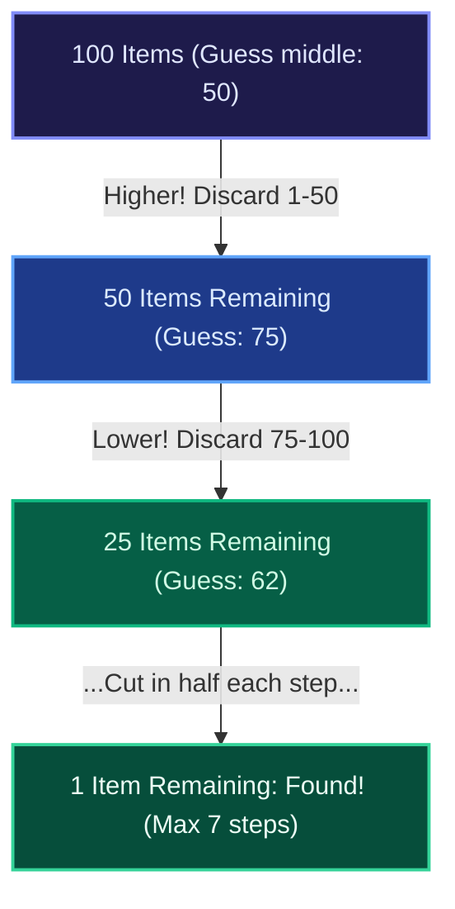

<LessonNote variant="why" title="The Superpower of O(log n)">
  What happens if your dataset doubles from 1,000,000 to 2,000,000 records? In
  an $O(n)$ linear scan, your time doubles. In an $O(\log n)$ binary search,
  **it takes exactly ONE extra check**! The first comparison cuts the 2 million
  down to 1 million, and you are back on familiar ground. Searching 1 billion
  items takes only 30 checks!
</LessonNote>

```python
# O(log n) Example: Binary Search on sorted items
def binary_search(sorted_items, target):
    left, right = 0, len(sorted_items) - 1
    while left <= right:
        mid = (left + right) // 2
        if sorted_items[mid] == target:
            return mid
        elif sorted_items[mid] < target:
            left = mid + 1      # Throw away left half
        else:
            right = mid - 1     # Throw away right half
    return -1
```

---

### 3. $O(n)$ — Linear Time (The Airport Security Line)

<AnalogyCard name="The Airport Security Line">
  <div>
    <strong>Everyday Intuition</strong>
    <p>
      A TSA agent checks each passenger's passport one by one. If 10 passengers
      arrive, the agent inspects 10 passports. If 100 passengers arrive, the
      agent inspects 100 passports. If the line doubles, the waiting time
      doubles.
    </p>
  </div>
  <div>
    <strong>Machine Reality</strong>
    <p>
      A single <code>for</code> loop scanning an unsorted array. To find the
      largest number or search for a name, the computer must inspect index 0,
      then index 1, then index 2, all the way to $n - 1$. Work scales in exact
      1:1 lockstep with input size.
    </p>
  </div>
</AnalogyCard>

```python
# O(n) Example: Inspecting every element once
def find_maximum(numbers):
    max_val = numbers[0]
    for num in numbers:          # Runs n times
        if num > max_val:
            max_val = num
    return max_val
```

---

### 4. $O(n \log n)$ — Linearithmic Time (The Card Sorter's Secret)

$O(n \log n)$ is the complexity class that confuses beginners the most: _"Where does the $n$ come from, and where does the $\log n$ come from?"_

Here is the secret: **One single pass through a dataset is not enough to sort it.** To put shuffled items in order, you have to break the collection into small pieces, sort the pieces, and merge them back together (like **MergeSort**).

<AnalogyCard name="Sorting 8 Playing Cards">
  <div>
    <strong>The Split and Merge Levels (log n)</strong>
    <p>
      Imagine 8 shuffled cards. You split them in half repeatedly until you have
      8 single cards. How many times can you split 8 cards in half? Exactly{" "}
      <strong>3 times</strong> (8 → 4 → 2 → 1). That is $\log_2(8) = 3$ levels
      of division.
    </p>
  </div>
  <div>
    <strong>The Work Per Level (n)</strong>
    <p>
      At each of those 3 levels, you compare and merge cards back into sorted
      piles. To merge them, you look at all <strong>8 cards</strong>. So every
      level takes 8 operations of work.
    </p>
  </div>
</AnalogyCard>

$$\text{Total Work} = (\text{Number of Levels}) \times (\text{Work Per Level}) = \log_2(n) \times n = \mathbf{n \log n}$$

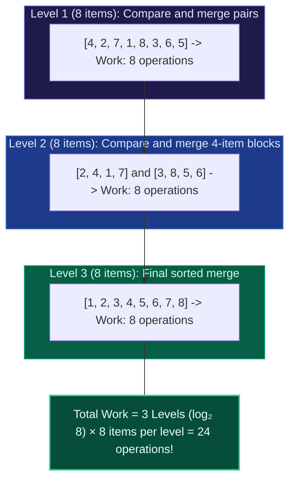

Why does this matter? Because $O(n \log n)$ is the **mathematical speed limit of general sorting**. Python's `list.sort()`, JavaScript's `array.sort()`, and Java's `Arrays.sort()` all run in $O(n \log n)$. When sorting 1 million items, it takes roughly 20 million operations—completing in a fraction of a second.

---

### 5. $O(n^2)$ — Quadratic Time (The Handshake Dinner Party)

<AnalogyCard name="The Handshake Dinner Party">
  <div>
    <strong>Everyday Intuition</strong>
    <p>You invite 10 friends to dinner. As a greeting, <strong>every guest must walk around and shake hands with every other guest</strong>. Person 1 shakes 9 hands. Person 2 shakes 8 hands. Total handshakes $\approx \frac{10 \times 10}{2} \approx 50$.<br/>
    Now imagine 100 guests attend. Handshakes explode to $\frac{100 \times 100}{2} \approx \mathbf{5{,}000}$!</p>
  </div>
  <div>
    <strong>The Quadratic Trap</strong>
    <p>The guest list grew by <strong>10×</strong>, but the handshakes multiplied by <strong>100×</strong> ($10^2$)! In code, this happens whenever you place a loop inside another loop, comparing every item against every other item.</p>
  </div>
</AnalogyCard>

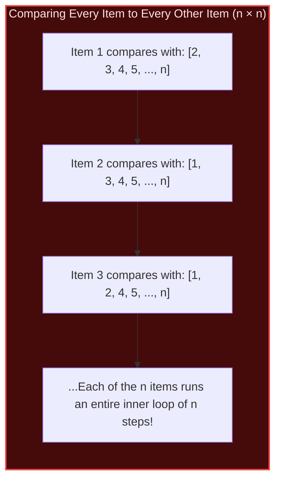

```python
# O(n²) Example: Comparing all pairs in an array
def has_duplicates(items):
    n = len(items)
    for i in range(n):              # Outer loop: runs n times
        for j in range(i + 1, n):   # Inner loop: runs ~n/2 times
            if items[i] == items[j]:
                return True
    return False
```

<LessonNote variant="warning" title="The Quadratic Production Trap">
Notice how deceptively dangerous $O(n^2)$ is:
- At $n = 50$: $2{,}500$ operations $\to$ **$0.002$ milliseconds** (instant).
- At $n = 1{,}000{,}000$: $1{,}000{,}000{,}000{,}000$ operations $\to$ **$16.6$ minutes**!
Code that feels blistering fast during staging tests can bring down your entire production cluster when subjected to real-world catalog volumes.
</LessonNote>

---

### 6. $O(2^n)$ — Exponential Time (The Toggle Padlock)

<AnalogyCard name="The Toggle Padlock">
  <div>
    <strong>Everyday Intuition</strong>
    <p>
      Imagine a digital padlock where each digit is a switch that can be either{" "}
      <strong>UP</strong> or <strong>DOWN</strong> (2 choices).
      <br />
      • 1 switch = 2 combinations (UP, DOWN)
      <br />
      • 2 switches = 4 combinations (UP-UP, UP-DOWN, DOWN-UP, DOWN-DOWN)
      <br />
      • 3 switches = 8 combinations
      <br />
      • 10 switches = 1,024 combinations
      <br />• 30 switches = <strong>1,073,741,824 combinations</strong> (over 1
      billion!)
    </p>
  </div>
  <div>
    <strong>The Exponential Explosion</strong>
    <p>
      Notice what happens: every time you add just{" "}
      <strong>ONE single switch</strong>, the total work doesn't increase by
      1—it <strong>DOUBLES the entire universe of work</strong>! An algorithm
      with $O(2^n)$ complexity is mathematically unusable for anything larger
      than $n \approx 30$.
    </p>
  </div>
</AnalogyCard>

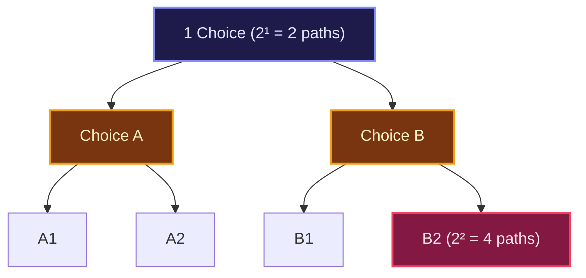

```python
# O(2ⁿ) Example: Naive recursive Fibonacci (branches in two at every step)
def fibonacci(n):
    if n <= 1:
        return n
    return fibonacci(n - 1) + fibonacci(n - 2)  # Spawns 2 recursive calls per step!
```

---

### Quick Check: Test Your Intuition Right Now

<TryIt
  question="You double your input dataset size from 1,000 items to 2,000 items. If your algorithm runs in O(log n) time, how much additional work does it perform?"
  options={[
    "It performs roughly double the work (2,000 operations)",
    "It performs exactly one additional comparison step",
    "It performs four times as much work (4,000 operations)",
    "It performs no additional work at all (0 extra steps)",
  ]}
  answer="B"
  why="In logarithmic time, doubling the input adds exactly one step (log₂(2n) = log₂(n) + 1). The first comparison cuts the 2,000 items in half down to 1,000, bringing you right back to your original problem size."
/>

<TryIt
  question="Why does sorting an array of n items with MergeSort take O(n log n) time instead of just O(n)?"
  options={[
    "Sorting requires generating all possible permutations of the elements first",
    "MergeSort breaks data into log n division levels, and does n work at every level",
    "Modern CPUs require log n cache flushes for every element moved in memory",
    "The algorithm must scan the entire array twice for each positive number found",
  ]}
  answer="B"
  why="Cutting the array in half until single items remain creates log₂(n) levels of division. Merging items back in sorted order requires inspecting all n items at each level. (Levels × Work per level = log n × n = n log n)."
/>

---

## 04 — The 3-Step Code Audit Method

Whenever you look at a piece of code in a code review or interview, use this 3-step audit to determine its time complexity in seconds:

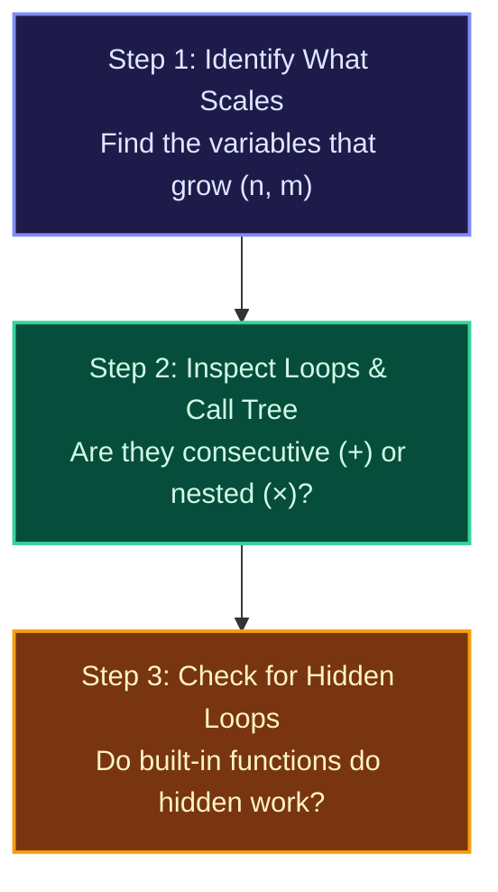

<Steps>
### Step 1: Identify What Grows
Look at the function parameters. What represents the size of the workload?
- An array `items` of length $n$.
- A string `s` of length $k$.
- A grid of rows $r$ and columns $c$.

### Step 2: Trace Loop Combinations (Add vs. Multiply)

- **Consecutive loops ADD:** If one loop finishes, and _then_ another loop starts, you add their complexities:
  $$O(n) + O(n) = O(2n) \implies \mathbf{O(n)}$$
- **Nested loops MULTIPLY:** If one loop runs _inside_ another loop, you multiply their complexities:
  $$O(n) \times O(n) = \mathbf{O(n^2)}$$
- **Dividing loops TAKE LOG:** If the index doubles or halves each time (`i *= 2` or `i //= 2`), it takes **$O(\log n)$**.

### Step 3: Beware of Hidden Linear Work

Always remember that standard library convenience methods are not free! Calling `arr.indexOf()`, `arr.includes()`, or string concatenation inside a loop secretly adds an inner $O(n)$ multiplier.

</Steps>

---

## 05 — Space Complexity: The Memory Trade-Off

When engineers discuss algorithmic performance, they often obsess over runtime speed: _"How many milliseconds does it take?"_

However, in real production environments—from mobile apps with limited memory to cloud microservices capped at 512 MB of RAM—**Space Complexity** is just as critical. If an algorithm runs out of memory, it doesn't just run slowly: the operating system forcibly kills your process with an **Out Of Memory (OOM) Crash**.

---

### The Chef's Kitchen Analogy

To understand what space complexity actually measures, imagine working in a kitchen:

<AnalogyCard name="The Chef's Cutting Board">
  <div>
    <strong>The Input (The Customer's Crate)</strong>
    <p>
      A customer walks into your kitchen and hands you a crate containing{" "}
      <strong>100 raw potatoes</strong> to peel. You did not buy the crate, and
      you didn't create the potatoes. That crate is the <strong>Input</strong>.
      It already exists in the room.
    </p>
  </div>
  <div>
    <strong>Auxiliary Space (Your Working Countertops)</strong>
    <p>
      As you peel, you have two choices:
      <br />• <strong>Method A (In-Place)</strong>: You hold 1 potato, peel it
      over the sink, and place it right back in the crate. You used 1 peeler.
      Your extra counter space is <strong>$O(1)$ constant</strong>.<br />•{" "}
      <strong>Method B (Extra Memory)</strong>: You pull out 100 individual
      bowls from the cupboard and put each peeled potato into its own bowl. Your
      extra counter space is <strong>$O(n)$ linear</strong>.
    </p>
  </div>
</AnalogyCard>

<Callout type="info" title="The Golden Rule: We Measure Auxiliary Space">
  In 99% of interviews, code reviews, and system design evaluations, **Space
  Complexity refers to Auxiliary Space**: *How much **extra** working memory
  does your algorithm allocate while doing its job, beyond the memory already
  taken by the input itself?*
</Callout>

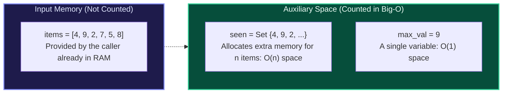

---

### The Two Places Your Code Allocates Memory

Whenever code runs, it consumes memory in exactly two places:

<Steps>
### 1. Explicit Data Structures (Heap Allocations)
Memory created intentionally with variables and collections:
- **A few simple variables** (`let count = 0`, `let max = arr[0]`, `let left = 0`): These take a fixed, tiny amount of space regardless of $n$. This is **$O(1)$ Constant Space**.
- **An auxiliary array, list, or hash set** that stores up to $n$ items: As input grows, memory grows in direct proportion. This is **$O(n)$ Linear Space**.
- **A 2D matrix or grid** of size $n \times n$ (like in graph adjacency matrices or dynamic programming tables): This is **$O(n^2)$ Quadratic Space**.

### 2. The Invisible Call Stack (Recursion)

This is the hidden trap that catches developers by surprise!

- Every time a function calls itself, the computer pauses the current function and creates a **Stack Frame** in RAM to remember where it left off, what local variables exist, and where to return.
- If a recursive function calls itself $n$ times before returning (like searching a deep linked list or naive tree depth traversal), there will be **$n$ stack frames sitting in RAM at the exact same time**.
- That means your recursive algorithm uses **$O(n)$ Space**, even if you never allocated a single list or variable!
  </Steps>

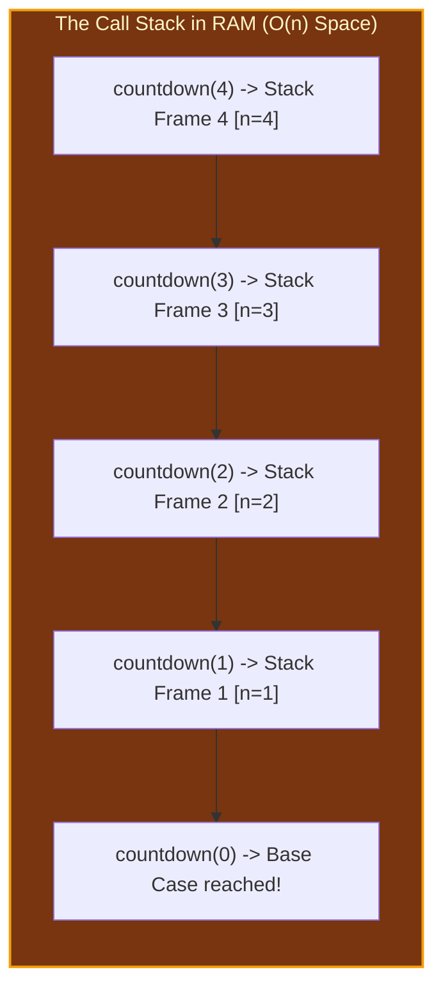

<LessonNote
  variant="warning"
  title="What happens when the Call Stack overflows?"
>
  If a recursive function dives 20,000 levels deep without returning, it
  exhausts the allocated call stack memory limit, resulting in the famous crash:
  - Python: <code>RecursionError: maximum recursion depth exceeded</code>-
  JavaScript: <code>RangeError: Maximum call stack size exceeded</code>-
  Java/C++: <code>java.lang.StackOverflowError</code>
</LessonNote>

---

### In-Place vs. Out-of-Place: The Reversal Example

To see how space complexity works in code, look at two different ways to reverse an array:

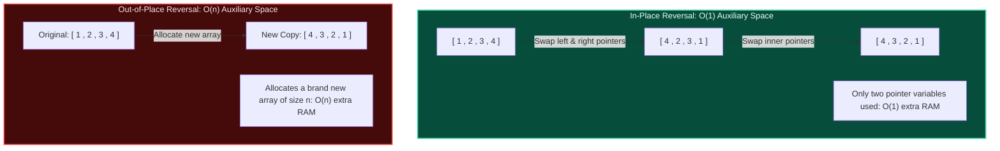

<Tabs items={["Python", "TypeScript"]}>
<Tab value="Python">
```python
# Strategy 1: In-Place Reversal (O(1) Auxiliary Space)
# We only use two integer pointers: left and right. Zero extra lists created!
def reverse_in_place(arr):
    left = 0
    right = len(arr) - 1
    while left < right:
        arr[left], arr[right] = arr[right], arr[left]
        left += 1
        right -= 1
    return arr  # Time: O(n), Auxiliary Space: O(1)

# Strategy 2: Out-of-Place Reversal (O(n) Auxiliary Space)

# Allocates an entirely new list in memory of size n

def reverse_out_of_place(arr):
reversed_copy = []
for i in range(len(arr) - 1, -1, -1):
reversed_copy.append(arr[i])
return reversed_copy # Time: O(n), Auxiliary Space: O(n)

````
</Tab>

<Tab value="TypeScript">
```typescript
// Strategy 1: In-Place Reversal (O(1) Auxiliary Space)
function reverseInPlace<T>(arr: T[]): T[] {
  let left = 0;
  let right = arr.length - 1;
  while (left < right) {
    const temp = arr[left];
    arr[left] = arr[right];
    arr[right] = temp;
    left++;
    right--;
  }
  return arr; // Time: O(n), Auxiliary Space: O(1)
}

// Strategy 2: Out-of-Place Reversal (O(n) Auxiliary Space)
function reverseOutOfPlace<T>(arr: T[]): T[] {
  const result: T[] = new Array(arr.length); // Allocates new memory for n items
  for (let i = 0; i < arr.length; i++) {
    result[i] = arr[arr.length - 1 - i];
  }
  return result; // Time: O(n), Auxiliary Space: O(n)
}
````

</Tab>
</Tabs>

---

### The Fundamental Space-Time Trade-Off

In software engineering, you can almost always trade physical memory (RAM) to buy CPU speed, or sacrifice CPU speed to conserve RAM.

Recall the **Duplicate Search** from earlier:

| Strategy       | Algorithm              | Time Complexity          | Auxiliary Space             | Behavior on 1,000,000 items                                        |
| :------------- | :--------------------- | :----------------------- | :-------------------------- | :----------------------------------------------------------------- |
| **Strategy A** | Nested Loop comparison | **$O(n^2)$** (Quadratic) | **$O(1)$** (Zero extra RAM) | Takes **16.6 minutes**, but uses 0 MB of extra memory              |
| **Strategy B** | Hash Set lookup        | **$O(n)$** (Linear)      | **$O(n)$** (Linear RAM)     | Takes **1 millisecond**, but uses $\approx 32\text{ MB}$ of memory |

<LessonNote
  variant="why"
  title="When would you ever pick Strategy A (O(1) Space)?"
>
  On modern web servers, Strategy B is the clear winner: RAM is cheap, and
  waiting 16 minutes for a request is unacceptable. However, if you are
  programming an **embedded microcontroller in a microwave, an IoT pacemaker, or
  a space rover** with only **64 Kilobytes of total RAM**, allocating a 32 MB
  hash set will immediately crash the hardware. In embedded and low-resource
  environments, $O(1)$ space algorithms are mandatory!
</LessonNote>

---

### Quick Check: Test Your Space Complexity Intuition

<TryIt
  question="A function accepts an array of n numbers and calculates the average using a single 'for' loop and a 'sum' variable. What is the auxiliary space complexity?"
  options={[
    "O(n) space, because the array passed into the function has n elements",
    "O(1) space, because the function only allocates a single 'sum' variable in memory",
    "O(log n) space, because dividing the sum by n performs logarithmic calculations",
    "O(n²) space, because reading each element allocates a temporary memory buffer",
  ]}
  answer="B"
  why="Auxiliary space only measures the *extra* memory your function creates. The input array was already allocated by the caller. Since the function only creates a single 'sum' variable, auxiliary space is O(1)."
/>

<TryIt
  question="A recursive function has no loops and creates no arrays, but calls itself recursively n times (depth n) before hitting the base case. What is its space complexity?"
  options={[
    "O(1) space, because no data structures or arrays were allocated in the code",
    "O(n) space, because each recursive call adds a stack frame to the call stack in RAM",
    "O(2ⁿ) space, because recursion always duplicates the operating system environment",
    "O(0) space, because pure functions without side-effects bypass physical memory",
  ]}
  answer="B"
  why="Even without allocating arrays, each unresolved recursive call pushes a stack frame onto the call stack. A recursion depth of n occupies n simultaneous frames in RAM, requiring O(n) auxiliary stack space."
/>

---

## 06 — Best, Worst, and Average Case ($O$, $\Omega$, $\Theta$)

Consider searching for a value in an unsorted list of $n$ numbers using linear search:

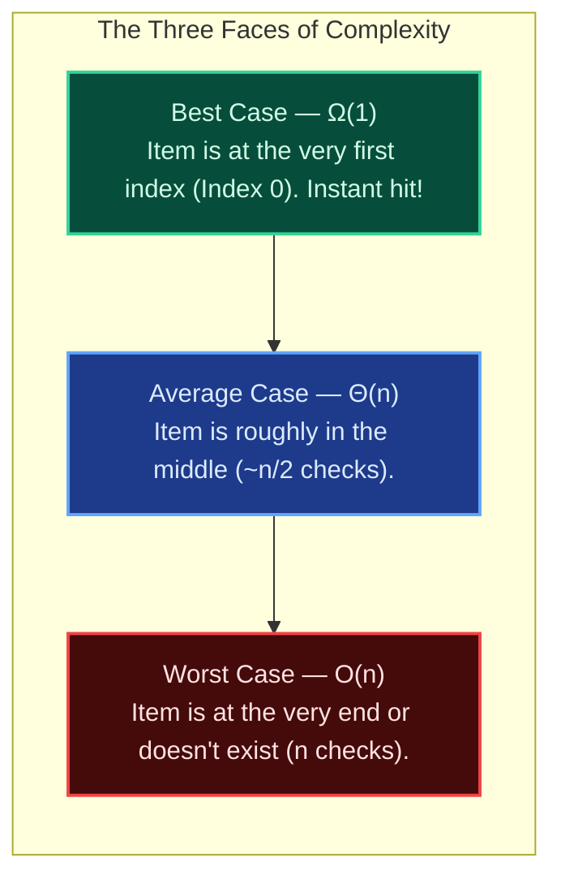

1. **Big-Omega ($\Omega$) — The Floor (Best Case):** The absolute minimum steps required under ideal conditions. For linear search, if the target is the very first element, it takes $1$ check ($\Omega(1)$).
2. **Big-Theta ($\Theta$) — The Tight Bound (Average Case):** How the algorithm typically behaves across random distributions. For linear search, on average you check $\frac{n}{2}$ elements, which simplifies to $\Theta(n)$.
3. **Big-O ($O$) — The Ceiling (Worst Case):** The guaranteed upper bound. Even under the absolute worst possible input, the algorithm will never take more than this many operations.

<LessonNote
  variant="why"
  title="Why software engineers almost always quote Big-O (Worst Case)"
>
  When designing production services, you must design for worst-case traffic. If
  your checkout service runs in 5 milliseconds on average, but stalls for 20
  seconds whenever an edge-case catalog item is selected, the system will
  experience cascading queue timeouts under high concurrency. Big-O gives you
  the safety guarantee.
</LessonNote>

---

## 07 — Hidden Production Complexity Traps

The most catastrophic performance bugs in real codebases rarely come from blatant nested `for` loops. They come from innocent-looking single lines that hide internal loops:

### Trap 1: Calling Linear Search Inside a Filter Loop

```javascript
// DANGEROUS HIDDEN O(n * m) TRAP:
const userIds = getActiveUserIds(); // Array of 100,000 IDs
const bannedUsers = getBannedList(); // Array of 50,000 IDs

const allowed = userIds.filter((id) => {
  // Array.includes() is an O(m) linear scan under the hood!
  // Nested inside .filter() (O(n)), total operations = n * m = 5,000,000,000!
  return !bannedUsers.includes(id);
});
```

**The Fix:** Convert the lookup collection to a `Set` first to turn the inner lookup into an $O(1)$ operation:

```javascript
// SAFE O(n + m) FIX:
const userIds = getActiveUserIds();
const bannedSet = new Set(getBannedList()); // O(m) one-time cost

const allowed = userIds.filter((id) => {
  return !bannedSet.has(id); // O(1) hash lookup!
});
```

---

### Trap 2: String Concatenation in Loops

In languages where strings are immutable (Python, Java, JavaScript), concatenating with `+=` creates a brand-new string and copies all previous characters each time:

```python
# SLOW O(n²) STRING CONCATENATION:
result = ""
for word in words:          # Loops n times
    result += word          # Copies all previous characters: 1 + 2 + 3 + ... + n -> O(n²)

# FAST O(n) JOIN:
result = "".join(words)     # Pre-allocates buffer once and copies linearly: O(n)
```

---

## 08 — Check Your Understanding

Test your retention with these three quick recall checks. Try answering in your head before revealing the explanation.

<TryIt
  question="Why does evaluating algorithms with a stopwatch (wall-clock time) fail to provide an objective comparison?"
  options={[
    "Stopwatches cannot measure intervals smaller than one second accurately",
    "Wall-clock timing depends heavily on CPU speed, RAM latency, and OS scheduling rather than the code alone",
    "Modern operating systems artificially throttle compilers when timers are active",
    "Wall-clock timing converts all linear algorithms into logarithmic curves during execution",
  ]}
  answer="B"
  why="Wall-clock milliseconds measure the physical hardware environment at a single instant. Big-O measures the intrinsic mathematical growth rate of operations, which remains true across all computers."
/>

<TryIt
  question="If an algorithm takes 3n² + 500n + 10,000 operations, what is its simplified Big-O time complexity?"
  options={[
    "O(n³), because constants multiply to create a cubic boundary",
    "O(n²), because we drop lower-order terms (500n, 10000) and constant multipliers (3)",
    "O(n), because linear operations dominate on modern multicore processors",
    "O(500n), because the largest constant multiplier dictates overall latency",
  ]}
  answer="B"
  why="As n approaches infinity, n² dwarfs 500n and 10,000. Applying the two rules of asymptotic simplification (dropping lower terms and dropping constants) leaves O(n²)."
/>

<TryIt
  question="An O(log n) binary search checks ~20 items in a dataset of 1,000,000 records. How many checks will it take if the dataset grows 1,000x to 1,000,000,000 records?"
  options={[
    "Roughly 30 checks, because each halving step handles exponentially larger spaces (log₂(1000) ≈ 10)",
    "Roughly 20,000 checks, because increasing input by 1,000 multiplies work by 1,000",
    "Roughly 400 checks, because logarithmic curves grow quadratically under scale",
    "Roughly 2,000 checks, because the logarithm scales with the square root of the dataset",
  ]}
  answer="A"
  why="Logarithmic growth is exceptionally slow. Because 2¹⁰ ≈ 1,000, multiplying the input size by 1,000 adds only about 10 additional comparisons (20 + 10 = 30)."
/>

---

<Takeaway>

**One Win for This Lesson:**
Big-O is not a benchmark of clock ticks; it is the universal law of how work multiplies as data scales. To analyze any code snippet:

1. Find the inputs that scale ($n$).
2. Check if loops are consecutive ($+$) or nested ($\times$).
3. Watch out for hidden $O(n)$ methods (`includes`, string concatenation) disguising quadratic traps inside loops.

</Takeaway>

---

<Callout type="info" title="Next Steps & Discussion">
  How did this lesson feel? Are the mental models and examples clear, or would
  you like to tweak any explanation before we proceed to apply this teaching
  style across the rest of the DSA curriculum? Ask your teacher any question!
</Callout>
