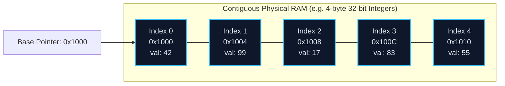
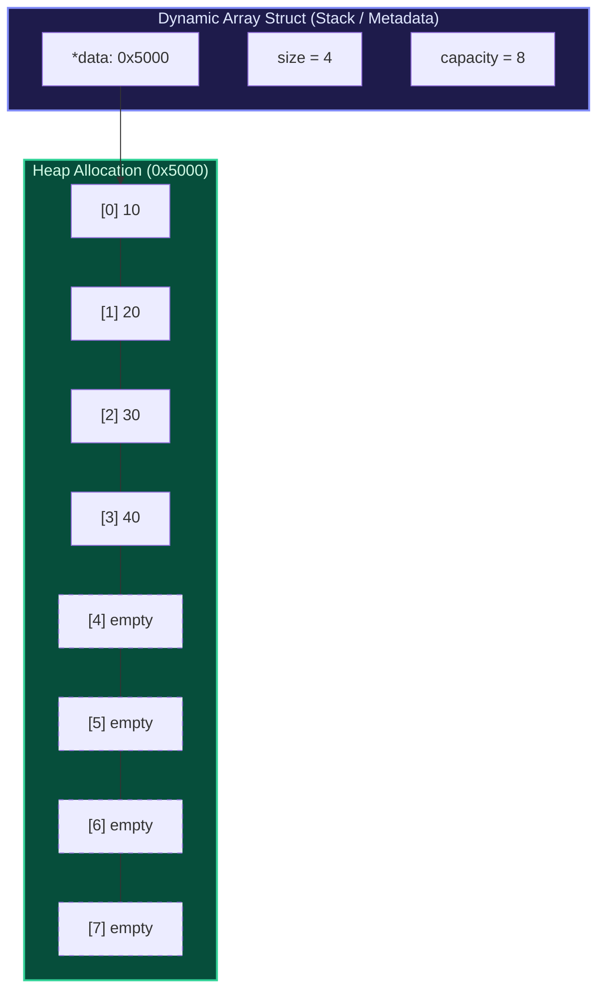

import { Callout } from "fumadocs-ui/components/callout";
import { Tabs, Tab } from "fumadocs-ui/components/tabs";
import { Steps, Step } from "fumadocs-ui/components/steps";
import { Cards, Card } from "fumadocs-ui/components/card";

## The Core Mental Model: Contiguous Memory & Pointer Arithmetic

An array is the most fundamental data structure in computer science. Its power stems directly from a physical guarantee: **all elements reside in a single unbroken block of contiguous memory addresses**.

Because elements are contiguous and uniform in byte-size, calculating the physical address of element $i$ requires no searching or pointer traversing. It is a single, instantaneous mathematical operation:

$$\text{Address}(A[i]) = \text{BaseAddress} + i \times \text{ElementSize}$$



Because modern x86-64 and ARM architectures provide specialized hardware instructions (such as x86 `MOV [RAX + RCX*4], EDX`), random indexing into an array executes in **1 clock cycle** ($O(1)$).

---

## Dynamic Arrays & Geometric Expansion

Static arrays suffer from a critical limitation: their capacity is fixed at allocation time. A **Dynamic Array** (such as Python's `list`, C++'s `std::vector`, or Java's `ArrayList`) overcomes this by maintaining three core fields:

1. `data`: Raw pointer to the contiguous heap buffer.
2. `size`: Number of valid elements currently stored.
3. `capacity`: Total allocated slots available in the current buffer.



### The Growth Factor Debate: 2.0x vs 1.5x

When an insertion occurs and `size == capacity`, the dynamic array must resize:

1. Allocate a new contiguous memory block of size $\lceil \gamma \times \text{capacity} \rceil$ where $\gamma$ is the growth factor.
2. Copy existing elements from the old block to the new block.
3. Deallocate the old memory block.
4. Point `data` to the new block and insert the new element.

Why not grow by adding a fixed constant (e.g. `capacity += 100`)?

- An arithmetic progression leads to $\sum_{k=1}^{N/100} 100k = O(N^2)$ total copies over $N$ inserts—yielding an unacceptable $O(N)$ amortized time per insertion.
- A **geometric progression** ensures that reallocations become exponentially rarer, achieving **amortized $O(1)$** push cost.

#### Why 1.5x Beats 2.0x in High-Performance Systems

- **The $2.0\times$ Problem (GCC `libstdc++`)**:
  Capacities grow: $1 \to 2 \to 4 \to 8 \to 16 \to 32 \to 64 \dots$
  Notice that $\sum_{i=0}^{k-1} 2^i = 2^k - 1 < 2^k$.
  The sum of all previously deallocated memory chunks is _always strictly smaller_ than the next allocation request! Therefore, the operating system memory allocator (`glibc ptmalloc`, `jemalloc`) can **never reuse** the contiguous memory block you just freed. This drives heap fragmentation and forces continuous virtual address space expansion.

- **The $1.5\times$ Solution (MSVC STL, Facebook Folly `fbvector`)**:
  When growth factor $\gamma < \frac{1 + \sqrt{5}}{2} \approx 1.618$ (the Golden Ratio), the cumulative memory freed from previous reallocations eventually exceeds the size of the next allocation request:
  $$\sum_{i=0}^{k-1} \gamma^i > \gamma^k$$
  After several reallocations, the memory allocator can place new vector buffers back into previously recycled memory slots, maximizing cache locality and minimizing page faults.

---

## Complexity Matrix: Static vs Dynamic Array

| Operation                               | Static Array | Dynamic Array (Worst-Case) | Dynamic Array (Amortized) | Auxiliary Space |
| :-------------------------------------- | :----------- | :------------------------- | :------------------------ | :-------------- |
| **Index Access (`A[i]`)**               | $O(1)$       | $O(1)$                     | $O(1)$                    | $O(1)$          |
| **Search (Unsorted)**                   | $O(N)$       | $O(N)$                     | $O(N)$                    | $O(1)$          |
| **Search (Sorted / Binary Search)**     | $O(\log N)$  | $O(\log N)$                | $O(\log N)$               | $O(1)$          |
| **Append (`push_back`)**                | N/A (Fixed)  | $O(N)$                     | $O(1)$                    | $O(1)$          |
| **Pop Last (`pop_back`)**               | N/A (Fixed)  | $O(1)$                     | $O(1)$                    | $O(1)$          |
| **Arbitrary Insert (`insert(i, val)`)** | $O(N)$       | $O(N)$                     | $O(N)$                    | $O(1)$          |
| **Arbitrary Delete (`erase(i)`)**       | $O(N)$       | $O(N)$                     | $O(N)$                    | $O(1)$          |

---

## Production Dynamic Vector Implementation

Below is a complete, custom generic dynamic array implementation written from scratch across three languages, demonstrating capacity expansion, element shifting, and boundary validation.

<Tabs items={['Python', 'TypeScript', 'C++']}>
<Tab value="Python">
```python
from typing import Any, Optional
import ctypes

class DynamicArray:
"""
A low-level dynamic array implementation using raw contiguous ctypes buffers,
mirroring CPython's PyListObject mechanics with a 1.5x geometric expansion.
"""
def **init**(self, initial_capacity: int = 4):
self.\_size = 0
self.\_capacity = max(1, initial_capacity)
self.\_data = self.\_create_buffer(self.\_capacity)

    def __len__(self) -> int:
        return self._size

    def __getitem__(self, index: int) -> Any:
        if not 0 <= index < self._size:
            raise IndexError(f"Index {index} out of bounds for size {self._size}")
        return self._data[index]

    def __setitem__(self, index: int, value: Any) -> None:
        if not 0 <= index < self._size:
            raise IndexError(f"Index {index} out of bounds for size {self._size}")
        self._data[index] = value

    def append(self, element: Any) -> None:
        """Amortized O(1) push_back operation."""
        if self._size == self._capacity:
            self._resize(int(self._capacity * 1.5) + 1)
        self._data[self._size] = element
        self._size += 1

    def pop(self) -> Any:
        """O(1) pop operation from end."""
        if self._size == 0:
            raise IndexError("pop from empty DynamicArray")
        self._size -= 1
        item = self._data[self._size]
        self._data[self._size] = None  # GC cleanup
        return item

    def insert(self, index: int, element: Any) -> None:
        """O(N) arbitrary position insert requiring rightward memory shift."""
        if not 0 <= index <= self._size:
            raise IndexError(f"Index {index} out of bounds")
        if self._size == self._capacity:
            self._resize(int(self._capacity * 1.5) + 1)
        # Shift elements rightward
        for i in range(self._size, index, -1):
            self._data[i] = self._data[i - 1]
        self._data[index] = element
        self._size += 1

    def _resize(self, new_capacity: int) -> None:
        new_data = self._create_buffer(new_capacity)
        for i in range(self._size):
            new_data[i] = self._data[i]
        self._data = new_data
        self._capacity = new_capacity

    def _create_buffer(self, capacity: int):
        return (capacity * ctypes.py_object)()

    def __repr__(self) -> str:
        items = [repr(self._data[i]) for i in range(self._size)]
        return f"DynamicArray([{', '.join(items)}], size={self._size}, capacity={self._capacity})"

````
</Tab>

<Tab value="TypeScript">
```typescript
/**
 * Generic Dynamic Array backed by flat typed storage or contiguous slot arrays.
 */
export class DynamicVector<T> {
  private buffer: (T | undefined)[];
  private currentSize: number = 0;
  private currentCapacity: number;

  constructor(initialCapacity: number = 4) {
    this.currentCapacity = Math.max(1, initialCapacity);
    this.buffer = new Array<T | undefined>(this.currentCapacity);
  }

  public size(): number {
    return this.currentSize;
  }

  public capacity(): number {
    return this.currentCapacity;
  }

  public get(index: number): T {
    this.assertBounds(index);
    return this.buffer[index] as T;
  }

  public set(index: number, value: T): void {
    this.assertBounds(index);
    this.buffer[index] = value;
  }

  public push(value: T): void {
    if (this.currentSize === this.currentCapacity) {
      // 1.5x geometric expansion
      this.resize(Math.floor(this.currentCapacity * 1.5) + 1);
    }
    this.buffer[this.currentSize++] = value;
  }

  public pop(): T {
    if (this.currentSize === 0) {
      throw new RangeError("Cannot pop from an empty vector.");
    }
    const idx = --this.currentSize;
    const value = this.buffer[idx] as T;
    this.buffer[idx] = undefined; // Avoid memory leaks
    return value;
  }

  public insert(index: number, value: T): void {
    if (index < 0 || index > this.currentSize) {
      throw new RangeError(`Index ${index} out of bounds.`);
    }
    if (this.currentSize === this.currentCapacity) {
      this.resize(Math.floor(this.currentCapacity * 1.5) + 1);
    }
    // Shift elements right
    for (let i = this.currentSize; i > index; i--) {
      this.buffer[i] = this.buffer[i - 1];
    }
    this.buffer[index] = value;
    this.currentSize++;
  }

  private resize(newCapacity: number): void {
    const newBuffer = new Array<T | undefined>(newCapacity);
    for (let i = 0; i < this.currentSize; i++) {
      newBuffer[i] = this.buffer[i];
    }
    this.buffer = newBuffer;
    this.currentCapacity = newCapacity;
  }

  private assertBounds(index: number): void {
    if (index < 0 || index >= this.currentSize) {
      throw new RangeError(`Index ${index} is out of bounds [0, ${this.currentSize - 1}].`);
    }
  }
}
````

</Tab>

<Tab value="C++">
```cpp
#include <iostream>
#include <stdexcept>
#include <utility>
#include <memory>

template <typename T>
class CustomVector {
private:
T\* data*{nullptr};
size_t size*{0};
size*t capacity*{0};

    void reallocate(size_t new_capacity) {
        // Allocate raw uninitialized memory
        T* new_block = static_cast<T*>(::operator new(new_capacity * sizeof(T)));

        // Move existing elements to new memory block
        for (size_t i = 0; i < size_; ++i) {
            new (&new_block[i]) T(std::move(data_[i]));
            data_[i].~T(); // Destruct old object
        }

        // Deallocate old memory buffer
        ::operator delete(data_);
        data_ = new_block;
        capacity_ = new_capacity;
    }

public:
explicit CustomVector(size*t initial_capacity = 4)
: size*(0), capacity*(initial_capacity > 0 ? initial_capacity : 1) {
data* = static*cast<T\*>(::operator new(capacity* \* sizeof(T)));
}

    ~CustomVector() {
        clear();
        ::operator delete(data_);
    }

    void push_back(const T& value) {
        if (size_ >= capacity_) {
            // 1.5x growth factor
            reallocate(capacity_ + capacity_ / 2 + 1);
        }
        new (&data_[size_]) T(value);
        ++size_;
    }

    void push_back(T&& value) {
        if (size_ >= capacity_) {
            reallocate(capacity_ + capacity_ / 2 + 1);
        }
        new (&data_[size_]) T(std::move(value));
        ++size_;
    }

    void pop_back() {
        if (size_ == 0) throw std::out_of_range("Vector is empty");
        --size_;
        data_[size_].~T();
    }

    T& operator[](size_t index) { return data_[index]; }
    const T& operator[](size_t index) const { return data_[index]; }

    size_t size() const { return size_; }
    size_t capacity() const { return capacity_; }

    void clear() {
        for (size_t i = 0; i < size_; ++i) {
            data_[i].~T();
        }
        size_ = 0;
    }

};

````
</Tab>
</Tabs>

---

## Essential Algorithmic Patterns: Prefix Sums & Difference Arrays

### 1. Prefix Sums: $O(1)$ Range Queries

Given an array $A$ of length $N$, answer $Q$ queries asking for the sum of elements between indices $L$ and $R$ inclusive: $\sum_{i=L}^{R} A[i]$.

A naive loop takes $O(R - L + 1) = O(N)$ per query, resulting in $O(Q \times N)$ time.
With a **Prefix Sum Array** $P$, where $P[i] = \sum_{k=0}^{i-1} A[k]$ with $P[0] = 0$:

$$\text{RangeSum}(L, R) = P[R + 1] - P[L]$$

Preprocessing costs $O(N)$ time and $O(N)$ space. Each query takes **$O(1)$ time**.

```mermaid
flowchart LR
    subgraph Original["Original Array A"]
        A0["[0]: 3"]
        A1["[1]: 5"]
        A2["[2]: 2"]
        A3["[3]: 8"]
        A4["[4]: 1"]
    end

    subgraph Prefix["Prefix Sum Array P (1-indexed base)"]
        P0["P[0] = 0"]
        P1["P[1] = 3"]
        P2["P[2] = 8"]
        P3["P[3] = 10"]
        P4["P[4] = 18"]
        P5["P[5] = 19"]
    end

    Original -->|Cumulate| Prefix
````

To query range $[1, 3]$ (elements $5 + 2 + 8 = 15$):
$$\text{Sum}(1, 3) = P[4] - P[1] = 18 - 3 = 15$$

### 2. Difference Arrays: $O(1)$ Range Updates

Suppose you have an array initialized to zeros. You receive $K$ range update queries: "Add value $V$ to all indices in $[L, R]$". Finally, you must return the resulting array.

- **Naive approach**: Loop from $L$ to $R$ for each query $\implies O(K \times N)$ total time.
- **Difference Array approach**: Maintain array $D$, where $D[i] = A[i] - A[i-1]$ (with $A[-1] = 0$).
  Adding $V$ to all elements in $[L, R]$ changes only two values in $D$:
  1. $D[L] \mathrel{+}= V$ (because $A[L]$ increased relative to $A[L-1]$)
  2. $D[R + 1] \mathrel{-}= V$ (because $A[R+1]$ did not increase, but $A[R]$ did)

After processing all $K$ updates in **$O(1)$ time each**, recover the final array by computing the running prefix sum of $D$ in a single $O(N)$ pass!

```mermaid
flowchart TD
    Update["Range Update [L, R] with +V"] --> Action1["diff[L] += V"]
    Update --> Action2["diff[R + 1] -= V"]
    Action1 & Action2 --> Pass["Offline Sweep: result[i] = result[i-1] + diff[i]"]
    Pass --> Result["Final Array Restored in O(N) Total Time"]
```

---

## Production Systems Case Study: Python `list` & CPython Growth Strategy

In CPython (`listobject.c`), the dynamic array growth formula is explicitly tailored to prevent excessive reallocations while minimizing wasted memory overhead:

```c
// CPython listobject.c: list_resize function
new_allocated = ((size_t)newsize + (newsize >> 3) + 6) & ~(size_t)3;
```

Let's dissect this expression:

1. `newsize >> 3`: Adds $\approx 12.5\%$ to the requested size.
2. `+ 6`: Adds a constant padding to avoid thrashing at very small sizes ($0, 1, 2, 3$).
3. `& ~(size_t)3`: Rounds up to the nearest multiple of 4 or 8 bytes to align with CPU cache and allocator bucketing boundaries.

The resulting sequence of allocations when growing sequentially is:
$$0, 4, 8, 16, 24, 32, 40, 52, 64, 76, \dots$$
Notice that for larger sizes, the growth factor settles around **$1.125\times$ (1.125)**. Why so conservative compared to C++'s $1.5\times$ or $2.0\times$?
Because Python lists store pointers (`PyObject*`, 8 bytes each), Python processes frequently create millions of small lists. An aggressive $2\times$ factor would waste hundreds of megabytes of RAM across nested data structures.

---

## Common Interview Traps & Invariants

<Callout type="warn">
### The In-Place Array Mutation Trap
Modifying the size of an array while iterating over it via index or iterator causes subtle off-by-one errors and skipped elements:
```python
# BUG: Elements get skipped as indices shift left
arr = [1, 2, 2, 3, 4]
for i in range(len(arr)):
    if arr[i] == 2:
        del arr[i] # IndexError or skips the second 2!
```
Furthermore, `del arr[i]` triggers an $O(N)$ memory shift on each deletion, degrading the entire loop to $O(N^2)$ time.

**Golden Rule**: When removing elements matching a condition in-place, use the **Two-Pointer (Read/Write) Pattern** running in a single $O(N)$ pass:

```python
write_idx = 0
for read_idx in range(len(arr)):
    if arr[read_idx] != 2:
        arr[write_idx] = arr[read_idx]
        write_idx += 1
del arr[write_idx:]
```

</Callout>

---

## Hands-On Verification Challenge

1. **Prefix Sum Application**: Given an array `nums = [-2, 0, 3, -5, 2, -1]`, compute its 1-indexed prefix sum array. Using that array, calculate the sum of elements from index 2 to 5 in $O(1)$ operations.
2. **Difference Array Application**: You run a hotel with 100 rooms. You receive a list of $M$ booking reservations formatted as `[check_in, check_out, guests]`. Use a difference array to calculate the hotel's peak guest count across 365 calendar days in $O(M + 365)$ time.
