import { Callout } from "fumadocs-ui/components/callout";
import { Tabs, Tab } from "fumadocs-ui/components/tabs";
import { Steps, Step } from "fumadocs-ui/components/steps";
import {
  Concepts,
  LessonIntro,
  AnalogyCard,
  Explain,
  LessonNote,
  TryIt,
  Takeaway,
} from "@/components/cs101/lesson-blocks";

<Concepts
  items={[
    "contiguous memory",
    "pointer arithmetic",
    "row-major vs column-major",
    "jagged & sparse arrays",
    "circular arrays",
    "cache locality & 64B lines",
    "amortized analysis (banker's method)",
    "two pointers & sliding window",
    "prefix sums & difference arrays",
  ]}
/>

<LessonIntro>

Imagine you have just been hired as head of logistics for **ByteKart**, an e-commerce platform that needs to store **10,000 shoe boxes** in its central fulfillment warehouse.

You have two competing architectural proposals for how to organize the warehouse floor:

1. **Scattered Lockers (Linked List)**: Place shoe boxes in random empty lockers across 5 floors. Inside each locker, leave a sticky note pointing to the locker number of the next shoe.
2. **One Long Contiguous Steel Shelf (Array)**: Lay down an unbroken aisle of identical 40 cm cubbies, numbered consecutively from $0$ to $9{,}999$.

To retrieve Box #500 in the scattered lockers, a runner must sprint through all 499 previous lockers just to read the sticky notes. But on the contiguous steel shelf, the runner calculates $500 \times 40\text{ cm} = 200\text{ meters}$ and walks **straight to the exact slot in one step**.

**Arrays are the physical bedrock of silicon computing.** Modern CPUs are built specifically to stream contiguous memory. In this lesson, we explore how arrays interact with physical RAM, master address calculation formulas tested in university exams and interviews, uncover why dynamic arrays expand geometrically, and unlock the algorithmic patterns that power high-performance software.

</LessonIntro>

---

## 01 — Physical RAM & The Contiguous Guarantee

In computer hardware, physical RAM is an unbroken, billions-long sequence of 1-byte storage cells, each tagged with a unique hexadecimal number called its **memory address**.

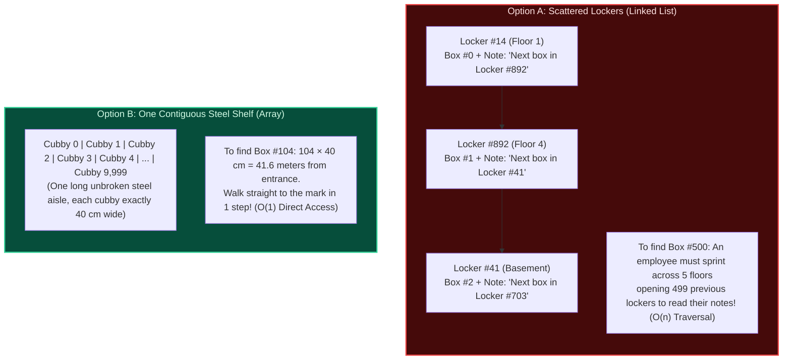

<AnalogyCard name="Hotel Corridor vs. Scattered Lockers">
  <div>
    <strong>The Hotel Corridor (Contiguous Array)</strong>
    <p>
      When you stay at a hotel, Room 101, 102, 103, and 104 are physically
      adjacent on the same corridor. If you stand at Room 101, you know with
      mathematical certainty that{" "}
      <strong>Room 107 is exactly 6 doors down on your right</strong>. You do
      not knock on rooms 102 through 106 to ask for directions.
    </p>
  </div>
  <div>
    <strong>The Scattered Lockers (Linked List)</strong>
    <p>
      Imagine if hotel guests were assigned random storage lockers across 10
      subway stations. To find friend #5, you must visit locker #1, which holds
      a key and note with the address of locker #2, which points to locker #3.
      Finding anyone requires a full scavenger hunt.
    </p>
  </div>
</AnalogyCard>

### 1D Address Calculation Formula

Because array elements are uniform in size and packed edge-to-edge without gaps, locating index $i$ requires **zero searching**. The CPU calculates the physical byte address directly:

$$\text{Address}(A[i]) = \text{Base} + (i - \text{LB}) \times W$$

Where:

- $\text{Base}$: Starting memory address of the first element in RAM.
- $i$: The target element index.
- $\text{LB}$: The lower bound of the index range ($0$ for zero-indexed languages like C, Python, and Java; $1$ for one-indexed languages like Fortran and Julia; or an arbitrary integer).
- $W$: The data width (size of each element in bytes, e.g., $4$ bytes for a 32-bit integer, $8$ bytes for a 64-bit float or pointer).

For standard $0$-indexed arrays where $\text{LB} = 0$, this simplifies to:

$$\text{Address}(A[i]) = \text{Base} + i \times W$$

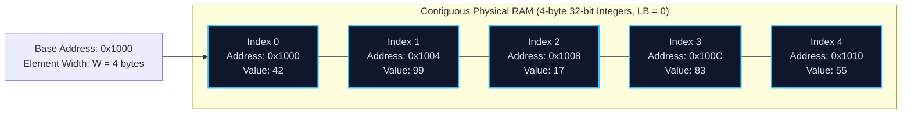

On modern x86-64 processors, this calculation is resolved by a single hardware instruction (`MOV [RAX + RCX*4], EDX`) in **1 CPU clock cycle** ($O(1)$).

---

## 02 — Interactive Simulator: Contiguous Memory in Action

Explore how the CPU accesses, reads, inserts, and deletes elements within a contiguous memory block:

<ArrayMemorySimulator />

<Callout type="info" title="How to Explore the Simulator">
  1. Click **PLAY ALL** or step through with **STEP →** to watch contiguous
  memory blocks allocate in RAM. 2. Observe how accessing index $i$ jumps
  directly to $\text{Base} + i \times 4$ without examining any preceding
  elements ($O(1)$ random access). 3. Notice what happens when inserting or
  deleting at the front: the CPU must **shift every subsequent element** by one
  slot to keep the contiguous guarantee intact ($O(n)$ shifting penalty).
</Callout>

---

## 03 — Silicon Reality: CPU Caches & Spatial Locality

Why do arrays consistently outperform linked lists by $10\times$ to $50\times$ in real benchmarks, even when both execute the same number of theoretical operations?

The answer lies in the **CPU memory hierarchy**:

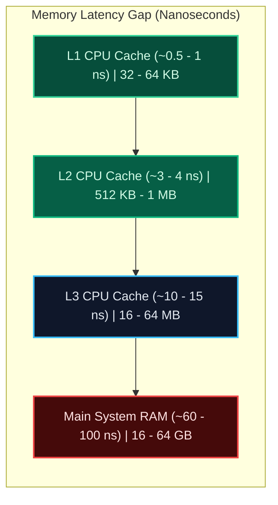

### The 64-Byte Cache Line Rule

A modern CPU never loads a single byte or a single integer from RAM in isolation. Whenever memory is requested, the CPU hardware memory controller fetches an entire **64-byte block** known as a **cache line**.

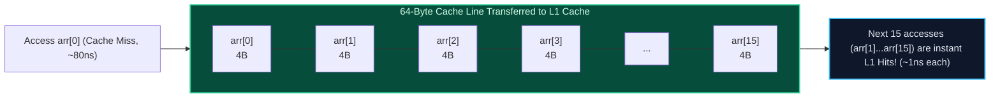

- When you read `arr[0]` (a 4-byte integer), the CPU pulls `arr[0]` through `arr[15]` into the blazing-fast L1 cache simultaneously.
- When your loop advances to `arr[1]`, `arr[2]`, $\dots$, `arr[15]`, the values are **already waiting inside the CPU core**. Access takes less than $1$ nanosecond (**Cache Hit**). This is **Spatial Locality**.
- By contrast, every node in a linked list is allocated at a random address on the heap. Traversing `node.next` forces the CPU to stall for $\approx 80$ nanoseconds waiting for main RAM (**Cache Miss / Pointer Chasing**).

<LessonNote variant="why" title="Hardware Prefetching">
  Modern CPUs feature hardware stream prefetchers. When the CPU notices your
  instructions sequentially accessing `arr[0]`, `arr[1]`, and `arr[2]`, it
  automatically speculates that you will soon need `arr[16]`, prefetching the
  subsequent cache lines into L2/L1 before your code even reaches them!
</LessonNote>

---

## 04 — Complete Taxonomy of Arrays

Arrays come in several structural varieties designed for different spatial and computational demands:

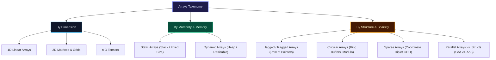

<Explain
  title="Static Arrays vs. Dynamic Arrays"
  what="Fixed compile-time size allocated on the call stack vs. resizable runtime capacity managed on the heap."
>

**Static Arrays** (e.g., C `int arr[100];`, Rust `[i32; 100]`) have their size fixed at compile time. They live on the rapid call stack or in the program data segment. Zero memory allocation overhead, but cannot grow if more data arrives.

**Dynamic Arrays** (e.g., Python `list`, C++ `std::vector`, Java `ArrayList`) store elements in a heap-allocated buffer. When full, they dynamically allocate a larger buffer and migrate their elements.

</Explain>

---

## 05 — Multidimensional Arrays & Address Calculation Formulas

In mathematics, a 2D matrix has rows and columns. But in hardware, **physical RAM is strictly one-dimensional**. To store a 2D grid in linear RAM, we must flatten the 2D coordinates $(i, j)$ into a single 1D offset.

There are two fundamental strategies for flattening:

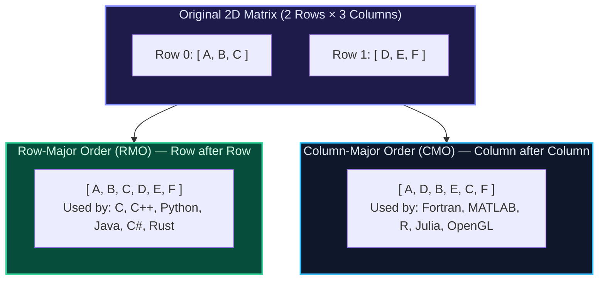

### Derivation of 2D Address Formulas (Major Exam Topic)

Let a 2D array be defined with bounds:

- Rows indexed from $\text{LB}_r$ to $\text{UB}_r \implies \text{Total Rows } R = \text{UB}_r - \text{LB}_r + 1$.
- Columns indexed from $\text{LB}_c$ to $\text{UB}_c \implies \text{Total Columns } C = \text{UB}_c - \text{LB}_c + 1$.
- Let $\text{Base}$ be the address of $A[\text{LB}_r][\text{LB}_c]$ and $W$ be element width in bytes.

<Steps>
### 1. Row-Major Order (RMO) Derivation
In Row-Major Order, all elements of Row 0 are stored first, followed by all elements of Row 1, and so on.
To locate element $A[i][j]$:
1. We must skip all preceding $(i - \text{LB}_r)$ complete rows.
2. Each complete row contains $C$ elements. Therefore, preceding rows account for $(i - \text{LB}_r) \times C$ elements.
3. Within the target row $i$, we must skip $(j - \text{LB}_c)$ preceding column entries.
4. Total elements skipped = $[C \times (i - \text{LB}_r) + (j - \text{LB}_c)]$.

$$\mathbf{\text{Address}(A[i][j]) = \text{Base} + W \times [C \times (i - \text{LB}_r) + (j - \text{LB}_c)]}$$

For standard 0-indexed matrices ($\text{LB}_r = 0, \text{LB}_c = 0$):
$$\text{Address}(A[i][j]) = \text{Base} + W \times (i \times C + j)$$

### 2. Column-Major Order (CMO) Derivation

In Column-Major Order, all elements of Column 0 are stored first, followed by Column 1, and so on.
To locate element $A[i][j]$:

1. We must skip all preceding $(j - \text{LB}_c)$ complete columns.
2. Each complete column contains $R$ elements. Therefore, preceding columns account for $(j - \text{LB}_c) \times R$ elements.
3. Within the target column $j$, we must skip $(i - \text{LB}_r)$ preceding row entries.
4. Total elements skipped = $[R \times (j - \text{LB}_c) + (i - \text{LB}_r)]$.

$$\mathbf{\text{Address}(A[i][j]) = \text{Base} + W \times [R \times (j - \text{LB}_c) + (i - \text{LB}_r)]}$$

For standard 0-indexed matrices ($\text{LB}_r = 0, \text{LB}_c = 0$):
$$\text{Address}(A[i][j]) = \text{Base} + W \times (j \times R + i)$$

</Steps>

---

### Step-by-Step Numerical Exam Walkthrough

<Callout type="info" title="Standard University Exam Problem">
  An array $A[1 \dots 4][1 \dots 5]$ is stored in memory with **Base Address =
  1000**. Each element occupies **$W = 4$ bytes**. Calculate the memory address
  of element **$A[2][3]$** in: 1. Row-Major Order (RMO) 2. Column-Major Order
  (CMO)
</Callout>

**Given Parameters:**

- Lower bounds: $\text{LB}_r = 1$, $\text{LB}_c = 1$
- Upper bounds: $\text{UB}_r = 4$, $\text{UB}_c = 5$
- Total Rows: $R = 4 - 1 + 1 = 4$
- Total Columns: $C = 5 - 1 + 1 = 5$
- Target: $i = 2$, $j = 3$
- $\text{Base} = 1000$, $W = 4$

#### Part 1: Row-Major Order (RMO) Calculation

$$\text{Address}(A[2][3]) = \text{Base} + W \times [C \times (i - \text{LB}_r) + (j - \text{LB}_c)]$$
$$\text{Address}(A[2][3]) = 1000 + 4 \times [5 \times (2 - 1) + (3 - 1)]$$
$$\text{Address}(A[2][3]) = 1000 + 4 \times [5 \times 1 + 2] = 1000 + 4 \times 7 = 1000 + 28 = \mathbf{1028}$$

_Verification_: Row 1 has 5 elements ($1000, 1004, 1008, 1012, 1016$). Row 2 begins with $A[2][1]$ at $1020$, $A[2][2]$ at $1024$, and $A[2][3]$ at **1028**.

#### Part 2: Column-Major Order (CMO) Calculation

$$\text{Address}(A[2][3]) = \text{Base} + W \times [R \times (j - \text{LB}_c) + (i - \text{LB}_r)]$$
$$\text{Address}(A[2][3]) = 1000 + 4 \times [4 \times (3 - 1) + (2 - 1)]$$
$$\text{Address}(A[2][3]) = 1000 + 4 \times [4 \times 2 + 1] = 1000 + 4 \times 9 = 1000 + 36 = \mathbf{1036}$$

_Verification_: Col 1 has 4 elements ($1000, 1004, 1008, 1012$). Col 2 has 4 elements ($1016, 1020, 1024, 1028$). Col 3 starts with $A[1][3]$ at $1032$, and $A[2][3]$ at **1036**.

<LessonNote
  variant="warning"
  title="Performance Impact: Iteration Order Matters"
>
  Because C and C++ store matrices in Row-Major Order, traversing row-by-row
  (`for i: for j: sum += matrix[i][j]`) accesses memory contiguously, achieving
  100% cache line utilization. Traversing column-by-column (`for j: for i: sum
  += matrix[i][j]`) strides by $C \times 4$ bytes on every inner iteration,
  triggering a CPU cache miss on every access and running **up to $10\times$
  slower**!
</LessonNote>

---

## 06 — Specialized Array Structures

<Explain
  title="Jagged (Ragged) Arrays"
  what="An array of array pointers where each row can have a completely different length."
>

Unlike a contiguous 2D rectangular matrix, a **Jagged Array** is an array of references (pointers). The primary array stores pointers to independent, heap-allocated 1D arrays of varying sizes.

Languages like Java (`int[][]`), C# (`int[][]`), and Python (nested `list`) implement multidimensional arrays as jagged arrays by default.

</Explain>

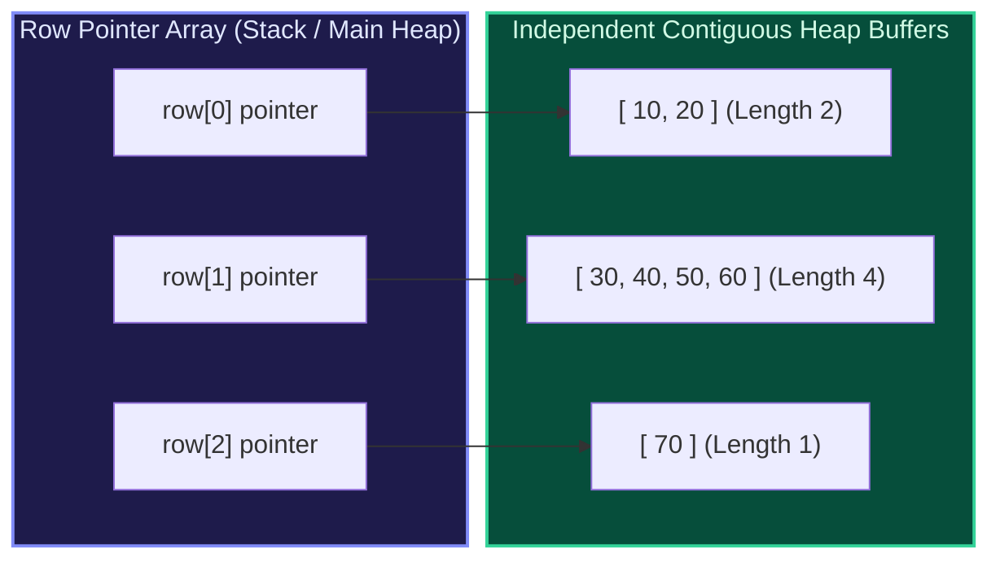

**Trade-offs of Jagged Arrays:**

- **Advantage**: Saves significant memory when rows are uneven (e.g., triangle matrices, graph adjacency lists, sentences of text).
- **Disadvantage**: Memory overhead (8 bytes per row pointer + allocator heap header per row) and broken spatial cache locality (rows are scattered across different heap pages).

---

<Explain
  title="Circular Arrays (Ring Buffers)"
  what="A fixed-capacity array where index arithmetic wraps around from the end back to index 0 using the modulo operator."
>

In a standard linear queue, popping an element from the front requires shifting all remaining elements left in $O(n)$ time. A **Circular Array** solves this by maintaining `head` and `tail` indices that move forward cyclically.

The transition formula: `next_index = (current_index + 1) % Capacity`.

</Explain>

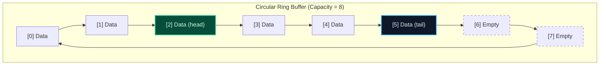

**Applications**: High-throughput message queues (LMAX Disruptor), audio buffer streaming, fixed-size undo histories, and network packet ring buffers in OS kernel drivers.

---

<Explain
  title="Sparse Arrays & Sparse Matrices"
  what="Arrays where the overwhelming majority of cells contain zero or default values."
>

Consider a $10{,}000 \times 10{,}000$ matrix representing user connections on a social network. Storing this as a full 2D array requires $10^8 \times 4\text{ bytes} \approx 400\text{ MB}$ of RAM. If only 500 connections exist, **99.9995% of that memory is wasted storing zeros!**

The classic solution is the **3-Tuple / Triplet Representation** (Coordinate format or COO), where each non-zero element is stored as `[Row, Column, Value]`.

</Explain>

#### Sparse Matrix Conversion Example:

Consider this $4 \times 5$ matrix containing only 4 non-zero entries:

$$
M = \begin{bmatrix}
0 & 0 & 15 & 0 & 0 \\
0 & 22 & 0 & 0 & 0 \\
0 & 0 & 0 & 0 & 0 \\
7 & 0 & 0 & 31 & 0
\end{bmatrix}
$$

**Classical 3-Tuple (Triplet) Representation Table:**

| Row Index | Column Index | Value | Note / Purpose                                           |
| :-------: | :----------: | :---: | :------------------------------------------------------- |
|   **4**   |    **5**     | **4** | _Row 0 Header: [Total Rows, Total Cols, Non-Zero Count]_ |
|     0     |      2       |  15   | First non-zero element at $M[0][2]$                      |
|     1     |      1       |  22   | Second non-zero element at $M[1][1]$                     |
|     3     |      0       |   7   | Third non-zero element at $M[3][0]$                      |
|     3     |      3       |  31   | Fourth non-zero element at $M[3][3]$                     |

_Memory saving_: Instead of allocating $4 \times 5 = 20$ integers, the triplet table stores only $5 \times 3 = 15$ values. For massive matrices ($10^6 \times 10^6$), sparse representations reduce gigabytes of wasted zeros down to megabytes.

---

<Explain
  title="Parallel Arrays vs. Array of Structs (AoS vs. SoA)"
  what="Storing record fields in multiple coordinated arrays vs. storing unified objects in a single array."
>

**Array of Structs (AoS)**: A single array of objects: `Person people[N]`, where each struct contains `{ name, age, salary }`. Traditional Object-Oriented design.

**Struct of Arrays (SoA) / Parallel Arrays**: Multiple separate arrays aligned by index: `names[N]`, `ages[N]`, `salaries[N]`.

</Explain>

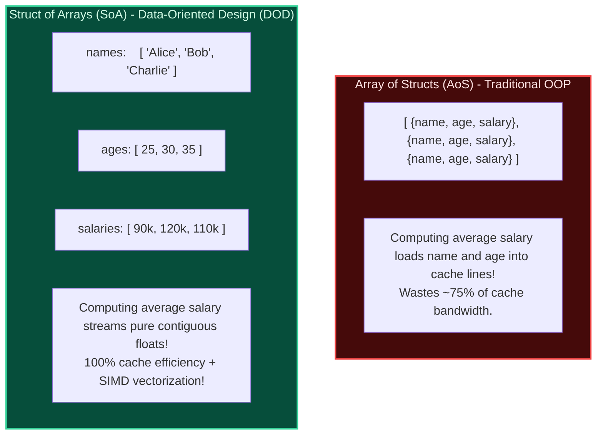

---

## 07 — Dynamic Array Growth: The Moving Day Protocol

Static arrays have one fatal flaw: **their capacity is locked at creation**.

What happens when your array is full and a new element arrives? Because memory adjacent to the array might already belong to other variables or the OS, the array cannot simply expand by 1 slot. It must execute **Moving Day**:

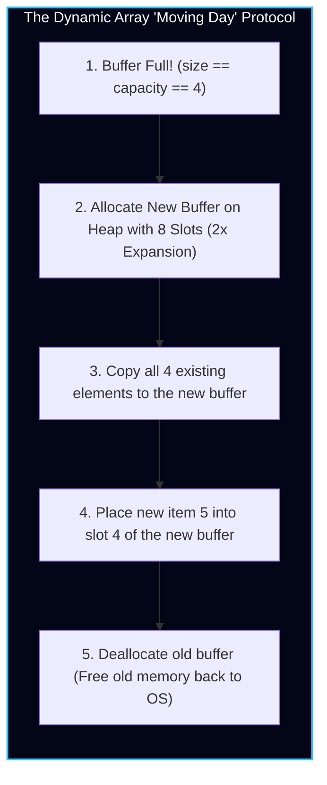

Internally, every dynamic array object (such as `std::vector` or Python `list`) stores three metadata fields on the stack:

- `data`: Pointer to the first slot of the contiguous heap buffer.
- `size`: The count of actual items currently stored.
- `capacity`: The total allocated slots available before Moving Day is triggered.

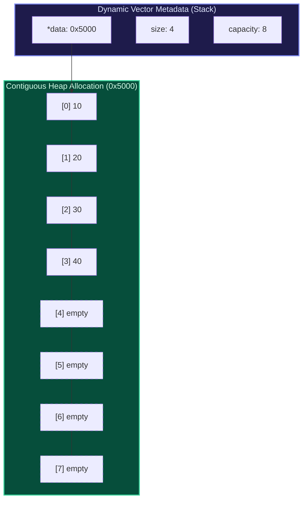

---

### Why Fixed Increments (+100) Lead to an O(n²) Disaster

Why can't an array grow by a fixed step (e.g., `capacity += 100`) whenever it runs out of space?

Suppose you insert $N$ items with a fixed increment of $100$:

- At item $100$: copy $100$ items.
- At item $200$: copy $200$ items.
- At item $300$: copy $300$ items.
- At item $N$: copy $N$ items.

Total items copied across all reallocations:

$$\sum_{k=1}^{N/100} 100k = 100 \times \frac{\frac{N}{100} \left(\frac{N}{100} + 1\right)}{2} \approx \frac{N^2}{200} \implies \mathbf{O(N^2) \text{ Total Copy Work}}$$

Dividing by $N$ insertions gives an average cost of **$O(N)$ per single append**! Appending would grind slower and slower as your array grew.

Only **geometric expansion** (multiplying capacity by a factor $\gamma > 1$) guarantees that reallocations become exponentially rarer, achieving **amortized $O(1)$** insertions.

---

### Amortized O(1) Proof: The Banker's Accounting Method

How can an operation that occasionally takes $O(N)$ work during Moving Day be mathematically guaranteed as $O(1)$?

<AnalogyCard name="The Moving Day Moving Fund">
  <div>
    <strong>The Real-World Moving Day Fund</strong>
    <p>
      Imagine your landlord increases your rent every time your family doubles.
      Moving trucks cost \$100. Rather than paying \$100 out of pocket in one
      disastrous hit, you deposit \$3 into a savings jar every time you buy a
      piece of furniture. When moving day arrives, the jar holds enough cash to
      hire the movers without borrowing a cent.
    </p>
  </div>
  <div>
    <strong>The Banker's Algorithm Credit</strong>
    <p>
      For every element appended to the array, we charge an amortized cost of{" "}
      <strong>$3 tokens</strong>:
    </p>
    <p>
      • <strong>Token 1</strong>: Pays for the immediate work of writing the
      element into its slot.
      <br />• <strong>Token 2</strong>: Stored as credit to pay for moving this
      element during the next resize.
      <br />• <strong>Token 3</strong>: Stored as credit to pay for moving an
      older element that already exhausted its token.
    </p>
  </div>
</AnalogyCard>

When capacity doubles from $N$ to $2N$:

- Exactly $N$ new elements were inserted since the last resize.
- Each deposited $2$ savings tokens $\implies 2N$ tokens in the bank.
- Moving Day costs exactly $N$ operations to copy all elements into the new buffer.
- The bank still has $N$ surplus tokens! The balance never drops below zero.

Thus, the amortized cost per append is **strictly $O(1)$**.

---

### The Growth Factor Debate: 2.0x vs. 1.5x

Should a dynamic array double its capacity ($2.0\times$) or multiply by $1.5\times$? This debate splits major compiler engineering teams:

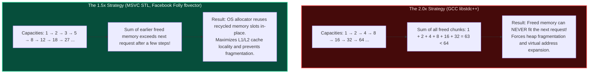

#### 1. The $2.0\times$ Problem (GCC `libstdc++`)

Capacities grow in powers of 2: $1, 2, 4, 8, 16, 32, 64, \dots$
Notice that:

$$\sum_{i=0}^{k-1} 2^i = 2^k - 1 < 2^k$$

The sum of all previously deallocated memory chunks is _always strictly smaller_ than the next allocation request! The operating system memory allocator (`glibc ptmalloc`, `jemalloc`) can **never reuse** the contiguous memory block you just freed. This drives heap fragmentation and virtual memory expansion.

#### 2. The $1.5\times$ Solution (MSVC STL, Facebook `fbvector`)

When growth factor $\gamma < \frac{1 + \sqrt{5}}{2} \approx 1.618$ (the Golden Ratio), the cumulative memory freed from previous reallocations eventually exceeds the size of the next allocation:

$$\sum_{i=0}^{k-1} \gamma^i > \gamma^k$$

After several reallocations, the memory allocator can place new vector buffers back into previously recycled memory slots, dramatically improving CPU cache locality.

#### 3. CPython's Growth Strategy (`listobject.c`)

In CPython, the growth formula is explicitly tailored to prevent excessive reallocations while minimizing wasted RAM:

```c
// CPython listobject.c: list_resize function
new_allocated = ((size_t)newsize + (newsize >> 3) + 6) & ~(size_t)3;
```

1. `newsize >> 3`: Adds $\approx 12.5\%$ to the requested size ($1.125\times$ growth).
2. `+ 6`: Constant padding to avoid frequent thrashing at very small sizes ($0, 1, 2, 3$).
3. `& ~(size_t)3`: Rounds to a multiple of 4 or 8 bytes to align with CPU cache lines.

---

## 08 — Complexity Matrix: Static vs Dynamic Array

| Operation                               | Static Array | Dynamic Array (Worst-Case) | Dynamic Array (Amortized) | Auxiliary Space |
| :-------------------------------------- | :----------- | :------------------------- | :------------------------ | :-------------- |
| **Index Access (`arr[i]`)**             | $O(1)$       | $O(1)$                     | $O(1)$                    | $O(1)$          |
| **Search (Unsorted)**                   | $O(n)$       | $O(n)$                     | $O(n)$                    | $O(1)$          |
| **Search (Sorted / Binary Search)**     | $O(\log n)$  | $O(\log n)$                | $O(\log n)$               | $O(1)$          |
| **Append (`push_back`)**                | N/A (Fixed)  | $O(n)$ (Resize)            | $\mathbf{O(1)}$           | $O(1)$          |
| **Pop Last (`pop_back`)**               | N/A (Fixed)  | $O(1)$                     | $O(1)$                    | $O(1)$          |
| **Arbitrary Insert (`insert(i, val)`)** | $O(n)$       | $O(n)$                     | $O(n)$                    | $O(1)$          |
| **Arbitrary Delete (`erase(i)`)**       | $O(n)$       | $O(n)$                     | $O(n)$                    | $O(1)$          |

---

## 09 — Production Dynamic Vector Implementations

Below is a complete, custom generic dynamic array implementation written from scratch across Python, TypeScript, and C++, demonstrating capacity expansion, element shifting, and boundary validation.

<Tabs items={['Python', 'TypeScript', 'C++']}>
<Tab value="Python">
```python
import ctypes
from typing import Any

class DynamicArray:
"""
A low-level dynamic array implementation using raw contiguous ctypes buffers,
mirroring CPython's PyListObject mechanics with a 1.5x geometric expansion.
"""
def **init**(self, initial_capacity: int = 4):
self.\_size = 0
self.\_capacity = max(1, initial_capacity)
self.\_data = self.\_create_buffer(self.\_capacity)

    def __len__(self) -> int:
        return self._size

    def __getitem__(self, index: int) -> Any:
        if not 0 <= index < self._size:
            raise IndexError(f"Index {index} out of bounds for size {self._size}")
        return self._data[index]

    def __setitem__(self, index: int, value: Any) -> None:
        if not 0 <= index < self._size:
            raise IndexError(f"Index {index} out of bounds for size {self._size}")
        self._data[index] = value

    def append(self, element: Any) -> None:
        """Amortized O(1) push_back operation."""
        if self._size == self._capacity:
            self._resize(int(self._capacity * 1.5) + 1)
        self._data[self._size] = element
        self._size += 1

    def pop(self) -> Any:
        """O(1) pop operation from the end."""
        if self._size == 0:
            raise IndexError("pop from empty DynamicArray")
        self._size -= 1
        item = self._data[self._size]
        self._data[self._size] = None  # Prevent memory leak
        return item

    def insert(self, index: int, element: Any) -> None:
        """O(N) arbitrary position insert requiring rightward memory shift."""
        if not 0 <= index <= self._size:
            raise IndexError(f"Index {index} out of bounds")
        if self._size == self._capacity:
            self._resize(int(self._capacity * 1.5) + 1)
        # Shift elements rightward to open slot
        for i in range(self._size, index, -1):
            self._data[i] = self._data[i - 1]
        self._data[index] = element
        self._size += 1

    def _resize(self, new_capacity: int) -> None:
        new_data = self._create_buffer(new_capacity)
        for i in range(self._size):
            new_data[i] = self._data[i]
        self._data = new_data
        self._capacity = new_capacity

    def _create_buffer(self, capacity: int):
        return (capacity * ctypes.py_object)()

    def __repr__(self) -> str:
        items = [repr(self._data[i]) for i in range(self._size)]
        return f"DynamicArray([{', '.join(items)}], size={self._size}, capacity={self._capacity})"

if **name** == "**main**":
arr = DynamicArray()
for x in [10, 20, 30, 40, 50]:
arr.append(x)
print(arr)

````
</Tab>

<Tab value="TypeScript">
```typescript
/**
 * Generic Dynamic Array backed by contiguous slot arrays.
 */
export class DynamicVector<T> {
  private buffer: (T | undefined)[];
  private currentSize: number = 0;
  private currentCapacity: number;

  constructor(initialCapacity: number = 4) {
    this.currentCapacity = Math.max(1, initialCapacity);
    this.buffer = new Array<T | undefined>(this.currentCapacity);
  }

  public size(): number {
    return this.currentSize;
  }

  public capacity(): number {
    return this.currentCapacity;
  }

  public get(index: number): T {
    this.assertBounds(index);
    return this.buffer[index] as T;
  }

  public set(index: number, value: T): void {
    this.assertBounds(index);
    this.buffer[index] = value;
  }

  public push(value: T): void {
    if (this.currentSize === this.currentCapacity) {
      // 1.5x geometric expansion
      this.resize(Math.floor(this.currentCapacity * 1.5) + 1);
    }
    this.buffer[this.currentSize++] = value;
  }

  public pop(): T {
    if (this.currentSize === 0) {
      throw new RangeError("Cannot pop from an empty vector.");
    }
    const idx = --this.currentSize;
    const value = this.buffer[idx] as T;
    this.buffer[idx] = undefined; // Avoid memory leaks
    return value;
  }

  public insert(index: number, value: T): void {
    if (index < 0 || index > this.currentSize) {
      throw new RangeError(`Index ${index} out of bounds.`);
    }
    if (this.currentSize === this.currentCapacity) {
      this.resize(Math.floor(this.currentCapacity * 1.5) + 1);
    }
    // Shift elements right
    for (let i = this.currentSize; i > index; i--) {
      this.buffer[i] = this.buffer[i - 1];
    }
    this.buffer[index] = value;
    this.currentSize++;
  }

  private resize(newCapacity: number): void {
    const newBuffer = new Array<T | undefined>(newCapacity);
    for (let i = 0; i < this.currentSize; i++) {
      newBuffer[i] = this.buffer[i];
    }
    this.buffer = newBuffer;
    this.currentCapacity = newCapacity;
  }

  private assertBounds(index: number): void {
    if (index < 0 || index >= this.currentSize) {
      throw new RangeError(`Index ${index} is out of bounds [0, ${this.currentSize - 1}].`);
    }
  }
}
````

</Tab>

<Tab value="C++">
```cpp
#include <iostream>
#include <stdexcept>
#include <utility>
#include <memory>

template <typename T>
class CustomVector {
private:
T\* data*{nullptr};
size_t size*{0};
size*t capacity*{0};

    void reallocate(size_t new_capacity) {
        // 1. Allocate raw uninitialized memory
        T* new_block = static_cast<T*>(::operator new(new_capacity * sizeof(T)));

        // 2. Move existing elements to new memory block
        for (size_t i = 0; i < size_; ++i) {
            new (&new_block[i]) T(std::move(data_[i]));
            data_[i].~T(); // Destruct old object in place
        }

        // 3. Deallocate old memory buffer
        ::operator delete(data_);
        data_ = new_block;
        capacity_ = new_capacity;
    }

public:
explicit CustomVector(size*t initial_capacity = 4)
: size*(0), capacity*(initial_capacity > 0 ? initial_capacity : 1) {
data* = static*cast<T\*>(::operator new(capacity* \* sizeof(T)));
}

    ~CustomVector() {
        clear();
        ::operator delete(data_);
    }

    void push_back(const T& value) {
        if (size_ >= capacity_) {
            reallocate(capacity_ + capacity_ / 2 + 1); // 1.5x growth
        }
        new (&data_[size_]) T(value);
        ++size_;
    }

    void push_back(T&& value) {
        if (size_ >= capacity_) {
            reallocate(capacity_ + capacity_ / 2 + 1); // 1.5x growth
        }
        new (&data_[size_]) T(std::move(value));
        ++size_;
    }

    void pop_back() {
        if (size_ == 0) throw std::out_of_range("Vector is empty");
        --size_;
        data_[size_].~T();
    }

    T& operator[](size_t index) { return data_[index]; }
    const T& operator[](size_t index) const { return data_[index]; }

    size_t size() const { return size_; }
    size_t capacity() const { return capacity_; }

    void clear() {
        for (size_t i = 0; i < size_; ++i) {
            data_[i].~T();
        }
        size_ = 0;
    }

};

int main() {
CustomVector<int> vec;
for (int i = 1; i <= 10; ++i) {
vec.push_back(i \* 10);
}
std::cout << "Vector size: " << vec.size() << ", capacity: " << vec.capacity() << "\n";
std::cout << "Element at index 4: " << vec[4] << "\n";
return 0;
}

````
</Tab>
</Tabs>

---

## 10 — Core Algorithmic Patterns on Arrays

Because arrays provide $O(1)$ random access by index, they form the bedrock of the most powerful algorithmic problem-solving paradigms:

### Pattern 1: Two Pointers (Opposite Ends & Fast/Slow)

Instead of testing all pairs with nested loops ($O(n^2)$), two pointers navigate the array linearly in $O(n)$ time.

```python
def two_sum_sorted(nums: list[int], target: int) -> list[int]:
    """Finds two indices in a sorted array that sum to target in O(N) time and O(1) space."""
    left, right = 0, len(nums) - 1
    while left < right:
        current_sum = nums[left] + nums[right]
        if current_sum == target:
            return [left, right]
        elif current_sum < target:
            left += 1   # Increase sum by moving left pointer right
        else:
            right -= 1  # Decrease sum by moving right pointer left
    return []
````

### Pattern 2: Fast & Slow Pointer (In-Place Deduplication)

```python
def remove_duplicates(nums: list[int]) -> int:
    """Removes duplicates from sorted array in-place. Returns length of unique prefix."""
    if not nums:
        return 0
    write_idx = 1
    for read_idx in range(1, len(nums)):
        if nums[read_idx] != nums[read_idx - 1]:
            nums[write_idx] = nums[read_idx]
            write_idx += 1
    return write_idx
```

---

### Pattern 3: Sliding Window (Dynamic Contiguous Subarray)

Instead of recomputing window sums from scratch ($O(k)$ per window), slide the window by adding the incoming element and subtracting the outgoing element in $O(1)$:

```python
def max_sub_array_of_size_k(k: int, nums: list[int]) -> int:
    """Finds maximum sum of any contiguous subarray of size k in O(N) time."""
    if len(nums) < k:
        return 0
    window_sum = sum(nums[:k])
    max_sum = window_sum
    for i in range(k, len(nums)):
        window_sum += nums[i] - nums[i - k]  # O(1) slide!
        max_sum = max(max_sum, window_sum)
    return max_sum
```

---

### Pattern 4: 1D Prefix Sums ($O(1)$ Range Queries)

**The ByteKart Scenario**: A financial auditor asks: _"What was ByteKart's total sales revenue between Day $L$ and Day $R$?"_

If you loop from $L$ to $R$ for each of $Q$ auditor queries, total runtime is $O(Q \times n)$. If $Q = 1{,}000{,}000$ and $n = 365$, this takes hundreds of millions of operations.

With a **Prefix Sum Array** $P$, where $P[i] = \sum_{k=0}^{i-1} A[k]$ with $P[0] = 0$:

$$\text{RangeSum}(L, R) = P[R + 1] - P[L]$$

Preprocessing costs $O(n)$ once. Every subsequent query executes in **instant $O(1)$ time**!

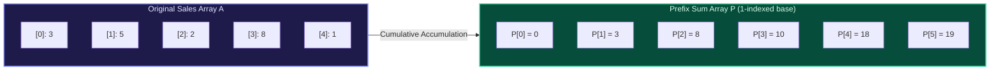

```python
class PrefixSum:
    def __init__(self, arr: list[int]):
        self.prefix = [0] * (len(arr) + 1)
        for i in range(len(arr)):
            self.prefix[i + 1] = self.prefix[i] + arr[i]

    def query(self, left: int, right: int) -> int:
        """Returns sum of arr[left...right] in O(1) time."""
        return self.prefix[right + 1] - self.prefix[left]
```

---

### Pattern 5: Difference Arrays ($O(1)$ Range Updates)

**The ByteKart Scenario**: During a flash sale, ByteKart applies a \$15 discount code to every product whose ID falls between $L$ and $R$. Over the weekend, $K = 500{,}000$ such promotional rules are applied.

- **Naive approach**: Loop from $L$ to $R$ on every coupon $\implies O(K \times n)$ total operations.
- **Difference Array approach**: Maintain array $D$, where $D[i] = A[i] - A[i-1]$ (with $A[-1] = 0$).

Adding value $V$ to all elements in range $[L, R]$ requires modifying **only two indices in $D$**:

1. $D[L] \mathrel{+}= V$ (marks the step up at the entrance of the range)
2. $D[R + 1] \mathrel{-}= V$ (marks the step down at the exit of the range)

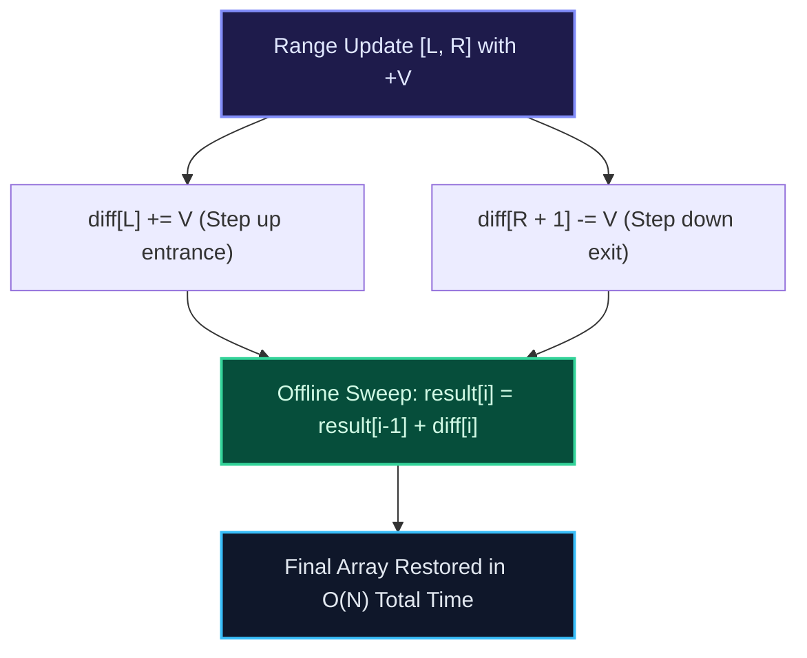

```python
class DifferenceArray:
    def __init__(self, n: int):
        self.n = n
        self.diff = [0] * (n + 1)

    def update(self, left: int, right: int, val: int) -> None:
        """Applies +val to range [left, right] in O(1) time."""
        self.diff[left] += val
        if right + 1 < len(self.diff):
            self.diff[right + 1] -= val

    def build(self) -> list[int]:
        """Recovers final array in O(N) time."""
        res = [0] * self.n
        running = 0
        for i in range(self.n):
            running += self.diff[i]
            res[i] = running
        return res
```

---

### Pattern 6: Kadane's Algorithm ($O(n)$ Maximum Subarray Sum)

Find the contiguous subarray having the largest sum in $O(n)$ time and $O(1)$ space:

```python
def max_subarray(nums: list[int]) -> int:
    """Computes maximum subarray sum in O(N) time and O(1) space."""
    if not nums:
        return 0
    current_max = global_max = nums[0]
    for x in nums[1:]:
        current_max = max(x, current_max + x)
        global_max = max(global_max, current_max)
    return global_max
```

---

### Pattern 7: 2D Prefix Sums ($O(1)$ Subgrid Queries)

For a 2D warehouse grid $M$ of size $R \times C$, answer queries for the total inventory within subgrid $(r_1, c_1)$ to $(r_2, c_2)$:

1. **Preprocessing ($O(R \times C)$)**:
   $$P[r][c] = M[r - 1][c - 1] + P[r - 1][c] + P[r][c - 1] - P[r - 1][c - 1]$$
2. **Querying ($O(1)$ via Inclusion-Exclusion)**:
   $$\text{Sum}(r_1, c_1, r_2, c_2) = P[r_2 + 1][c_2 + 1] - P[r_1][c_2 + 1] - P[r_2 + 1][c_1] + P[r_1][c_1]$$

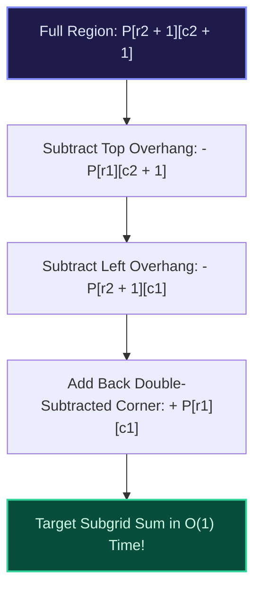

---

## 11 — Technical Traps & Misconceptions

<LessonNote variant="myth" title="Does accessing arr[999_999] take longer than arr[0]?">

**No. It takes the exact same time down to the nanosecond.**

The CPU does not iterate through the array to find slot 999,999. It multiplies the index by the element size (4 or 8 bytes) and adds it to the base address in a single instruction. Fetching index `0` or index `1,000,000,000` is identical $O(1)$ arithmetic.

</LessonNote>

<LessonNote variant="warning" title="The In-Place Mutation Trap">

Modifying array length during an indexed loop skips elements and silently creates subtle bugs:

```python
# BUG: Skipping elements as items shift left!
arr = [1, 2, 2, 3, 4]
for i in range(len(arr)):
    if arr[i] == 2:
        del arr[i]  # Triggers IndexError or skips the second 2!
```

Furthermore, `del arr[i]` forces an $O(n)$ memory shift on each deletion, degrading your loop to $O(n^2)$. **Fix**: Use the Two-Pointer (Read/Write) pattern to filter in a single $O(n)$ pass with $O(1)$ auxiliary space.

</LessonNote>

---

## 12 — Check Your Understanding

Test your knowledge with these retrieval practice questions. Try to solve each mentally before revealing the explanation.

<TryIt
  question="Given an array A[1...5][1...6] with Base = 2000 and element size W = 4 bytes, what is the address of A[3][4] in Row-Major Order?"
  options={[
    "Address 2056, because (3 - 1) * 6 + (4 - 1) = 15 elements skipped, and 2000 + 15 * 4 = 2060",
    "Address 2060, because 2 complete rows of 6 cols plus 3 columns in row 3 gives 15 elements (2000 + 60)",
    "Address 2076, because column-major multiplication counts rows rather than columns across boundaries",
    "Address 2048, because 0-based index calculation is mistakenly applied to a 1-based matrix declaration",
  ]}
  answer="B"
  why="In RMO, preceding rows = (3 - 1) = 2 rows. Elements in preceding rows = 2 * 6 = 12. Preceding columns in current row = (4 - 1) = 3. Total elements skipped = 12 + 3 = 15. Address = 2000 + 15 * 4 = 2060."
/>

<TryIt
  question="Why does dynamic array expansion by a constant increment (+100) degrade append operations to O(n) amortized time?"
  options={[
    "Operating system allocators refuse to assign memory blocks that are exact multiples of 100 bytes",
    "The cumulative number of elements copied across reallocations forms a quadratic series sum(100k) ~ O(n²)",
    "CPU hardware prefetchers disable L1 cache line streaming whenever arrays are reallocated repeatedly",
    "Memory bus saturation forces the CPU to serialize arithmetic pointer operations into linear scans",
  ]}
  answer="B"
  why="If capacity grows by +100, resizing occurs n/100 times. Copying 100, 200, 300, ... n elements sums to ~n²/200 total operations. Dividing by n insertions yields O(n) average work per append."
/>

<TryIt
  question="Why do arrays achieve significantly higher real-world traversal speed than linked lists of identical length?"
  options={[
    "Array elements are stored in 64-byte CPU cache lines, granting 15 cache hits for every 1 cache miss",
    "Compilers convert all array iterations into logarithmic binary searches during the optimization pass",
    "Linked list node references require dynamic garbage collector verification on every single traversal step",
    "Physical RAM circuits restrict sequential read operations to strictly odd-numbered memory addresses",
  ]}
  answer="A"
  why="Spatial locality allows the CPU to fetch 64 contiguous bytes at once into L1 cache (~1ns hit). Linked lists chase random heap pointers (~80ns cache miss per node)."
/>

<TryIt
  question="What is the primary architectural difference between a C-style rectangular matrix and a Java jagged array?"
  options={[
    "C matrices are one contiguous block of memory; Java jagged arrays are an array of pointers to separate heap blocks",
    "C matrices use column-major ordering exclusively, whereas Java jagged arrays are enforced row-major structures",
    "Java jagged arrays eliminate heap allocator overhead by storing row data directly inside the CPU registers",
    "C matrices allow rows to vary in length dynamically, whereas Java matrices require strict rectangular uniformity",
  ]}
  answer="A"
  why="In C, int matrix[R][C] is allocated as a single unbroken chunk of R*C*sizeof(int) bytes. In Java, int[][] is a pointer table where each row is an independently allocated heap array."
/>

---

<Takeaway>

**One Win for This Lesson:**
Arrays dominate high-performance computing because **contiguous memory unlocks $O(1)$ direct address calculation and 64-byte CPU cache line streaming**.

- To find any element: $\text{Address}(A[i]) = \text{Base} + i \times W$ in a single CPU cycle.
- In 2D Row-Major Order: $\text{Address}(A[i][j]) = \text{Base} + W \times [C \times (i - \text{LB}_r) + (j - \text{LB}_c)]$.
- Dynamic arrays expand geometrically ($1.5\times$ or $2\times$) so that Moving Day copies become exponentially rarer, mathematically guaranteeing **amortized $O(1)$ appends**.

</Takeaway>

---

<Callout type="info" title="Next Steps & Discussion">
  Next up: **Strings & String Algorithms**, where we explore how immutable vs
  mutable memory buffers, string hashing, and character encodings build directly
  upon these array foundations!
</Callout>
