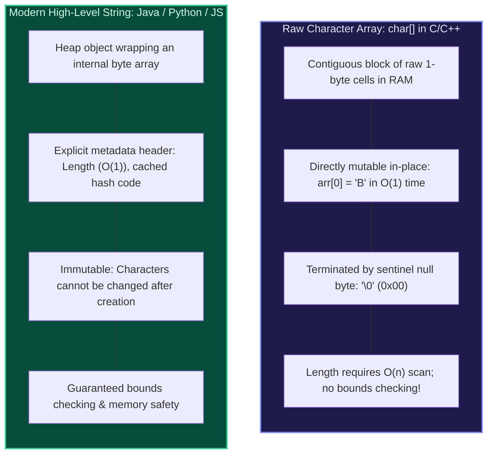
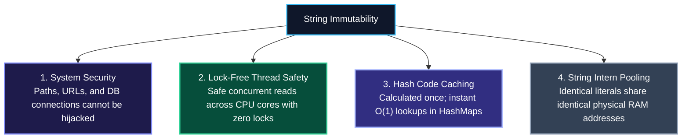
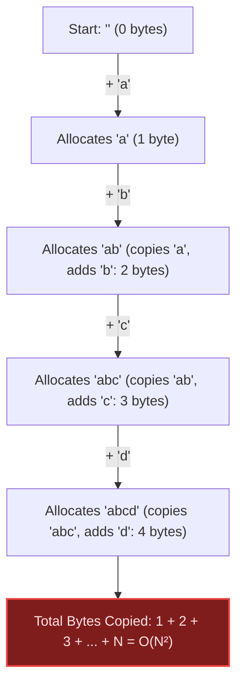
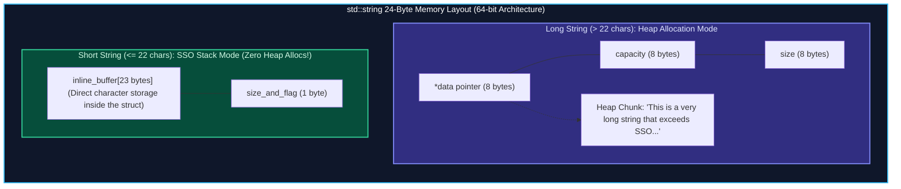
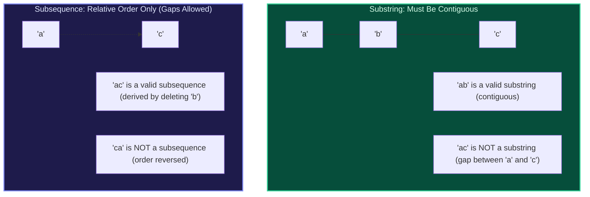
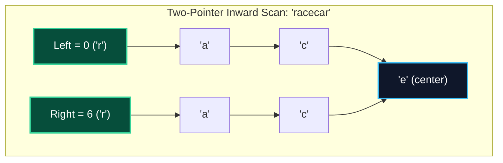
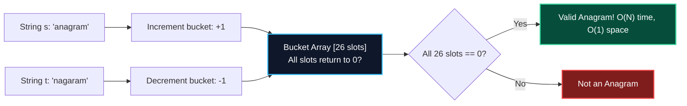
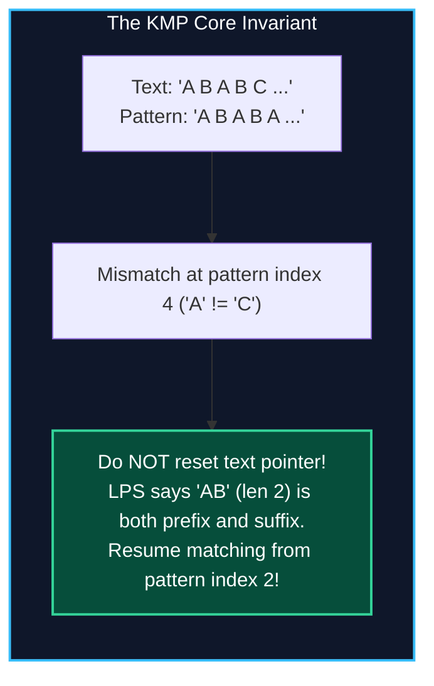
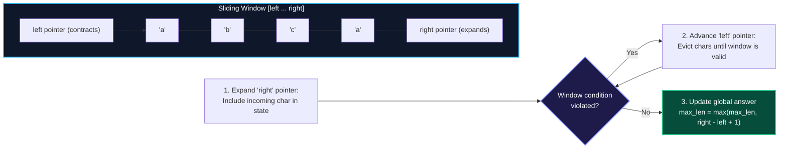

import { Callout } from "fumadocs-ui/components/callout";
import { Tabs, Tab } from "fumadocs-ui/components/tabs";
import { Steps, Step } from "fumadocs-ui/components/steps";
import {
  Concepts,
  LessonIntro,
  AnalogyCard,
  Explain,
  LessonNote,
  TryIt,
  Takeaway,
} from "@/components/cs101/lesson-blocks";

<Concepts
  items={[
    "strings vs char arrays",
    "string immutability physics",
    "O(n²) concatenation trap",
    "StringBuilder buffers",
    "ASCII, Unicode & UTF-8",
    "surrogate pairs & emoji trap",
    "Small String Optimization (SSO)",
    "substring vs subsequence math",
    "palindromes & anagram buckets",
    "KMP & LPS array trace",
    "Rabin-Karp rolling hash",
  ]}
/>

<LessonIntro>

To a human, text feels simple: a casual sequence of letters, spaces, and punctuation. You read `"Hello"`, you type `"World"`, and you expect your computer to treat text as effortlessly as numbers.

In physical computer hardware, **text does not exist**. There are only patterns of binary voltages organized into 8-bit bytes. Bridging human language and silicon hardware requires layers of character encodings, memory layouts, and architectural trade-offs that trip up even seasoned senior engineers.

A naive string concatenation inside an autocomplete loop can silently balloon into a **1.25 billion-byte copying avalanche**, freezing your server. Slicing a single character from a coupon code can split an emoji in half, corrupting database transactions.

In this lesson, we explore strings from the silicon up: from raw C-style character arrays and modern object wrappers to encoding boundaries, Small String Optimization (SSO), combinatorial substring mathematics, and linear pattern matching with KMP and Rabin-Karp.

</LessonIntro>

---

## 01 — The ByteKart Incident: Why Strings Break Production

It is 8:00 AM on Black Friday at **ByteKart**, a rapidly growing online marketplace. Over 250,000 bargain hunters flood the homepage simultaneously, their fingers flying across the search bar looking for lightning deals.

Within three minutes, the monitoring dashboards flash crimson:

1. **The Client-Side Freeze**: Shoppers typing in the search bar experience frozen browser tabs, unresponsive keyboards, and spinning beach balls.
2. **The 500-Error Spike**: Every customer who searches for the trending promotional coupon `"🛒 Discount"` receives an unhandled server exception: `400 Bad Request: Malformed Unicode Stream`.


### Incident Post-Mortem: What Actually Happened?

When the emergency war room assembled, the engineering lead diagnosed two catastrophic bugs stemming from fundamental misunderstandings of **string memory layouts** and **text encoding**:

1. **The $O(N^2)$ Concatenation Disaster**: An engineer wrote an autocomplete query sanitizer using `sanitized += next_char` inside an event loop processing rich product feed data. Because high-level languages treat strings as **immutable blocks of memory**, every single `+=` allocated a brand-new string on the heap and copied every previous character into the new buffer. For a 50,000-character payload, this performed:
   $$\sum_{i=1}^{50,000} i = \frac{50,000 \times 50,001}{2} \approx 1.25 \text{ billion byte copies!}$$
   A loop intended to take 2 milliseconds seized the CPU for over 8 seconds.

2. **The Emoji Slicing Catastrophe**: A validation rule tried to strip leading icons by doing `promo_code.slice(0, 1)`. The engineer assumed that "1 character equals 1 array index". But the shopping cart emoji `"🛒"` is a 4-byte UTF-8 sequence (`0xF0 0x9F 0x9B 0x92`) represented in JavaScript's UTF-16 as a surrogate pair (`\uD83D\uDED2`). Chopping at index 1 split the surrogate pair clean in half! The browser emitted the notorious Unicode replacement character `` (`\uFFFD`), failing database constraints and dumping 100,000 active shopping carts into the void.

To build software that handles real-world text at scale, we must abandon the illusion that strings are simple character arrays and examine their physical memory representations.

---

## 02 — Strings vs. Character Arrays: The Physical Architecture

When working with text in low-level languages like C or C++, text is handled through **character arrays** (`char[]`). High-level environments like Java, Python, JavaScript, and C# abstract this into a specialized **`String` object**.

Understanding the differences between these two models reveals why strings behave the way they do across modern runtimes:



<AnalogyCard name="Raw Wood Plank vs. Framed Museum Canvas">
  <div>
    <strong>Raw Character Array (The Wood Plank)</strong>
    <p>
      A <code>char[]</code> is like an unfinished wooden plank. You can carve a
      letter anywhere, sand out a word, or paint over a character in place with
      zero overhead. However, there are no guardrails: if you chisel past the
      plank's edge, you slice into your workbench (a memory buffer overflow).
    </p>
  </div>
  <div>
    <strong>High-Level String (The Framed Canvas)</strong>
    <p>
      A modern <code>String</code> is like a finished painting sealed behind
      museum glass with a brass plaque listing its title, painter, and exact
      dimensions. You cannot touch the paint. If you want one color changed, you
      must commission an entirely new painting on a brand-new canvas.
    </p>
  </div>
</AnalogyCard>

### Architectural Comparison

| Architectural Property  | Raw Character Array (`char[]`)                     | High-Level String (`String`, `str`)                    |
| :---------------------- | :------------------------------------------------- | :----------------------------------------------------- |
| **Physical Storage**    | Contiguous raw bytes on Stack or Heap              | Heap object wrapper + metadata header                  |
| **Mutability**          | **Mutable** in-place ($O(1)$ updates)              | **Immutable** (all modifications allocate new objects) |
| **Length Calculation**  | $O(N)$ linear scan for `\0` in C (`strlen`)        | $O(1)$ instantaneous metadata read (`.length`)         |
| **Memory Safety**       | Vulnerable to buffer overflows & off-by-one writes | Bounds-checked; throws runtime exceptions safely       |
| **Thread Safety**       | Requires manual locking and mutex synchronization  | **Inherently thread-safe** (shared read-only state)    |
| **HashMap Suitability** | Poor (contents can mutate, breaking hash buckets)  | **Optimal** (hash code is stable and cached)           |

---

## 03 — The Physics of String Immutability: Why Languages Chose It

Why did language architects (such as James Gosling for Java, Guido van Rossum for Python, and Brendan Eich for JavaScript) decide to make strings immutable?

Making strings immutable introduces runtime overhead during string modification, but it unlocks four massive architectural superpowers:



<Explain
  title="The Four Core Pillars of String Immutability"
  what="The technical justifications that make immutable text superior for high-level languages despite concatenation overhead."
>

1. **Security & Parameter Integrity**: Strings carry sensitive payloads throughout operating systems and web runtimes: file system paths (`"/etc/passwd"`), database connection URLs, network hostnames, and authentication tokens. If strings were mutable, an attacker could pass a legitimate path to a security validation method, then have another concurrent thread modify the string characters _after_ the check passed but _before_ the file was opened (a classic **Time-of-Check to Time-of-Use / TOCTOU** attack).
2. **Lock-Free Thread Safety**: Because an immutable string's internal byte buffer can never be altered after construction, hundreds of concurrent threads can read, slice, and inspect the same string simultaneously without mutex locks, semaphores, or data races.
3. **Hash Code Caching for HashMaps**: In Java, Python, and JavaScript, strings are the most common keys used in hash maps, sets, and object property lookups. In Java's `java.lang.String`, there is a private field: `private int hash;`. The first time `.hashCode()` is invoked, the algorithm computes the polynomial hash and saves it in `hash`. Every subsequent call returns that integer in **1 CPU cycle** ($O(1)$). If strings were mutable, changing a single letter would change the hash code while the object is sitting inside a hash bucket, permanently corrupting the hash table!
4. **String Intern Pooling**: Because strings cannot change, runtimes can maintain a **String Pool**. If 100,000 user records all contain the state `"CALIFORNIA"`, the runtime does not allocate 100,000 separate character buffers. It stores `"CALIFORNIA"` once in memory and points all 100,000 object references to that single physical address.

</Explain>

<AnalogyCard name="Carved Stone Tablet vs. Erasable Whiteboard">
  <div>
    <strong>Immutable Strings (The Carved Stone Tablet)</strong>
    <p>
      Words chiseled into granite cannot be modified. If you want to append a
      suffix or fix a letter, you must haul a brand-new slab of marble, re-carve
      the entire existing text from letter 1, carve the new letter, and smash
      the old slab. Repeating this in a loop produces an $O(N^2)$ catastrophe.
    </p>
  </div>
  <div>
    <strong>StringBuilder (The Erasable Whiteboard)</strong>
    <p>
      A <code>StringBuilder</code> is an erasable whiteboard with plenty of
      empty margin at the end. Appending a letter takes an instant ($O(1)$).
      Only when the whiteboard is completely filled do you replace it with a
      board twice as wide ($2\times$ geometric expansion).
    </p>
  </div>
</AnalogyCard>

### The $O(N^2)$ Concatenation Trap

When you write `s += c` inside a loop in Python, JavaScript, or Java, you are secretly executing a quadratic copying loop:



The mathematical formula for the total characters copied across $N$ concatenations:

$$\sum_{i=1}^{N} i = 1 + 2 + 3 + \dots + N = \frac{N(N+1)}{2} = \Theta(N^2)$$

For $N = 50{,}000$ characters, that is **$1{,}250{,}025{,}000$ operations**!

### The Remedy: Mutable String Buffers

To build strings in linear $O(N)$ time, always use mutable buffers that leverage geometric array growth:

<Tabs items={['Python', 'JavaScript', 'Java']}>
<Tab value="Python">
```python
# SLOW: O(N²) quadratic trap
s = ""
for char in large_character_stream:
    s += char  # Allocates and copies every existing character each step!

# FAST: O(N) linear construction

chunks = []
for char in large_character_stream:
chunks.append(char) # O(1) amortized append
s = "".join(chunks) # Single allocation and copy pass: O(N)

````
</Tab>

<Tab value="JavaScript">
```javascript
// SLOW: O(N²) quadratic trap
let s = "";
for (const char of largeCharacterStream) {
  s += char; // Intermediate string garbage on every loop
}

// FAST: O(N) linear construction
const buffer = [];
for (const char of largeCharacterStream) {
  buffer.push(char); // O(1) amortized append
}
const s = buffer.join(""); // Single O(N) pass
````

</Tab>

<Tab value="Java">
```java
// SLOW: O(N²) quadratic trap
String s = "";
for (char c : largeCharacterStream) {
    s += c; // Creates new String and StringBuilder under the hood per iteration!
}

// FAST: O(N) linear construction with StringBuilder
StringBuilder sb = new StringBuilder(estimatedCapacity);
for (char c : largeCharacterStream) {
sb.append(c); // O(1) amortized append into pre-allocated buffer
}
String s = sb.toString(); // Single O(N) allocation

````
</Tab>
</Tabs>

---

## 04 — Character Encodings & Memory: From ASCII to UTF-8 & The Emoji Trap

To a computer processor, memory contains only 8-bit bytes (values from `0` to `255`). An **encoding standard** is the agreed-upon dictionary that translates numbers into human-visible glyphs.

```mermaid
flowchart LR
    Char["Glyph: 'A'"] --> Unicode["Unicode Code Point: U+0041"]
    Unicode --> UTF8["UTF-8 Byte: 01000001 (0x41)"]
    UTF8 --> RAM["Physical RAM: 8 capacitive bit cells"]

    style Char fill:#0f172a,stroke:#38bdf8,stroke-width:2px,color:#fff
    style Unicode fill:#1e1b4b,stroke:#818cf8,stroke-width:2px,color:#fff
    style UTF8 fill:#064e3b,stroke:#34d399,stroke-width:2px,color:#fff
    style RAM fill:#334155,stroke:#94a3b8,stroke-width:2px,color:#fff
````

### The Historical Evolution

<Steps>
### Step 1: 7-Bit ASCII (1963)
American Standard Code for Information Interchange used 7 bits ($2^7 = 128$ symbols) to represent English letters, digits, and control characters (`'A'` is code `65`). The 8th bit of each byte was left unused or used for parity checks.

### Step 2: The Multi-Code Page Tower of Babel

As computing went global, different countries repurposed the 8th bit ($128 \dots 255$) to fit their native alphabets (Latin-1 in Western Europe, Shift-JIS in Japan, KOI-8 in Russia). If an English system opened a Japanese text file, it rendered as unintelligible gibberish known as **mojibake** (文字化け).

### Step 3: Universal Unicode Code Points

The Unicode Consortium unified world text by assigning a unique numerical identifier called a **Code Point** (written as `U+XXXX`) to every character in every living and historic language, including mathematical symbols and emojis. Unicode spans from `U+0000` to `U+10FFFF` (over 1.1 million possible characters).

### Step 4: UTF-8 Variable-Length Encoding

Invented by Ken Thompson and Rob Pike in 1992, **UTF-8** is a variable-length encoding that translates Unicode code points into sequences of $1$ to $4$ bytes. Today, it encodes over 98% of the World Wide Web.

</Steps>

### The Structure of UTF-8

The high-order bits of the first byte tell the decoder exactly how many bytes make up the character:

| Byte Length | Code Point Range       | Byte 1     | Byte 2     | Byte 3     | Byte 4     | Character Examples                         |
| :---------- | :--------------------- | :--------- | :--------- | :--------- | :--------- | :----------------------------------------- |
| **1 Byte**  | `U+0000` — `U+007F`    | `0xxxxxxx` | —          | —          | —          | Standard ASCII (`A`, `9`, `!`)             |
| **2 Bytes** | `U+0080` — `U+07FF`    | `110xxxxx` | `10xxxxxx` | —          | —          | Latin accents, Greek (`é`, `Ω`, `ñ`)       |
| **3 Bytes** | `U+0800` — `U+FFFF`    | `1110xxxx` | `10xxxxxx` | `10xxxxxx` | —          | Devanagari, CJK (`सं`, `中`, `日`)         |
| **4 Bytes** | `U+10000` — `U+10FFFF` | `11110xxx` | `10xxxxxx` | `10xxxxxx` | `10xxxxxx` | Emojis, ancient scripts (`🛒`, `🚀`, `🎉`) |

```mermaid
flowchart TD
    subgraph Emoji["The 4-Byte UTF-8 Anatomy of '🛒' (U+1F6D2)"]
        direction LR
        B1["Byte 1: 0xF0<br/>[11110 000]<br/>Header: 4-byte sequence"]
        B2["Byte 2: 0x9F<br/>[10 011111]<br/>Continuation byte"]
        B3["Byte 3: 0x9B<br/>[10 011011]<br/>Continuation byte"]
        B4["Byte 4: 0x92<br/>[10 010010]<br/>Continuation byte"]
        B1 --- B2 --- B3 --- B4
    end

    style B1 fill:#0f172a,stroke:#38bdf8,stroke-width:2px,color:#fff
    style B2 fill:#1e1b4b,stroke:#818cf8,stroke-width:2px,color:#fff
    style B3 fill:#1e1b4b,stroke:#818cf8,stroke-width:2px,color:#fff
    style B4 fill:#064e3b,stroke:#34d399,stroke-width:2px,color:#fff
```

<LessonNote variant="why" title="The Self-Synchronizing Beauty of UTF-8">
  Notice that every continuation byte starts with the two bits{" "}
  <code>10xxxxxx</code>. This means a program can start reading a stream at any
  random byte offset in RAM. If it encounters a byte starting with{" "}
  <code>10</code>, it immediately knows it landed in the middle of a character
  and simply scans forward until it finds a byte starting with <code>0</code> or{" "}
  <code>11</code>.
</LessonNote>

### The Emoji Slicing Trap: UTF-16 and Surrogate Pairs

JavaScript and Java historically chose **UTF-16** as their internal string representation. UTF-16 represents characters using **16-bit code units**:

- Code points up to `U+FFFF` fit into a single 16-bit unit.
- Code points above `U+FFFF` (such as emojis like `"🛒"`) require **two 16-bit units**, known as a **surrogate pair**:
  - **High Surrogate**: `0xD800` to `0xDBFF`
  - **Low Surrogate**: `0xDC00` to `0xDFFF`

```javascript
// In JavaScript:
const emoji = "🛒";

console.log(emoji.length);
// Outputs: 2! (It counts 16-bit UTF-16 code units, NOT human characters)

console.log(emoji.charCodeAt(0).toString(16)); // 0xd83d (High surrogate)
console.log(emoji.charCodeAt(1).toString(16)); // 0xded2 (Low surrogate)

// THE SLICING DISASTER:
const chopped = emoji.slice(0, 1);
console.log(chopped); // Outputs: "" (Unicode replacement character U+FFFD)
```

<LessonNote
  variant="warning"
  title="The Slicing Rule: Never Slice by Raw Byte or Code Unit"
>
  If you slice a string at index 1, you detach the high surrogate from its low
  surrogate. The runtime cannot decode an isolated surrogate and emits the
  replacement glyph <code></code> (<code>U+FFFD</code>). To safely iterate over
  true Unicode code points: - In JavaScript / TypeScript: Use{" "}
  <code>[...str]</code> or <code>Array.from(str)</code>, or{" "}
  <code>new Intl.Segmenter()</code> for true grapheme clusters. - In Python:
  Python's PEP 393 automatically represents strings using the most compact
  fixed-width array (1, 2, or 4 bytes), making <code>len(s)</code> and string
  slicing Unicode-safe out of the box!
</LessonNote>

---

## 05 — Memory Architecture: Small String Optimization (SSO)

In web servers, APIs, and microservices, profiling shows that **over 85% of strings are short** (fewer than 20 characters): HTTP headers (`"Content-Type"`), JSON keys (`"id"`, `"status"`), and database column names.

If every short string required a separate `malloc()` call on the heap:

1. The memory allocator would suffer extreme **heap fragmentation**.
2. Allocating heap memory requires locking the allocator, creating contention across CPU cores.
3. Reading the string requires chasing a pointer from the stack to the heap, causing **CPU cache misses**.

Modern systems runtimes (including C++ `std::string`, Rust, and high-performance game engines) resolve this using **Small String Optimization (SSO)**.



### The Engineering Ingenuity of the SSO Union

On a 64-bit architecture, a `std::string` object needs 24 bytes in heap mode (three 8-byte integers: `char* data`, `size_t capacity`, `size_t size`).

Instead of wasting those 24 bytes when storing a short word:

1. **The Union Storage**: The object's memory is structured as a C union. When the string is short, the 24 bytes are re-interpreted as a **23-byte inline character array** and a **1-byte length flag**.
2. **Zero Heap Allocation**: Strings containing up to 15 to 22 characters (e.g. `"active"`, `"Bearer"`, `"user_id"`) are stored **directly inside the struct on the CPU stack**.
3. **Instant Cache Access**: The CPU fetches the characters directly from the stack with 100% L1 cache locality, completely bypassing the heap manager.

---

## 06 — Substring vs. Subsequence: Combinatorics & Mental Models

In technical interviews and algorithm exams, confusing a **substring** with a **subsequence** is one of the most common pitfalls. They have vastly different combinatorial bounds and require entirely different algorithmic techniques.



<Explain
  title="The Combinatorial Formula: Counting Substrings vs. Subsequences"
  what="The mathematical proof governing the search space of strings."
>

For a string of length $n$:

1. **Substrings (Contiguous Blocks)**:
   - To choose a non-empty substring, you pick a start index $i$ and an end index $j \ge i$.
   - Length 1 substrings: $n$
   - Length 2 substrings: $n - 1$
   - $\dots$
   - Length $n$ substrings: $1$
   - **Total non-empty substrings**:
     $$\sum_{k=1}^n k = \frac{n(n + 1)}{2}$$
   - Including the unique empty string $\varepsilon$: $\frac{n(n + 1)}{2} + 1$.
   - **Growth Class**: $\mathcal{O}(n^2)$ polynomial.

2. **Subsequences (Order-Preserving Selections with Gaps)**:
   - For every character in the string, you make an independent binary choice: **Include ($1$)** or **Exclude ($0$)**.
   - With $n$ independent binary decisions, the total possible combinations is:
     $$2 \times 2 \times \dots \times 2 = 2^n$$
   - **Total non-empty subsequences**: $2^n - 1$ (subtracting the empty set).
   - **Growth Class**: $\mathcal{O}(2^n)$ exponential.

</Explain>

### Concrete Example: $S = \text{"abc"}$ ($n = 3$)

| Type                                       | Set of Elements                                | Count Formula          | Count ($n=3$)                       |
| :----------------------------------------- | :--------------------------------------------- | :--------------------- | :---------------------------------- |
| **Non-Empty Substrings**                   | `{"a", "b", "c", "ab", "bc", "abc"}`           | $\frac{n(n+1)}{2}$     | $\frac{3 \times 4}{2} = \mathbf{6}$ |
| **All Substrings (+ empty $\varepsilon$)** | `{"", "a", "b", "c", "ab", "bc", "abc"}`       | $\frac{n(n+1)}{2} + 1$ | $\mathbf{7}$                        |
| **Non-Empty Subsequences**                 | `{"a", "b", "c", "ab", "ac", "bc", "abc"}`     | $2^n - 1$              | $2^3 - 1 = \mathbf{7}$              |
| **All Subsequences (+ empty $\emptyset$)** | `{"", "a", "b", "c", "ab", "ac", "bc", "abc"}` | $2^n$                  | $2^3 = \mathbf{8}$                  |

<LessonNote variant="tip" title="Interview Decision Rule">
  Notice that <code>"ac"</code> is present in the subsequence list, but is
  completely absent from the substring list. - When an interview problem asks
  about <strong>substrings</strong>, you are almost always dealing with{" "}
  <strong>Sliding Window</strong> or <strong>Two Pointers</strong> in $O(n)$
  time. - When an interview problem asks about <strong>subsequences</strong>,
  you are almost always dealing with <strong>Dynamic Programming</strong> (e.g.
  Longest Common Subsequence) in $O(n \times m)$ time or{" "}
  <strong>Greedy Matching</strong> in $O(n)$ time.
</LessonNote>

---

## 07 — Core Interview Patterns: Palindromes & Anagrams

Two fundamental string patterns appear constantly in coding assessments: checking palindromes and detecting anagrams.

### Pattern 1: Palindrome Verification ($O(N)$ Time, $O(1)$ Space)

A string is a **palindrome** if it reads identically forwards and backwards ($S = S^R$).

The naive approach reverses the entire string and checks equality (`s == s[::-1]`), which allocates a new string buffer on the heap ($O(N)$ auxiliary space). The optimal approach uses **inward two-pointer traversal**:



```python
def is_palindrome(s: str) -> bool:
    """
    Validates palindrome property in O(N) time and O(1) auxiliary space.
    Ignores non-alphanumeric characters and casing.
    """
    left, right = 0, len(s) - 1

    while left < right:
        while left < right and not s[left].isalnum():
            left += 1
        while left < right and not s[right].isalnum():
            right -= 1

        if s[left].lower() != s[right].lower():
            return False

        left += 1
        right -= 1

    return True
```

<LessonNote
  variant="tip"
  title="Finding Longest Palindromic Substring: Expand Around Center"
>
  Instead of $O(N^3)$ brute force or $O(N^2)$ space dynamic programming, use the{" "}
  <strong>Expand Around Center</strong> technique: A string of length $n$ has
  $2n - 1$ centers: - $n$ single-character centers (for odd-length palindromes
  like <code>"aba"</code>) - $n - 1$ between-character centers (for even-length
  palindromes like <code>"abba"</code>) Expanding outwards from all $2n - 1$
  centers runs in $O(N^2)$ time and $O(1)$ auxiliary space!
</LessonNote>

---

### Pattern 2: Anagram Verification ($O(N)$ Time, $O(1)$ Space)

Two strings are **anagrams** if they contain the exact same characters with the exact same frequencies, rearranged.

1. **The Sorting Method**: Sort both strings and compare: `sorted(s) == sorted(t)`. Runs in $O(N \log N)$ time and $O(N)$ space.
2. **The Optimal Frequency Bucket Array**: Count character occurrences using a fixed 26-slot integer array (for lowercase English):



```python
def is_anagram(s: str, t: str) -> bool:
    """
    Checks if s and t are anagrams using a fixed 26-element frequency table.
    Time Complexity: O(N) where N is len(s).
    Auxiliary Space: O(1) (fixed 26-element integer array).
    """
    if len(s) != len(t):
        return False

    counts = [0] * 26

    for i in range(len(s)):
        counts[ord(s[i]) - ord('a')] += 1
        counts[ord(t[i]) - ord('a')] -= 1

    return all(c == 0 for c in counts)
```

---

## 08 — Pattern Matching: From Naive Search to KMP & Rabin-Karp

Given a long body of text $T$ of length $N$ and a search pattern $P$ of length $M$, how do we find all occurrences of $P$ inside $T$?

### 1. The Naive Search ($O(N \times M)$)

The brute-force algorithm tests whether $P$ matches $T[i \dots i + M - 1]$ for every starting offset $i$.

If text contains repetitive patterns (e.g. $T = \text{"AAAAAAAAAB"}$ and $P = \text{"AAAAB"}$), the naive matcher checks $M - 1$ characters, fails at the end, shifts the pattern by only $1$ slot, and **backtracks the text pointer** back to the beginning! This yields worst-case performance of $\mathcal{O}(N \times M)$ comparisons.

---

### 2. The Knuth-Morris-Pratt (KMP) Algorithm ($\mathcal{O}(N + M)$)

The fundamental breakthrough of KMP is: **Never backtrack the text pointer $i$**.

When a mismatch occurs after matching $j$ characters of the pattern, we do not throw away that knowledge. Because the prefix of the pattern was already matched against the text, we already know what characters exist in the text! We simply shift the pattern pointer $j$ to the longest prefix that is also a suffix of the matched substring.



### The LPS Array (Longest Proper Prefix which is also Suffix)

The LPS array precomputes pattern self-similarity:

- A **proper prefix** of a string is a prefix that is not the entire string itself.
- For pattern $P$, `lps[i]` is the length of the longest proper prefix of $P[0 \dots i]$ that is also a suffix of $P[0 \dots i]$.

#### Manual Trace: Constructing LPS for Pattern `"ABABCABAB"`

Let us manually construct the LPS array for the 9-character pattern $P = \text{"ABABCABAB"}$:

| Index $i$ | Substring $P[0 \dots i]$ | Proper Prefixes                           | Suffixes                         | Longest Matching Prefix-Suffix | `lps[i]` Value |
| :-------- | :----------------------- | :---------------------------------------- | :------------------------------- | :----------------------------- | :------------- |
| **0**     | `"A"`                    | None                                      | None                             | None                           | **0**          |
| **1**     | `"AB"`                   | `"A"`                                     | `"B"`                            | None                           | **0**          |
| **2**     | `"ABA"`                  | `"A"`, `"AB"`                             | `"A"`, `"BA"`                    | `"A"` (length 1)               | **1**          |
| **3**     | `"ABAB"`                 | `"A"`, `"AB"`, `"ABA"`                    | `"B"`, `"AB"`, `"BAB"`           | `"AB"` (length 2)              | **2**          |
| **4**     | `"ABABC"`                | `"A"`, `"AB"`, `"ABA"`, `"ABAB"`          | Suffixes end in `'C'` (no match) | None                           | **0**          |
| **5**     | `"ABABCA"`               | `"A"`, `"AB"`, $\dots$                    | Ends in `'A'`                    | `"A"` (length 1)               | **1**          |
| **6**     | `"ABABCAB"`              | `"A"`, `"AB"`, $\dots$                    | Ends in `"AB"`                   | `"AB"` (length 2)              | **2**          |
| **7**     | `"ABABCABA"`             | `"A"`, `"AB"`, `"ABA"`, $\dots$           | Ends in `"ABA"`                  | `"ABA"` (length 3)             | **3**          |
| **8**     | `"ABABCABAB"`            | `"A"`, `"AB"`, `"ABA"`, `"ABAB"`, $\dots$ | Ends in `"ABAB"`                 | `"ABAB"` (length 4)            | **4**          |

The resulting LPS array:

```
Pattern:  A  B  A  B  C  A  B  A  B
Index:    0  1  2  3  4  5  6  7  8
LPS:     [0, 0, 1, 2, 0, 1, 2, 3, 4]
```

When matching text against `"ABABCABAB"`:
If a mismatch happens at index 8 (after matching `"ABABCABA"`), `lps[7] = 3`. We do not restart matching from index 0! We slide pattern pointer $j$ to index `3` and continue comparing. The text pointer $i$ never takes a single step backward!

- **LPS Construction Time**: $\mathcal{O}(M)$
- **KMP Search Time**: $\mathcal{O}(N)$
- **Total Runtime**: $\mathcal{O}(N + M)$ guaranteed linear time!

---

### 3. The Rabin-Karp Algorithm: Rolling Hash ($\mathcal{O}(N + M)$ Average)

Instead of comparing characters one by one, the **Rabin-Karp** algorithm converts the search pattern and every sliding window of length $M$ into a numerical integer hash:

$$H(S) = \left( \sum_{i=0}^{M-1} S[i] \cdot B^{M - 1 - i} \right) \pmod{M_{od}}$$

Where $B$ is a base (typically $256$ for extended ASCII) and $M_{od}$ is a large prime number (e.g. $10^9 + 7$).


When sliding the window 1 step to the right, we update the hash in **$\mathcal{O}(1)$ arithmetic steps**:

$$H_{next} = \left( (H - T[i] \cdot B^{M-1}) \cdot B + T[i + M] \right) \pmod{M_{od}}$$

When $H(T[i \dots i + M - 1]) == H(P)$, we perform a character-by-character equality check to guard against rare **hash collisions**.

- **Average Runtime**: $\mathcal{O}(N + M)$
- **Worst-Case Runtime**: $\mathcal{O}(N \times M)$ (only if the hash function produces pathological collisions)
- **Auxiliary Space**: $\mathcal{O}(1)$

---

## 09 — Dynamic Sliding Window Substring Pattern

When solving substring problems involving conditions (e.g., "Longest substring without repeating characters", "Minimum window containing all target characters"), brute-force testing of all substrings takes $O(N^3)$ time ($O(N^2)$ pairs with $O(N)$ validation).

The **Sliding Window** pattern reduces this search to **guaranteed $O(N)$ linear time**.



### The Amortized $O(N)$ Proof

Even though there is a `while` loop nested inside a `for` loop:

- The `right` pointer moves forward exactly $N$ times.
- The `left` pointer moves forward at most $N$ times across the **entire lifecycle of the function**.
- The inner while loop executes at most $N$ total operations cumulatively.
- **Total Operations**: At most $2N$ steps $\implies \mathcal{O}(N)$ linear time!

---

## 10 — Production Polyglot Implementations

Below are complete, production-grade implementations of the canonical string algorithms in Python, TypeScript, and C++.

<Tabs items={['Python', 'TypeScript', 'C++']}>
<Tab value="Python">
```python
from typing import List

class StringAlgorithms:
@staticmethod
def length_of_longest_substring(s: str) -> int:
"""
Sliding Window: Longest substring without repeating characters.
Uses a hash map to jump 'left' pointer past duplicates instantly.
Time: O(N), Space: O(min(N, AlphabetSize))
"""
last_seen = {}
max_len = 0
left = 0

        for right, char in enumerate(s):
            if char in last_seen and last_seen[char] >= left:
                left = last_seen[char] + 1

            last_seen[char] = right
            max_len = max(max_len, right - left + 1)

        return max_len

    @staticmethod
    def compute_lps(pattern: str) -> List[int]:
        """
        Computes the Longest Proper Prefix that is also Suffix (LPS) array for KMP.
        Time: O(M), Space: O(M)
        """
        m = len(pattern)
        lps = [0] * m
        length = 0  # Length of the previous longest prefix suffix
        i = 1

        while i < m:
            if pattern[i] == pattern[length]:
                length += 1
                lps[i] = length
                i += 1
            else:
                if length != 0:
                    length = lps[length - 1]
                else:
                    lps[i] = 0
                    i += 1
        return lps

    @staticmethod
    def kmp_search(text: str, pattern: str) -> List[int]:
        """
        Knuth-Morris-Pratt pattern search.
        Returns all starting indices of 'pattern' in 'text'.
        Time: O(N + M), Space: O(M)
        """
        n, m = len(text), len(pattern)
        if m == 0 or m > n:
            return []

        lps = StringAlgorithms.compute_lps(pattern)
        matches = []
        i = 0  # Text pointer (never backtracks!)
        j = 0  # Pattern pointer

        while i < n:
            if text[i] == pattern[j]:
                i += 1
                j += 1

            if j == m:
                matches.append(i - j)
                j = lps[j - 1]
            elif i < n and text[i] != pattern[j]:
                if j != 0:
                    j = lps[j - 1]
                else:
                    i += 1

        return matches

# Verification

if **name** == "**main**":
text = "ABABDABACDABABCABAB"
pattern = "ABABCABAB"
lps = StringAlgorithms.compute_lps(pattern)
print(f"Pattern: {pattern} -> LPS: {lps}")
indices = StringAlgorithms.kmp_search(text, pattern)
print(f"Matches found at indices: {indices}")

````
</Tab>

<Tab value="TypeScript">
```typescript
/**
 * Production String Algorithms in TypeScript.
 */
export class StringAlgorithms {
  /**
   * Sliding Window: Longest unique substring length.
   * Utilizes a flat Int32Array for fast ASCII lookups.
   * Time: O(N), Space: O(1) fixed lookup buffer.
   */
  static lengthOfLongestSubstring(s: string): number {
    const lastIndex = new Int32Array(128).fill(-1);
    let maxLength = 0;
    let left = 0;

    for (let right = 0; right < s.length; right++) {
      const code = s.charCodeAt(right);
      if (code < 128 && lastIndex[code] >= left) {
        left = lastIndex[code] + 1;
      }
      if (code < 128) {
        lastIndex[code] = right;
      }
      maxLength = Math.max(maxLength, right - left + 1);
    }
    return maxLength;
  }

  /**
   * Rabin-Karp pattern search with O(1) polynomial rolling hash updates.
   * Average Time: O(N + M), Space: O(1)
   */
  static rabinKarp(text: string, pattern: string): number[] {
    const n = text.length;
    const m = pattern.length;
    if (m === 0 || m > n) return [];

    const base = 256;
    const mod = 1_000_000_007;
    let patternHash = 0;
    let windowHash = 0;
    let highPow = 1;

    for (let i = 0; i < m - 1; i++) {
      highPow = (highPow * base) % mod;
    }

    for (let i = 0; i < m; i++) {
      patternHash = (patternHash * base + pattern.charCodeAt(i)) % mod;
      windowHash = (windowHash * base + text.charCodeAt(i)) % mod;
    }

    const matches: number[] = [];
    for (let i = 0; i <= n - m; i++) {
      if (windowHash === patternHash && text.substring(i, i + m) === pattern) {
        matches.push(i);
      }
      if (i < n - m) {
        windowHash =
          ((windowHash - text.charCodeAt(i) * highPow) * base + text.charCodeAt(i + m)) % mod;
        if (windowHash < 0) windowHash += mod;
      }
    }
    return matches;
  }
}
````

</Tab>

<Tab value="C++">
```cpp
#include <iostream>
#include <string>
#include <vector>
#include <algorithm>

class StringAlgorithms {
public:
/\*\*
_ Longest unique substring using a flat 256-element ASCII array.
_ Time: O(N), Space: O(1)
\*/
static int lengthOfLongestSubstring(const std::string& s) {
std::vector<int> last_seen(256, -1);
int max_len = 0;
int left = 0;

        for (int right = 0; right < static_cast<int>(s.length()); ++right) {
            unsigned char c = static_cast<unsigned char>(s[right]);
            if (last_seen[c] >= left) {
                left = last_seen[c] + 1;
            }
            last_seen[c] = right;
            max_len = std::max(max_len, right - left + 1);
        }
        return max_len;
    }

    /**
     * KMP Search in C++
     * Time: O(N + M), Space: O(M)
     */
    static std::vector<int> kmpSearch(const std::string& text, const std::string& pattern) {
        int n = static_cast<int>(text.length());
        int m = static_cast<int>(pattern.length());
        if (m == 0 || m > n) return {};

        // Compute LPS
        std::vector<int> lps(m, 0);
        int len = 0;
        int i = 1;
        while (i < m) {
            if (pattern[i] == pattern[len]) {
                len++;
                lps[i] = len;
                i++;
            } else {
                if (len != 0) {
                    len = lps[len - 1];
                } else {
                    lps[i] = 0;
                    i++;
                }
            }
        }

        // Search text
        std::vector<int> matches;
        i = 0;
        int j = 0;
        while (i < n) {
            if (text[i] == pattern[j]) {
                i++;
                j++;
            }
            if (j == m) {
                matches.push_back(i - j);
                j = lps[j - 1];
            } else if (i < n && text[i] != pattern[j]) {
                if (j != 0) {
                    j = lps[j - 1];
                } else {
                    i++;
                }
            }
        }
        return matches;
    }

};

````
</Tab>
</Tabs>

---

## 11 — Systems Case Study: Google V8 Engine's String Hierarchy

Inside Google Chrome and Node.js, the V8 JavaScript engine does not store strings as simple contiguous character arrays. Doing so would freeze browser responsiveness during heavy HTML DOM manipulations and string joins.

Instead, V8 utilizes a sophisticated **polymorphic class hierarchy**:

```mermaid
flowchart TD
    String["V8 String Base Class"]
    SeqString["SeqString<br/>(Contiguous sequential byte buffer)"]
    ConsString["ConsString (Rope Tree)<br/>(O(1) concatenation without copying!)"]
    SlicedString["SlicedString<br/>(O(1) zero-copy slice into parent buffer)"]
    ThinString["ThinString<br/>(Indirection to internalized string table)"]

    String --> SeqString
    String --> ConsString
    String --> SlicedString
    String --> ThinString

    style String fill:#0f172a,stroke:#38bdf8,stroke-width:2px,color:#fff
    style SeqString fill:#1e1b4b,stroke:#818cf8,stroke-width:2px,color:#fff
    style ConsString fill:#064e3b,stroke:#34d399,stroke-width:2px,color:#fff
    style SlicedString fill:#312e81,stroke:#a5b4fc,stroke-width:2px,color:#fff
    style ThinString fill:#334155,stroke:#94a3b8,stroke-width:2px,color:#fff
````

1. **`ConsString` (The Rope Tree)**:
   When JavaScript executes `const message = s1 + s2`, V8 does **not** allocate a new buffer or copy characters. Instead, it instantiates a tiny 24-byte `ConsString` node containing two pointers: `left -> s1` and `right -> s2`. This turns string concatenation into a lightning-fast **$\mathcal{O}(1)$ pointer assignment**.
2. **Flattening On Demand**:
   Only when the string is indexed (`message[4]`) or passed to a regex engine does V8 traverse the rope and flatten it into a contiguous `SeqString`.
3. **`SlicedString`**:
   Executing `s.slice(0, 50)` does not copy 50 characters. It creates a `SlicedString` node containing: `parent: s`, `offset: 0`, and `length: 50`. Character copying is completely eliminated.

---

## 12 — Check Your Understanding

Test your retention with these interview recall questions. Answer them in your head before revealing the explanation.

<TryIt
  question="Why does Java's String class cache its hashCode() in a private integer field, and what allows this optimization?"
  options={[
    "Because string characters can be edited in place without changing the memory address of the object",
    "Because immutability guarantees characters never change, making the first computed hash permanently valid",
    "Because Java's garbage collector recalculates hash codes during each background memory compaction phase",
    "Because strings are stored exclusively on the CPU register stack where arithmetic recalculation is prohibited",
  ]}
  answer="B"
  why="Because String is immutable, its contents can never change after construction. This means the hash code calculated on the first .hashCode() invocation remains permanently valid, allowing it to be cached in a single 32-bit field for instant O(1) HashMap lookups."
/>

<TryIt
  question="For a string of length n = 4, how many non-empty substrings and non-empty subsequences exist respectively?"
  options={[
    "10 non-empty substrings and 15 non-empty subsequences",
    "16 non-empty substrings and 16 non-empty subsequences",
    "8 non-empty substrings and 12 non-empty subsequences",
    "10 non-empty substrings and 16 non-empty subsequences",
  ]}
  answer="A"
  why="Total non-empty substrings is n(n + 1)/2 = 4(5)/2 = 10. Total non-empty subsequences is 2ⁿ - 1 = 2⁴ - 1 = 15 (each character has a binary in/out choice, excluding the empty set)."
/>

<TryIt
  question="Why does concatenating a single character to an immutable string in a loop of N iterations take O(N²) overall time?"
  options={[
    "Because the runtime must execute a linear search to locate the null terminator character on each iteration",
    "Because each concatenation allocates a brand-new buffer and copies all previous characters: 1 + 2 + ... + N",
    "Because memory bus locks prevent simultaneous reads and writes to CPU cache lines during string expansion",
    "Because modern operating systems require a kernel context switch for every heap memory allocation request",
  ]}
  answer="B"
  why="With immutable strings, you cannot mutate memory in-place. Iteration i allocates a new string of size i and copies all i - 1 previous characters into it. The sum of copies 1 + 2 + ... + N = N(N + 1)/2, which is O(N²)."
/>

<TryIt
  question="What is the primary architectural purpose of the LPS (Longest Prefix Suffix) array in the Knuth-Morris-Pratt (KMP) algorithm?"
  options={[
    "It sorts the characters of the pattern to enable O(log M) binary search over the target text",
    "It hashes the search pattern using a polynomial base so windows can be compared with rolling modulus arithmetic",
    "It records pattern self-similarity so that on a mismatch, the text pointer never backtracks and search resumes linearly",
    "It dynamically increases the capacity of the string buffer to prevent heap fragmentation during substring slicing",
  ]}
  answer="C"
  why="The LPS array precomputes the length of the longest proper prefix that is also a suffix for every prefix of the pattern. When a mismatch occurs, KMP shifts the pattern pointer to this length while leaving the text pointer untouched, guaranteeing O(N + M) total time."
/>

<TryIt
  question="What causes the 'Emoji Slicing Trap' when executing str.slice(0, 1) on a 4-byte emoji string in JavaScript?"
  options={[
    "JavaScript stores strings in UTF-16 where emojis require two 16-bit code units (a surrogate pair); slicing at index 1 splits the pair",
    "The CPU's arithmetic logic unit cannot parse numbers greater than 127 without an explicit BigInt type conversion header",
    "UTF-8 requires all multi-byte characters to be padded with null bytes, which causes the browser's C string parser to abort",
    "V8's SlicedString class only supports ASCII characters, defaulting to the replacement glyph whenever an emoji is referenced",
  ]}
  answer="A"
  why="JavaScript strings are indexed by 16-bit UTF-16 code units. Emojis reside outside the Basic Multilingual Plane (BMP) and require two 16-bit code units (a surrogate pair). Slicing at index 1 splits the surrogate pair, leaving an orphan surrogate that displays as the replacement character '' (U+FFFD)."
/>

---

<Takeaway>

**One Win for This Lesson:**
Strings are not simple character arrays—they are encoded, bounded, immutable memory buffers.

1. **Know the Physics**: Because strings are immutable, avoid `s += char` in loops to prevent the $O(N^2)$ concatenation cliff; use `StringBuilder` or list joins for linear $O(N)$ builds.
2. **Respect the Encoding**: A string's `.length` is not a count of human glyphs; slicing by raw indices can split UTF-16 surrogate pairs and corrupt text.
3. **Choose the Right Tool**: For contiguous search problems, use **Sliding Window** ($O(N)$); for exact pattern matching without text backtracking, rely on **KMP** (via the LPS array) or **Rabin-Karp** (via rolling hashes).

</Takeaway>

---

<Callout type="info" title="Next Steps & Discussion">
  You now have a deep, mechanical understanding of string memory layouts,
  encoding traps, and interview-grade pattern matching algorithms. Ready to put
  this into practice? Try implementing KMP from scratch or explore how dynamic
  arrays and linked lists compare in the next module!
</Callout>
