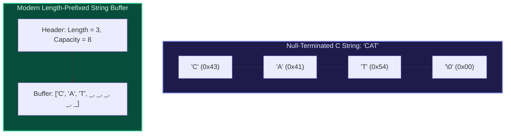
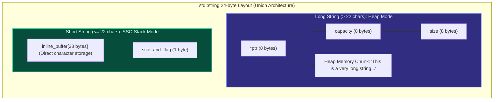
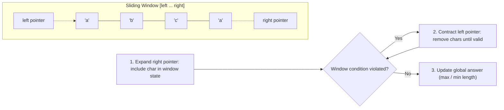

import { Callout } from "fumadocs-ui/components/callout";
import { Tabs, Tab } from "fumadocs-ui/components/tabs";
import { Steps, Step } from "fumadocs-ui/components/steps";
import { Cards, Card } from "fumadocs-ui/components/card";

## The Core Mental Model: Bytes, Encodings & Memory Layouts

To a human, a string is a sequence of characters: `"Hello, World!"`. To a computer, a string is an array of raw binary bytes interpreted through an **encoding standard** (ASCII, UTF-8, UTF-16, or UTF-32).

Historically, strings were represented in two distinct ways:

1. **C-Style (Null-Terminated)**: Characters placed contiguously in memory followed by a sentinel zero byte `\0`.
   - _Drawback_: Finding length requires scanning the entire buffer, taking $O(N)$ time.
2. **Pascal-Style / Modern Length-Prefixed**: Explicit metadata stores the string's length and capacity before or alongside the byte buffer.
   - _Advantage_: Retrieving string length is instantaneous ($O(1)$).



---

## Memory Architecture: Small String Optimization (SSO)

In typical production applications (HTTP headers, JSON keys, variable names), the vast majority of strings are short (fewer than 20 characters). If every string required a heap allocation via `malloc()` or `operator new`, the system would suffer severe heap fragmentation, cache misses, and memory manager lock contention.

To solve this, modern C++ standard libraries (`std::string`), Rust, and high-performance engines use **Small String Optimization (SSO)**.



### How SSO Works Under the Hood

A `std::string` object occupies 24 bytes (on 64-bit systems). It uses an internal union:

- **Large string mode**: Contains a pointer to heap memory (8 bytes), capacity (8 bytes), and current size (8 bytes).
- **Small string mode**: Uses the same 24 bytes directly as an inline buffer of 23 characters plus 1 byte reserved for string length and mode flag.
- **Result**: Strings with 15–22 characters (depending on compiler: libc++, libstdc++, MSVC) require **zero heap allocations**. They live directly on the CPU stack or inside the parent struct!

---

## String Immutability vs Mutability

In high-level languages (Python, JavaScript, Java, C#), strings are **immutable**. Once created, their characters cannot be modified in place.

| Language                | Mutability  | Internal Encoding                      | Optimization Strategy                     |
| :---------------------- | :---------- | :------------------------------------- | :---------------------------------------- |
| **Python (`str`)**      | Immutable   | Latin-1 / UCS-2 / UCS-4 (PEP 393)      | String interning for short identifiers    |
| **JavaScript (V8)**     | Immutable   | One-Byte (Latin1) or Two-Byte (UTF-16) | ConsString (ropes) & SlicedString         |
| **C++ (`std::string`)** | **Mutable** | Raw bytes (typically UTF-8)            | Small String Optimization (SSO)           |
| **Rust (`String`)**     | **Mutable** | Guaranteed UTF-8                       | Heap vector of `u8` with UTF-8 validation |

### The Catastrophic Cost of Naive String Concatenation

Because strings are immutable in Python and JavaScript, repeatedly concatenating characters in a loop creates an asymptotic trap:


Total work required to build a string of length $N$:

$$\sum_{i=1}^{N} i = \frac{N(N+1)}{2} = \Theta(N^2)$$

### The Solution: StringBuilder Pattern

Instead of allocating a new string on each character addition, accumulate characters in a dynamic array buffer with geometric expansion.

- Each append is amortized $O(1)$.
- When concatenation is complete, convert the buffer into a single string in one $O(N)$ allocation.
- **Total Time Complexity**: $\Theta(N)$.

---

## The Master Pattern: Dynamic Sliding Window Substring

One of the most essential string algorithmic patterns is the **Sliding Window**. It solves problems asking for optimal contiguous substrings (longest substring without repeating characters, minimum window substring) in linear $O(N)$ time instead of brute-force $O(N^2)$ or $O(N^3)$.



### Invariant Rules for Sliding Window:

1. `right` pointer expands monotonically from `0` to `N - 1`.
2. `left` pointer advances monotonically from `0` to `right`.
3. Because both `left` and `right` advance at most $N$ times, the inner `while` loop runs at most $N$ times across the _entire_ algorithm.
4. **Total Time Complexity**: $\Theta(N)$ (amortized $O(1)$ per step).

---

## Production Code Implementations

Below is the production implementation of the canonical sliding window challenge: **"Longest Substring Without Repeating Characters"** across Python, TypeScript, and C++.

<Tabs items={['Python', 'TypeScript', 'C++']}>
<Tab value="Python">
```python
class Solution:
    @staticmethod
    def length_of_longest_substring(s: str) -> int:
        """
        Finds the length of the longest substring without repeating characters.
        Time Complexity: O(N) where N is len(s).
        Auxiliary Space: O(min(N, Sigma)) where Sigma is the alphabet size (ASCII 128/256).
        """
        # Map character to its most recently seen index + 1
        last_seen = {}
        max_length = 0
        left = 0

        for right, char in enumerate(s):
            # If the character is already within our current window, jump 'left'
            if char in last_seen and last_seen[char] >= left:
                left = last_seen[char] + 1

            last_seen[char] = right
            current_window = right - left + 1
            if current_window > max_length:
                max_length = current_window

        return max_length

# Verification

if **name** == "**main**":
test_cases = ["abcabcbb", "bbbbb", "pwwkew", ""]
for tc in test_cases:
print(f"Input: '{tc}' -> Longest unique substring length: {Solution.length_of_longest_substring(tc)}")

````
</Tab>

<Tab value="TypeScript">
```typescript
/**
 * Sliding Window solution using direct index jump optimization.
 * Utilizes a fixed 128-element Int32Array for pure ASCII performance.
 */
export function lengthOfLongestSubstring(s: string): number {
  // NOTE: This implementation handles ASCII characters only (codes 0-127).
  // For full Unicode support, replace Int32Array(128) with a Map<string, number>.
  const lastIndex = new Int32Array(128).fill(-1);
  let maxLength = 0;
  let left = 0;

  for (let right = 0; right < s.length; right++) {
    const charCode = s.charCodeAt(right);

    // If character was seen at or after 'left', contract window immediately
    if (charCode < 128 && lastIndex[charCode] >= left) {
      left = lastIndex[charCode] + 1;
    }

    if (charCode < 128) {
      lastIndex[charCode] = right;
    }

    const windowLength = right - left + 1;
    if (windowLength > maxLength) {
      maxLength = windowLength;
    }
  }

  return maxLength;
}

// Verification
console.log(lengthOfLongestSubstring("abcabcbb")); // Expected: 3 ("abc")
console.log(lengthOfLongestSubstring("pwwkew"));   // Expected: 3 ("wke")
````

</Tab>

<Tab value="C++">
```cpp
#include <iostream>
#include <string>
#include <vector>
#include <algorithm>

class Solution {
public:
static int lengthOfLongestSubstring(const std::string& s) {
// Fast direct-mapped ASCII lookup table initialized to -1
std::vector<int> last_seen(256, -1);
int max_len = 0;
int left = 0;

        for (int right = 0; right < static_cast<int>(s.length()); ++right) {
            unsigned char char_code = static_cast<unsigned char>(s[right]);

            // If duplicate found within current window, hop left past previous occurrence
            if (last_seen[char_code] >= left) {
                left = last_seen[char_code] + 1;
            }

            last_seen[char_code] = right;
            max_len = std::max(max_len, right - left + 1);
        }

        return max_len;
    }

};

int main() {
std::string test = "abcabcbb";
std::cout << "Input: " << test << " -> Max unique len: "
<< Solution::lengthOfLongestSubstring(test) << "\n";
return 0;
}

````
</Tab>
</Tabs>

---

## Production Systems Case Study: Google V8 Engine's String Hierarchy

Inside Google Chrome's V8 JavaScript engine, strings are not simple contiguous character arrays. V8 uses a specialized polymorphic class hierarchy to optimize string manipulations without copying memory:

```mermaid
flowchart TD
    String["V8 String Base Class"]
    SeqString["SeqString (Sequential contiguous buffer)"]
    ConsString["ConsString (Rope data structure for concatenation)"]
    SlicedString["SlicedString (Zero-copy slice into parent string)"]
    ThinString["ThinString (Indirection to internalized string table)"]

    String --> SeqString
    String --> ConsString
    String --> SlicedString
    String --> ThinString
````

1. **`ConsString` (Rope Structure)**: When you evaluate `s1 + s2` in JavaScript, V8 does **not** allocate a new buffer and copy both strings. Instead, it creates a small `ConsString` node consisting of two pointers: `left -> s1` and `right -> s2`. This makes string concatenation **$O(1)$**!
2. **Flattening On Demand**: Only when the string is indexed or evaluated in regex does V8 "flatten" the `ConsString` tree into a contiguous `SeqString`.
3. **`SlicedString`**: Calling `s.slice(0, 10)` creates a `SlicedString` pointer containing `parent: s`, `offset: 0`, and `length: 10` without copying a single character.

---

## Technical Interview Invariants & Traps

<Callout type="warn">
  ### The Unicode Code Point vs Code Unit Trap In JavaScript and Python: - In
  JavaScript, `s.length` returns the number of **UTF-16 code units**, not
  human-perceived characters (graphemes). ```javascript "😀".length; // Returns
  2! (Surrogate pair) ``` - If your interview prompt involves emojis or
  international text, simple index iteration can split a surrogate pair in half,
  causing corrupted characters. - Use `Array.from(s)` or `[...s]` in TypeScript
  to iterate over full Unicode codepoints.
</Callout>

---

## Hands-On Verification Challenge

1. **Sliding Window Challenge**: Given a string `s` and a string `t`, implement the **Minimum Window Substring** algorithm to find the smallest substring in `s` that contains all characters of `t` (including duplicates) in $O(|s| + |t|)$ time.
2. **SSO Inspection**: In C++, use `sizeof(std::string)` to inspect the static footprint on your platform. Allocate a 10-character string and a 100-character string. Print their internal data pointers (`s.data()`) alongside the address of the string object (`&s`) to prove whether memory was allocated inline or on the heap!
