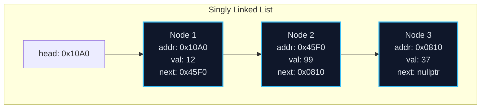
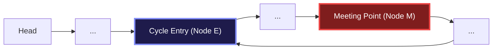
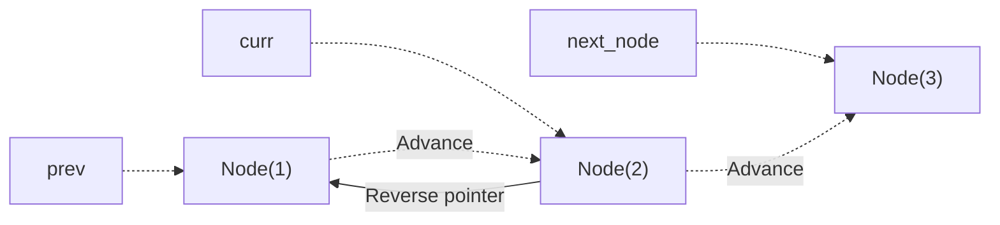
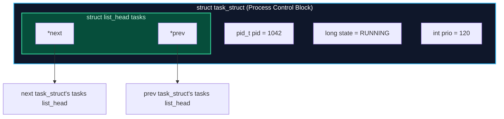

import { Callout } from "fumadocs-ui/components/callout";
import { Tabs, Tab } from "fumadocs-ui/components/tabs";
import { Steps, Step } from "fumadocs-ui/components/steps";
import { Cards, Card } from "fumadocs-ui/components/card";

## The Core Mental Model: Dispersed Nodes & Explicit Pointers

Unlike arrays, which demand a single contiguous slab of memory, a **Linked List** scatters its elements across arbitrary locations in the heap. Each element is packaged into a **Node** containing:

1. `val`: The payload data.
2. `next` (and optionally `prev`): Raw memory pointers linking adjacent nodes together.



### The Architectural Tradeoff: Array vs. Linked List

| Dimension                              | Dynamic Array                 | Singly Linked List                                |
| :------------------------------------- | :---------------------------- | :------------------------------------------------ |
| **Memory Layout**                      | Contiguous chunk              | Dispersed heap nodes                              |
| **Random Indexing (`get(i)`)**         | **$O(1)$**                    | **$O(N)$** (Must traverse pointers)               |
| **Insert / Delete at Head**            | $O(N)$ (Requires right-shift) | **$O(1)$** (Update head pointer)                  |
| **Insert / Delete given Node pointer** | $O(N)$                        | **$O(1)$** (Local pointer splice)                 |
| **Cache Locality**                     | **Near 100% L1/L2 hits**      | **Frequent L1/L2 cache misses** (Pointer chasing) |
| **Memory Overhead**                    | 0 bytes per element           | 8–16 bytes per node (Pointers)                    |

---

## The Sentinel (Dummy) Node Pattern

The most common source of bugs in linked list manipulation is managing edge cases:

- Inserting at an empty list.
- Inserting or deleting the very first node (`head`).
- Deleting the very last node (`tail`).

A **Sentinel Node** (or Dummy Head) is a permanent, non-data node placed at the beginning (and optionally end) of the list. By ensuring that _every real data node always has a predecessor_, you eliminate `if (head == nullptr)` branches entirely.


---

## Floyd's Cycle-Finding Algorithm (Tortoise & Hare)

Given a linked list, determine if it contains a cycle, and if so, return the node where the cycle begins.



### The Exact Mathematical Proof

Let:

- $F$ = Distance from `head` to the cycle entrance node $E$.
- $C$ = Total length (number of nodes) of the cycle.
- $a$ = Distance from cycle entrance $E$ to the meeting point $M$.

We advance two pointers:

- **Slow pointer** ($\text{Tortoise}$): Moves $1$ step per tick.
- **Fast pointer** ($\text{Hare}$): Moves $2$ steps per tick.

#### Step 1: Prove they must meet inside the cycle

When slow enters the cycle, fast is already somewhere inside. Each tick decreases the relative distance between fast and slow by $1$ modulo $C$. Therefore, fast is guaranteed to catch slow within at most $C$ iterations.

#### Step 2: Formulate distance equations

When they meet at $M$:

- Distance traveled by slow: $D_{\text{slow}} = F + a$
- Distance traveled by fast: $D_{\text{fast}} = F + a + k \cdot C$ (where $k \ge 1$ is the number of full loops fast completed)

Because fast travels at twice the speed of slow:

$$D_{\text{fast}} = 2 \cdot D_{\text{slow}}$$

$$F + a + k \cdot C = 2(F + a)$$

$$F + a + k \cdot C = 2F + 2a$$

Subtract $(F + a)$ from both sides:

$$k \cdot C = F + a$$

Rearranging for $F$:

$$F = k \cdot C - a = (k - 1) \cdot C + (C - a)$$

#### Step 3: The Geometric Deduction

Notice what $(C - a)$ represents: it is the remaining distance from the meeting point $M$ back to the cycle entrance $E$!

Therefore:

- If we reset `slow` back to `head`, and keep `fast` at meeting point $M$,
- And advance both pointers at **equal speed (1 step per tick)**:
- After `slow` walks $F$ steps, it arrives precisely at entrance node $E$.
- Simultaneously, `fast` walks $(k - 1)$ complete cycles plus $(C - a)$ steps, arriving at entrance node $E$ at the **exact same tick**!

---

## In-Place Reversal of a Singly Linked List

Reversing a linked list in $O(N)$ time and $O(1)$ space requires maintaining three sliding pointers: `prev`, `curr`, and `next_node`.



At each step:

1. `next_node = curr.next` (Preserve reference to the rest of the list)
2. `curr.next = prev` (Reverse the direction of the current link)
3. `prev = curr` (Advance prev forward)
4. `curr = next_node` (Advance curr forward)

---

## Production Polyglot Implementations

Below is the complete implementation of:

1. Reversing a Linked List in place.
2. Floyd's Cycle Detection with entrance identification.

<Tabs items={['Python', 'TypeScript', 'C++']}>
<Tab value="Python">
```python
from typing import Optional

class ListNode:
def **init**(self, val: int = 0, next: Optional['ListNode'] = None):
self.val = val
self.next = next

class LinkedListAlgorithms:
@staticmethod
def reverse_list(head: Optional[ListNode]) -> Optional[ListNode]:
"""
Reverses a singly linked list in-place.
Time: O(N), Space: O(1).
"""
prev: Optional[ListNode] = None
curr: Optional[ListNode] = head

        while curr is not None:
            next_node = curr.next
            curr.next = prev
            prev = curr
            curr = next_node

        return prev

    @staticmethod
    def detect_cycle_entry(head: Optional[ListNode]) -> Optional[ListNode]:
        """
        Detects cycle start node using Floyd's Tortoise and Hare algorithm.
        Time: O(N), Space: O(1).
        """
        if not head or not head.next:
            return None

        slow = head
        fast = head

        # Phase 1: Determine if cycle exists
        while fast and fast.next:
            slow = slow.next
            fast = fast.next.next
            if slow == fast:
                break
        else:
            return None  # No cycle found

        # Phase 2: Find cycle entrance node
        slow = head
        while slow != fast:
            slow = slow.next
            fast = fast.next

        return slow  # Exact entrance node

````
</Tab>

<Tab value="TypeScript">
```typescript
export class ListNode {
  val: number;
  next: ListNode | null;

  constructor(val: number = 0, next: ListNode | null = null) {
    this.val = val;
    this.next = next;
  }
}

export class LinkedListUtils {
  /**
   * Reverses a singly-linked list in place.
   * Time Complexity: O(N), Space Complexity: O(1)
   */
  public static reverseList(head: ListNode | null): ListNode | null {
    let prev: ListNode | null = null;
    let curr: ListNode | null = head;

    while (curr !== null) {
      const nextTemp: ListNode | null = curr.next;
      curr.next = prev;
      prev = curr;
      curr = nextTemp;
    }

    return prev;
  }

  /**
   * Floyd's Cycle Finding Algorithm: Finds cycle starting node.
   */
  public static detectCycleEntry(head: ListNode | null): ListNode | null {
    if (!head || !head.next) return null;

    let slow: ListNode | null = head;
    let fast: ListNode | null = head;

    // Phase 1: Intersection detection
    while (fast !== null && fast.next !== null) {
      slow = slow!.next;
      fast = fast.next.next;
      if (slow === fast) {
        // Phase 2: Locate cycle head
        let entry: ListNode | null = head;
        while (entry !== slow) {
          entry = entry!.next;
          slow = slow!.next;
        }
        return entry;
      }
    }

    return null;
  }
}
````

</Tab>

<Tab value="C++">
```cpp
#include <iostream>

struct ListNode {
int val;
ListNode\* next;
explicit ListNode(int x) : val(x), next(nullptr) {}
};

class LinkedListOps {
public:
static ListNode* reverseList(ListNode* head) {
ListNode* prev = nullptr;
ListNode* curr = head;

        while (curr != nullptr) {
            ListNode* next_node = curr->next;
            curr->next = prev;
            prev = curr;
            curr = next_node;
        }

        return prev;
    }

    static ListNode* detectCycleEntry(ListNode* head) {
        if (!head || !head->next) return nullptr;

        ListNode* slow = head;
        ListNode* fast = head;

        while (fast && fast->next) {
            slow = slow->next;
            fast = fast->next->next;
            if (slow == fast) {
                ListNode* ptr1 = head;
                ListNode* ptr2 = slow;
                while (ptr1 != ptr2) {
                    ptr1 = ptr1->next;
                    ptr2 = ptr2->next;
                }
                return ptr1;
            }
        }

        return nullptr;
    }

};

````
</Tab>
</Tabs>

---

## Production Systems Case Study: Linux Kernel's Intrusive Doubly Linked List

In standard user-space libraries, a node typically wraps your data:
```c
struct StandardNode {
    void* data;
    struct StandardNode* next;
    struct StandardNode* prev;
};
````

This forces two heap allocations per element (one for the node, one for data) and induces double pointer chasing.

The **Linux Kernel** inverts this relationship with **Intrusive Lists** (`<linux/list.h>`):



```c
struct list_head {
    struct list_head *next, *prev;
};

// Embedding the list head directly inside the host struct:
struct task_struct {
    pid_t pid;
    long state;
    struct list_head tasks; // Embedded intrusive node!
    int priority;
};
```

To recover the parent `task_struct` from a pointer to `struct list_head tasks`, the kernel uses the famous `container_of` macro:

```c
#define container_of(ptr, type, member) \
    ((type *)((char *)(ptr) - offsetof(type, member)))
```

### Why Intrusive Lists Dominate Kernel & Game Engine Design:

1. **Zero Heap Allocations**: No memory allocation needed when adding an existing struct to a list.
2. **Multiple Simultaneous Lists**: A single `task_struct` can contain `tasks`, `children`, and `run_list` heads, living on three completely different lists simultaneously with zero memory bloat.
3. **No Allocation Failure**: Inserting a node into a list is mathematically guaranteed never to fail due to `out-of-memory`.

---

## Technical Interview Invariants & Traps

<Callout type="warn">
### The Dangling Pointer and Lost Reference Trap
When modifying pointers in a linked list, **always capture your next pointer before modifying the current one**:
```cpp
// FATAL ERROR:
curr->next = prev;
curr = curr->next; // BUG: curr->next was just overwritten with prev!
```
**Golden Rule**: Write down pointer reassignment order on scratch paper before coding. In singly linked lists, you almost always need `next_node = curr->next` before `curr->next = prev`.
</Callout>

---

## Hands-On Verification Challenge

1. **LRU Cache Precursor**: Implement a Doubly Linked List with sentinel `head` and `tail` nodes that supports:
   - `add_to_front(node)` in $O(1)$
   - `remove(node)` in $O(1)$
   - `move_to_front(node)` in $O(1)$
2. Verify that deleting the only remaining real node never throws a `NullReferenceException` or `NullPointerException`.
