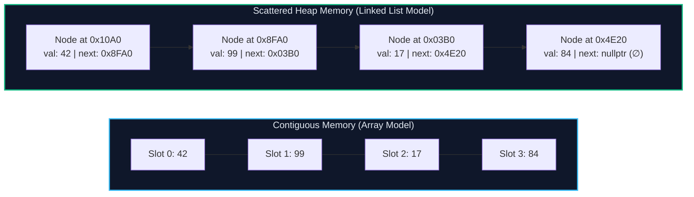
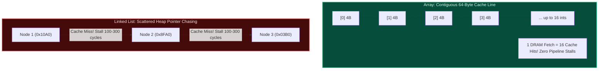
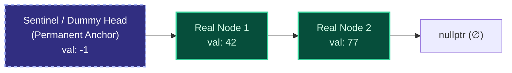
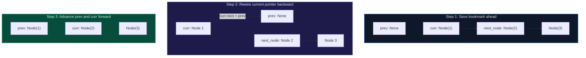
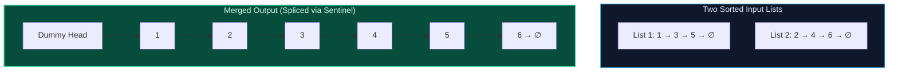
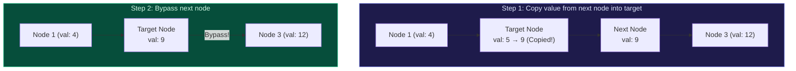
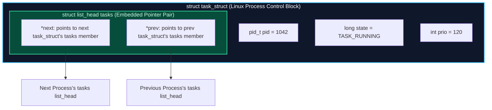
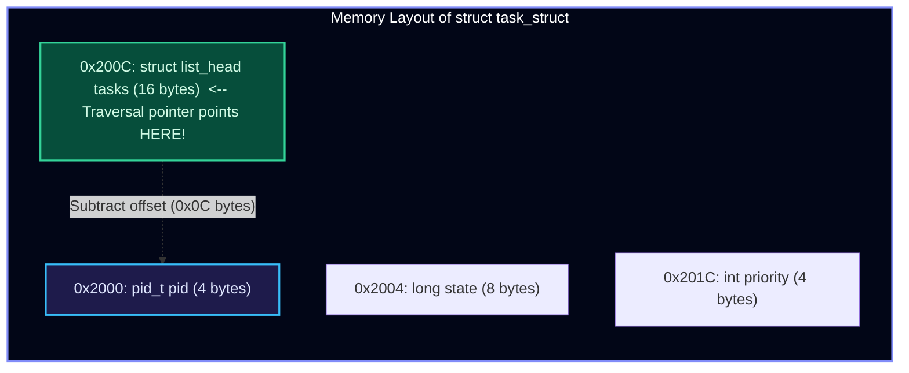

import { Callout } from "fumadocs-ui/components/callout";
import { Tabs, Tab } from "fumadocs-ui/components/tabs";
import { Steps, Step } from "fumadocs-ui/components/steps";
import { Cards, Card } from "fumadocs-ui/components/card";
import {
  Concepts,
  LessonIntro,
  AnalogyCard,
  Explain,
  LessonNote,
  TryIt,
  Takeaway,
} from "@/components/cs101/lesson-blocks";

<Concepts
  items={[
    "contiguous vs scattered memory",
    "cache locality & L1 misses",
    "singly, doubly & circular lists",
    "skip lists & express lanes",
    "sentinel dummy node pattern",
    "in-place 3-pointer reversal",
    "Floyd's cycle detection proof",
    "fast/slow pointer techniques",
    "intrusive lists & container_of",
  ]}
/>

<LessonIntro>

Imagine you manage warehouse inventory. With a **rigid steel shelf (an array)**, all 10,000 slots are bolted side-by-side in a single unbroken aisle. Calculating where box #42 lives is instant math: you walk directly to slot 42. But if a VIP package arrives that must sit at **slot 0**, disaster strikes: you must physically push all 10,000 existing boxes one slot to the right.

What if, instead of forcing items to live together in a rigid physical line, you scattered the boxes anywhere there was open floor space, and simply connected them with **strings and address tags**?

Inserting a VIP package at the front now takes **two seconds flat**: place the box in any open corner, tie its string to the old first box, and update your clipboard. But there is an inescapable trade-off: when someone asks for box #50, you can no longer jump there with arithmetic. You must start at the clipboard and follow all 50 strings one by one.

This is the foundational trade-off of the **Linked List**.

</LessonIntro>

---

## 01 — Physical Everyday Analogies

To anchor your intuition before manipulating memory addresses, consider two physical systems you already know:

<AnalogyCard name="Rigid Shelf vs. Scavenger Hunt">
  <div>
    <strong>The Rigid Steel Shelf (Array)</strong>
    <p>
      A library bookshelf with slots numbered 0 to 999. Because every slot is
      identical in width and contiguous, you calculate the physical address of
      book <code>i</code> in one step: <code>base + i * width</code>. However,
      inserting a new book at slot 0 requires shifting 999 books down the shelf.
    </p>
  </div>
  <div>
    <strong>The Scavenger Hunt (Linked List)</strong>
    <p>
      You find Clue 1 inside your pocket: <em>"Check under the park bench."</em>{" "}
      Under the bench is Clue 2: <em>"Look inside locker 42."</em> You cannot
      teleport to Clue 5 because you have no idea where it is until you visit
      Clue 4. Splicing a new clue into the hunt takes seconds, but lookup
      requires walking the full chain.
    </p>
  </div>
</AnalogyCard>



---

## 02 — Arrays vs. Linked Lists: The Hardware Reality

Introductory textbooks often offer misleading advice: _"Use arrays for fast lookups, and use linked lists for fast insertions."_ In production systems engineering, this advice is frequently incorrect. To make sound architectural decisions, you must understand how hardware executes these structures.

<Explain
  title="Contiguous Memory vs. Scattered Heap Allocation"
  what="Why memory layout dictates CPU cache performance and allocation overhead"
>
  An array allocates a single contiguous slab of virtual address space. Because
  elements are packed back-to-back, computing <code>arr[i]</code> requires only
  a base addition and a multiplication:{" "}
  <code>Address = Base + i * sizeof(T)</code>. This executes in{" "}
  <strong>1 CPU clock cycle</strong> ($O(1)$). A linked list allocates each
  element as an independent object scattered across arbitrary locations in heap
  memory. Each node bundles the user data payload with one or more explicit
  pointer addresses. Traversing from node <code>k</code> to node{" "}
  <code>k + 1</code> requires{" "}
  <strong>dereferencing an address stored in dynamic RAM</strong>.
</Explain>



### The Three Hardware Penalties of Linked Lists

<Steps>
### 1. Pointer Chasing & CPU Cache Misses
Modern CPUs never fetch individual bytes from system RAM; they read **64-byte chunks called cache lines** into ultra-fast L1/L2 caches. When an array is scanned, a single memory fetch loads up to 16 consecutive 4-byte integers. Hardware prefetchers detect linear memory access patterns and preload the next cache lines before the CPU even requests them.

In a linked list, each node lives in an unrelated heap page. Traversing `curr = curr.next` forces the CPU to wait for main memory (DRAM), causing an L1/L2 cache miss and stalling the processor pipeline for **100 to 300 clock cycles**.

### 2. Massive Pointer Memory Overhead

On a 64-bit operating system, a memory pointer occupies **8 bytes**.

- In a Singly Linked List storing a 4-byte integer: Node size = $4\text{ bytes (data)} + 8\text{ bytes (next)} = 12\text{ bytes}$. Due to 8-byte structure alignment in C/C++/Rust, the memory allocator pads this to **16 bytes**.
- In a Doubly Linked List storing a 4-byte integer: Node size = $4 + 8\text{ (next)} + 8\text{ (prev)} = 20\text{ bytes}$, padded to **24 or 32 bytes**.
- Storing 1,000,000 integers in a dynamic array takes **4 MB**. Storing them in a doubly linked list takes **24 MB to 32 MB**—an overhead of 500% to 700%!

### 3. Heap Fragmentation & Allocator Pressure

Creating 1,000,000 nodes requires 1,000,000 calls to the heap allocator (`malloc` or `new`). This fragments heap memory, increases metadata tracking overhead, and puts immense pressure on runtime garbage collectors (in Java, Go, and Python).

</Steps>

<LessonNote
  variant="myth"
  title="Bjarne Stroustrup's Vector vs. List Benchmark"
>
  Bjarne Stroustrup (creator of C++) famously tested inserting random integers
  into a sorted `std::vector` (array) versus a sorted `std::list` (doubly linked
  list). Even though inserting into a vector requires shifting thousands of
  elements ($O(n)$) while linked lists splice pointers ($O(1)$ once located),
  **`std::vector` outperformed `std::list` by an order of magnitude**. Shifting
  contiguous bytes in L1 cache with vectorized CPU instructions (`memmove`) is
  vastly faster than chasing scattered pointers across DRAM.
</LessonNote>

### Comprehensive Time & Space Complexity Matrix

| Operation                       | Dynamic Array (`vector`)          | Singly Linked List (SLL)     | Doubly Linked List (DLL)          | Hardware Root Cause                                                       |
| :------------------------------ | :-------------------------------- | :--------------------------- | :-------------------------------- | :------------------------------------------------------------------------ |
| **Random Access (`get(i)`)**    | **$O(1)$**                        | $O(n)$                       | $O(n)$                            | Array uses pointer math; list must traverse pointers                      |
| **Search by Value**             | $O(n)$ (or $O(\log n)$ if sorted) | $O(n)$                       | $O(n)$                            | Linear scan required (cannot binary search standard list)                 |
| **Insert at Head**              | $O(n)$                            | **$O(1)$**                   | **$O(1)$**                        | Array shifts all elements right; list updates head reference              |
| **Insert at Tail**              | **$O(1)$** amortized              | $O(1)$ (with tail pointer)   | **$O(1)$** (with tail pointer)    | Array appends to reserved capacity; list splices tail                     |
| **Insert at Position $k$**      | $O(n)$                            | $O(k)$ traversal + $O(1)$    | $O(k)$ traversal + $O(1)$         | Array shifts elements; list walks $k$ steps then rewires pointers         |
| **Delete at Head**              | $O(n)$                            | **$O(1)$**                   | **$O(1)$**                        | Array shifts elements left; list advances head pointer                    |
| **Delete at Tail**              | **$O(1)$**                        | $O(n)$ (must reach $n-1$)    | **$O(1)$** (uses `tail.prev`)     | Singly linked list cannot traverse backward to update penultimate node    |
| **Delete Given Node Reference** | $O(n)$ (must shift)               | $O(n)$ without predecessor\* | **$O(1)$**                        | Doubly linked list updates `node.prev.next` and `node.next.prev` directly |
| **Memory Overhead per Item**    | **0 bytes** (capacity padding)    | 8 bytes (1 pointer)          | 16 bytes (2 pointers) + padding   | 64-bit memory addresses require 8 bytes each                              |
| **Cache Friendliness**          | **Optimal** (Spatial locality)    | **Poor** (Pointer chasing)   | **Poor** (Double pointer chasing) | Contiguous cache lines vs scattered heap allocations                      |

_(Note: In SLL, deleting a node in $O(1)$ without predecessor reference is possible via the value-copy trick, detailed in Section 06)._

---

## 03 — Interactive Lab: The Linked List Simulator

Explore how nodes live across scattered heap addresses and watch how pointer splicing works step-by-step.

<LinkedListSimulator />

### Guided Exploration Steps:

1. **Press `▶ PLAY ALL` or use `STEP ▶`**:
   - **Beat 1 (Allocation)**: Notice nodes spawning across scattered coordinates in memory. They are not lined up side-by-side like an array.
   - **Beat 2 (Linking)**: Watch the `HEAD` pointer anchor the sequence, with arrows pointing node-to-node until terminating at `null` ($\emptyset$).
   - **Beat 3 (Traversal)**: Watch the hop counter increment `0 → 1 → 2 → 3`. Accessing index 3 requires visiting every previous link, visually proving why random access is $O(n)$.
   - **Beat 4 (Head Insertion)**: A new node appears. Watch the pointer rewire: first `newNode.next` points to old head, then `HEAD` shifts to `newNode`. Splicing finishes in **2 operations** without shifting any existing elements.
   - **Beat 5 (Deletion)**: The pointer from Node 3 bypasses Node 7 and points directly to Node 2. Node 7 is orphaned from the chain.

---

## 04 — The Four Variants of Linked Lists

```mermaid
flowchart TD
    subgraph SLL["1. Singly Linked List (Unidirectional)"]
        direction LR
        S_Head["Head"] --> S1["Node A<br/>next →"] --> S2["Node B<br/>next →"] --> S3["Node C<br/>next: ∅"]
    end

    subgraph DLL["2. Doubly Linked List (Bidirectional)"]
        direction LR
        D_Head["Head"] --> D1["Node A"]
        D1 <--> D2["Node B"] <--> D3["Node C"]
        D3 --> D_Null["next: ∅"]
    end

    subgraph CLL["3. Circular Linked List (Ring Structure)"]
        direction LR
        C1["Node A"] --> C2["Node B"] --> C3["Node C"]
        C3 -->|"Loops back to Head"| C1
    end

    subgraph Skip["4. Skip List (Multilevel Express Lanes)"]
        direction TB
        subgraph L2["Express Level 2"]
            direction LR
            E_H["Head"] --> E7["Node 7"] --> E_N["NIL"]
        end
        subgraph L1["Express Level 1"]
            direction LR
            M_H["Head"] --> M3["Node 3"] --> M7["Node 7"] --> M_N["NIL"]
        end
        subgraph L0["Base Level 0 (All Nodes)"]
            direction LR
            B_H["Head"] --> B1["Node 1"] --> B3["Node 3"] --> B5["Node 5"] --> B7["Node 7"] --> B_N["NIL"]
        end
    end

    style SLL fill:#0f172a,stroke:#38bdf8,stroke-width:1.5px,color:#e2e8f0
    style DLL fill:#1e1b4b,stroke:#818cf8,stroke-width:1.5px,color:#e0e7ff
    style CLL fill:#064e3b,stroke:#34d399,stroke-width:1.5px,color:#d1fae5
    style Skip fill:#1e293b,stroke:#f59e0b,stroke-width:1.5px,color:#fef3c7
```



<Steps>
### 1. Singly Linked List (SLL)
Each node stores data and a single forward reference (`next`).
- **Advantage**: Lowest memory overhead (only one pointer per node).
- **Limitation**: Traversal is strictly unidirectional. Finding the predecessor of a node requires restarting from `head` and scanning $O(n)$ steps. Deleting the tail requires walking to node $n-1$.

### 2. Doubly Linked List (DLL)

Each node stores data and two pointers: `next` and `prev`.

- **Advantage**: Bidirectional traversal. Given a direct pointer to any node, you can delete it in **$O(1)$** time because `node.prev.next = node.next` and `node.next.prev = node.prev`.
- **Limitation**: Doubles pointer memory overhead (16 bytes of pointers per node on 64-bit systems) and requires updating 4 pointers on every insertion or deletion.

### 3. Circular Linked List (CLL)

The tail node's `next` pointer loops back to `head` instead of pointing to `null`. In a circular doubly linked list, `head.prev` also points directly to `tail`.

- **Advantage**: No null checks required during continuous streaming. Any node can serve as an entry point to visit the entire list.
- **Production Applications**:
  - **Round-Robin CPU Scheduling**: Operating system schedulers cycle through active processes in equal time slices. When the last process finishes its quantum, the scheduler wraps seamlessly to the first.
  - **Audio & Video Repeat Buffers**: Media players looping playlists or continuous ring buffers for real-time telemetry.

### 4. Skip Lists: Multilevel Express Lanes

Why can't we perform binary search ($O(\log n)$) on a sorted linked list? Because you cannot jump to the middle node without walking $n/2$ pointers ($O(n)$).
In 1989, William Pugh invented **Skip Lists**:

- A base linked list (Level 0) contains all elements in sorted order.
- Higher levels act as **express transit lines**, skipping over multiple intermediate nodes using probabilistic promotion (each node has a $50\%$ chance of being promoted to the level above).
- Search starts at the highest express level, runs forward until the next key is too large, drops down one level, and repeats.
- **Performance**: Delivers guaranteed **$O(\log n)$ average search, insertion, and deletion**.
- **Why Databases & Redis Choose Skip Lists Over Balanced Trees (AVL / Red-Black)**:
  - In a balanced tree, inserting an element can trigger cascading tree rotations that lock large subtrees, severely degrading multi-threaded concurrency.
  - In a skip list, insertion only updates localized forward pointers on each level. This enables **lock-free concurrent implementations** using atomic compare-and-swap (CAS) operations.
  - Used in **Redis Sorted Sets (`zset`)**, **Apache Cassandra MemTables**, and **RocksDB / LevelDB**.
    </Steps>

---

## 05 — Pointer Mechanics & The Sentinel (Dummy) Node Pattern

Ask any candidate who has interviewed at a major tech company, and they will tell you: **90% of linked list bugs stem from boundary edge cases**:

- Inserting into an empty list (`head == null`).
- Deleting the very first node (`head` must be reassigned).
- Deleting the only node in the list (`head` becomes `null`).
- Updating the tail when the list has only 1 or 2 nodes.

<Explain
  title="The Sentinel (Dummy) Node Pattern"
  what="A permanent, auxiliary anchor node prepended to the head of a linked list"
>
  Without a sentinel node, every insertion and deletion must check:{" "}
  <em>
    "Am I modifying the head? If so, treat this completely differently than
    modifying any other node."
  </em>
  A <strong>Sentinel (Dummy) Node</strong> is an allocated node (e.g.,{" "}
  <code>dummy = ListNode(-1, next=head)</code>) that permanently precedes the
  real list. With a sentinel node,{" "}
  <strong>
    every real node—including the first one—is guaranteed to have an existing
    predecessor
  </strong>
  . Boundary branches vanish from your code.
</Explain>



### Code Comparison: Removing Elements Matching Target Value

Suppose we want to delete all nodes containing value `target` from a list.

<Tabs items={['Without Sentinel (Bug-Prone & Verbose)', 'With Sentinel (Bulletproof & Unified)']}>
<Tab value="Without Sentinel (Bug-Prone & Verbose)">
```python
def remove_elements_ugly(head: Optional[ListNode], val: int) -> Optional[ListNode]:
    # Edge Case 1: Head itself contains target (possibly multiple in a row)
    while head is not None and head.val == val:
        head = head.next

    # Edge Case 2: List was entirely targets or originally empty
    if head is None:
        return None

    # Normal traversal requires special checks
    curr = head
    while curr.next is not None:
        if curr.next.val == val:
            curr.next = curr.next.next  # Splice out target
        else:
            curr = curr.next

    return head

````
</Tab>
<Tab value="With Sentinel (Bulletproof & Unified)">
```python
def remove_elements_clean(head: Optional[ListNode], val: int) -> Optional[ListNode]:
    # 1. Create a permanent anchor before head
    sentinel = ListNode(val=-1, next=head)
    curr = sentinel

    # 2. Every node in the list now has a guaranteed predecessor!
    while curr.next is not None:
        if curr.next.val == val:
            curr.next = curr.next.next  # Splice out target
        else:
            curr = curr.next

    # 3. Return the real head
    return sentinel.next
````

</Tab>
</Tabs>

<LessonNote variant="warning" title="The Dangling Reference & Memory Leak Trap">
When modifying pointers in a linked list, **never overwrite a pointer before saving where it points**:
```cpp
// FATAL RUNTIME BUG:
curr->next = prev;  // You overwrote the forward link!
curr = curr->next;  // BUG: curr now jumps backward to prev instead of forward!
```
In languages without automatic garbage collection (C, C++), permanently losing the address of downstream nodes causes **irrecoverable memory leaks**. Always capture your bookmark before rewiring:
```cpp
ListNode* next_node = curr->next; // 1. Save reference ahead
curr->next = prev;                // 2. Rewire current link
prev = curr;                      // 3. Step prev forward
curr = next_node;                 // 4. Step curr forward
```
</LessonNote>

---

## 06 — Crucial Exam & Technical Interview Algorithms

Below are the five canonical linked list algorithms tested in university exams and senior technical interviews.

---

### Algorithm 1: In-Place Reversal of a Singly Linked List

Reversing a linked list in **$O(n)$ time and $O(1)$ auxiliary space** is a foundational rite of passage.



The algorithm maintains three sliding pointers across every iteration:

1. `prev`: The node behind us (initially `None`).
2. `curr`: The node currently being rewired.
3. `next_node`: The temporary bookmark holding the remaining forward chain.

```python
def reverse_list(head: Optional[ListNode]) -> Optional[ListNode]:
    prev: Optional[ListNode] = None
    curr: Optional[ListNode] = head

    while curr is not None:
        next_node = curr.next  # 1. Save bookmark
        curr.next = prev       # 2. Reverse link
        prev = curr            # 3. Slide prev forward
        curr = next_node       # 4. Slide curr forward

    return prev  # New head of reversed list
```

---

### Algorithm 2: Floyd's Cycle-Finding Algorithm ("Tortoise and Hare")

Given a linked list, does it contain an infinite loop? And if so, **what is the exact node where the cycle begins**?


#### The Relative Speed Intuition

Imagine two runners on a circular track. Runner **Slow** moves at $1\text{ step/tick}$, while Runner **Fast** sprints at $2\text{ steps/tick}$.
Their relative closing speed is:
$$\text{Relative Speed} = 2 - 1 = 1\text{ step/tick}$$
Every tick, the gap between Fast and Slow closes by exactly 1 node. Because a cycle has finite perimeter $C$, Fast is mathematically guaranteed to lap and collide with Slow without skipping over it!

#### The Mathematical Proof for Finding the Cycle Entrance


Let:

- $F$ = Distance from `head` to the cycle entrance node $E$.
- $C$ = Total number of nodes in the cycle (circumference).
- $a$ = Distance from entrance $E$ to the meeting point $M$.

**Step 1: Distance equations at collision point $M$**

- Distance traveled by Slow:
  $$D_{\text{slow}} = F + a$$
- Distance traveled by Fast:
  $$D_{\text{fast}} = F + a + k \cdot C$$
  _(where $k \ge 1$ is the integer number of full laps Fast completed inside the cycle)._

**Step 2: Equating speeds**
Because Fast moves exactly twice as fast as Slow:
$$D_{\text{fast}} = 2 \cdot D_{\text{slow}}$$
$$F + a + k \cdot C = 2(F + a) = 2F + 2a$$

Subtract $(F + a)$ from both sides:
$$k \cdot C = F + a$$

**Step 3: Solving for $F$**
$$F = k \cdot C - a = (k - 1) \cdot C + (C - a)$$

**The Geometric Revelation:**
What does $(C - a)$ represent? It is the **remaining distance from meeting point $M$ forward along the loop back to entrance $E$**!
Therefore, if we leave Fast at meeting point $M$, reset Slow back to `head`, and advance **both pointers at 1 step per tick**:

- Slow walks $F$ steps to reach entrance $E$.
- Fast walks $(k - 1)$ full circles plus $(C - a)$ steps from $M$, arriving at entrance $E$ on the exact same tick!
- **Both pointers collide at the cycle entrance node $E$!**

```python
def detect_cycle_entry(head: Optional[ListNode]) -> Optional[ListNode]:
    if not head or not head.next:
        return None

    slow: Optional[ListNode] = head
    fast: Optional[ListNode] = head

    # Phase 1: Detect if a cycle exists
    while fast and fast.next:
        slow = slow.next
        fast = fast.next.next
        if slow == fast:
            break
    else:
        return None  # fast reached null; no cycle

    # Phase 2: Find cycle entrance node
    slow = head
    while slow != fast:
        slow = slow.next
        fast = fast.next

    return slow  # Collide at exact cycle entrance
```

---

### Algorithm 3: Middle of the Linked List in a Single Pass

How do you find the middle node of a linked list without first counting its length?

<Explain
  title="Single-Pass Middle Finding (Slow & Fast Pointers)"
  what="Advance fast at 2x speed so it hits the end when slow hits the exact midpoint"
>
  Initialize <code>slow = head</code> and <code>fast = head</code>. In each
  step, move <code>slow = slow.next</code> and{" "}
  <code>fast = fast.next.next</code>. When <code>fast</code> reaches the end (or{" "}
  <code>fast.next</code> is <code>null</code>), <code>slow</code> has traversed
  exactly half the distance!
</Explain>

```python
def find_middle(head: Optional[ListNode]) -> Optional[ListNode]:
    slow = head
    fast = head

    while fast and fast.next:
        slow = slow.next
        fast = fast.next.next

    return slow
```

- **Odd Length ($1 \to 2 \to 3 \to 4 \to 5$)**: `fast` lands on Node 5 (`fast.next` is `None`). `slow` lands on Node 3 (the exact center).
- **Even Length ($1 \to 2 \to 3 \to 4$)**: `fast` lands on `None`. `slow` lands on Node 3 (the second middle node, standard convention in LeetCode #876).

---

### Algorithm 4: Merging Two Sorted Linked Lists

Given the heads of two sorted linked lists, splice their nodes together into a single sorted list in **$O(n + m)$ time and $O(1)$ auxiliary space**.



```python
def merge_two_lists(l1: Optional[ListNode], l2: Optional[ListNode]) -> Optional[ListNode]:
    dummy = ListNode(-1)
    tail = dummy

    while l1 and l2:
        if l1.val <= l2.val:
            tail.next = l1
            l1 = l1.next
        else:
            tail.next = l2
            l2 = l2.next
        tail = tail.next

    # Attach whichever list still has remaining elements
    tail.next = l1 if l1 else l2

    return dummy.next
```

---

### Algorithm 5: Deleting a Node Given Only a Pointer to It ($O(1)$ Value-Copy Trick)

You are given direct access to a node in a singly linked list, but you are **not given access to the head pointer**. How do you delete it in $O(1)$ time?



```python
def delete_node(node: ListNode) -> None:
    """
    Deletes node in O(1) without head access.
    Limitation: Cannot delete the tail node!
    """
    node.val = node.next.val       # Step 1: Steal next node's value
    node.next = node.next.next     # Step 2: Bypass next node
```

<LessonNote variant="warning" title="Critical Edge Case Limitation">
  This interview trick **cannot delete the tail node**. If `node.next` is
  `null`, there is no subsequent value to copy, and setting `node = None` only
  overwrites a local variable reference without modifying the predecessor's
  pointer.
</LessonNote>

---

## 07 — Production Polyglot Implementations

Below are complete, production-grade implementations of the core linked list algorithms across Python, TypeScript, and C++.

<Tabs items={['Python', 'TypeScript', 'C++']}>
<Tab value="Python">
```python
from typing import Optional

class ListNode:
"""Singly linked list node definition."""
def **init**(self, val: int = 0, next: Optional['ListNode'] = None):
self.val = val
self.next = next

class LinkedListAlgorithms:
@staticmethod
def reverse_list(head: Optional[ListNode]) -> Optional[ListNode]:
prev: Optional[ListNode] = None
curr: Optional[ListNode] = head

        while curr is not None:
            next_node = curr.next
            curr.next = prev
            prev = curr
            curr = next_node

        return prev

    @staticmethod
    def detect_cycle_entry(head: Optional[ListNode]) -> Optional[ListNode]:
        if not head or not head.next:
            return None

        slow: Optional[ListNode] = head
        fast: Optional[ListNode] = head

        while fast and fast.next:
            slow = slow.next
            fast = fast.next.next
            if slow == fast:
                break
        else:
            return None

        slow = head
        while slow != fast:
            slow = slow.next
            fast = fast.next

        return slow

    @staticmethod
    def find_middle(head: Optional[ListNode]) -> Optional[ListNode]:
        slow = head
        fast = head
        while fast and fast.next:
            slow = slow.next
            fast = fast.next.next
        return slow

    @staticmethod
    def merge_two_lists(l1: Optional[ListNode], l2: Optional[ListNode]) -> Optional[ListNode]:
        dummy = ListNode(-1)
        tail = dummy
        while l1 and l2:
            if l1.val <= l2.val:
                tail.next = l1
                l1 = l1.next
            else:
                tail.next = l2
                l2 = l2.next
            tail = tail.next
        tail.next = l1 if l1 else l2
        return dummy.next

````
</Tab>

<Tab value="TypeScript">
```typescript
export class ListNode {
  val: number;
  next: ListNode | null;

  constructor(val: number = 0, next: ListNode | null = null) {
    this.val = val;
    this.next = next;
  }
}

export class LinkedListAlgorithms {
  public static reverseList(head: ListNode | null): ListNode | null {
    let prev: ListNode | null = null;
    let curr: ListNode | null = head;

    while (curr !== null) {
      const nextNode: ListNode | null = curr.next;
      curr.next = prev;
      prev = curr;
      curr = nextNode;
    }

    return prev;
  }

  public static detectCycleEntry(head: ListNode | null): ListNode | null {
    if (!head || !head.next) return null;

    let slow: ListNode | null = head;
    let fast: ListNode | null = head;

    while (fast !== null && fast.next !== null) {
      slow = slow!.next;
      fast = fast.next.next;
      if (slow === fast) {
        let entry: ListNode | null = head;
        while (entry !== slow) {
          entry = entry!.next;
          slow = slow!.next;
        }
        return entry;
      }
    }

    return null;
  }

  public static findMiddle(head: ListNode | null): ListNode | null {
    let slow = head;
    let fast = head;
    while (fast !== null && fast.next !== null) {
      slow = slow!.next;
      fast = fast.next.next;
    }
    return slow;
  }

  public static mergeTwoLists(
    l1: ListNode | null,
    l2: ListNode | null
  ): ListNode | null {
    const dummy = new ListNode(-1);
    let tail: ListNode = dummy;

    while (l1 !== null && l2 !== null) {
      if (l1.val <= l2.val) {
        tail.next = l1;
        l1 = l1.next;
      } else {
        tail.next = l2;
        l2 = l2.next;
      }
      tail = tail.next;
    }
    tail.next = l1 !== null ? l1 : l2;

    return dummy.next;
  }
}
````

</Tab>

<Tab value="C++">
```cpp
#include <iostream>

struct ListNode {
int val;
ListNode* next;
explicit ListNode(int x) : val(x), next(nullptr) {}
ListNode(int x, ListNode* n) : val(x), next(n) {}
};

class LinkedListAlgorithms {
public:
static ListNode* reverseList(ListNode* head) {
ListNode* prev = nullptr;
ListNode* curr = head;

        while (curr != nullptr) {
            ListNode* next_node = curr->next;
            curr->next = prev;
            prev = curr;
            curr = next_node;
        }

        return prev;
    }

    static ListNode* detectCycleEntry(ListNode* head) {
        if (!head || !head->next) return nullptr;

        ListNode* slow = head;
        ListNode* fast = head;

        while (fast && fast->next) {
            slow = slow->next;
            fast = fast->next->next;
            if (slow == fast) {
                ListNode* p1 = head;
                ListNode* p2 = slow;
                while (p1 != p2) {
                    p1 = p1->next;
                    p2 = p2->next;
                }
                return p1;
            }
        }

        return nullptr;
    }

    static ListNode* findMiddle(ListNode* head) {
        ListNode* slow = head;
        ListNode* fast = head;
        while (fast && fast->next) {
            slow = slow->next;
            fast = fast->next->next;
        }
        return slow;
    }

    static ListNode* mergeTwoLists(ListNode* l1, ListNode* l2) {
        ListNode dummy(-1);
        ListNode* tail = &dummy;

        while (l1 && l2) {
            if (l1->val <= l2->val) {
                tail->next = l1;
                l1 = l1->next;
            } else {
                tail->next = l2;
                l2 = l2->next;
            }
            tail = tail->next;
        }
        tail->next = l1 ? l1 : l2;

        return dummy.next;
    }

};

````
</Tab>
</Tabs>

---

## 08 — Systems Architecture Case Study: Linux Kernel Intrusive Lists

In standard application software (like Java or standard C++), a node wraps your data payload:

```c
// Standard Non-Intrusive Node (Double Allocation)
struct StandardNode {
    void* data;                  // Allocation 1: Pointer to payload on heap
    struct StandardNode* next;   // Allocation 2: Pointer to next node on heap
    struct StandardNode* prev;
};
````

This pattern causes two severe penalties in operating systems and high-frequency trading engines:

1. **Double Allocation**: Every item requires two separate heap allocations (`data` and `StandardNode`).
2. **Double Cache Misses**: Traversing requires dereferencing `node->next`, then dereferencing `node->data`.

### The Linux Kernel Breakthrough: Intrusive Linked Lists

The **Linux Kernel** (`<linux/list.h>`) inverts this relationship. Instead of wrapping data inside a node, it **embeds a pure pointer struct directly inside your data structure**:



```c
// 1. The Pure Pointer Struct (Occupies only 16 bytes on 64-bit systems)
struct list_head {
    struct list_head *next, *prev;
};

// 2. Embed list_head directly INSIDE the host struct:
struct task_struct {
    pid_t pid;
    long state;
    struct list_head tasks;     // Member of all active processes list
    struct list_head children;  // Head of child processes list
    int priority;
};
```

### The `container_of` Macro Magic

When the Linux kernel scheduler traverses a list of `struct list_head*`, how does it recover the outer `struct task_struct*`? It uses the `container_of` macro:

```c
#define offsetof(TYPE, MEMBER) ((size_t) &((TYPE *)0)->MEMBER)

#define container_of(ptr, type, member) ({                      \
    const typeof( ((type *)0)->member ) *__mptr = (ptr);        \
    (type *)( (char *)__mptr - offsetof(type, member) );})
```



By subtracting the byte offset of `tasks` within `task_struct` from the pointer to `tasks`, the kernel computes the base address of the host process struct in **zero clock cycles of memory access**!

#### Why Intrusive Lists Rule Systems Programming:

1. **Zero Dynamic Allocation**: Inserting an existing process into a runqueue calls no memory allocator.
2. **Cannot Fail with Out-of-Memory (OOM)**: Adding to a list requires zero heap allocation, making kernel list operations mathematically immune to memory exhaustion.
3. **Simultaneous Multi-List Membership**: A single `task_struct` can contain `tasks`, `children`, and `cgroup` list heads simultaneously, existing on multiple lists with zero extra allocation overhead.

---

## 09 — Interactive Retrieval Practice

Test your retention before viewing the solutions.

<TryIt
  question="Why does std::vector frequently outperform std::list in real-world benchmarks even when inserting into the middle of sorted collections?"
  options={[
    "Vectors compress elements with hardware gzip instructions during execution",
    "CPUs fetch 64-byte cache lines; array locality beats DRAM pointer chasing latency",
    "Linked lists require recursive locks on every individual node pointer",
    "Modern operating systems disable L1 and L2 caches during pointer dereferencing",
  ]}
  answer="B"
  why="Arrays offer contiguous spatial locality, enabling hardware prefetchers and near 100% L1 cache hits. Traversing linked lists triggers DRAM cache misses on every node, stalling CPU cores for hundreds of cycles."
/>

<TryIt
  question="In Floyd's cycle detection algorithm, why do slow (1 step) and fast (2 steps) pointers collide when slow is reset to head and both move 1 step per tick?"
  options={[
    "Fast is forced to reverse direction upon collision with slow",
    "Distance from head to entrance equals remaining distance from meet point to entrance",
    "The compiler replaces the pointer traversal with a logarithmic binary search",
    "The circular list automatically resets its head reference on the first collision",
  ]}
  answer="B"
  why="Mathematically, F = (k-1)C + (C - a). The straight-line distance from head to entrance (F) matches the remaining loop distance from the meeting point forward to the entrance (C - a)."
/>

<TryIt
  question="What is the primary architectural advantage of using a Sentinel (Dummy) Node when manipulating linked lists?"
  options={[
    "It converts O(n) linear traversals into O(1) direct mathematical indexing",
    "It eliminates edge cases by guaranteeing that every real node has an existing predecessor",
    "It forces the memory allocator to pack subsequent nodes into a single cache line",
    "It reduces the memory overhead of a 64-bit pointer from 8 bytes down to 4 bytes",
  ]}
  answer="B"
  why="With a sentinel head, inserting or deleting at index 0 requires no special-casing for null or empty lists, because the sentinel is a permanent predecessor."
/>

<TryIt
  question="Under what condition does the O(1) trick of deleting a node by copying its neighbor's value fail completely?"
  options={[
    "When the linked list contains duplicate values in adjacent positions",
    "When the target node to delete is the last (tail) node of the list",
    "When the list contains an odd number of nodes and no cycle is detected",
    "When the node values are 64-bit floating point numbers rather than integers",
  ]}
  answer="B"
  why="If the target node is the tail, node.next is null, so there is no subsequent value to copy and no forward node to bypass."
/>

<TryIt
  question="Why do high-throughput storage engines (like Redis and RocksDB) prefer Skip Lists over balanced trees (AVL or Red-Black trees)?"
  options={[
    "Skip lists have O(1) worst-case search complexity while balanced trees are O(n)",
    "Skip lists enable lock-free concurrent updates without cascading rebalancing rotations",
    "Skip lists use 90% less memory than balanced trees on 64-bit systems",
    "Balanced trees cannot be serialized to disk or non-volatile solid-state drives",
  ]}
  answer="B"
  why="Inserting into balanced trees triggers tree rotations that require wide locks across large subtrees. Skip list insertions update only localized pointers, enabling scalable lock-free concurrency."
/>

---

<Takeaway>

**One Win for This Lesson:**
A linked list is a trade-off between **instant $O(1)$ pointer splicing** and **expensive $O(n)$ DRAM pointer chasing**. Reach for arrays by default for CPU cache locality; reach for linked lists when node addresses must stay stable in memory, when splicing must be non-allocating and instantaneous (LRU caches, intrusive OS kernel lists), or when lock-free concurrency is paramount (skip lists).

</Takeaway>

---

## Hands-On Verification Challenges

Test your mastery by implementing these two canonical systems problems:

<Cards>
  <Card title="Challenge 1: LRU Cache Precursor" icon="Workflow">
    Implement a Doubly Linked List with permanent sentinel `head` and `tail`
    nodes that supports: - `add_to_front(node)` in $O(1)$ - `remove(node)` in
    $O(1)$ - `move_to_front(node)` in $O(1)$ *Verification*: Verify that calling
    `remove()` on the last remaining real node leaves the sentinel head and tail
    properly connected to each other without throwing a `NullPointerException`.
  </Card>
  <Card
    title="Challenge 2: Palindrome Linked List in O(1) Space"
    icon="GitCommit"
  >
    Given the head of a singly linked list, determine if it is a palindrome in
    **$O(n)$ time and $O(1)$ auxiliary space**. *Strategy*: 1. Find the list
    middle using Tortoise and Hare. 2. Reverse the second half in-place. 3.
    Compare values of first half and reversed second half. 4. Restore the
    original list structure before returning!
  </Card>
</Cards>
