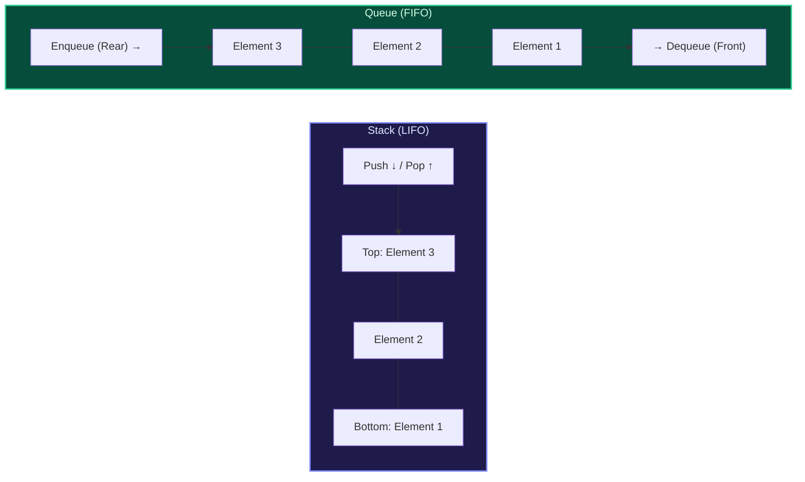
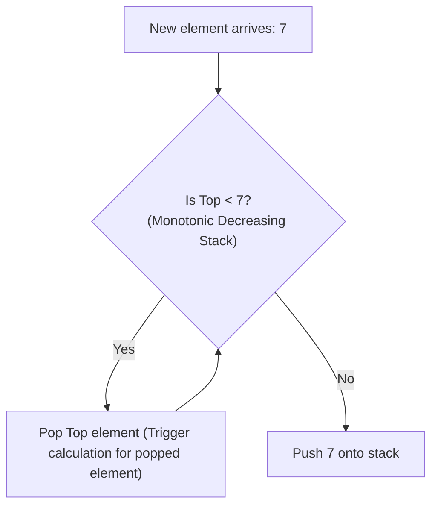
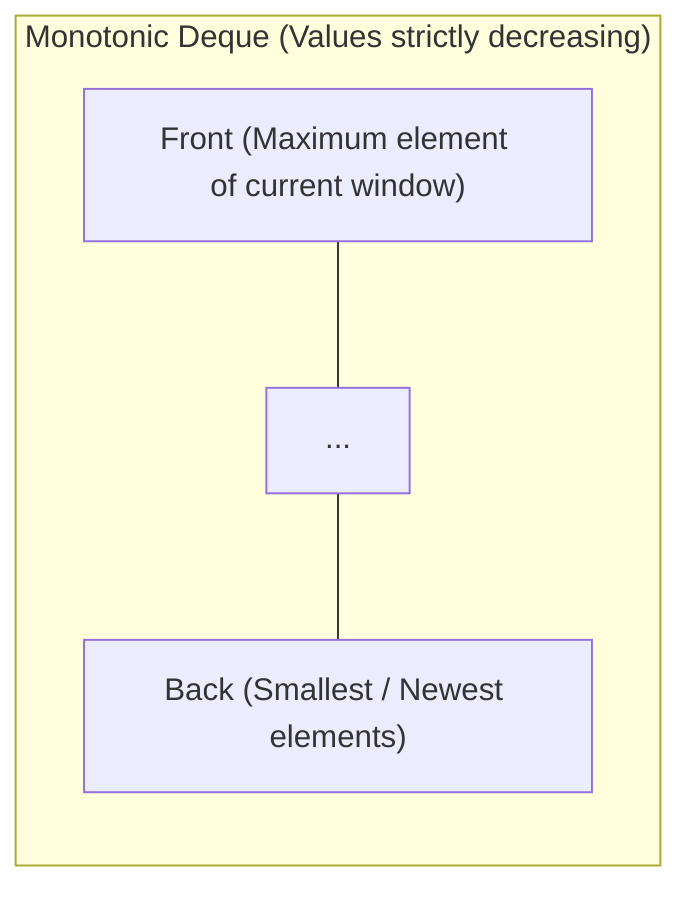

import { Callout } from "fumadocs-ui/components/callout";
import { Tabs, Tab } from "fumadocs-ui/components/tabs";
import { Steps, Step } from "fumadocs-ui/components/steps";
import { Cards, Card } from "fumadocs-ui/components/card";

## The Core Mental Model: LIFO vs. FIFO

Stacks and Queues are constrained linear abstractions that restrict data ingress and egress to specific endpoints:

- **Stack (LIFO: Last-In, First-Out)**: Analogous to a spring-loaded stack of cafeteria plates. You can only push onto the top and pop from the top. Used in program execution call stacks, DFS graph traversals, and syntax parsing.
- **Queue (FIFO: First-In, First-Out)**: Analogous to a checkout counter line at a supermarket. Elements join at the rear (`enqueue`) and depart from the front (`dequeue`). Used in BFS search, task scheduling, and asynchronous messaging pipelines.



---

## The Circular Queue (Ring Buffer)

Implementing a queue via a naive dynamic array causes a disastrous bottleneck: popping from index 0 requires shifting all remaining $N-1$ elements leftward, degrading `dequeue()` to $O(N)$ time.

A **Circular Queue** (or Ring Buffer) solves this by mapping a fixed-size contiguous buffer into a logical circle using modular arithmetic.


### Pointer Arithmetic & Invariants

Let $N$ be the capacity of the buffer:

- **Enqueue**:
  $$\text{buffer}[\text{tail}] = \text{val}, \quad \text{tail} = (\text{tail} + 1) \pmod N$$
- **Dequeue**:
  $$\text{val} = \text{buffer}[\text{head}], \quad \text{head} = (\text{head} + 1) \pmod N$$
- **Power of Two Optimization**: If capacity is chosen as a power of 2 ($N = 2^k$), the slow modulo division operator `%` can be replaced with an ultra-fast bitwise AND instruction:
  $$\text{index} = (\text{index} + 1) \& (N - 1)$$

---

## The Monotonic Stack Pattern

A **Monotonic Stack** enforces a strict invariant: elements inside the stack are strictly increasing or strictly decreasing from bottom to top.

When a new incoming element violates the invariant, we repeatedly pop older elements until the invariant is restored.



### Canonical Applications:

1. **Next Greater Element**: Find the first element to the right that is larger than the current element in $O(N)$ time.
2. **Daily Temperatures**: Calculate how many days until a warmer temperature occurs.
3. **Largest Rectangle in Histogram**: Find the maximum rectangular area in a bar chart.

### Derivation: Largest Rectangle in Histogram

Given bar heights `[2, 1, 5, 6, 2, 3]`:

- Maintain a monotonic increasing stack of indices.
- When current bar $i$ is shorter than the bar at `stack.peek()`, the bar at `stack.peek()` can extend no further right!
- Pop height $h = \text{heights}[\text{stack.pop()}]$.
- The width of the rectangle with height $h$ is:
  $$\text{width} = \begin{cases} i & \text{if stack is empty} \\ i - \text{stack.peek()} - 1 & \text{otherwise} \end{cases}$$
- Area $= h \times \text{width}$.
- Because every index is pushed and popped at most once, total time is strictly **$\Theta(N)$**.

---

## The Monotonic Deque: Sliding Window Maximum

Find the maximum value in every contiguous subarray of size $k$ as the window slides across an array of length $N$.

A naive scan takes $O(k)$ per window, totaling $O(N \cdot k)$.
A **Monotonic Deque** achieves **$O(N)$ overall time** (amortized $O(1)$ per step):



### Deque Invariants:

1. **Evict Out-of-Window Elements**: Before processing index $i$, pop from the front if $\text{front\_idx} \le i - k$.
2. **Maintain Decreasing Monotonicity**: While the deque is not empty and $\text{nums}[\text{back\_idx}] \le \text{nums}[i]$, pop from the back (these smaller elements can never be the maximum because the new element is both larger and newer).
3. **Push Current Index**: Push $i$ onto the back.
4. **Front is Maximum**: The element at the front of the deque is guaranteed to be the maximum for the current window.

---

## Production Polyglot Implementations

Below is the complete implementation of:

1. A thread-safe, high-performance Circular Ring Buffer.
2. Largest Rectangle in Histogram using a Monotonic Stack.

<Tabs items={['Python', 'TypeScript', 'C++']}>
<Tab value="Python">
```python
from typing import List, Optional

class CircularQueue:
"""Fixed-capacity Ring Buffer implementation."""
def **init**(self, capacity: int):
self.capacity = capacity
self.queue: List[Optional[int]] = [None] \* capacity
self.head = 0
self.tail = 0
self.size = 0

    def enqueue(self, val: int) -> bool:
        if self.is_full():
            return False
        self.queue[self.tail] = val
        self.tail = (self.tail + 1) % self.capacity
        self.size += 1
        return True

    def dequeue(self) -> Optional[int]:
        if self.is_empty():
            return None
        val = self.queue[self.head]
        self.queue[self.head] = None
        self.head = (self.head + 1) % self.capacity
        self.size -= 1
        return val

    def is_empty(self) -> bool:
        return self.size == 0

    def is_full(self) -> bool:
        return self.size == self.capacity

class MonotonicStackPatterns:
@staticmethod
def largest_rectangle_area(heights: List[int]) -> int:
"""
Calculates largest rectangular area in histogram in O(N) time.
Uses a monotonic increasing stack with sentinel zero-padding.
"""
stack = [] # Stores indices
max_area = 0
extended_heights = heights + [0] # Sentinel at end forces stack flush

        for i, h in enumerate(extended_heights):
            while stack and extended_heights[stack[-1]] > h:
                height = extended_heights[stack.pop()]
                width = i if not stack else i - stack[-1] - 1
                max_area = max(max_area, height * width)
            stack.append(i)

        return max_area

````
</Tab>

<Tab value="TypeScript">
```typescript
export class CircularRingBuffer<T> {
  private buffer: (T | null)[];
  private head: number = 0;
  private tail: number = 0;
  private count: number = 0;
  private readonly capacity: number;

  constructor(capacity: number) {
    this.capacity = capacity;
    this.buffer = new Array<T | null>(capacity).fill(null);
  }

  public enqueue(item: T): boolean {
    if (this.isFull()) return false;
    this.buffer[this.tail] = item;
    this.tail = (this.tail + 1) % this.capacity;
    this.count++;
    return true;
  }

  public dequeue(): T | null {
    if (this.isEmpty()) return null;
    const item = this.buffer[this.head];
    this.buffer[this.head] = null;
    this.head = (this.head + 1) % this.capacity;
    this.count--;
    return item;
  }

  public isEmpty(): boolean {
    return this.count === 0;
  }

  public isFull(): boolean {
    return this.count === this.capacity;
  }
}

/**
 * Largest Rectangle in Histogram using monotonic index stack.
 * Time Complexity: O(N), Auxiliary Space: O(N)
 */
export function largestRectangleArea(heights: number[]): number {
  const stack: number[] = [];
  let maxArea = 0;
  const n = heights.length;

  for (let i = 0; i <= n; i++) {
    const currentHeight = i === n ? 0 : heights[i];

    while (stack.length > 0 && heights[stack[stack.length - 1]] > currentHeight) {
      const h = heights[stack.pop()!];
      const w = stack.length === 0 ? i : i - stack[stack.length - 1] - 1;
      maxArea = Math.max(maxArea, h * w);
    }

    stack.push(i);
  }

  return maxArea;
}
````

</Tab>

<Tab value="C++">
```cpp
#include <iostream>
#include <vector>
#include <stack>
#include <algorithm>

template <typename T>
class RingBuffer {
private:
std::vector<T> data*;
size_t head*{0};
size*t tail*{0};
size*t size*{0};
size*t capacity*;

public:
explicit RingBuffer(size*t capacity)
: data*(capacity), capacity\_(capacity) {}

    bool enqueue(const T& item) {
        if (size_ == capacity_) return false;
        data_[tail_] = item;
        tail_ = (tail_ + 1) % capacity_;
        ++size_;
        return true;
    }

    bool dequeue(T& out_item) {
        if (size_ == 0) return false;
        out_item = data_[head_];
        head_ = (head_ + 1) % capacity_;
        --size_;
        return true;
    }

    bool empty() const { return size_ == 0; }
    bool full() const { return size_ == capacity_; }

};

class HistogramSolver {
public:
static int largestRectangleArea(const std::vector<int>& heights) {
std::stack<int> s; // Monotonic increasing stack of indices
int max_area = 0;
int n = static_cast<int>(heights.size());

        for (int i = 0; i <= n; ++i) {
            int h = (i == n) ? 0 : heights[i];
            while (!s.empty() && heights[s.top()] > h) {
                int height = heights[s.top()];
                s.pop();
                int width = s.empty() ? i : i - s.top() - 1;
                max_area = std::max(max_area, height * width);
            }
            s.push(i);
        }

        return max_area;
    }

};

````
</Tab>
</Tabs>

---

## Production Systems Case Study: The LMAX Disruptor High-Frequency Trading Engine

In financial high-frequency trading (HFT), traditional concurrency queues (such as Java's `ArrayBlockingQueue` or C++ `std::mutex`-guarded queues) incur unacceptable latency jitter due to:
1. **OS Thread Context Switching** and Lock Contention.
2. **False Sharing**: When `head` and `tail` pointers share the same 64-byte CPU cache line, a write to `tail` invalidates the L1 cache for the core reading `head`!

The **LMAX Disruptor** engine revolutionized low-latency systems by designing a lock-free, cache-padded ring buffer capable of processing over **6 million transactions per second** with sub-microsecond latency.

```mermaid
flowchart TD
    subgraph CacheLinePadding["Cache Line Alignment (Prevent False Sharing)"]
        direction TB
        Pad1["padding: 56 bytes"] --- Head["head pointer: 8 bytes (Fits in Cache Line 1)"]
        Pad2["padding: 56 bytes"] --- Tail["tail pointer: 8 bytes (Fits in Cache Line 2)"]
    end

    subgraph RingArray["Ring Buffer Array (Preallocated Contiguous Memory)"]
        R0["Entry 0"] --- R1["Entry 1"] --- R2["Entry 2"] --- R3["Entry 3"]
    end

    Head -.-> RingArray
    Tail -.-> RingArray
````

### Key Engineering Innovations:

1. **Cache-Line Padding**: Insertion of 7 unused 64-bit integers (`long p1, p2, p3, p4, p5, p6, p7`) before and after head/tail pointers ensures that `head` and `tail` always occupy distinct 64-byte cache lines.
2. **Pre-allocated Memory**: Objects inside the ring buffer are instantiated at startup and reused in-place, generating zero garbage collection pressure.
3. **Power-of-Two Bitmasking**: Head and tail indices increment monotonically towards $2^{64}-1$ without modulo wrapping; array slot is resolved via fast bitwise AND: `sequence & (buffer_size - 1)`.

---

## Technical Interview Invariants & Traps

<Callout type="warn">
### The Monotonic Stack "Equal Element" Trap
When maintaining a monotonic stack, be extremely precise about whether your problem requires **strictly increasing** ($<$) or **non-decreasing** ($\le$).
- In **Largest Rectangle in Histogram**, if you pop on $\ge$, identical heights trigger recalculation early, but the final duplicate will compute the correct global maximal width.
- In **Next Greater Element**, you must pop elements that are strictly smaller ($<$), because an equal element is *not* greater!
</Callout>

---

## Hands-On Verification Challenge

1. **Daily Temperatures**: Given an array of integers `temperatures = [73, 74, 75, 71, 69, 72, 76, 73]`, implement a monotonic stack that returns an array `answer` where `answer[i]` is the number of days you have to wait after the $i$-th day to get a warmer temperature.
2. **Sliding Window Maximum**: Given array `[1, 3, -1, -3, 5, 3, 6, 7]` and $k = 3$, trace the exact contents of the monotonic deque at each step and verify the output is `[3, 3, 5, 5, 6, 7]`.
