import { Callout } from "fumadocs-ui/components/callout";
import { Tabs, Tab } from "fumadocs-ui/components/tabs";
import { Steps, Step } from "fumadocs-ui/components/steps";
import { Cards, Card } from "fumadocs-ui/components/card";
import {
  Concepts,
  LessonIntro,
  AnalogyCard,
  Explain,
  LessonNote,
  TryIt,
  Takeaway,
} from "@/components/cs101/lesson-blocks";

<Concepts
  items={[
    "LIFO vs FIFO invariants",
    "stack overflow & underflow",
    "call stack & recursion frames",
    "infix to postfix conversion",
    "postfix expression evaluation",
    "monotonic stack pattern",
    "next greater element",
    "linear queue false overflow",
    "circular queue modulo arithmetic",
    "double-ended queue (deque)",
    "sliding window monotonic deque",
    "queue using two stacks (amortized O(1))",
    "LMAX disruptor ring buffer",
  ]}
/>

<LessonIntro>

At **ByteKart**, during the peak rush of Black Friday, two completely different engineering problems unfold at the exact same moment on two separate layers of the platform:

1. **The Cart Undo Engine**: A shopper adds a 75-inch TV, applies a coupon, and then accidentally clicks "Add Velvet Gift Wrap (\$30)". When she hits **Undo (Ctrl+Z)**, the system must reverse the _most recent_ action first. It would be catastrophic if clicking Undo deleted her TV while leaving the gift wrap in her cart! The newest action is undone first.
2. **The Flash-Sale Line**: At that same microsecond, 50,000 shoppers click "Confirm Payment" for 500 discounted consoles. The payment gateway can process only 50 charges per second. If the system processed the _newest_ customer first, patient buyers waiting in line would starve while latecomers snatched consoles. The first buyer to arrive must be the first buyer served.

These two fundamental access patterns—**LIFO (Last-In, First-Out)** and **FIFO (First-In, First-Out)**—form the backbone of operating systems, compilers, event loops, and high-frequency trading engines.

</LessonIntro>

---

## 01 — Stacks: The LIFO Principle & Invariants

A **Stack** is a linear data structure that operates under a strict discipline:

> **LIFO (Last-In, First-Out)**: The element added most recently is the very first element to be removed. Ingress and egress occur at a single, exclusive endpoint known as the **top**.

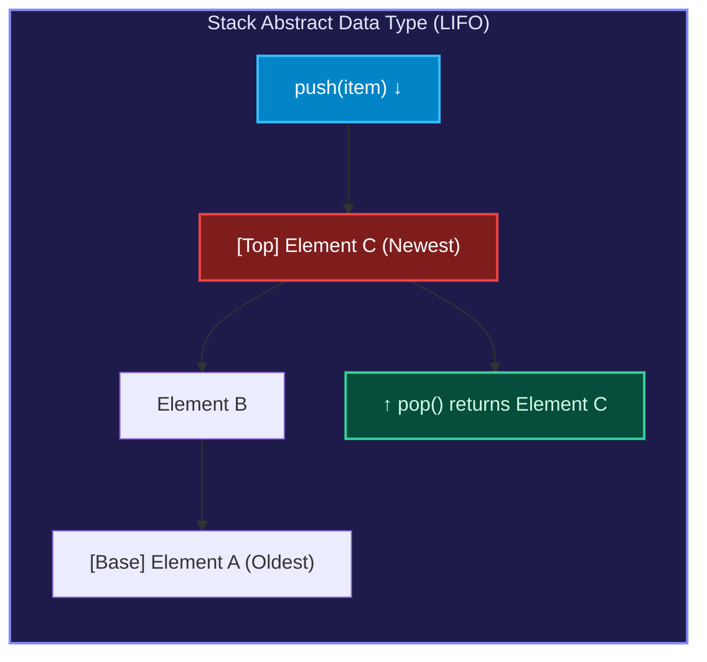

<AnalogyCard name="Cafeteria Tray Dispenser vs. Random Access Memory">
  <div>
    <strong>The Spring-Loaded Tray Dispenser</strong>
    <p>
      In a dining hall, clean trays are placed onto a spring-loaded cylinder.
      Each added tray pushes the stack downward. When a student takes a tray,
      they lift the top tray. You cannot grab the bottom tray without first
      removing all trays above it. The only accessible tray is the one sitting
      at the <strong>top</strong>.
    </p>
  </div>
  <div>
    <strong>The Stack Data Structure</strong>
    <p>
      A stack restricts arbitrary access. Unlike an array where you can jump to{" "}
      <code>arr[42]</code> in $O(1)$ time, a stack only gives you visibility
      into <code>top</code>. Both insertion (<code>push</code>) and deletion (
      <code>pop</code>) take place at the top index in guaranteed $\mathbf{O(1)}
      $ time.
    </p>
  </div>
</AnalogyCard>

### Core Stack Operations

| Operation          | Signature                 | Description                                             | Time Complexity | Space Complexity |
| :----------------- | :------------------------ | :------------------------------------------------------ | :-------------- | :--------------- |
| `push(x)`          | `push(T element) -> void` | Inserts element `x` onto the top of the stack           | **$O(1)$**      | $O(1)$           |
| `pop()`            | `pop() -> T`              | Removes and returns the top element                     | **$O(1)$**      | $O(1)$           |
| `peek()` / `top()` | `peek() -> T`             | Returns the top element without removing it             | **$O(1)$**      | $O(1)$           |
| `isEmpty()`        | `isEmpty() -> bool`       | Returns `true` if the stack contains no elements        | **$O(1)$**      | $O(1)$           |
| `isFull()`         | `isFull() -> bool`        | Returns `true` if internal static buffer is at capacity | **$O(1)$**      | $O(1)$           |

### Boundary Faults: Overflow & Underflow

Every robust stack implementation must guard against two critical boundary states:

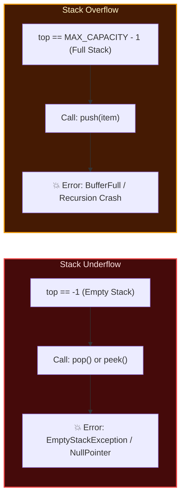

<Explain
  title="Overflow vs. Underflow"
  what="Overflow occurs when pushing to a full container; underflow occurs when popping from an empty container."
>

**Stack Underflow** happens when code attempts to `pop()` or `peek()` while `isEmpty() == true` (i.e., `top == -1`). In C or C++, this leads to out-of-bounds pointer reads or undefined behavior; in Java or Python, it raises an exception.

**Stack Overflow** occurs when attempting to `push()` into a fixed-capacity buffer that has reached `MAX_SIZE`. In operating systems, each thread is assigned a fixed call stack (typically 1 MB to 8 MB). When recursion fails to terminate, new stack frames consume all allocated memory, triggering a hardware page fault known as a **Stack Overflow Crash**.

</Explain>

### Implementation Face-Off: Array vs. Singly Linked List

A stack can be implemented using either a contiguous dynamic array or a singly linked list. Each approach offers distinct engineering tradeoffs:

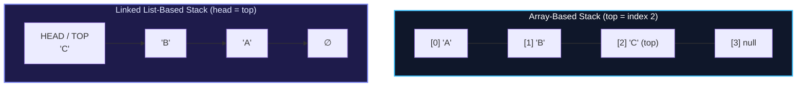

| Architectural Criterion | Array-Based Implementation                                      | Linked List-Based Implementation                         |
| :---------------------- | :-------------------------------------------------------------- | :------------------------------------------------------- |
| **`push()` Runtime**    | $O(1)$ amortized (occasional $O(n)$ reallocation)               | Guaranteed strict $O(1)$ per push                        |
| **`pop()` Runtime**     | Strict $O(1)$                                                   | Strict $O(1)$                                            |
| **Memory Overhead**     | Minimal: just the raw array elements + integer `top`            | High: 8 to 16 bytes pointer overhead per node            |
| **Cache Locality**      | **Superior**: contiguous memory leverages CPU L1/L2 prefetching | **Poor**: nodes scattered across heap cause cache misses |
| **Capacity Limit**      | Fixed buffer (static) or doubling resize overhead (dynamic)     | Unlimited (bounded only by total physical RAM)           |

---

## 02 — Interactive Lab 1: The Stack Simulator

Explore how items stack vertically and observe how the `TOP` pointer automatically tracks additions and removals.

<StackSimulator />

### Guided Exploration Steps:

1. **Press `▶ PLAY ALL` or step through with `STEP ▶`**:
   - **Beat 1**: The base plate settles into place with spring suspension.
   - **Beat 2 (Push A, B, C)**: Watch each new colored block drop from above. Notice how the `TOP` pointer marker tracks the uppermost block.
   - **Beat 3 (Pop)**: Block C is ejected horizontally into the air, and `TOP` automatically drops to block B. Notice that blocks A and B were **never moved or inspected**.
   - **Beat 4 (Push D)**: Block D lands on top of B, proving that the stack grows and shrinks strictly from one end.
2. **Exploratory Question**: Why do both `push()` and `pop()` execute in guaranteed **$O(1)$** time? Because regardless of whether there are 3 plates or 3,000,000 plates, the computer only ever reads and writes to the memory address stored in the `top` pointer!

---

## 03 — Essential Applications of Stacks

Stacks are not just classroom abstractions; they are the mechanical engine behind modern software execution.

### Application 1: Function Call Stack & Recursion

When a function executes, the CPU allocates a block of memory called an **Activation Record (Stack Frame)** on the runtime call stack.

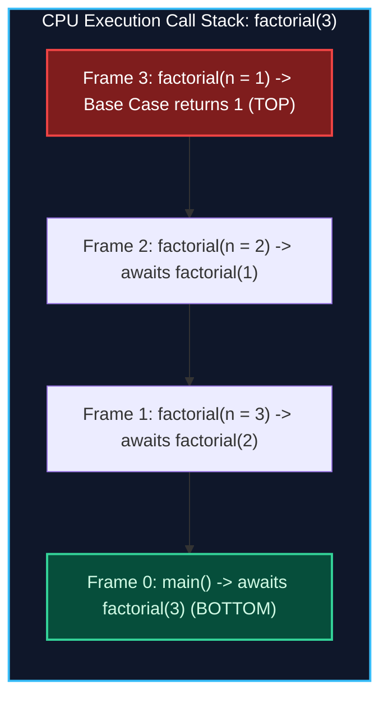

Each stack frame stores:

- **Return Address**: The instruction pointer address where control resumes after `return`.
- **Function Arguments**: Inputs passed into the current invocation.
- **Local Variables**: Variables declared inside the function scope.

When a function is called, its frame is **pushed**. When it returns, its frame is **popped**, and its local variables are freed immediately. If recursion lacks a valid base case, frames accumulate until memory is exhausted, throwing a **Stack Overflow**.

---

### Application 2: Undo / Redo Architecture (The Dual-Stack Pattern)

Every text editor, drawing tool, and CAD system implements reversible user history using two collaborating stacks:

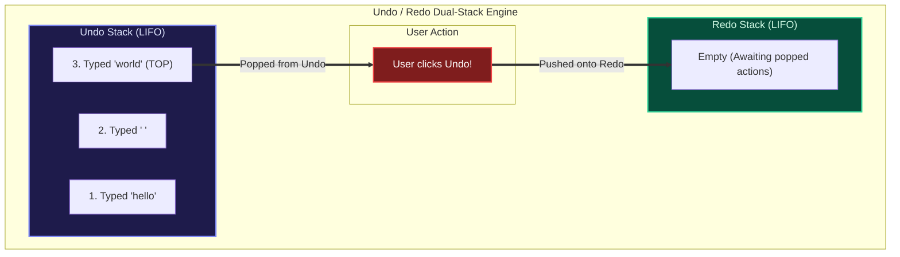

<Steps>
### Typing an Action
When the user modifies a document:
- Push the forward operation onto `undo_stack`.
- Clear `redo_stack` (new edits invalidate the alternate future).

### Pressing Undo

When the user clicks Undo:

- Pop the top action from `undo_stack`.
- Apply its inverse action to the document.
- Push the original action onto `redo_stack`.

### Pressing Redo

When the user clicks Redo:

- Pop the top action from `redo_stack`.
- Re-apply the action to the document.
- Push the action back onto `undo_stack`.
  </Steps>

---

### Application 3: Balanced Parentheses Matching

Compilers and code formatters use a stack to verify that nested delimiters (`()`, `{}`, `[]`) are correctly paired and closed.

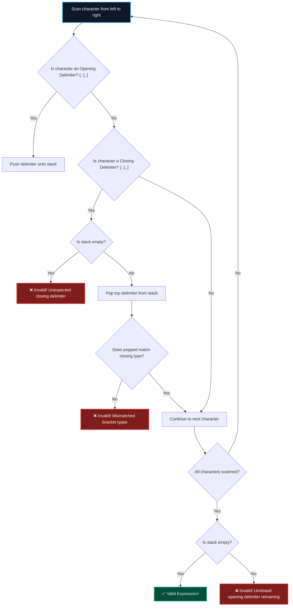

---

## 04 — Expression Conversions & Evaluation (Exam Heavyweight)

University exams and technical assessments routinely test arithmetic expression representations. Why do we need multiple notations?

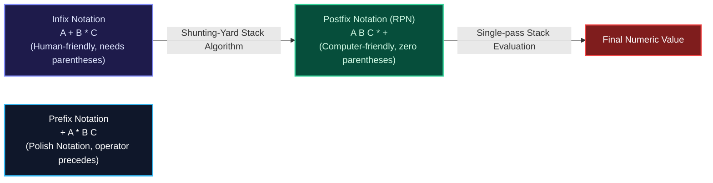

### The Three Notations Compared

1. **Infix Notation**: Operators sit _between_ operands: `(A + B) * C`.
   - Great for humans, but requires knowledge of operator precedence, parentheses, and associativity.
2. **Postfix Notation (Reverse Polish Notation — RPN)**: Operators sit _after_ their operands: `A B + C *`.
   - Parentheses are completely unnecessary. Unambiguous evaluation can be performed linearly in a single left-to-right pass using a stack.
3. **Prefix Notation (Polish Notation)**: Operators sit _before_ their operands: `* + A B C`.

### Operator Precedence & Associativity Hierarchy

| Operator               | Precedence Rank | Associativity | In-Stack Precedence            | Incoming Precedence      |
| :--------------------- | :-------------- | :------------ | :----------------------------- | :----------------------- |
| `^` (Exponentiation)   | **3 (Highest)** | Right-to-Left | 3                              | 4                        |
| `*`, `/`, `%`          | **2**           | Left-to-Right | 2                              | 2                        |
| `+`, `-`               | **1 (Lowest)**  | Left-to-Right | 1                              | 1                        |
| `(` (Left Parenthesis) | Special         | N/A           | 0 (never pops other operators) | $\infty$ (always pushed) |

---

### Infix to Postfix Conversion: The Shunting-Yard Algorithm

Invented by Edsger Dijkstra, the **Shunting-Yard Algorithm** uses an operator stack to convert infix expressions to postfix format in $O(n)$ time.

<Steps>
### Step 1: Scan Tokens Left-to-Right
Iterate through the tokens of the infix expression one by one.

### Step 2: Operands

If the token is an operand (a variable or number), send it **directly to the output**.

### Step 3: Left Parenthesis `(`

If the token is `(`, push it onto the operator stack.

### Step 4: Right Parenthesis `)`

If the token is `)`, repeatedly pop operators from the stack and append them to output until a matching `(` is popped. Discard both parentheses.

### Step 5: Operator `op`

While the stack is not empty and the top operator has **greater than or equal precedence** to `op` (taking associativity into account), pop the top operator to output. Then, push `op` onto the stack.

### Step 6: Flush Remaining Operators

At end of expression, pop all remaining operators from the stack to output.

</Steps>

#### Full Trace Walkthrough: Convert `A + B * (C - D) / E`

Let us trace `A + B * (C - D) / E` step-by-step:

|  Step  | Scanned Token | Operator Stack (Bottom $\to$ Top) | Postfix Output      | Rule Applied                                                  |
| :----: | :-----------: | :-------------------------------- | :------------------ | :------------------------------------------------------------ |
| **1**  |      `A`      | `[]`                              | `A`                 | Operand $\to$ output                                          |
| **2**  |      `+`      | `[+]`                             | `A`                 | Stack empty $\to$ push `+`                                    |
| **3**  |      `B`      | `[+]`                             | `A B`               | Operand $\to$ output                                          |
| **4**  |      `*`      | `[+, *]`                          | `A B`               | `*` has higher precedence than `+` $\to$ push `*`             |
| **5**  |      `(`      | `[+, *, (]`                       | `A B`               | `(` always pushed                                             |
| **6**  |      `C`      | `[+, *, (]`                       | `A B C`             | Operand $\to$ output                                          |
| **7**  |      `-`      | `[+, *, (, -]`                    | `A B C`             | Inside parens, stack top is `(` $\to$ push `-`                |
| **8**  |      `D`      | `[+, *, (, -]`                    | `A B C D`           | Operand $\to$ output                                          |
| **9**  |      `)`      | `[+, *]`                          | `A B C D -`         | Found `)` $\to$ pop until `(`, discard parens                 |
| **10** |      `/`      | `[+, /]`                          | `A B C D - *`       | `/` vs `*`: equal precedence (L-to-R) $\to$ pop `*`, push `/` |
| **11** |      `E`      | `[+, /]`                          | `A B C D - * E`     | Operand $\to$ output                                          |
| **12** |     _End_     | `[]`                              | `A B C D - * E / +` | Flush stack: pop `/`, then pop `+`                            |

**Final Postfix Result:** `A B C D - * E / +`

---

### Postfix Expression Evaluation Algorithm

Evaluating a postfix expression is clean and requires a single evaluation stack:

<Steps>
### Step 1: Scan Tokens Left-to-Right
Iterate through the tokens of the postfix string.

### Step 2: Push Operands

Whenever a number is encountered, push it onto the evaluation stack.

### Step 3: Evaluate Operators

Whenever an operator `op` is encountered:

1. Pop the top element into operand $b$ (second operand).
2. Pop the next top element into operand $a$ (first operand).
3. Compute the result: $\text{res} = a \text{ op } b$.
4. Push $\text{res}$ back onto the stack.

### Step 4: Final Output

After scanning all tokens, the stack contains exactly one element: the final evaluated value.

</Steps>

<LessonNote variant="warning" title="The Critical Operand Order Trap">
  Notice the popping order: the **first popped value is $b$**, and the **second
  popped value is $a$**. You must evaluate $\mathbf{a - b}$ and $\mathbf{a / b}
  $, **never** $b - a$ or $b / a$! Division and subtraction are non-commutative;
  swapping the operands produces an incorrect result.
</LessonNote>

#### Step-by-Step Trace: Evaluate `2 3 1 * + 9 -`

Let us evaluate `2 3 1 * + 9 -`:

| Step  | Scanned Token | Evaluation Stack (Bottom $\to$ Top) | Computation Performed              | Action Description                            |
| :---: | :-----------: | :---------------------------------- | :--------------------------------- | :-------------------------------------------- |
| **1** |      `2`      | `[2]`                               | None                               | Push operand 2                                |
| **2** |      `3`      | `[2, 3]`                            | None                               | Push operand 3                                |
| **3** |      `1`      | `[2, 3, 1]`                         | None                               | Push operand 1                                |
| **4** |      `*`      | `[2, 3]`                            | $b=1, a=3 \implies 3 \times 1 = 3$ | Pop 1, pop 3, multiply, push 3                |
| **5** |      `+`      | `[5]`                               | $b=3, a=2 \implies 2 + 3 = 5$      | Pop 3, pop 2, add, push 5                     |
| **6** |      `9`      | `[5, 9]`                            | None                               | Push operand 9                                |
| **7** |      `-`      | `[-4]`                              | $b=9, a=5 \implies 5 - 9 = -4$     | Pop 9, pop 5, compute $5 - 9 = -4$, push $-4$ |

**Final Evaluated Answer:** **`-4`**

---

## 05 — Advanced Stack Patterns: Monotonic Stacks

A standard stack stores items in arbitrary order. A **Monotonic Stack** enforces a strict invariant:

> **Monotonic Invariant**: Elements inside the stack are preserved in strictly sorted order (either strictly increasing or strictly decreasing) from bottom to top.

When an incoming element threatens to break the sorting order, **existing elements are repeatedly popped** until the invariant is restored.

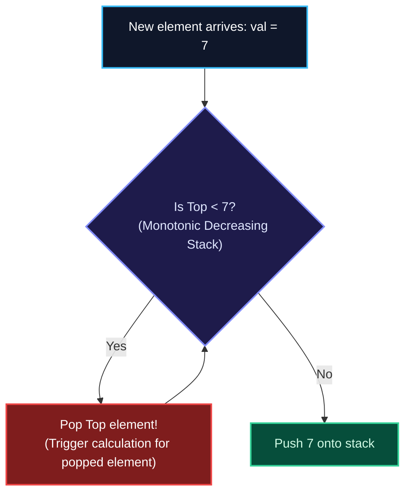

<AnalogyCard name="City Skyline & Line of Sight">
  <div>
    <strong>The City Skyline</strong>
    <p>
      Imagine standing on the ground looking across a row of buildings. A
      10-story building is directly in front of you. Behind it stands a 3-story
      house. You cannot see the house because the 10-story building completely
      blocks your line of sight. Behind the house stands an 80-story skyscraper,
      which towers over everything.
    </p>
  </div>
  <div>
    <strong>The Monotonic Stack</strong>
    <p>
      The shorter 3-story house is "dominated" and invisible. A monotonic stack
      eliminates dominated elements. When a taller element arrives, it shadows
      and resolves questions for the smaller elements before ejecting them.
    </p>
  </div>
</AnalogyCard>

### Canonical Problem 1: Next Greater Element (NGE)

Given an array `arr = [4, 5, 2, 25]`, find the first element to the right that is strictly greater for each position. If no greater element exists, assign `-1`.

- **Naive Approach**: For every element, scan all elements to its right $\implies O(n^2)$ time.
- **Monotonic Decreasing Stack**: Solves the entire array in **$O(n)$ time**!

```
Input:  [4,  5,  2, 25]
Output: [5, 25, 25, -1]
```

#### Why is Monotonic Stack $O(n)$ Amortized?

Even though there is a `while` loop nested inside a `for` loop:

- Every element index is pushed onto the stack **at most once**.
- Every element index is popped from the stack **at most once**.
- The total number of stack operations across the entire algorithm is bounded by $2n = \Theta(n)$!

---

### Canonical Problem 2: Largest Rectangle in Histogram

Given bar heights `[2, 1, 5, 6, 2, 3]` with unit width 1, find the area of the largest rectangle that fits inside the histogram:

```
       ┌───┐
       │ 6 │
   ┌───┼───┤
   │ 5 │ 6 │         Max Area = 5 × 2 = 10!
┌──┼───┼───┼───┬───┐ (spanning bars of height 5 and 6)
│2 │ 1 │ 5 │ 6 │ 2 │ 3 │
└──┴───┴───┴───┴───┴───┘
```

#### Step-by-Step Derivation:

1. Maintain a **Monotonic Increasing Stack of indices**.
2. When the current bar `heights[i]` is **shorter** than `heights[stack.peek()]`, we have discovered the **right boundary** for the taller bar.
3. Pop the taller bar: `h = heights[stack.pop()]`.
4. Its width extends from the new `stack.peek()` (left boundary) to index $i$ (right boundary):
   $$\text{width} = \begin{cases} i & \text{if stack is empty} \\ i - \text{stack.peek()} - 1 & \text{otherwise} \end{cases}$$
5. Area $= h \times \text{width}$. Running time is strictly $O(n)$.

---

## 06 — Queues: The FIFO Principle & The False Overflow Dilemma

A **Queue** is a linear data structure that operates under the rule of fairness:

> **FIFO (First-In, First-Out)**: The first element added is the first element removed. Elements enter at the **rear** (`enqueue`) and depart from the **front** (`dequeue`).

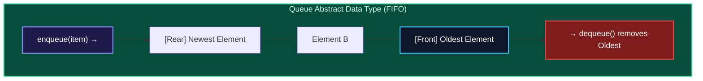

### The Linear Queue Problem ("False Overflow")

Why is building a queue with a naive static array a trap? Let us trace what happens to memory as elements are added and removed:

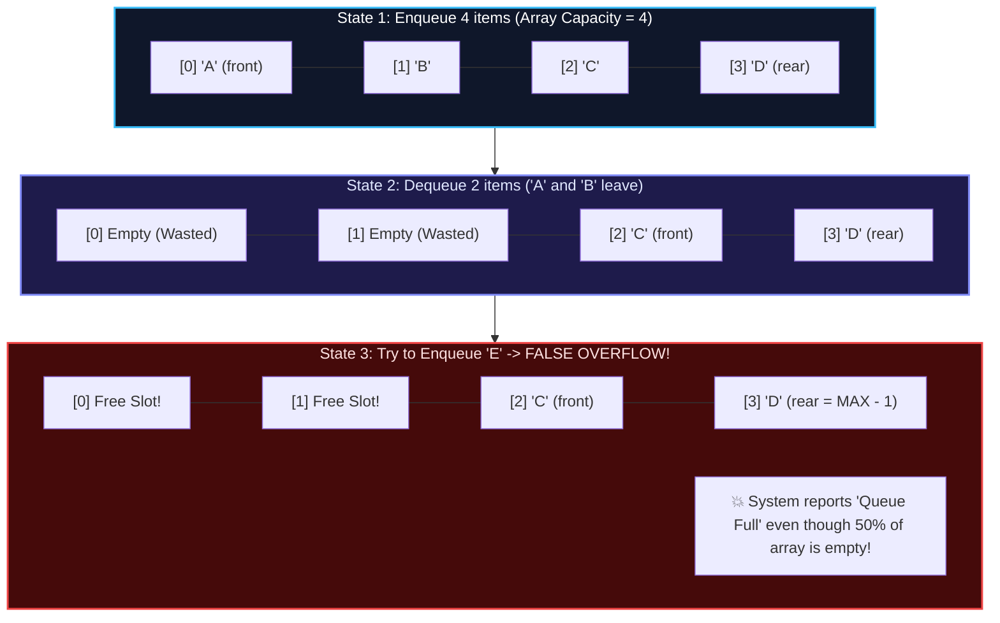

<Explain
  title="The Linear Queue False Overflow"
  what="A state where an array queue rejects new insertions because rear == MAX - 1, despite having available memory at the front."
>

In a simple array queue, each `dequeue()` increments `front`. The data structure drifts forward through memory like an inchworm. Once `rear` hits the end of the array, no more items can be enqueued, even if slots `0` through `front - 1` are completely unoccupied!

Shifting all elements left on every dequeue would cost **$O(n)$** per operation, degrading overall queue performance to $O(n^2)$. The elegant solution is the **Circular Queue**.

</Explain>

---

## 07 — The Circular Queue (Ring Buffer)

A **Circular Queue** wraps a fixed-size array into a virtual ring using modular arithmetic: when a pointer increments past the final slot, it wraps around to index `0`.

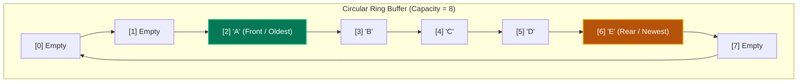

### The Modulo Arithmetic Formulas

$$\text{rear} = (\text{rear} + 1) \pmod{\text{MAX}}$$
$$\text{front} = (\text{front} + 1) \pmod{\text{MAX}}$$

### Handling Empty vs. Full Conditions

In a circular array, both a completely empty queue and a completely full queue can result in `front == rear`. Systems use one of two conventions to resolve this ambiguity:

<Tabs items={['Convention A: Explicit Count Variable', 'Convention B: Reserve 1 Sentinel Slot']}>
<Tab value="Convention A: Explicit Count Variable">
Maintain an integer field `count` alongside `front` and `rear`:
- **Empty Condition**: `count == 0`
- **Full Condition**: `count == MAX`
- **Capacity**: Can utilize all $N$ slots of the array.
- **Advantage**: Simple to reason about, no wasted array slot.
</Tab>

<Tab value="Convention B: Reserve 1 Sentinel Slot">
Keep 1 slot empty as a buffer sentinel. An array of size $N$ stores at most $N - 1$ items:
- **Empty Condition**: `front == rear` (or `front == -1`)
- **Full Condition**: `(rear + 1) % MAX == front`
- **Capacity**: Stores $N - 1$ items.
- **Advantage**: Lock-free single-producer single-consumer implementations can operate without updating a shared `count` variable!
</Tab>
</Tabs>

### The 1-Cycle Bitwise Masking Trick

On modern CPUs, integer division and modulo (`%`) take **10 to 25 clock cycles**. If we constrain capacity $N$ to be an exact power of two ($N = 2^k$, e.g., 64, 1024, 65536), we can replace the modulo operator with an instantaneous **bitwise AND** (`&`) that executes in **1 clock cycle**:

$$\text{index} = (\text{index} + 1) \ \& \ (N - 1)$$

```
Example with Capacity N = 8:
Bitmask: N - 1 = 7 = 0b0111

If index = 7:
(7 + 1) & 7 = 8 & 7 = 0b1000 & 0b0111 = 0b0000 = 0  (Instantaneous wrap!)
```

---

## 08 — Interactive Lab 2: The Queue Simulator

Watch how elements enter at the rear and depart from the front of the pipeline without ever shifting neighboring memory slots.

<QueueSimulator />

### Guided Exploration Steps:

1. **Press `▶ PLAY ALL` or step through with `STEP ▶`**:
   - **Beat 1**: Observe the pipeline lane with marked `FRONT` and `REAR` gates.
   - **Beat 2 (Enqueue)**: Watch items `A`, `B`, `C` enter through the `REAR` gate and take their places sequentially.
   - **Beat 3 (Dequeue)**: Watch item `A` at `FRONT` slide smoothly into the `SERVED` tray. Notice that items `B` and `C` **stay exactly where they are**.
   - **Beat 4 (Queue Advance)**: Additional items join at the rear while front items exit, illustrating how `front` and `rear` pointers chase each other through memory in pure $O(1)$ time.

---

## 09 — Deques (Double-Ended Queues)

A **Deque** (pronounced _"deck"_, Double-Ended Queue) generalizes stacks and queues by permitting $O(1)$ insertion and deletion at **both endpoints**:

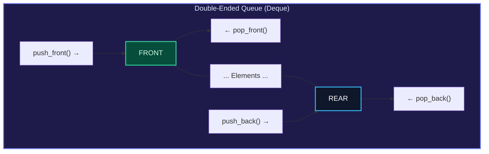

### Input-Restricted vs. Output-Restricted Deques

University examinations frequently test the distinction between restricted deques:

| Deque Variant               | Insertion Policy                              | Deletion Policy                                | Typical Use Case                  |
| :-------------------------- | :-------------------------------------------- | :--------------------------------------------- | :-------------------------------- |
| **Input-Restricted Deque**  | Allowed at **ONE end only** (e.g., rear only) | Allowed at **BOTH ends** (front and rear)      | Priority work-stealing schedulers |
| **Output-Restricted Deque** | Allowed at **BOTH ends** (front and rear)     | Allowed at **ONE end only** (e.g., front only) | Undoable print spooling queues    |

---

### Sliding Window Maximum: The Monotonic Deque Pattern

Given an array `nums = [1, 3, -1, -3, 5, 3, 6, 7]` and window size $k = 3$, find the maximum value for each window sliding from left to right.

- Naive scan: $k$ comparisons per window $\implies O(n \cdot k)$ time.
- **Monotonic Deque**: Maintains indices of elements in **strictly decreasing value order** $\implies \mathbf{O(n)}$ overall time.

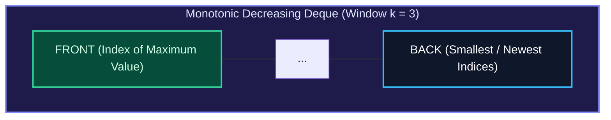

#### The Three Invariants:

1. **Evict Expired Elements**: If `deque.front() <= i - k`, the oldest element has slipped outside the active window. Evict with `pop_front()`.
2. **Eliminate Dominated Candidates**: While `deque` is not empty and `nums[deque.back()] <= nums[i]`, remove with `pop_back()`.
   _Intuition_: If an incoming element is both **larger** and **newer** than older elements in the window, those older elements can never be the maximum again.
3. **Record Window Maximum**: Once $i \ge k - 1$, `nums[deque.front()]` is guaranteed to be the maximum for that window.

---

## 10 — Queue Using Two Stacks: Amortized $O(1)$ Proof

How do you implement a First-In, First-Out queue using only two Last-In, First-Out stacks?

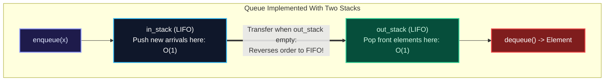

### The Mechanism

1. **`enqueue(x)`**:
   Push `x` directly onto `in_stack`. Runtime is strictly **$O(1)$**.
2. **`dequeue()`**:
   - If `out_stack` is not empty: pop and return `out_stack.pop()`.
   - If `out_stack` is empty:
     - While `in_stack` is not empty, pop from `in_stack` and push onto `out_stack`.
     - Pop and return `out_stack.pop()`.
   - If both stacks are empty: raise Queue Underflow error.

### The Mathematical Amortized $O(1)$ Proof

A single `dequeue()` call that triggers a stack transfer takes $O(n)$ worst-case time. Why is the overall data structure still considered **$O(1)$ amortized**?

We prove this using the **Accounting (Banker's) Method**:

- Consider the entire lifecycle of any single element inserted into the queue.
- Every element experiences at most **four discrete operations** in its lifetime:
  1. **Push** onto `in_stack` (during `enqueue`).
  2. **Pop** from `in_stack` (during transfer).
  3. **Push** onto `out_stack` (during transfer).
  4. **Pop** from `out_stack` (during `dequeue`).
- Each individual operation costs exactly $O(1)$ work.
- For $N$ elements inserted and removed, the total work across all operations is bounded by:
  $$\text{Total Work} \le 4N \cdot O(1) = O(N)$$
- Dividing total work by $N$ operations yields:
  $$\text{Amortized Cost per Operation} = \frac{O(N)}{N} = \mathbf{O(1)}$$

---

## 11 — Production Systems Case Study: The LMAX Disruptor

In ultra-low-latency financial exchanges, standard queue implementations (such as Java's `ArrayBlockingQueue` or mutex-locked C++ queues) suffer from severe latency spikes due to two physical hardware bottlenecks:

1. **Thread Context Switching** caused by lock contention.
2. **False Sharing in CPU Caches**: When `front` and `rear` pointers share the same **64-byte CPU cache line**, an update to `rear` on Core 1 invalidates the L1 cache of Core 2 reading `front`, triggering continuous cache-line ping-pong across the memory bus.

The **LMAX Disruptor** engine solves this by using a lock-free, cache-padded circular ring buffer capable of processing over **6,000,000 transactions per second** with sub-microsecond latency.

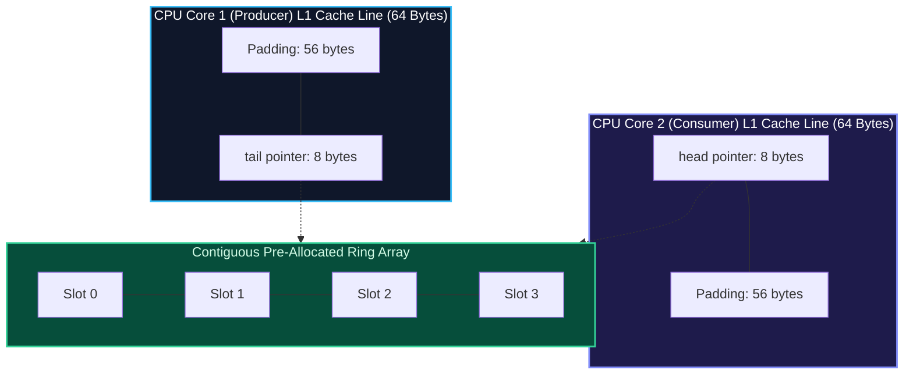

### Architectural Highlights:

1. **Cache-Line Padding**: By placing 56 bytes of unused dummy data before and after pointer variables, compilers ensure `head` and `tail` occupy completely separate 64-byte cache lines, eliminating false sharing.
2. **Zero-GC Pre-Allocation**: All event objects inside the ring buffer are instantiated at startup and reused in place, avoiding memory allocation pauses.
3. **Monotonically Advancing Sequences**: 64-bit sequence counters increment without modulo divisions, mapping to slots via bitwise masks: `seq & (capacity - 1)`.

---

## 12 — Production Polyglot Implementations

Below are complete, production-grade implementations covering:

1. Fast Power-of-Two Circular Ring Buffer.
2. Infix to Postfix Converter & Postfix Evaluator.
3. Queue Using Two Stacks (Amortized $O(1)$).
4. Monotonic Stack & Deque Solvers.

<Tabs items={['Python', 'TypeScript', 'C++']}>
<Tab value="Python">
```python
from collections import deque
from typing import List, Optional

class CircularRingBuffer:
"""Fixed-capacity circular ring buffer using power-of-two bitmasking."""
def **init**(self, capacity: int):
pow2_cap = 1
while pow2_cap < capacity:
pow2_cap <<= 1
self.capacity = pow2_cap
self.mask = pow2_cap - 1
self.buffer: List[Optional[int]] = [None] \* self.capacity
self.head = 0
self.tail = 0
self.size = 0

    def enqueue(self, val: int) -> bool:
        if self.is_full():
            return False
        self.buffer[self.tail] = val
        self.tail = (self.tail + 1) & self.mask
        self.size += 1
        return True

    def dequeue(self) -> Optional[int]:
        if self.is_empty():
            return None
        val = self.buffer[self.head]
        self.buffer[self.head] = None
        self.head = (self.head + 1) & self.mask
        self.size -= 1
        return val

    def is_empty(self) -> bool:
        return self.size == 0

    def is_full(self) -> bool:
        return self.size == self.capacity

class ExpressionEngine:
"""Infix to Postfix converter and Postfix evaluator."""
@staticmethod
def precedence(op: str) -> int:
if op in ('+', '-'): return 1
if op in ('\*', '/'): return 2
if op == '^': return 3
return 0

    @classmethod
    def infix_to_postfix(cls, expression: str) -> str:
        output = []
        stack = []
        tokens = expression.split()

        for token in tokens:
            if token.isalnum():
                output.append(token)
            elif token == '(':
                stack.append(token)
            elif token == ')':
                while stack and stack[-1] != '(':
                    output.append(stack.pop())
                stack.pop()  # Discard '('
            else:  # Operator
                while (stack and stack[-1] != '(' and
                       cls.precedence(stack[-1]) >= cls.precedence(token)):
                    output.append(stack.pop())
                stack.append(token)

        while stack:
            output.append(stack.pop())
        return " ".join(output)

    @staticmethod
    def evaluate_postfix(expression: str) -> int:
        stack = []
        for token in expression.split():
            if token.lstrip('-').isdigit():
                stack.append(int(token))
            else:
                b = stack.pop()  # Note order: b is second operand
                a = stack.pop()  # a is first operand
                if token == '+': stack.append(a + b)
                elif token == '-': stack.append(a - b)
                elif token == '*': stack.append(a * b)
                elif token == '/': stack.append(int(a / b))
        return stack[0]

class QueueUsingTwoStacks:
"""FIFO Queue implemented using two LIFO stacks with amortized O(1) ops."""
def **init**(self):
self.in_stack = []
self.out_stack = []

    def enqueue(self, val: int) -> None:
        self.in_stack.append(val)

    def dequeue(self) -> int:
        self._shift_if_needed()
        if not self.out_stack:
            raise IndexError("dequeue from empty queue")
        return self.out_stack.pop()

    def peek(self) -> int:
        self._shift_if_needed()
        if not self.out_stack:
            raise IndexError("peek from empty queue")
        return self.out_stack[-1]

    def _shift_if_needed(self) -> None:
        if not self.out_stack:
            while self.in_stack:
                self.out_stack.append(self.in_stack.pop())

    def is_empty(self) -> bool:
        return not self.in_stack and not self.out_stack

class MonotonicSolvers:
@staticmethod
def next_greater_element(nums: List[int]) -> List[int]:
"""Monotonic decreasing stack for Next Greater Element in O(n) time."""
res = [-1] \* len(nums)
stack = [] # Stores indices

        for i, val in enumerate(nums):
            while stack and nums[stack[-1]] < val:
                prev_idx = stack.pop()
                res[prev_idx] = val
            stack.append(i)
        return res

    @staticmethod
    def max_sliding_window(nums: List[int], k: int) -> List[int]:
        """Sliding window maximum using monotonic deque in O(n) time."""
        dq: deque[int] = deque()
        res = []

        for i, val in enumerate(nums):
            if dq and dq[0] <= i - k:
                dq.popleft()
            while dq and nums[dq[-1]] <= val:
                dq.pop()
            dq.append(i)
            if i >= k - 1:
                res.append(nums[dq[0]])
        return res

````
</Tab>

<Tab value="TypeScript">
```typescript
export class CircularRingBuffer<T> {
  private buffer: (T | null)[];
  private head: number = 0;
  private tail: number = 0;
  private count: number = 0;
  private readonly capacity: number;
  private readonly mask: number;

  constructor(capacity: number) {
    let pow2 = 1;
    while (pow2 < capacity) pow2 <<= 1;
    this.capacity = pow2;
    this.mask = pow2 - 1;
    this.buffer = new Array<T | null>(this.capacity).fill(null);
  }

  public enqueue(item: T): boolean {
    if (this.isFull()) return false;
    this.buffer[this.tail] = item;
    this.tail = (this.tail + 1) & this.mask;
    this.count++;
    return true;
  }

  public dequeue(): T | null {
    if (this.isEmpty()) return null;
    const item = this.buffer[this.head];
    this.buffer[this.head] = null;
    this.head = (this.head + 1) & this.mask;
    this.count--;
    return item;
  }

  public isEmpty(): boolean { return this.count === 0; }
  public isFull(): boolean { return this.count === this.capacity; }
}

export class QueueUsingTwoStacks<T> {
  private inStack: T[] = [];
  private outStack: T[] = [];

  public enqueue(item: T): void {
    this.inStack.push(item);
  }

  public dequeue(): T {
    this.shiftIfNeeded();
    if (this.outStack.length === 0) {
      throw new Error("Queue Underflow");
    }
    return this.outStack.pop()!;
  }

  public peek(): T {
    this.shiftIfNeeded();
    if (this.outStack.length === 0) {
      throw new Error("Queue Underflow");
    }
    return this.outStack[this.outStack.length - 1];
  }

  private shiftIfNeeded(): void {
    if (this.outStack.length === 0) {
      while (this.inStack.length > 0) {
        this.outStack.push(this.inStack.pop()!);
      }
    }
  }

  public isEmpty(): boolean {
    return this.inStack.length === 0 && this.outStack.length === 0;
  }
}

export function nextGreaterElement(nums: number[]): number[] {
  const result = new Array(nums.length).fill(-1);
  const stack: number[] = []; // Stores indices

  for (let i = 0; i < nums.length; i++) {
    while (stack.length > 0 && nums[stack[stack.length - 1]] < nums[i]) {
      const prev = stack.pop()!;
      result[prev] = nums[i];
    }
    stack.push(i);
  }
  return result;
}
````

</Tab>

<Tab value="C++">
```cpp
#include <iostream>
#include <vector>
#include <stack>
#include <deque>
#include <stdexcept>

template <typename T>
class QueueUsingTwoStacks {
private:
std::stack<T> in*stack*;
std::stack<T> out*stack*;

    void shift_if_needed() {
        if (out_stack_.empty()) {
            while (!in_stack_.empty()) {
                out_stack_.push(in_stack_.top());
                in_stack_.pop();
            }
        }
    }

public:
void enqueue(const T& val) {
in*stack*.push(val);
}

    T dequeue() {
        shift_if_needed();
        if (out_stack_.empty()) {
            throw std::underflow_error("Queue is empty");
        }
        T front_val = out_stack_.top();
        out_stack_.pop();
        return front_val;
    }

    T peek() {
        shift_if_needed();
        if (out_stack_.empty()) {
            throw std::underflow_error("Queue is empty");
        }
        return out_stack_.top();
    }

    bool empty() const {
        return in_stack_.empty() && out_stack_.empty();
    }

};

std::vector<int> nextGreaterElement(const std::vector<int>& nums) {
int n = nums.size();
std::vector<int> result(n, -1);
std::stack<int> s; // Indices

    for (int i = 0; i < n; ++i) {
        while (!s.empty() && nums[s.top()] < nums[i]) {
            result[s.top()] = nums[i];
            s.pop();
        }
        s.push(i);
    }
    return result;

}

```
</Tab>
</Tabs>

---

## 13 — Algorithmic Complexity Reference Matrix

| Data Structure / Pattern | Operation | Time Complexity | Space Complexity | Architectural Mechanism |
| :--- | :--- | :--- | :--- | :--- |
| **Stack (Array-based)** | `push` / `pop` / `peek` | **$\Theta(1)$** | $O(n)$ | Top index pointer into contiguous buffer |
| **Stack (Linked List)** | `push` / `pop` / `peek` | **$\Theta(1)$** | $O(n) + \text{ptrs}$ | Splicing at head node |
| **Linear Queue (Array)** | `enqueue` / `dequeue` | **$\Theta(1)$** | $O(n)$ | Suffers from False Overflow |
| **Circular Queue** | `enqueue` / `dequeue` | **$\Theta(1)$** | $O(N)$ pre-allocated | Modulo pointer wrapping |
| **Queue via Two Stacks** | `enqueue` / `dequeue` | **$\Theta(1)$ amortized** | $O(n)$ | Reversal between `in_stack` and `out_stack` |
| **Monotonic Stack** | Next Greater Element | **$\Theta(n)$** | $O(n)$ | Discarding dominated smaller elements |
| **Monotonic Deque** | Sliding Window Max | **$\Theta(n)$** | $O(k)$ | Double-ended eviction of non-max candidates |

---

## 14 — Technical Interview Traps & Invariants

<Callout type="warn" title="Trap 1: The Non-Commutative Operand Order">
When evaluating postfix expressions, remember that the first popped value is $b$ (right operand) and the second is $a$ (left operand). Always compute:
$$\text{result} = a - b \quad \text{and} \quad \text{result} = a / b$$
Computing $b - a$ or $b / a$ reverses subtraction and division, silently producing wrong answers.
</Callout>

<Callout type="warn" title="Trap 2: Strict vs. Non-Strict Equality in Monotonic Stacks">
- For **Next Greater Element**: Pop while `stack.top < current` (strict inequality). If duplicate values exist, an equal value is *not* greater, so it must not be popped.
- For **Largest Rectangle in Histogram**: Popping on `>=` vs `>` both achieve $O(n)$ time. Popping on `>=` prematurely calculates intermediate areas for identical bars, but the final identical bar will span the full width correctly.
</Callout>

<Callout type="warn" title="Trap 3: Python's list as a Queue">
Never use `list.pop(0)` or `list.insert(0, x)` in Python for queue operations! Python lists are contiguous arrays; removing from index 0 forces the runtime to copy all $n$ items one position to the left in $O(n)$ time. Always import and use `collections.deque`.
</Callout>

---

## 15 — Check Your Understanding

Test your retention with these exam and interview questions. Work out the answer before revealing the explanation.

<TryIt
  question="During the evaluation of the postfix expression '8 2 / 3 -', what is the exact sequence of computations performed on the stack?"
  options={[
    "Divide 8 by 2 to get 4, then compute 4 - 3 = 1",
    "Divide 2 by 8 to get 0.25, then compute 3 - 0.25 = 2.75",
    "Subtract 3 from 2 to get -1, then compute 8 / (-1) = -8",
    "Multiply 8 and 2 to get 16, then subtract 3 to get 13",
  ]}
  answer="A"
  why="Encountering '/' pops b=2 and a=8, calculating 8 / 2 = 4 and pushing 4. Next, 3 is pushed. Encountering '-' pops b=3 and a=4, calculating 4 - 3 = 1."
/>

<TryIt
  question="In a fixed-size Circular Queue using the sentinel slot method with array capacity MAX = 8, what condition confirms that the queue is completely FULL?"
  options={[
    "(rear + 1) % MAX == front",
    "rear == MAX - 1 && front == 0",
    "rear == front",
    "(front + 1) % MAX == rear",
  ]}
  answer="A"
  why="Under the 1-sentinel convention, when advancing rear by one position lands on front ((rear + 1) % MAX == front), the queue is declared full, preserving one empty slot to differentiate full from empty (rear == front)."
/>

<TryIt
  question="What distinguishes an Input-Restricted Deque from an Output-Restricted Deque?"
  options={[
    "Input-restricted allows insertion at only one end, while output-restricted allows deletion at only one end",
    "Input-restricted allows deletion at only one end, while output-restricted allows insertion at only one end",
    "Input-restricted allows operations at both ends, while output-restricted forbids middle access",
    "Input-restricted requires a power-of-two capacity, while output-restricted works on dynamic linked lists",
  ]}
  answer="A"
  why="An Input-Restricted Deque restricts insertions to a single end (while deletions may happen at both ends). An Output-Restricted Deque restricts deletions to a single end (while insertions may happen at both ends)."
/>

<TryIt
  question="Why is the dequeue operation in a Queue built with Two Stacks classified as amortized O(1), even though a single call may take O(n) time?"
  options={[
    "Each element is pushed and popped across the two stacks at most 4 times throughout its entire lifecycle",
    "The CPU hardware cache automatically pre-loads the second stack in zero clock cycles",
    "The out_stack uses binary search to retrieve elements without traversing linear memory",
    "Operating system thread schedulers prioritize stack copy routines over standard CPU loops",
  ]}
  answer="A"
  why="By the accounting method, every item experiences exactly 2 pushes and 2 pops across its entire journey from in_stack to out_stack. Total work for n elements is 4n, yielding an amortized cost of 4n / n = O(1) per operation."
/>

---

<Takeaway>

**One Win for This Lesson:**
Stacks (LIFO) and Queues (FIFO) enforce strict access boundaries:
1. **Stacks** control depth (function recursion, parenthesis nesting, undo engines, and monotonic lines of sight).
2. **Queues** guarantee fair ordering (event streaming, breadcrumb pipelines, and sliding windows).
3. Whenever an array queue reports "overflow" with empty slots in front, wrap the indices with modular arithmetic: `(index + 1) % capacity`.

</Takeaway>
```
