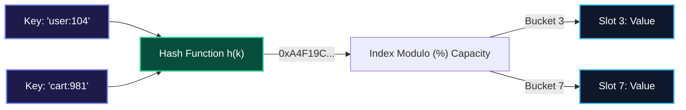
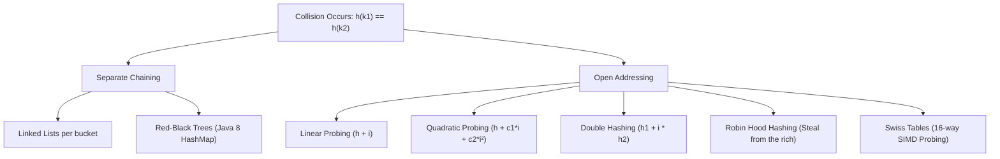
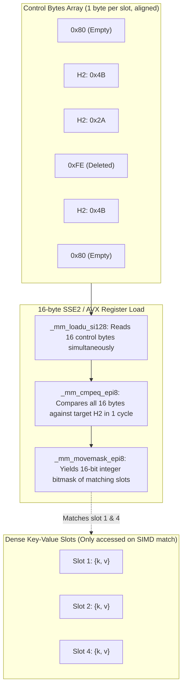
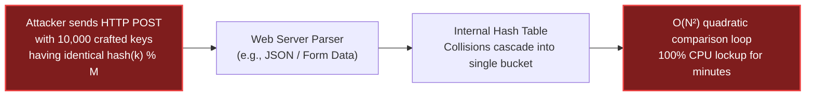

import { Callout } from "fumadocs-ui/components/callout";
import { Tabs, Tab } from "fumadocs-ui/components/tabs";
import { Steps, Step } from "fumadocs-ui/components/steps";
import { Cards, Card } from "fumadocs-ui/components/card";

## The Core Mental Model: The O(1) Constant Time Promise

A **Hash Table** maps arbitrary keys (strings, objects, UUIDs) to values by applying a mathematical **Hash Function** $h(k)$ that projects infinite key spaces onto a finite array of slots:

$$\text{Index} = h(\text{key}) \pmod{\text{Capacity}}$$



When designed properly, lookup, insertion, and deletion operate in **average-case $O(1)$** time. However, by the **Pigeonhole Principle**, because the universe of potential keys exceeds table capacity, two distinct keys will eventually yield the identical bucket index:

$$h(k_1) \pmod M = h(k_2) \pmod M \quad \text{where } k_1 \ne k_2$$

Resolving these **collisions** efficiently without sacrificing cache locality is one of the crowning achievements of systems engineering.

---

## Collision Resolution Strategies



### 1. Separate Chaining

Each slot in the bucket array stores a head pointer to an auxiliary data structure.

- **Classic**: A singly linked list. When a collision occurs, prepend or append to the bucket's list.
- **Java 8 Optimization**: When a single bucket exceeds 8 entries, Java transforms the linked list into a self-balancing **Red-Black Tree**, reducing worst-case lookup from $O(N)$ to $O(\log N)$.
- **Disadvantage**: Massive pointer overhead and poor CPU cache locality due to scattered heap node allocations.

### 2. Open Addressing & Primary Clustering

All entries are stored directly in the flat bucket array itself. If slot $h(k)$ is occupied, search subsequent slots according to a probe sequence:

- **Linear Probing**: $\text{idx} = (h(k) + i) \pmod M$.
  _Flaw_: Causes **Primary Clustering**—contiguous blocks of occupied slots merge together, causing probe times to degrade drastically as load factor rises above 0.7.
- **Quadratic Probing**: $\text{idx} = (h(k) + c_1 i + c_2 i^2) \pmod M$. Prevents primary clusters, but causes secondary clustering.

### 3. Robin Hood Hashing: "Steal from the Rich to Give to the Poor"

In standard linear probing, an element inserted early stays close to its home bucket, while late arrivals suffer lengthy probe sequences.
**Robin Hood Hashing** equalizes probe lengths:

1. Every inserted key tracks its **Probe Sequence Length (PSL)**—how far it was pushed from its ideal home bucket.
2. During insertion, if the incoming element has traveled _further_ than the element currently sitting in a slot ($\text{PSL}_{\text{new}} > \text{PSL}_{\text{existing}}$), the newcomer **evicts and steals** the slot!
3. The evicted element continues probing with its inherited PSL.

- **Result**: Drastically tightens the variance of probe lengths. Even with load factors as high as $0.9$, lookups terminate rapidly.

---

## The Modern Revolution: Google Swiss Tables & SIMD Probing

In 2018, Google open-sourced **Abseil `flat_hash_map`** (popularly known as **Swiss Tables**), which was immediately adopted by the **Rust standard library** (`hashbrown`).

Swiss Tables completely rethink open addressing by decoupling metadata inspection from actual key-value payload storage using **SIMD vector instructions**.



### How Swiss Tables Work:

1. **Hash Splitting**: Given a 64-bit hash $H$:
   - $H1 = H \gg 7$ (Top 57 bits): Determines the group index.
   - $H2 = H \ \& \ 0x7F$ (Bottom 7 bits): A 7-bit fingerprint stored in the control byte.
2. **Control Byte States**:
   - `0x80` = Empty slot.
   - `0xFE` = Deleted (tombstone) slot.
   - `0x00` to `0x7F` = Occupied slot carrying the 7-bit $H2$ fingerprint.
3. **16-Way SIMD Probing**:
   The CPU loads 16 control bytes into a 128-bit SIMD register (`_mm_loadu_si128`) and executes `_mm_cmpeq_epi8` in a **single CPU clock cycle**.
   - If no match: Advance to the next 16-byte chunk.
   - If match found: Only then dereference the full key and value to verify equality.
4. **Payoff**: Cache misses on key-value data drops by over **80%**, and lookups run **2x to 3x faster** than traditional open-addressed tables.

---

## Security Engineering: HashDoS & SipHash Defenses

In 2011, security researchers exposed a vulnerability affecting nearly all web application frameworks (Node.js, PHP, Python, Ruby, Java). Known as **HashDoS**, an attacker could freeze a multicore web server with a modest 100 KB HTTP POST payload.



### The Mechanism of HashDoS

Deterministic hash algorithms (like MurmurHash2 or Java's standard string polynomial hash $\sum s[i] \cdot 31^{n-1-i}$) are predictable.

- An attacker calculates thousands of distinct strings that yield identical hash codes modulo table size.
- When the server parses form parameters into a hash map, every insertion takes $O(N)$ comparisons.
- Total processing time for $N$ keys explodes from $O(N)$ to $O(N^2)$. A single 1-megabyte payload kept a Xeon core pegged at 100% CPU for 30 minutes.

### The Solution: SipHash

To defend against HashDoS, modern languages (Python 3.4+, Rust, Ruby, Linux Kernel) adopted **SipHash-2-4**:

- SipHash is a **keyed, cryptographically secure PRF (Pseudo-Random Function)**.
- At process startup, the runtime generates a secret 128-bit random seed: `k = (k0, k1)`.
- Even if an attacker knows the algorithm, without knowing the process's secret key, calculating colliding keys is mathematically intractable.

---

## Production Polyglot Implementations

Below is the complete implementation of an **Open-Addressing Hash Table with Linear Probing and Tombstone Handling** across Python, TypeScript, and C++.

<Tabs items={['Python', 'TypeScript', 'C++']}>
<Tab value="Python">
```python
from typing import Optional, Any, List

class HashEntry:
def **init**(self, key: str, value: Any):
self.key = key
self.value = value
self.is_deleted = False

class OpenAddressingHashMap:
"""
Open-addressing hash table with linear probing and tombstone markers.
Maintains load factor below 0.70 with automatic 2x geometric resizing.
"""
def **init**(self, initial_capacity: int = 8):
self.\_capacity = initial_capacity
self.\_size = 0
self.\_table: List[Optional[HashEntry]] = [None] \* self.\_capacity

    def _hash(self, key: str) -> int:
        # FNV-1a 32-bit hash function
        h = 2166136261
        for char in key.encode('utf-8'):
            h ^= char
            h = (h * 16777619) & 0xFFFFFFFF
        return h % self._capacity

    def put(self, key: str, value: Any) -> None:
        if (self._size + 1) / self._capacity > 0.70:
            self._resize(self._capacity * 2)

        idx = self._hash(key)
        first_tombstone = None

        while self._table[idx] is not None:
            entry = self._table[idx]
            if entry.is_deleted:
                if first_tombstone is None:
                    first_tombstone = idx
            elif entry.key == key:
                entry.value = value
                return
            idx = (idx + 1) % self._capacity

        # Reuse tombstone slot if available, otherwise use empty slot
        target_idx = first_tombstone if first_tombstone is not None else idx
        self._table[target_idx] = HashEntry(key, value)
        self._size += 1

    def get(self, key: str) -> Optional[Any]:
        idx = self._hash(key)
        start_idx = idx

        while self._table[idx] is not None:
            entry = self._table[idx]
            if not entry.is_deleted and entry.key == key:
                return entry.value
            idx = (idx + 1) % self._capacity
            if idx == start_idx:
                break
        return None

    def delete(self, key: str) -> bool:
        idx = self._hash(key)
        start_idx = idx

        while self._table[idx] is not None:
            entry = self._table[idx]
            if not entry.is_deleted and entry.key == key:
                entry.is_deleted = True
                self._size -= 1
                return True
            idx = (idx + 1) % self._capacity
            if idx == start_idx:
                break
        return False

    def _resize(self, new_capacity: int) -> None:
        old_table = self._table
        self._capacity = new_capacity
        self._table = [None] * new_capacity
        self._size = 0

        for entry in old_table:
            if entry and not entry.is_deleted:
                self.put(entry.key, entry.value)

````
</Tab>

<Tab value="TypeScript">
```typescript
class Entry<V> {
  constructor(
    public key: string,
    public value: V,
    public isDeleted: boolean = false
  ) {}
}

export class LinearProbingMap<V> {
  private table: (Entry<V> | null)[];
  private currentSize: number = 0;
  private capacity: number;

  constructor(initialCapacity: number = 16) {
    this.capacity = initialCapacity;
    this.table = new Array(this.capacity).fill(null);
  }

  private hash(key: string): number {
    let hashVal = 5381;
    for (let i = 0; i < key.length; i++) {
      hashVal = (hashVal * 33) ^ key.charCodeAt(i);
    }
    return Math.abs(hashVal) % this.capacity;
  }

  public set(key: string, value: V): void {
    if ((this.currentSize + 1) / this.capacity > 0.7) {
      this.resize(this.capacity * 2);
    }

    let idx = this.hash(key);
    let tombstoneIdx: number | null = null;

    while (this.table[idx] !== null) {
      const entry = this.table[idx]!;
      if (entry.isDeleted) {
        if (tombstoneIdx === null) tombstoneIdx = idx;
      } else if (entry.key === key) {
        entry.value = value;
        return;
      }
      idx = (idx + 1) % this.capacity;
    }

    const targetIdx = tombstoneIdx !== null ? tombstoneIdx : idx;
    this.table[targetIdx] = new Entry(key, value);
    this.currentSize++;
  }

  public get(key: string): V | undefined {
    let idx = this.hash(key);
    const start = idx;

    while (this.table[idx] !== null) {
      const entry = this.table[idx]!;
      if (!entry.isDeleted && entry.key === key) {
        return entry.value;
      }
      idx = (idx + 1) % this.capacity;
      if (idx === start) break;
    }
    return undefined;
  }

  private resize(newCapacity: number): void {
    const oldTable = this.table;
    this.capacity = newCapacity;
    this.table = new Array(newCapacity).fill(null);
    this.currentSize = 0;

    for (const entry of oldTable) {
      if (entry && !entry.isDeleted) {
        this.set(entry.key, entry.value);
      }
    }
  }
}
````

</Tab>

<Tab value="C++">
```cpp
#include <iostream>
#include <vector>
#include <string>
#include <optional>
#include <functional>

template <typename K, typename V>
class FlatHashMap {
private:
enum class State { EMPTY, OCCUPIED, DELETED };

    struct Slot {
        K key;
        V value;
        State state{State::EMPTY};
    };

    std::vector<Slot> slots_;
    size_t size_{0};
    size_t capacity_{16};

    size_t hash_key(const K& key) const {
        return std::hash<K>{}(key) % capacity_;
    }

    void rehash(size_t new_capacity) {
        std::vector<Slot> old_slots = std::move(slots_);
        capacity_ = new_capacity;
        slots_ = std::vector<Slot>(capacity_);
        size_ = 0;

        for (auto& slot : old_slots) {
            if (slot.state == State::OCCUPIED) {
                insert(slot.key, slot.value);
            }
        }
    }

public:
explicit FlatHashMap(size*t cap = 16) : capacity*(cap), slots\_(cap) {}

    void insert(const K& key, const V& val) {
        if (static_cast<double>(size_ + 1) / capacity_ > 0.70) {
            rehash(capacity_ * 2);
        }

        size_t idx = hash_key(key);
        ssize_t tombstone_idx = -1;

        while (slots_[idx].state != State::EMPTY) {
            if (slots_[idx].state == State::DELETED) {
                if (tombstone_idx == -1) tombstone_idx = idx;
            } else if (slots_[idx].key == key) {
                slots_[idx].value = val;
                return;
            }
            idx = (idx + 1) % capacity_;
        }

        size_t target_idx = (tombstone_idx != -1) ? tombstone_idx : idx;
        slots_[target_idx].key = key;
        slots_[target_idx].value = val;
        slots_[target_idx].state = State::OCCUPIED;
        ++size_;
    }

    std::optional<V> find(const K& key) const {
        size_t idx = hash_key(key);
        size_t start = idx;

        while (slots_[idx].state != State::EMPTY) {
            if (slots_[idx].state == State::OCCUPIED && slots_[idx].key == key) {
                return slots_[idx].value;
            }
            idx = (idx + 1) % capacity_;
            if (idx == start) break;
        }
        return std::nullopt;
    }

};

````
</Tab>
</Tabs>

---

## Production Systems Case Study: Python 3.6+ Compact Dictionary

Prior to Python 3.6, `dict` stored a sparse array of 24-byte entries (`hash`, `key*`, `value*`). A table with capacity 8 used $8 \times 24 = 192$ bytes, leaving large sparse gaps of empty memory.

Raymond Hettinger redesigned Python's dict using a **dense array + sparse indices table**:

```mermaid
flowchart TD
    subgraph SparseIndices["Sparse Indices Table (1 byte per entry)"]
        Idx0["[0]: -1"]
        Idx1["[1]: 0"]
        Idx2["[2]: -1"]
        Idx3["[3]: 1"]
        Idx4["[4]: -1"]
    end

    subgraph DenseEntries["Dense Entries Array (Packed Contiguously)"]
        E0["Entry 0: {hash: 0x9F, key: 'apple', val: 100}"]
        E1["Entry 1: {hash: 0x2B, key: 'orange', val: 200}"]
    end

    Idx1 --> E0
    Idx3 --> E1

    style SparseIndices fill:#1e1b4b,stroke:#818cf8,stroke-width:2px,color:#fff
    style DenseEntries fill:#064e3b,stroke:#34d399,stroke-width:2px,color:#fff
````

### Advantages of the Compact Dict:

1. **Memory Reduction**: 30% to 95% reduction in RAM overhead because sparse slots are tiny integers (`int8_t` or `int16_t`) rather than full 24-byte structs.
2. **Deterministic Insertion Order**: Because the `entries` array appends items in chronological sequence, iterating over a Python dict is guaranteed to preserve insertion order.
3. **Sequential Cache Streaming**: Iterating through keys/values scans the contiguous `entries` buffer with optimal L1 cache locality.

---

## Technical Interview Invariants & Traps

<Callout type="warn">
  ### The Object Key Identity vs Value Equality Trap - In JavaScript, using an
  object as a key in standard `{}` converts it to `"[object Object]"`, causing
  all objects to collide into a single string key! (Use `Map` instead). - In
  Python, if you define `__eq__` on a custom class, Python automatically
  disables `__hash__` by setting it to `None`. You must explicitly define
  `__hash__` to preserve hashability! - Keys placed in a hash table must be
  **immutable**. If an object's properties mutate while stored inside a hash
  table, its hash value changes, making it permanently unfindable—creating a
  memory leak!
</Callout>

---

## Hands-On Verification Challenge

1. **Hash Table Collision Trace**: Given a hash table with capacity $M = 7$ using linear probing and hash function $h(k) = k \pmod 7$, insert keys: `10, 17, 24, 31`.
   Trace the exact slot index and number of probes required for each key.
2. **Tombstone Demonstration**: In your linear probing implementation, insert keys `A` and `B` that collide at index 3 (`A` at 3, `B` at 4). Delete `A`. Verify that a query for `B` does not falsely return `None` because of the gap left by `A`.
